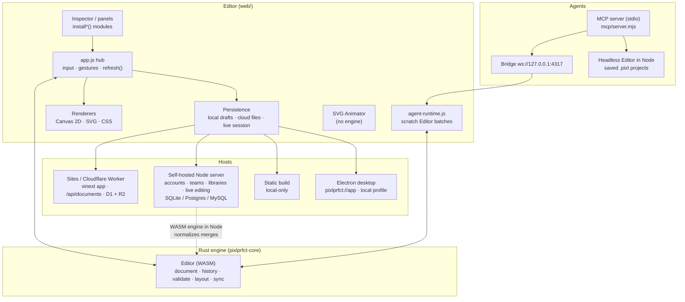
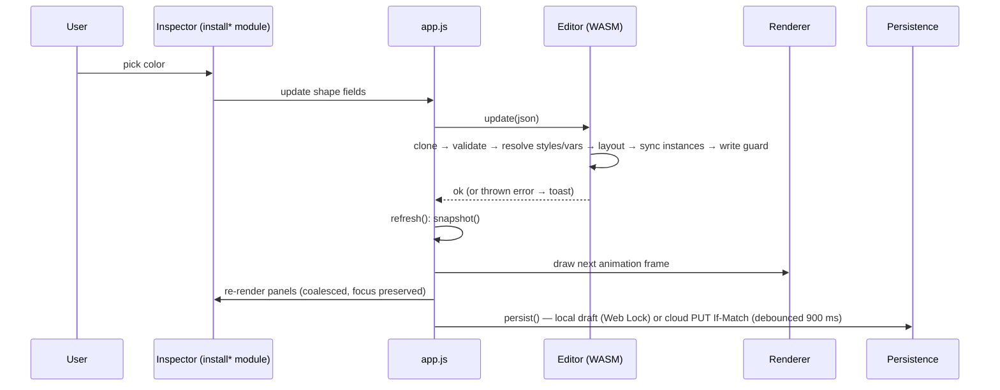

# Architecture Overview

**PixlPrfct is one Rust document engine, compiled to WebAssembly, wrapped by one vanilla-JavaScript editor, deployed through four interchangeable hosts.** The engine (`Editor` in `src/lib.rs`) owns the document, every mutation, validation, layout and undo. The editor in `web/` is a thin adapter: it turns input into engine calls, re-reads the snapshot, and paints it. Hosts differ only in where documents are stored and which collaboration features exist. AI agents edit through the same engine via the MCP server.

## At a glance

| Layer | Where | Responsibility | Deep dive |
| --- | --- | --- | --- |
| Document engine | `src/*.rs` → `web/pkg/` | Document model, atomic mutations, validation, layout, components, styles/variables, undo | [Rust Document Engine](Rust-Document-Engine.md) |
| File formats | serde structs in `src/` | `.pixl` (v2), clipboard, `.pixllib` | [Document Model and File Format](Document-Model-and-File-Format.md) |
| Editor | `web/app.js` + ~250 modules | Input, tools, panels, rendering, persistence, agent runtime | [Web Editor Architecture](Web-Editor-Architecture.md) |
| Renderers | `web/viewport-renderer.js`, `css-renderer.js`, `export.js` | Canvas 2D, SVG, HTML/CSS — shared geometry | [Rendering and Export](Rendering-and-Export.md) |
| Hosts | `app/`+`worker/`, `server/`, static build, `desktop/` | Storage, identity, teams | [Hosting Modes](Hosting-Modes.md) |
| Agents | `mcp/` + `web/agent-*.js` | MCP tools over stdio; live bridge or headless engine | [MCP Server](MCP-Server.md) |
| SVG Animator | `web/svg-animation*.js` | Separate design type, SMIL export; bypasses the engine | [SVG Animator](SVG-Animator.md) |

## System diagram

## The five ideas that explain the codebase

### 1. The engine is the single source of truth

`Editor` exposes ~110 methods over 15 `#[wasm_bindgen] impl` blocks; all structured data crosses the boundary as JSON strings. Every mutation **clones the document, edits the clone, and commits** through `commit_validated_document`, which in order: prunes and validates, checks component structure, resolves styles and variables onto literal values, rebuilds paint-stack summaries, runs layout (calling back into JS for text measurement), syncs component instances, assigns `layout_class`, re-validates, enforces the 5 MB cap, and runs the JS **write guard** (team lease / library protection). Only then is the new document swapped in and the old one pushed to history. Failures throw a string and leave the document untouched.

Consequences you'll meet everywhere:

- **One user action = one undo step.** Drags call preview methods (`preview_update_many`, `preview_layout_update`) and commit once on pointer-up. Multi-step operations stage on a cloned `Editor` and commit once.
- **Derived data is materialized.** Instances are fully rebuilt from their main component on every commit; style and variable values are written into each linked layer. Renderers only ever read literal values.
- **Undo is full-document snapshots** (100 max). Team "edit together" adds a per-user `PersonalHistory` that three-way merges undo against the shared document.

### 2. The editor is an adapter, not a framework

`web/app.js` (~2k dense lines, 112 imports) holds UI state and the `gesture` object, translates input into engine calls, then runs `refresh()`: re-snapshot → re-render panels → draw once per animation frame → `persist()` → update undo state. Feature areas are plain ES modules exporting `installX(...)` functions (≈45) that wire DOM and return update callbacks. There is no React in the editor (React exists only for the Sites Projects page).

### 3. Three renderers, one geometry

Canvas 2D (`drawScene`), SVG (`svgDocument`) and HTML/CSS (`compileCssScene`) share `compositeGeometry()` and `paintLayers()`, so bounds, effects and paint stacks agree. The **CSS canvas** (shadow-DOM HTML) is used in the editor whenever a page needs real browser layout — native controls, CSS Grid, breakpoints (`layout_media`), custom CSS — and is the same compiler that produces HTML/CSS and framework exports. A viewport raster cache (256 px overscan) keeps panning cheap.

### 4. Hosts are detected at runtime, and share storage handlers

The same built editor runs everywhere. It decides where it is by checking, in order: `<html data-host="static">` → `window.pixlDesktop.local` → `GET /api/installation` (`{mode:'self-hosted'}` from Node, `{mode:'desktop'}` from Electron, 404 ⇒ Sites). `lib/documents.mjs` and `lib/document-versions.mjs` serve both Sites (D1 + R2) and the self-hosted server (through a D1-compatible adapter over `node:sqlite`, `pg` or `mysql2`).

| | Static | Desktop (local) | Sites | Self-hosted |
| --- | --- | --- | --- | --- |
| Storage | browser `localStorage` | Electron profile partition | D1 + R2, per user | SQL DB (+ `document_bodies`) |
| Accounts | — | — | platform identity | Better Auth (email, 2FA) |
| Cloud files + version history | — | — | ✓ | ✓ |
| Orgs, teams, file roles, handoff, reviews | — | — | — | ✓ |
| Team libraries | device libraries | device libraries | — | ✓ protected |
| Edit together (polling merge) | — | — | — | ✓ |
| MCP live editing | ✓ (pairing code) | ✓ (auto discovery) | depends on CSP | ✓ |

Concurrency is optimistic everywhere on the server side: writes send `If-Match: <revision>`; a 409 preserves the local copy. Self-hosted writes add SQL **write fences** (`EXISTS` checks for lease, policy revision and membership inside the committing statement). Bodies over 1.5 MB are content-addressed (`@pixlprfct-r2:<sha256>`).

### 5. Agents use the same engine and the same rules

`mcp/server.mjs` (stdio) registers 20 tools — 14 design tools plus 6 opt-in installation tools. A **live session** reaches an open editor over a loopback WebSocket bridge (pairing code, or an origin-scoped HMAC token handed out by the desktop app via `~/.pixlprfct/mcp/*.json`). A **file session** loads a saved `.pixl` into a headless `Editor` inside Node. In the browser, `agent-runtime.js` checks the revision and busy state, runs a batch of up to 200 operations on a scratch `Editor` under the same write guard, then loads the result once — atomic and one undo step. The command catalog (`web/editor-api.js`, 100 commands / 51 models) is generated from the WASM type declarations and Rust sources.

## Request lifecycle — "change a fill color"

## Build pipeline in one line

`npm run build:editor` = preloader → `wasm-pack build --target web --out-dir web/pkg` → generate `web/editor-api.js` → bundle design-file import worker → `scripts/build.mjs`. Everything downstream (tests, MCP, self-hosted server, desktop, Sites) imports `web/pkg`, so nothing works until this has run. See [Build System](Build-System.md).

## Security boundaries worth knowing

- **Desktop:** editor served from privileged `pixlprfct://app` with a CSP; each team server runs in its own partition/window with no native bridge; six guarded IPC channels.
- **Untrusted code:** development behaviors and native-control runtimes never run on the canvas or in the prototype player — only in a sandboxed preview iframe or in exports. The SVG Animator export preview is an opaque `sandbox="allow-scripts"` iframe.
- **Imports:** `.fig` parsing runs in a worker with bounded decompression and a hand-written Kiwi decoder (no `new Function`), and the result is validated by a throwaway `Editor`.
- **MCP bridge:** loopback only; Host/Origin checks; pairing code rotates per restart.
- **Self-hosted:** strict `Origin == PIXL_APP_URL` on mutations; client identity headers stripped and re-set server-side.

## Known architectural risks

| Risk | Where | Detail |
| --- | --- | --- |
| Memory/latency scale with document size | `src/lib.rs` | Full-copy undo (up to 100 × 5 MB) and ~3 validations + 2 serializations per commit make every edit O(document); B33 frame budget still open |
| Thin native tests | `src/` | Only 3 Rust unit tests; engine coverage comes from ~126 Node test files that import the WASM build |
| Unknown fields dropped on load | serde | No `deny_unknown_fields`/forward-compat marker; SVG Animator docs must bypass the engine |
| Unbounded server growth | `server/` | `live_versions`, `live_mutations`, notifications, content-addressed bodies are never pruned |
| Silent commits from migrations | `web/app.js` `refresh()` | `enable_grid_containers()` can add an undo entry and clear redo |
| Generated artifacts drift | `web/vendor/*`, `web/editor-api.js` | Rebuild after changing the design-import worker or SVG interaction player; `mcp:check` guards the catalog only |

## Related pages

[Home](Home.md) · [Rust Document Engine](Rust-Document-Engine.md) · [Web Editor Architecture](Web-Editor-Architecture.md) · [Hosting Modes](Hosting-Modes.md) · [MCP Server](MCP-Server.md) · [Glossary](Glossary.md)

## Source of truth

`src/lib.rs` (`Editor`, `commit_validated_document`), `web/app.js` (`refresh`, `persist`), `web/agent-runtime.js`, `web/static-host.js`, `lib/documents.mjs`, `server/index.mjs`, `desktop/main.cjs`, `mcp/server.mjs`, [README](../../README.md) "Architecture".
