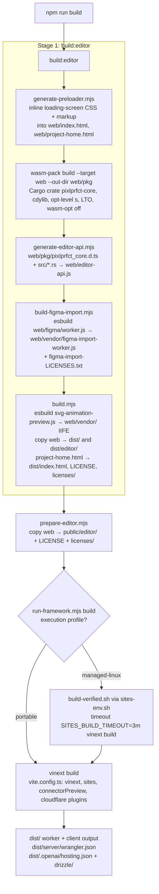

# Build System

The build has two stages. **Stage 1, `npm run build:editor`**, produces the browser editor as plain files: it regenerates the preloader blocks, compiles the Rust crate to WASM with `wasm-pack` into `web/pkg/`, regenerates `web/editor-api.js` from the compiled TypeScript declarations, bundles two vendor workers with esbuild, and copies `web/` into `dist/`. **Stage 2** packages those files for a host: `prepare-editor.mjs` + vinext/Vite for the Sites (Cloudflare Worker) app, `build-static.mjs` for a static site, `scripts/desktop/*` for Electron, or nothing at all for the self-hosted Node server, which serves `web/` directly. Almost every runtime (tests, MCP server, self-host server, static build) imports `web/pkg/pixlprfct_core.js`, so **nothing works until `build:editor` has run once**.

## At a glance

| Key files | Entry points | Depends on | Used by | Related docs |
|---|---|---|---|---|
| [package.json](../../package.json), [scripts/build.mjs](../../scripts/build.mjs), [scripts/prepare-editor.mjs](../../scripts/prepare-editor.mjs), [scripts/run-framework.mjs](../../scripts/run-framework.mjs), [scripts/generate-editor-api.mjs](../../scripts/generate-editor-api.mjs), [scripts/build-static.mjs](../../scripts/build-static.mjs), [vite.config.ts](../../vite.config.ts), [Cargo.toml](../../Cargo.toml), [.gitignore](../../.gitignore) | `npm run build`, `npm run build:editor`, `npm run dev`, `npm run build:static`, `npm run desktop:*` | Rust + `wasm32-unknown-unknown`, wasm-pack, Node ≥ 22.13 (24 recommended), esbuild, vinext, Vite, Wrangler | Every hosting mode, tests, MCP server, CI workflows | [README](../../README.md), [CONTRIBUTING.md](../../CONTRIBUTING.md), [SELF_HOSTING.md](../SELF_HOSTING.md), [DESKTOP.md](../DESKTOP.md), [PRELOADER.md](../PRELOADER.md), [Design-file import guide](../DESIGN_FILE_IMPORT.md) |

## Prerequisites

- Rust toolchain with `rustup target add wasm32-unknown-unknown` (README) and a native linker for `cargo test`.
- `wasm-pack` — listed as an npm devDependency (`wasm-pack ^0.15.0`), so `npm run` scripts find it in `node_modules/.bin`. `Dockerfile.selfhost` instead uses `cargo install wasm-pack --locked`.
- Node: `package.json` `engines.node` is `>=22.13.0`. README says "Node.js 24 or newer (the API tests use node:sqlite)"; SELF_HOSTING.md says 22.13+ works and 24 is recommended. Use 24 to run the full test suite.
- `npm ci` (or `npm run install:ci`, below). `.npmrc` disables audit, fund and update-notifier.

## npm scripts

### Editor and framework build

| Script | Command | What it does |
|---|---|---|
| `build:editor` | `generate-preloader.mjs && wasm-pack build --target web --out-dir web/pkg && generate-editor-api.mjs && build-figma-import.mjs && build.mjs` | Stage 1 (see flowchart). Output: `web/pkg/`, `web/editor-api.js`, `web/vendor/*`, `dist/` |
| `build` | `npm run build:editor && node scripts/prepare-editor.mjs && node scripts/run-framework.mjs build` | Full Sites build: editor, copy to `public/editor/`, vinext build into `dist/` |
| `dev` | `node scripts/run-framework.mjs dev` | vinext dev server on port 5173 (portable profile) or Vite on `0.0.0.0` (managed-linux). Serves `/editor/*` from `public/editor/`, so run `build` (or `prepare-editor.mjs`) first |
| `start` | `node --import ./scripts/sites-env.mjs ./node_modules/wrangler/bin/wrangler.js dev --config dist/server/wrangler.json --local --persist-to .wrangler/state --ip 127.0.0.1 --inspector-port 0` | Runs the **built** worker locally under Wrangler/Miniflare with local D1 state in `.wrangler/state` |
| `dev:editor` | `node scripts/serve.mjs` | Minimal static server for `dist/` on `http://127.0.0.1:4173` (`/` → `dist/index.html`, the project home) |
| `build:static` | `npm run build:editor && node scripts/build-static.mjs` | Local-only static site in `.static/` (see below) |
| `typecheck` | `tsc --noEmit --incremental false` | TypeScript check of every `*.ts`, `*.tsx`, `*.mts` file in `tsconfig.json` `include` (Sites app, worker, `lib/`, `db/`, `components/`); the `web/*.js` editor modules are not in `include`, so they are not type-checked |
| `lint` | `eslint . --ignore-pattern dist --ignore-pattern .next` | `eslint.config.mjs` extends `eslint-config-next` and ignores `public/editor/**`, `web/pkg/**`, `.desktop/**`, `web/vendor/figma-import-worker.js`, etc. |
| `db:generate` | `drizzle-kit generate` | Generates SQL migrations in `drizzle/` from `db/schema.ts` (sqlite dialect, `drizzle.config.ts`). See [Cloud-API-and-Database](Cloud-API-and-Database.md) |
| `install:ci` | `node scripts/install-ci.mjs` | Deterministic dependency install (below) |

### Tests and acceptance

| Script | Command | Notes |
|---|---|---|
| `test` | `cargo test && node --test tests/*.test.mjs` | Node tests import `web/pkg/pixlprfct_core.js` and read `pixlprfct_core_bg.wasm`; build the editor first |
| `test:browser` / `test:browser:update` | `playwright test` (`--update-snapshots`) | `playwright.config.mjs` web server runs `npm run build:editor && node scripts/acceptance/serve.mjs` on port 4198 serving `dist/` |
| `test:idle` | `node scripts/acceptance/mcp-idle.mjs 40` | MCP bridge idle/reconnect acceptance with real WebSockets |
| `benchmark:editor` | `node scripts/acceptance/benchmark.mjs` | Headless engine + `createAgentRuntime` benchmark (synthetic 5-page fixture; `complex-fixture.mjs` is the 727-layer public workload) |
| `test:sleep` | `node scripts/acceptance/desktop-sleep.mjs` | Manual OS sleep acceptance for the desktop app; never changes power settings |
| `desktop:check` | `node --test tests/desktop.test.mjs` | Desktop packaging checks |

See [Testing-and-Verification](Testing-and-Verification.md).

### MCP

| Script | Command | Notes |
|---|---|---|
| `mcp` | `node mcp/server.mjs` | Starts the MCP server (needs `web/pkg`) — [MCP-Server](MCP-Server.md) |
| `mcp:catalog` | `node scripts/generate-editor-api.mjs` | Regenerates `web/editor-api.js` from `web/pkg/pixlprfct_core.d.ts` and `src/*.rs` |
| `mcp:check` | `generate-editor-api.mjs --check && node --test tests/mcp*.test.mjs` | Fails with "Editor API catalog is stale…" if the committed file differs |

### Self-host and desktop

| Script | What it does |
|---|---|
| `selfhost:setup` | `scripts/self-host/setup.mjs` — interactive setup that writes `.env.selfhost` |
| `selfhost:migrate` | `node --env-file=.env.selfhost scripts/self-host/migrate.mjs` |
| `selfhost:start` | `node --env-file=.env.selfhost server/index.mjs` (serves `web/` at `/editor/`) |
| `selfhost:build` | Alias for `npm run build:editor` |
| `desktop:prepare` | `build:editor` then `scripts/desktop/prepare.mjs`: copies `web/` and `desktop/*.cjs` into `.desktop/app/`, writes its `package.json` (`main.cjs`, version from root) and `update-config.json`, renders `icon.png`/`icon.ico` into `.desktop/icons/` with `sharp` |
| `desktop:dev` | `desktop:prepare` then `electron .desktop/app` |
| `desktop:pack` / `desktop:mac` / `desktop:win` / `desktop:mas` / `desktop:mas:dev` | `desktop:prepare` then `scripts/desktop/build.mjs --dir/--mac/--win/--mas/--mas-dev` (electron-builder; `desktop/builder.config.cjs` sets `directories:{app:'.desktop/app',output:'releases/desktop',buildResources:'.desktop/icons'}`) |

Details in [Self-Hosted-Server](Self-Hosted-Server.md) and [Desktop-App](Desktop-App.md).

## `npm run build` flow

Order matters: `generate-editor-api.mjs` reads the `.d.ts` that `wasm-pack` writes; `build.mjs` must run after the vendor bundles exist so they are copied; the vinext build compiles `app/page.tsx`, which imports CSS from `web/` and dynamically imports `web/project-home.js`, which imports `web/pkg/pixlprfct_core.js`.

## Script reference (`scripts/`)

| Script | Purpose |
|---|---|
| `build.mjs` | esbuild `web/svg-animation-preview.js` → `web/vendor/svg-animation-preview.js` (`format:'iife'`, `target:'es2022'`; loaded by the CSP-locked `svg-animation-preview.html` sandbox). Copies `web/` to `dist/` **and** `dist/editor/`, `web/project-home.html` → `dist/index.html`, `LICENSE`, `docs/licenses/` → `dist/licenses/`. |
| `prepare-editor.mjs` | Copies `web/` → `public/editor/` plus `LICENSE` and licenses. The Sites app serves these as static assets at `/editor/…` (README: "After changing editor assets, run `node scripts/prepare-editor.mjs`"). |
| `run-framework.mjs` | `dev`/`build` dispatcher. Reads the execution profile; on managed-linux `build` it execs `build-verified.sh`; otherwise it imports `node_modules/vinext/dist/cli.js` (or `vite/bin/vite.js` on managed-linux `dev`) in-process "so the preview owner retains its PID and signals". Adds `--port 5173` for portable `dev`. |
| `execution-profile.mjs` | `readExecutionProfile()` reads `.sites-runtime/execution-profile.json`; missing file → `"portable"`; only `managed-linux` and `portable` are valid. |
| `build-verified.sh` | Re-execs through `sites-env.sh`, requires GNU `timeout`, checks `node_modules/.bin/vinext` exists, runs `vinext build` with `SITES_BUILD_TIMEOUT` (default `3m`) and `SITES_BUILD_KILL_AFTER` (default `10s`). |
| `sites-env.sh` | Creates `.sites-runtime/{home,npm-cache,xdg-config,tmp,wrangler/logs}` (or `$SITES_RUNTIME_ROOT`), exports `HOME`, `XDG_CONFIG_HOME`, `TMPDIR`, Wrangler/Miniflare paths and `npm_config_cache`, removes npm proxy aliases, `cd`s to the repo and execs the command. |
| `sites-env.mjs` | Node equivalent for `npm start`: calls `configureToolEnvironment()`, `chdir`s to the project root and creates the Wrangler log/registry directories. Exports `projectRoot`. |
| `tool-environment.mjs` | `configureToolEnvironment(root)` defaults `CLOUDFLARE_CF_FETCH_ENABLED=false`, `WRANGLER_SEND_METRICS=false`, `WRANGLER_WRITE_LOGS=false`, and Wrangler/Miniflare log and registry paths under `.sites-runtime/`. Used by `vite.config.ts` too. |
| `install-ci.mjs` | Must be run via `npm run install:ci` (checks `npm_execpath`). Sets `SHARP_IGNORE_GLOBAL_LIBVIPS=1` unless a sharp override is present. Managed-linux → `install-ci.sh`; otherwise `npm ci --prefix <root> --workspaces=false --include=dev --include=optional --prefer-offline --no-audit --no-fund` via `runNpmInstall()`, then verifies `node_modules/.bin/vinext` (exit 69 if missing). |
| `install-ci.sh` | Managed-linux installer: requires `flock`, `timeout`, `curl`, `sha256sum`; validates `HOME`/npm cache are the `.sites-runtime` ones (exit 78); takes `.sites-runtime/install.lock` (exit 75 if busy or another `npm ci` runs in the checkout); optionally restores an image npm cache seed (`SITES_NPM_CACHE_SEED`) when its lockfile hash matches; otherwise pre-downloads the integrity-pinned vinext tarball from `package-lock.json` and verifies its hash; runs exactly one `npm ci` with `NPM_CONFIG_MAXSOCKETS=1`, no retries, `SITES_INSTALL_TIMEOUT` (default `8m`); writes `node_modules/.sites-install.json` (lockfile SHA-256, Node version, platform). |
| `npm-install.mjs` | `runNpmInstall(command, cacheSeed)` spawns npm and, when `SITES_INSTALL_REPORT_PATH` names a regular file, writes a cache-hit/download report (`NpmCacheProgress`). |
| `install-pnpm.sh`, `pnpm-install.mjs` | pnpm counterparts (`--require-shared`, `--prepare-store`; `SITES_PNPM_BIN`, Corepack fallback, store-state reporting). Not referenced by `package.json` or any workflow; the project installs with npm (`install-ci.*` reads `package-lock.json`), so these are dormant Sites tooling. |
| `generate-preloader.mjs` | Replaces the `<!-- preloader:styles -->` and `<!-- preloader:markup -->` blocks in `web/index.html` ("Opening your workspace…") and `web/project-home.html` ("Loading your projects…") from `web/loading-screen.css` and `loadingScreenMarkup()`. `--check` fails on drift (used by `tests/loading-screen.test.mjs`). |
| `generate-editor-api.mjs` | Builds `web/editor-api.js` (`engineCommands`, `modelReference`). `--check` compares instead of writing. See [Web-Editor-Architecture](Web-Editor-Architecture.md#editor-apijs-the-generated-engine-catalog). |
| `build-figma-import.mjs` | esbuild `web/figma/worker.js` → `web/vendor/figma-import-worker.js` (ESM, minified, `legalComments:'eof'`) and concatenates fflate, fzstd and kiwi-schema licenses (kiwi-schema from `scripts/licenses/kiwi-schema.txt`) into `web/vendor/figma-import-LICENSES.txt`. See [Import-Design-Files](Import-Design-Files.md). |
| `build-static.mjs` | `node scripts/build-static.mjs [outDir=.static]`. Refuses an output equal to the filesystem root, repo root or `web/`; requires `web/pkg/pixlprfct_core_bg.wasm`. Deletes and recreates the output, copies `web/` → `<out>/editor/` excluding dotfiles, `*.d.ts`, `README.md` and `account.html`; copies project home to `<out>/index.html`; adds `data-host="static"` to every `<html>` tag (read by `web/static-host.js`); writes an Apache `.htaccess` (`AddType application/wasm`, `Cache-Control: no-cache`, `nosniff`, deflate, 404 → `/index.html`). |
| `serve.mjs` | `dev:editor` server for `dist/` on 127.0.0.1:4173 with `Cache-Control: no-cache`; MIME map covers only `.html/.js/.css/.wasm/.json`. |
| `update-font-weights.mjs` | Fetches `METADATA.pb` for each `fontSuggestions` family from `google/fonts` (ofl/apache/ufl) via `curl` and rewrites `web/font-weight-catalog.js`. Manual; needs network. |
| `sync-icon-library.mjs` | `node scripts/sync-icon-library.mjs [../pixlprfct_icons]`: rewrites `iconPaths`/`filledIcons` in `web/icons.js`, `web/icon-keywords.js`, copies fonts/css/LICENSE/`territory-track.json` into `web/icon-library-assets/`, and bumps the `icons.css?v=` query in `web/index.html`. See [Icon-Library](Icon-Library.md). |
| `territory-icon-inventory.mjs` | `node scripts/territory-icon-inventory.mjs <TerritoryIQ> <TerritoryTrackIOS> [output.json|--check]`: scans external web (TypeScript AST) and iOS (Swift regex) sources for icon names; `--check` verifies coverage against `web/icon-library-assets/territory-track.json`. See [TERRITORY_ICON_COVERAGE.md](../TERRITORY_ICON_COVERAGE.md). |
| `connector-preview/*` | Development-only "connected apps" bridge for the Sites runtime: `worker.mjs` (`ConnectorPreview` WorkerEntrypoint), `connector-preview-session.mjs` (agent-run stdio/JSON-RPC process), `host-binding.mjs` (grant and limit checks), `protocol.mjs` (zod schemas; read-only grants). |
| `vite/sites-vite-plugin.ts` | Vendored `@openai/sites-vite-plugin` 0.2.0 (MIT). In `serve` it can mock sign-in (`local_seedy` / `seedy@sites.test`, cookie `__sites_local_auth`) and strips spoofed `oai-authenticated-user-*` headers; on `build` `closeBundle()` writes `dist/.openai/hosting.json` and copies `drizzle/` to `dist/.openai/drizzle/`. |
| `vite/connector-preview-plugin.mjs` | Provides `virtual:sites-connector-preview` and dev endpoints `/__sites_connector_preview/invoke` and `/context`, relaying through a shared session directory. |
| `acceptance/*`, `self-host/*`, `desktop/*` | See the npm script tables above. |

## vite.config.ts, next.config.ts and the Sites runtime

The cloud host is a Next.js-style app (`app/`, `components/`) compiled by **vinext** (a Vite implementation of the Next.js app router) and deployed as a Cloudflare Worker:

- `vite.config.ts` loads `.openai/hosting.json` (`{"d1":"DB","r2":"BUCKET"}`) and registers `vinext()`, `sites({mockAuth: !managedLinux})`, `connectorPreview()` and `@cloudflare/vite-plugin` with `viteEnvironment:{name:'rsc',childEnvironments:['ssr']}`. The local binding config uses `main: ./worker/index.ts`, `nodejs_compat`, a D1 binding with placeholder database ID `00000000-0000-4000-8000-000000000000` and an R2 bucket. In `serve` only, it adds a `CONNECTORS` service binding to an auxiliary `sites-connector-preview` worker. Managed-linux dev binds `0.0.0.0` with `allowedHosts:['terminal.local']`; `CODEX_SANDBOX=seatbelt` switches the watcher to polling.
- `worker/index.ts` wraps `vinext/server/fetch-handler` with `runWithConnectorBinding()`; the dev-only branch emulates the request-scoped `CONNECTORS` capability with a 60 s expiry.
- `next.config.ts` is an empty `NextConfig`; it exists for Next/vinext tooling and type generation (`next-env.d.ts`, `.next/types`), not for build behaviour.
- `npm start` runs the built output with Wrangler using `dist/server/wrangler.json`. README: apply `drizzle/0000_flaky_phalanx.sql` once with `wrangler d1 execute DB --local --config dist/server/wrangler.json --persist-to .wrangler/state --file …` after the first build.

See [Hosting-Modes](Hosting-Modes.md) and [Cloud-API-and-Database](Cloud-API-and-Database.md).

## wasm-pack output (`web/pkg`)

`wasm-pack build --target web --out-dir web/pkg` builds crate `pixlprfct-core` (`Cargo.toml`: `crate-type = ["cdylib","rlib"]`, deps `serde`, `serde_json`, `wasm-bindgen 0.2`, `js-sys 0.3`; release `opt-level = "s"`, `lto = true`; `[package.metadata.wasm-pack.profile.release] wasm-opt = false`). Files used at runtime:

- `pixlprfct_core.js` — ES module with default `init()` (browser: fetches `pixlprfct_core_bg.wasm` relative to the module), `initSync()` and the `Editor` class.
- `pixlprfct_core_bg.wasm` — the engine.
- `pixlprfct_core.d.ts` — input to `generate-editor-api.mjs`.

Consumers: `web/app.js`, `web/project-home.js` (browser `init()`), `mcp/projects.mjs` (`init({module_or_path: readFile(...wasm)})`), `server/live-editing.mjs` (`initSync`), every engine test in `tests/`, and `Dockerfile.selfhost` (builds `pkg` in a Rust stage and copies it to `web/pkg`).

## Generated vs committed

| Path | Produced by | In git? |
|---|---|---|
| `web/pkg/` | wasm-pack | No (`.gitignore`) |
| `web/editor-api.js` | `generate-editor-api.mjs` | **Yes** — committed, verified by `mcp:check` |
| Preloader blocks in `web/index.html`, `web/project-home.html` | `generate-preloader.mjs` | **Yes** — regenerated in place, drift-tested |
| `web/vendor/figma-import-worker.js`, `figma-import-LICENSES.txt`, `svg-animation-preview.js` | `build-figma-import.mjs`, `build.mjs` | No |
| `web/font-weight-catalog.js`, `web/icons.js` (icon data), `web/icon-keywords.js`, `web/icon-library-assets/` | `update-font-weights.mjs`, `sync-icon-library.mjs` (manual) | Yes |
| `dist/` | `build.mjs` + vinext | No |
| `public/editor/` | `prepare-editor.mjs` | No |
| `.static/` | `build-static.mjs` | No |
| `.desktop/` (app staging, icons), `releases/` | desktop scripts / electron-builder | No |
| `.sites-runtime/`, `.wrangler/`, `.next/`, `.vinext/`, `next-env.d.ts`, `*.tsbuildinfo` | Sites tooling, Wrangler, Next/vinext | No |
| `drizzle/*.sql` | `db:generate` | Yes |
| `.env*`, `.env.selfhost*`, `compose.mcp.yaml`, `.pixl-setup.lock`, `/data/` | self-host setup, local runs | No |
| `.local/`, `test-results/`, `playwright-report/`, `coverage/` | local diagnostics and tests | No |

## Output directories

| Directory | Contents | Served by |
|---|---|---|
| `dist/` | Copy of `web/` at the root and under `dist/editor/`, `index.html` (project home), licenses; after vinext build also the worker bundle, `dist/server/wrangler.json`, `dist/.openai/` | `npm start` (Wrangler), `dev:editor` (`serve.mjs` :4173), Playwright (`acceptance/serve.mjs` :4198) |
| `public/editor/` | Copy of `web/` | vinext dev/build static assets at `/editor/` |
| `.static/` | `index.html`, `editor/`, `licenses/`, `LICENSE`, `.htaccess` | Any static web server |
| `.desktop/app/` | `web/`, desktop `*.cjs`, `desktop/connect.*`, generated `package.json`, `update-config.json`, `LICENSING.md` | Electron |
| `web/` (no copy) | Source tree with `web/pkg` | Self-hosted server (`server/index.mjs`, `config.webRoot ?? 'web'`) and the Docker image |

## CI

`.github/workflows/pages.yml` publishes only the static `site/` folder (tar of `site/`, no build). `desktop.yml` runs `npm ci`, `node node_modules/electron/install.js`, `npm run desktop:check`, `npm run desktop:<target>`; `windows-prerelease.yml` runs `npm run desktop:win`, desktop/design-file import tests and an install/startup/uninstall check, then uploads a prerelease artifact with checksums. CONTRIBUTING.md states automatic CI and required checks are disabled; the full local check list is `npm run build`, `npm test`, `npm run lint`, `npm run typecheck`, `npm run test:browser`, `node scripts/generate-editor-api.mjs --check`, `cargo fmt --all --check`, `cargo clippy --all-targets --all-features -- -D warnings`. See [CI-CD-and-Releases](CI-CD-and-Releases.md).

## Troubleshooting

| Symptom | Cause / fix |
|---|---|
| `Cannot find module '../web/pkg/pixlprfct_core.js'` in `npm test`, `npm run mcp`, `selfhost:start`, or a blank editor with a failed `./pkg/` import | `web/pkg` is not committed. Run `npm run build:editor`. |
| `web/pkg is missing. Run npm run build:editor first.` | `build-static.mjs` precondition. |
| wasm-pack fails with a missing target / `wasm32-unknown-unknown` errors | `rustup target add wasm32-unknown-unknown`. If the `wasm-pack` binary is unavailable (e.g. npm install scripts were skipped), install it with `cargo install wasm-pack --locked` as `Dockerfile.selfhost` does. |
| `Editor API catalog is stale. Run npm run mcp:catalog after building the engine.` | A Rust `Editor` signature or `src/*.rs` model changed. Run `npm run build:editor` (or `npm run mcp:catalog` after wasm-pack) and commit `web/editor-api.js`. |
| `Run node scripts/generate-preloader.mjs to update index.html` (from `tests/loading-screen.test.mjs`) or `Missing preloader markers in …` | Preloader blocks drifted from `loading-screen.css`/`loading-screen.js`, or the comment markers were deleted. Run the script; restore the markers if removed. |
| `Run this installer with npm run install:ci.` | `install-ci.mjs` was run with plain `node`. |
| `npm ci exited successfully but the local vinext executable is unavailable.` (exit 69) / `vinext is unavailable. Run npm run install:ci …` | Incomplete install; rerun `npm run install:ci` and let it finish. |
| `Invalid local execution profile; rerun the Sites plugin's configure-execution-profile.mjs.` | `.sites-runtime/execution-profile.json` contains something other than `managed-linux`/`portable`. Fix or delete it (missing → portable). |
| Exit 75 `Another dependency install is already running…` / exit 78 `Expected HOME=…` | Managed-linux `install-ci.sh` lock or environment check; wait for the other install, or run through `scripts/sites-env.sh --`. |
| `install-ci.sh requires Linux flock` / `GNU timeout` / `curl` / `sha256sum` (exit 69) | Managed-linux profile on a host without those tools; use the portable profile (delete `.sites-runtime/execution-profile.json`). |
| Build killed after 3 minutes (managed-linux) | `SITES_BUILD_TIMEOUT` default `3m`; raise it for slow machines. Installs use `SITES_INSTALL_TIMEOUT` (`8m`). |
| `npm start` cannot find `dist/server/wrangler.json`, or API calls fail with missing tables | Run `npm run build` first, then apply `drizzle/0000_flaky_phalanx.sql` locally with the README `wrangler d1 execute` command. |
| Editor changes not visible under `npm run dev` | `/editor/` is served from `public/editor/`, a copy. Run `node scripts/prepare-editor.mjs` (or the full build). |
| `Not found. Run npm run build first.` from `dev:editor` | `dist/` is empty; run `npm run build:editor`. README warns `dev:editor` uses the same `dist/` as deployment output, so rerun the full build before publishing. |
| design-file import fails with a missing worker; SVG Animator preview is blank | `web/vendor/*` bundles are gitignored build output. Run `npm run build:editor`. `build-figma-import.mjs` also needs `node_modules/fflate` and `node_modules/fzstd` (for their LICENSE files). |
| `Choose an output directory of its own; it is deleted and rebuilt.` | `build-static.mjs` was given the repo root, `web/` or `/`. |
| `Build macOS packages on a Mac.` / App Store `… is required` | `scripts/desktop/build.mjs` platform and signing preconditions (`PIXL_DESKTOP_APP_ID`, `APPLE_TEAM_ID`, `PIXL_MAS_PROFILE`). See [DESKTOP.md](../DESKTOP.md). |
| Electron fails to start after `npm ci` | DESKTOP.md: if lifecycle scripts are blocked, run `node node_modules/electron/install.js`. |
| `node:sqlite` errors in tests | Use Node 24 (README); `engines` allows 22.13 but some API tests need the built-in SQLite module. |
| HMR does not update in a macOS Codex sandbox | `vite.config.ts` enables polling only when `CODEX_SANDBOX=seatbelt`. |

## Invariants and gotchas

- `web/` is the only source for editor assets; `dist/`, `public/editor/`, `.static/` and `.desktop/app/web/` are copies and are overwritten on each build. Never edit them.
- `build.mjs` and the vinext build both write into `dist/`; the editor copy is made first and the framework output is added beside it.
- `web/editor-api.js` and the preloader blocks are generated **and** committed; regenerate them in the same change as their inputs.
- The Docker image copies `web/` from the build context and builds only `pkg`; it does not run `build-figma-import.mjs` or `build.mjs`, so `web/vendor/*` bundles are present only if they already exist in the build context. Run `npm run build:editor` before `docker build`, or design-file import and the SVG Animator preview will be missing from the image (inferred from the Dockerfile; not verified by a container run).
- `serve.mjs` serves unknown extensions as `application/octet-stream` (no `.svg`, `.png` or `.woff2` types), unlike `acceptance/serve.mjs`; use Playwright's server or a real host when checking icons and fonts.

## Related pages

[Getting-Started](Getting-Started.md) · [Hosting-Modes](Hosting-Modes.md) · [Web-Editor-Architecture](Web-Editor-Architecture.md) · [Rust-Document-Engine](Rust-Document-Engine.md) · [Desktop-App](Desktop-App.md) · [Self-Hosted-Server](Self-Hosted-Server.md) · [Testing-and-Verification](Testing-and-Verification.md) · [CI-CD-and-Releases](CI-CD-and-Releases.md)

## Source of truth

- [package.json](../../package.json), [Cargo.toml](../../Cargo.toml), [.gitignore](../../.gitignore), [.npmrc](../../.npmrc), [eslint.config.mjs](../../eslint.config.mjs), [playwright.config.mjs](../../playwright.config.mjs), [drizzle.config.ts](../../drizzle.config.ts)
- [scripts/](https://github.com/ninefingerwoodshop-ops/pixlprfct/tree/main/scripts) — every file listed above
- [vite.config.ts](../../vite.config.ts), [next.config.ts](../../next.config.ts), [worker/index.ts](../../worker/index.ts), [.openai/hosting.json](../../.openai/hosting.json)
- [Dockerfile.selfhost](../../Dockerfile.selfhost), [desktop/builder.config.cjs](../../desktop/builder.config.cjs), [.github/workflows/](https://github.com/ninefingerwoodshop-ops/pixlprfct/tree/main/.github/workflows)
- Docs: [README](../../README.md) ("Run locally"), [CONTRIBUTING.md](../../CONTRIBUTING.md), [SELF_HOSTING.md](../SELF_HOSTING.md), [DESKTOP.md](../DESKTOP.md), [PRELOADER.md](../PRELOADER.md), [Design-file import guide](../DESIGN_FILE_IMPORT.md)
