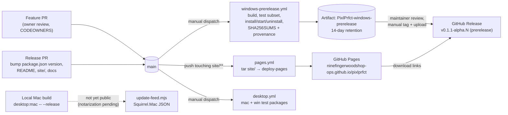

# CI/CD and Releases

PixlPrfct has no automatic CI for tests: the three GitHub Actions workflows are a **product-site publisher** (`pages.yml`, on push to `main`), and two **manually dispatched desktop packagers** (`desktop.yml` for Mac/Windows test packages, `windows-prerelease.yml` for the public Windows preview). Public releases so far are unsigned Windows x64 prereleases tagged `v0.1.1-alpha.N`, built by the Windows prerelease workflow and published by hand to GitHub Releases with `SHA256SUMS.txt` and `BUILD-PROVENANCE.json`. The thing to remember: nothing publishes itself — the maintainer dispatches the build, checks the artifacts, creates the tag and release, and keeps README, `site/` and docs in step with the version in `package.json`.

## At a glance

| Key files | Entry points | Depends on | Used by | Related docs |
| --- | --- | --- | --- | --- |
| [.github/workflows/pages.yml](../../.github/workflows/pages.yml), [.github/workflows/desktop.yml](../../.github/workflows/desktop.yml), [.github/workflows/windows-prerelease.yml](../../.github/workflows/windows-prerelease.yml), [.github/dependabot.yml](../../.github/dependabot.yml), [.github/CODEOWNERS](../../.github/CODEOWNERS), [package.json](../../package.json) `version`, [scripts/desktop/build.mjs](../../scripts/desktop/build.mjs), [scripts/desktop/signing.mjs](../../scripts/desktop/signing.mjs), [scripts/desktop/update-feed.mjs](../../scripts/desktop/update-feed.mjs), [scripts/desktop/release-check.mjs](../../scripts/desktop/release-check.mjs), [desktop/updates.cjs](../../desktop/updates.cjs), [desktop/builder.config.cjs](../../desktop/builder.config.cjs), `site/` | Actions → *Run workflow*; `npm run desktop:win` / `desktop:mac` / `desktop:mas`; push to `main` touching `site/**` | GitHub-hosted runners, Node 24, Rust stable + `wasm32-unknown-unknown`, electron-builder | Maintainer (James Gibbens), downloaders via the product site | [CODE_SIGNING.md](../../CODE_SIGNING.md), [SECURITY.md](../../SECURITY.md), [DESKTOP.md](../DESKTOP.md), [SECURITY_CHECK_2026-10-30.md](../SECURITY_CHECK_2026-10-30.md), [RELEASE_ACCEPTANCE.md](../RELEASE_ACCEPTANCE.md), [CONTRIBUTING.md](../../CONTRIBUTING.md) |

## Pipeline overview



## Repository governance

- **CODEOWNERS:** `* @ninefingerwoodshop-ops` — every path, including workflows and CODEOWNERS itself, requires the project owner's review.
- **Branch protection** (described in [CONTRIBUTING.md](../../CONTRIBUTING.md), not visible in the repo): `main` requires a PR, owner review and resolved conversations; new commits dismiss stale approvals; force-push and deletion blocked; the owner keeps an administrator override *through a PR*. "Automatic CI and required status checks are disabled."
- **Actions hardening:** every third-party action is pinned to a full commit SHA with a version comment; `checkout` uses `persist-credentials: false`; default `permissions: contents: read`. `pages.yml` deliberately packages the site with `tar` instead of the `upload-pages-artifact` composite action to avoid its unpinned inner dependency.
- **Security reports:** [SECURITY.md](../../SECURITY.md) — private GitHub security advisory; fixes go to the latest `main`.

### Dependabot

[.github/dependabot.yml](../../.github/dependabot.yml) configures two ecosystems, both weekly with a **7-day cooldown** ("so a compromised publish has time to be yanked"; security updates ignore it):

| Ecosystem | Directory | Grouping |
| --- | --- | --- |
| `cargo` | `/` | minor + patch grouped as `cargo` |
| `github-actions` | `/` | all grouped as `actions` |

> **Note:** There is no `npm` entry, yet git history contains npm bump PRs (#3–#12 and #15, 2026-10-25 to 10-29, e.g. *Bump zod from 3.25.76 to 4.6.7*). Those came from an earlier configuration or from Dependabot security updates; the snapshot does not show which. npm dependency risk is currently tracked manually in [SECURITY_CHECK_2026-10-30.md](../SECURITY_CHECK_2026-10-30.md).

## Workflows

### `pages.yml` — Publish product site

| Item | Value |
| --- | --- |
| Trigger | `push` to `main` with changes under `site/**` or the workflow file; `workflow_dispatch` |
| Guard | job `if: github.ref == 'refs/heads/main'` |
| Concurrency | group `github-pages`, `cancel-in-progress: false` |
| Permissions | `contents: read`, `pages: write`, `id-token: write`; environment `github-pages` |
| Steps | checkout → `configure-pages` → `tar --dereference --hard-dereference --directory site --exclude=.git --exclude=.github -cf $RUNNER_TEMP/artifact.tar .` → `upload-artifact` (name `github-pages`, 1-day retention) → `deploy-pages` |

The site is static (`site/index.html`, `styles.css`, `site.js`, `assets/`, `robots.txt`, `sitemap.xml`) with canonical URL `https://ninefingerwoodshop-ops.github.io/pixlprfct/`. There is no build step. Preview locally with `python3 -m http.server 4200 --bind 127.0.0.1 --directory site`. The Playwright spec `tests/browser/product-site.spec.mjs` covers the page locally; the workflow itself runs no tests.

### `desktop.yml` — Desktop test packages

Manual (`workflow_dispatch`). Matrix `{macos-latest: mac, windows-latest: win}`, `fail-fast: false`. Steps: Node 24 (npm cache), Rust stable with `wasm32-unknown-unknown`, `npm ci`, `node node_modules/electron/install.js`, `npm run desktop:check`, `npm run desktop:<target>`. Uploads `releases/desktop/*.dmg|*.exe|*.zip` as `PixlPrfct-<target>-test-packages` (14 days). Without `--release`, `signing.mjs` puts the build in **test mode**: ad-hoc Mac signature (`identity:'-'`), no notarization, unsigned Windows. The Mac target defaults to a universal binary.

### `windows-prerelease.yml` — Windows prerelease

Manual, `windows-latest`, 35-minute timeout, `contents: read` only (no signing secrets, no release publishing).

1. Checkout, Node 24, Rust + wasm target, `npm ci`, Electron runtime download.
2. `npm run desktop:win` → `build:editor` (preloader, `wasm-pack`, catalog, design-file importer bundle, `scripts/build.mjs`) → `scripts/desktop/prepare.mjs` (stages `.desktop/app`) → `scripts/desktop/build.mjs --win` (NSIS + ZIP, x64).
3. **Tests:** `node --test tests/desktop.test.mjs tests/desktop-signing.test.mjs tests/desktop-preferences.test.mjs tests/figma-import.test.mjs`.
4. **Native check (PowerShell):** exactly one `*.exe`; silent install `/S /D=$RUNNER_TEMP\PixlPrfct-installed`; launch `PixlPrfct.exe`, wait 15 s, assert the process is alive and has a `MainWindowHandle`; close; run the single `*Uninstall*.exe /S`; assert `PixlPrfct.exe` is removed within 20 s. The log states: "This is a startup check, not a full interactive test."
5. **Checksums and provenance:** requires exactly one `.exe` and one `.zip`; writes `releases/desktop/SHA256SUMS.txt` (lower-case SHA-256, two spaces, filename; UTF-8 without BOM) and `releases/desktop/BUILD-PROVENANCE.json`:

   ```json
   {"repository":"<owner/repo>","commit":"<github.sha>","build":"<server>/<repo>/actions/runs/<run_id>","platform":"windows-x64","signing":"unsigned"}
   ```

6. Upload artifact `PixlPrfct-windows-prerelease` (the `.exe`, `.zip`, `SHA256SUMS.txt`, `BUILD-PROVENANCE.json`; 14 days).

Artifact names come from `desktop/builder.config.cjs` `artifactName: 'PixlPrfct-${version}-${os}-${arch}.${ext}'`, where `version` is copied from the root `package.json` into `.desktop/app/package.json` by `prepare.mjs`. Example: `PixlPrfct-0.1.1-alpha.21-win-x64.exe`.

## Versioning

- The single source of truth is `"version"` in [package.json](../../package.json) (currently **`0.1.1-alpha.21`**). The Electron app, artifact names, About dialog and `update-feed.mjs` all derive from it; `release-check.mjs` fails if a Mac bundle's `CFBundleShortVersionString` differs.
- Scheme: `0.1.1-alpha.N`, incremented for every local desktop install and every public preview. Tags are `v` + version. The first public download was **`v0.1.0-alpha.1`** (MIT / Apache 2.0); from 0.1.1 the custom Community License applies.
- `Cargo.toml` stays at `0.1.0` and the MCP server advertises `0.1.0`; they are not bumped with releases.
- Version strings are also hand-maintained in `README.md`, `site/index.html`, `docs/DESKTOP.md`, `docs/SVG_ANIMATION.md` and status docs. `roadmap.json.currentRelease` identifies the public preview; older `desktopVersion` fields describe the installed build used for historical acceptance and must not be relabeled. Update `site/dev-log.html` and the wiki for each release.

## Release history

Built from [`gitlog`](#source-of-truth) titles and the dated sections of [DESKTOP.md](../DESKTOP.md) / [RELEASE_ACCEPTANCE.md](../RELEASE_ACCEPTANCE.md). "Local" builds were ad-hoc-signed Mac installs on the maintainer's machine and were never published.

| Version | Date | Channel | Commit / PR | Contents (summary) |
| --- | --- | --- | --- | --- |
| v0.1.0-alpha.1 | 2026-10-29 | Public Windows prerelease | `48f42ba` #16 *Prepare first desktop prerelease and publishing policies* | First Windows x64 preview; MIT / Apache 2.0 terms |
| 0.1.1-alpha.2 – .5 | ≤ 2026-10-30 | Local Mac | not recorded (alpha.4 notes its changes "remain in draft PR #29") | Desktop updates; alpha.5 keeps an 8-page, 613-layer design intact |
| 0.1.1-alpha.6 | ≤ 2026-10-30 | Local Mac | not recorded (pre-#29 merge) | MCP live session ID preserved across reconnects |
| 0.1.1-alpha.7 | 2026-10-30 | Local Mac | not recorded (pre-#29 merge) | Performance update (viewport raster cache, cheaper MCP updates) |
| 0.1.1-alpha.10 – .14 | 2026-10-30 | Local Mac | `bc4ec9d` #29, `c4cfc7d` #31 | Frame enclosure (.10); evaluation fixes (.11); libraries, Page Styles, bounded exports (.12); file roles/leases (.13); review/inbox, update tooling (.14) |
| v0.1.1-alpha.15 | 2026-10-31 | Public Windows prerelease | `46cdca5` #38 *Release the SVG animator in the Windows desktop preview* | SVG Animator, grouped keyframes (#37) |
| v0.1.1-alpha.16 | 2026-10-31 | Public Windows prerelease | `7624bdf` #41 | Group easing (#39), precise timing (#40) |
| v0.1.1-alpha.17 | 2026-10-31 | Public Windows prerelease | `5661704` #44 | Keyframe reuse (#42), reversal (#43) |
| v0.1.1-alpha.18 | 2026-10-31 | Public Windows prerelease | `441e789` #47 | Keyframe duplication (#45), snapping (#46) |
| v0.1.1-alpha.19 | 2026-11-01 | Public Windows prerelease | built from `ea20b14`, merged as `e97e25e` (#50, identical tree) | Keyframe navigation (#48), Pause fix (#49) |

| v0.1.1-alpha.20 | 2026-11-01 | Public Windows prerelease | built from `c59178a`, merged as `ffbea1a` (#52, identical tree) | Canvas stretch and rotation handles |
| v0.1.1-alpha.21 | 2026-11-01 | Windows prerelease | Exact source and build run recorded in release `BUILD-PROVENANCE.json` | SVG drawing, gradients, parent panel workspace; website Dev Log |

> **Note:** alpha.8 and alpha.9 are not mentioned in any document or commit title. Alpha.19 was published from `ea20b14` (manual Windows build `41312336745`; packages verified by SHA-256, provenance and source comparison) and merged as PR #50 (`e97e25e`) with the owner's override approval, per [SVG_ANIMATION.md](../SVG_ANIMATION.md). Because Pages deploys on every push to `main`, README/site links to a release can go live before its assets exist — publish the release before merging site changes that link to it.

Other milestones from git history: `5022f80` #1 *Add license, CI, Dependabot, and security policy* (the CI workflow it mentions no longer exists), `4b2e7ff` #2 Rust-powered editor, `6d9127f` #34 *Fix Pixel Perfect site publishing with pinned actions*, `153087f` #32 Dependabot actions bump.

## Code signing

Status per [CODE_SIGNING.md](../../CODE_SIGNING.md): **Windows previews are unsigned.** A SignPath Foundation application was made while the project was MIT/Apache; approval was not granted and eligibility must be reassessed under the custom license. Mac direct-download signing uses a Developer ID Application identity; public Mac distribution requires notarization, which has not been completed for any public release.

[scripts/desktop/signing.mjs](../../scripts/desktop/signing.mjs) `configureSigning(config, {flags, platform, env})` chooses one of four modes:

| Mode | Flags | Behaviour | Output dir |
| --- | --- | --- | --- |
| `test` | none | `CSC_IDENTITY_AUTO_DISCOVERY=false`; Mac `identity:'-'` (ad-hoc), no notarize, no hardened runtime; Windows `signExecutable:false` | `releases/desktop` |
| `signed` | `--sign-only` (Mac only) | `forceCodeSigning`, hardened runtime, signed DMG, **no** notarization | `releases/desktop/signed` |
| `release` | `--release` | `forceCodeSigning`; Mac requires notarization credentials: `APPLE_ID`+`APPLE_APP_SPECIFIC_PASSWORD`+`APPLE_TEAM_ID`, or `APPLE_API_KEY`+`APPLE_API_KEY_ID`+`APPLE_API_ISSUER`, or `APPLE_KEYCHAIN_PROFILE`; Windows uses electron-builder's `WIN_CSC_LINK`/`WIN_CSC_KEY_PASSWORD` | `releases/desktop/release` |
| `app-store` | `--mas` / `--mas-dev` | Requires `PIXL_DESKTOP_APP_ID`, 10-char `APPLE_TEAM_ID`, `PIXL_MAS_PROFILE` (checked in `build.mjs`) | `releases/desktop/app-store` |

`--sign-only` combined with `--release` or a non-Mac platform throws. `tests/desktop-signing.test.mjs` asserts that a public Mac release cannot skip notarization and that the modes stay distinct.

[scripts/desktop/release-check.mjs](../../scripts/desktop/release-check.mjs) `<PixlPrfct.app>` verifies a Mac release: `codesign --verify --deep --strict`, `Authority=Developer ID Application:`, `spctl --assess --type execute`, `xcrun stapler validate`, and bundle version = `package.json` version.

Electron fuses (`builder.config.cjs`): `runAsNode:false`, no `NODE_OPTIONS`, no inspect args, embedded ASAR integrity validation, `onlyLoadAppFromAsar`, no extra `file:` privileges.

## Update feed (Mac only)

- `scripts/desktop/prepare.mjs` writes `.desktop/app/update-config.json` = `{"release":false,"feed":null}`; `scripts/desktop/build.mjs` overwrites it with `{release: mode==='release', feed: mode==='release' ? updateFeed(PIXL_UPDATE_URL) : null}`. The feed URL is **embedded at build time**; workspace pages cannot change it.
- `desktop/updates.cjs` `updateFeed(url)` requires `https:` with no credentials or fragment. `installUpdates()` configures Electron `autoUpdater` (`serverType:'json'`) only when the app is packaged, not MAS, on `darwin`, and `config.release && config.feed`. **Help → Check for updates…** otherwise explains that updates are not configured. It never force-quits; it asks the user to save and restart.
- `node scripts/desktop/update-feed.mjs signed.zip https://host/signed.zip feed.json [notes.txt]` writes a Squirrel.Mac JSON feed `{currentRelease, releases:[{version, updateTo:{version,url,name,notes,pub_date,sha256,size}}]}`. It requires a `.zip`, refuses to overwrite (`flag:'wx'`), and prints "Publish only after signed-app and notarization checks pass."
- **Windows has no automatic updates**; users install the new preview over the old one.
- Rollback is "ship a higher version containing the reverted code" ([DESKTOP.md](../DESKTOP.md)).

> **Note:** `desktop/update-config.json` in the repository (`{"release":false,"feed":null}`) is not copied by `prepare.mjs`, which writes its own; the repo file appears unused. [DESKTOP.md](../DESKTOP.md) also says "Automatic updates are not implemented" in one section and documents the Mac updater in a later one; the code implements the Mac updater.

## Security posture for releases

From [SECURITY_CHECK_2026-10-30.md](../SECURITY_CHECK_2026-10-30.md) (an engineering check, not an audit): the 2026-10-31 follow-up reports zero high/critical and 30 moderate npm advisories, all from the minimatch ReDoS advisory in lint/packaging tooling, deliberately not force-fixed. Desktop keeps sandboxing, context isolation, navigation controls, scoped MCP bridge tokens, HTTPS-only build-time update feeds and hardened release gates. Public signing/notarization, a signed update/rollback drill and independent review remain open.

## Cut a new alpha release (Windows preview)

Derived from the workflows, scripts and the pattern of PRs #38/#41/#44/#47. Steps marked *(manual)* have no automation in the repo.

1. **Collect the features.** Use already merged changes or include the reviewed feature work in the release PR. Their docs (e.g. `docs/SVG_ANIMATION.md`) say "local pending merge / not in alpha.N".
2. **Run the local gates** on the merged `main` (see [Testing-and-Verification](Testing-and-Verification.md)): `npm run build`, `npm test`, `npm run lint`, `npm run typecheck`, `node scripts/generate-editor-api.mjs --check`, `cargo fmt --all --check`, `cargo clippy --all-targets --all-features -- -D warnings`, `npm run test:browser`. Record PASS/FAIL with counts.
3. **Create a release branch and bump the version:** `npm version 0.1.1-alpha.<N> --no-git-tag-version` (updates `package.json` and the lockfile if present).
4. **Update user-facing references** in the same PR:
   - `README.md` — the "Windows **v0.1.1-alpha.N** preview" paragraphs.
   - `site/index.html` — release note text, every `releases/download/v0.1.1-alpha.N/…` link (`-win-x64.exe`, `-win-x64.zip`, `SHA256SUMS.txt`, `BUILD-PROVENANCE.json`) and the `releases/tag/…` link; the `styles.css?v=` cache-buster if styles changed; JSON-LD if platforms changed. [CONTRIBUTING.md](../../CONTRIBUTING.md): "Update the visible version, release notes, structured metadata, and platform/signing status together."
   - `docs/DESKTOP.md` — the "Windows … preview — v0.1.1-alpha.N" section and release link; feature docs' "Included in Windows v0.1.1-alpha.N" lines.
   - Optionally `roadmap.json` `desktopVersion`.
5. **Mind the publishing order.** Merging changes under `site/**` triggers `pages.yml` immediately, so the live site will link to `v0.1.1-alpha.N` assets before they exist. Either (a) dispatch the build from the release branch and publish the GitHub release before merging, then merge; or (b) leave `site/` out of the release PR and update it in a follow-up after the release is live. *(manual decision; the history shows site and version changes in the same PR.)*
6. **Dispatch the build.** Actions → *Windows prerelease* → *Run workflow* on the exact commit to be released (branch or `main` after merge). Wait for success: build, four test files, install/start/uninstall, checksums, provenance.
7. **Download and check the artifact** `PixlPrfct-windows-prerelease` within 14 days: confirm `BUILD-PROVENANCE.json` `commit` equals the intended SHA and `signing` is `unsigned`; verify hashes (`sha256sum -c SHA256SUMS.txt` or `Get-FileHash`); optionally smoke-test the installer on a real Windows machine. *(manual)*
8. **Tag and publish** *(manual)*: create tag `v0.1.1-alpha.N` pointing at the build's exact commit ([CODE_SIGNING.md](../../CODE_SIGNING.md) step 4) and a GitHub **prerelease** with the four files, e.g.

   ```sh
   gh release create v0.1.1-alpha.N --target <commit-sha> --prerelease \
     --title "PixlPrfct v0.1.1-alpha.N (Windows preview)" --notes-file notes.md \
     PixlPrfct-0.1.1-alpha.N-win-x64.exe PixlPrfct-0.1.1-alpha.N-win-x64.zip \
     SHA256SUMS.txt BUILD-PROVENANCE.json
   ```

   Release notes must identify the build run URL, tested platform, unsigned status, license (Community License; v0.1.0-alpha.1 keeps MIT/Apache), and known limitations.
9. **Verify the site** after Pages deploys: every download link resolves (`curl -fsSI <url>`), the version text is consistent.
10. **Record evidence**: add a dated entry to `docs/DESKTOP.md` (and `docs/TT-Design-System-Gaps.md` if gaps were closed), distinguishing source, packaged, installed and published states.

**Mac (not yet performed publicly):** on a Mac with a Developer ID identity, `APPLE_KEYCHAIN_PROFILE=… APPLE_TEAM_ID=… [PIXL_UPDATE_URL=https://…] npm run desktop:mac -- --release`, then `node scripts/desktop/release-check.mjs <path to the built PixlPrfct.app under releases/desktop/release/>`, then (if offering updates) `update-feed.mjs` and upload the verified ZIP before atomically replacing the feed.

## Invariants and gotchas

- Workflows never publish releases and hold no signing credentials; the token is read-only. Keep it that way: CODE_SIGNING.md requires manual approval for any future signing request.
- Artifacts expire after 14 days; a release must be cut from a run within that window or rebuilt.
- The Windows workflow expects **exactly one** installer and **one** ZIP; adding an ARM64 target to the same run breaks the checksum step.
- Tests in the prerelease workflow run after packaging and only cover desktop policy, signing configuration, preferences and design-file import — not the full suite.
- `package-lock.json` (root) and `server/package-lock.json` are committed and required by `npm ci` / `cache: npm` and the Docker build; keep them in sync with `package.json` changes.
- Version strings in docs and site are manual; grep for the previous `alpha.N` before merging a release PR.

## Known limitations

- No CI for tests, lint, typecheck or browser screenshots; quality gates are local and self-reported.
- No Windows code signing, no notarized public Mac build, no Windows auto-update.
- Dependabot does not cover npm.
- No independent second-person review: the owner authors, reviews and approves releases ([CODE_SIGNING.md](../../CODE_SIGNING.md)).

## Related pages

- [Desktop-App](Desktop-App.md) — Electron app, packaging, IPC
- [Testing-and-Verification](Testing-and-Verification.md) — the gates to run before a release
- [Build-System](Build-System.md) — `build:editor`, `prepare.mjs`, staging
- [Contributing-and-Conventions](Contributing-and-Conventions.md) — PR rules and evidence conventions
- [Project-Status-and-Roadmap](Project-Status-and-Roadmap.md)
- [SVG-Animator](SVG-Animator.md) — content of alpha.15–.19

## Source of truth

- Workflows and repo config: [.github/workflows/pages.yml](../../.github/workflows/pages.yml), [.github/workflows/desktop.yml](../../.github/workflows/desktop.yml), [.github/workflows/windows-prerelease.yml](../../.github/workflows/windows-prerelease.yml), [.github/dependabot.yml](../../.github/dependabot.yml), [.github/CODEOWNERS](../../.github/CODEOWNERS)
- Build and release scripts: [scripts/desktop/build.mjs](../../scripts/desktop/build.mjs), [scripts/desktop/prepare.mjs](../../scripts/desktop/prepare.mjs), [scripts/desktop/signing.mjs](../../scripts/desktop/signing.mjs), [scripts/desktop/update-feed.mjs](../../scripts/desktop/update-feed.mjs), [scripts/desktop/release-check.mjs](../../scripts/desktop/release-check.mjs), [desktop/updates.cjs](../../desktop/updates.cjs), [desktop/builder.config.cjs](../../desktop/builder.config.cjs)
- Policy and records: [CODE_SIGNING.md](../../CODE_SIGNING.md), [SECURITY.md](../../SECURITY.md), [CONTRIBUTING.md](../../CONTRIBUTING.md), [DESKTOP.md](../DESKTOP.md), [RELEASE_ACCEPTANCE.md](../RELEASE_ACCEPTANCE.md), [SECURITY_CHECK_2026-10-30.md](../SECURITY_CHECK_2026-10-30.md)
- History: `git log --oneline` (53 commits to `6f3d74b`, 2026-11-01)
