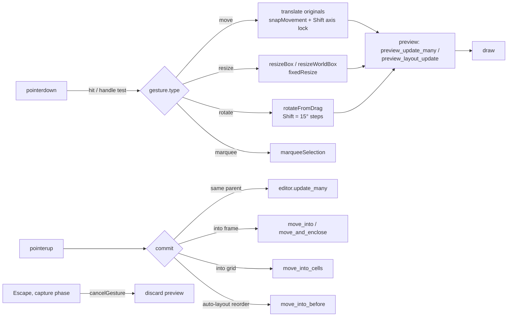

# Canvas Tools and Editing

The canvas editing layer turns pointer and keyboard input into document mutations. Almost all interaction logic lives in [web/app.js](../../web/app.js) (gesture state machine, global `keydown` handler), backed by small pure helper modules in `web/` (selection, snapping, transforms, vectors, text, clipboard) and by Rust mutation methods on the WASM `Editor` (`src/lib.rs`, `src/groups.rs`, `src/arrangement.rs`, `src/path_join.rs`, `src/path_split.rs`, `src/layer_drop.rs`, `src/frame_enclosure.rs`). The single most important rule: **gestures preview without touching history, and every completed user action commits exactly one validated `Editor` mutation** (one undo step). Previews go through `preview_update_many` / `preview_layout_update`; commits go through `update`, `update_many` or a dedicated structural method, which all funnel into `Editor::commit`.

## At a glance

| | |
|---|---|
| **Key files** | [web/app.js](../../web/app.js), [web/toolbelt.js](../../web/toolbelt.js), [web/selection.js](../../web/selection.js), [web/snapping.js](../../web/snapping.js), [web/guide-snap.js](../../web/guide-snap.js), [web/resizing.js](../../web/resizing.js), [web/rotation.js](../../web/rotation.js), [web/scaling.js](../../web/scaling.js), [web/vectors.js](../../web/vectors.js), [web/vector-edit.js](../../web/vector-edit.js), [web/pencil.js](../../web/pencil.js), [web/text-editing.js](../../web/text-editing.js), [web/typography.js](../../web/typography.js), [web/clipboard.js](../../web/clipboard.js), [web/layer-drop.js](../../web/layer-drop.js), [src/groups.rs](../../src/groups.rs), [src/arrangement.rs](../../src/arrangement.rs) |
| **Entry points** | `canvas.onpointerdown/move/up`, `canvas.ondblclick`, the global `window` `keydown` listener (app.js ~line 1795), `copy`/`cut`/`paste` window listeners, `installToolbelt()` |
| **Depends on** | WASM `Editor` (validation, history, hit testing, group/arrange/join/split/drop), [scene.js](../../web/scene.js) (`frameAt`, `paintBounds`, clipping), [layout-sizing.js](../../web/layout-sizing.js) (`sizingPatch`) |
| **Used by** | Inspector panels, Layers panel, MCP/agent API ([editor-api.js](../../web/editor-api.js)) which calls the same `Editor` methods |
| **Related docs** | [TEXT_EDITING.md](../TEXT_EDITING.md), [grouping-comparison.md](../grouping-comparison.md), [Interface reference log](../FIGMA_UI_REFERENCE.md), [README](../../README.md) "First milestone" |

## Responsibilities

- Tool selection and the floating toolbelt (Move/Region/Shape/Creation/Type/Code/Comment groups, plus Draw/Design/Motion/Dev modes).
- Selection: click, Shift-click, Ctrl/Cmd-click deep select, marquee, Enter/Shift+Enter/Tab hierarchy navigation, Layers-panel range selection.
- Direct manipulation: move (with snapping and axis lock), resize (8 handles), rotate (outside-corner handle), K-tool scale, nudging.
- Drawing: frames (with enclosure), rectangles, ellipses, lines/arrows, polygon/star, pen, pencil, text, text-on-path, editor-only marks (section, slice, comment, annotation, measurement, spec).
- Vector point editing: anchor drag/nudge/insert/delete, smooth/corner conversion, join two paths, split at an anchor.
- On-canvas text editing.
- Images (place, drop, paste, replace, crop).
- Structure: group/ungroup, frame selection, stacking order, lock/hide, rename, layer-panel drag and drop, pages.
- Clipboard: copy/cut/paste/paste-over-selection/paste-to-replace, SVG/image/plain-text paste.

## Tools and the toolbelt

`toolGroups` in [web/toolbelt.js](../../web/toolbelt.js) is the canonical tool catalog (id, label, shortcut label). `installToolbelt({action, modeChanged})` rebuilds `.toolbox` as split buttons with `
` menus; it returns an `update(tool)` function that also exposes `update.mode(next)` / `update.getMode()` for the four toolbelt modes (`draw`, `design`, `motion`, `dev`). `code`, `spec` and `media` entries are actions, not tools (`data-action`), routed to the `action` callback.

Tool ids map to shape creation as follows:

| Tool id | Created by | Notes |
|---|---|---|
| `frame` | `drawnShape('frame',…)` then `editor.insert_enclosing_frame` | White fill, clips by default; adopts fully enclosed unlocked sibling roots (see [Layout page](Layout-Auto-Layout-and-Grid.md#frame-enclosure)). Presets from `FRAME_PRESETS` in [frame-tools.js](../../web/frame-tools.js). |
| `rectangle`, `ellipse` | `drawnShape` in [vectors.js](../../web/vectors.js) | Shift = square, Alt = from center. Click without drag places a default size. |
| `line`, `arrow` | `drawnShape` → `fromPoints` | Shift snaps to 45° increments. |
| `polygon`, `star` | `drawnShape` | Fixed point counts (3 and 10 points; star inner radius 0.22). |
| `pen` | `penPoints` + `finishPen()` | Click = corner anchor, drag = mirrored handles; Enter finishes open path; click first anchor closes. |
| `pencil` | `fromPoints('pencil', smoothPencil(points, #pencil-smoothing, zoom))` | Iterative Ramer-Douglas-Peucker in [pencil.js](../../web/pencil.js); turns with dot < 0.5 stay corners, gentler turns get aligned handles. |
| `text` | `drawnText(start,end,zoom)` in [text-editing.js](../../web/text-editing.js) | Click → `sizing:'width'` (auto width); drag > 4 screen px → `sizing:'fixed'`. |
| `text-path` | `textOnPath(source)` in [canvas-tools.js](../../web/canvas-tools.js) | Samples a vector/ellipse into normalized points stored in `editor_meta.text_path`; glyphs laid out by `pathGlyphs`. |
| `section`, `slice`, `comment`, `annotation`, `measurement`, `spec` | `editorShape(role,…)` in canvas-tools.js | Stored as ordinary shapes with `editor_meta.role`; `artworkShapes()` strips them (and re-parents their children) before export. Rust validates roles in `editor_tools::validate`. |
| `scale` (K) | `scaleShapes()` in [scaling.js](../../web/scaling.js) | Scales geometry *and* stroke widths, radii, effects, auto-layout gaps/padding, grid fixed tracks, layout guides, size limits and font size. Origin is the selection's upper-left. |
| `hand` (H) | pan only | Space-hold gives a temporary hand. |

All drawn shapes start inside the frontmost visible frame at the initial pointer position (`frameAt(pageShapes(), point)` in [scene.js](../../web/scene.js)).

## Selection model

Selection is a `Set` of IDs (`selectedIds`) in app.js; the Rust side receives it as a JSON array and checks it with `Editor::selection_ids` (unique, all on the active page). [web/selection.js](../../web/selection.js) contains the hierarchy rules:

- `selectionTarget(shapes, id, selected, {deep, drill})` resolves a raw hit to what a click should select. A top-level non-component frame acts as a canvas (its children are selected directly); an instance is selected as one object unless drilling; once a sibling at some nesting level is selected, further clicks stay at that level. `deep` (Ctrl/Cmd-click) returns the raw hit; `drill` (double-click) goes one level deeper.
- `canvasSelection` filters hidden (`visibleInTree`) and locked (`lockedInTree`) layers, then reduces to `selectionRoots` (a selected ancestor absorbs its descendants).
- `childSelection` / `parentSelection` / `siblingSelection` implement Enter / Shift+Enter / Tab.
- `marqueeSelection` intersects axis-aligned *visual* bounds (`visualBounds` from rotation.js), so rotated layers use their rotated extent.
- `layerRange` implements Shift-click ranges in the Layers list.

Hit testing for clicks is done by `Editor::hit_test` in Rust, which walks paint order (`stacking::paint_order`, honoring `canvas_stacking: "first"`) and flattens Bézier paths (`path_polyline` / `flatten_curve`) for accurate path hits.

## Move, snap, resize, rotate

- **Snapping** — `snapMovement(shapes, box, excluded, zoom, settings, axes, guides)` in [snapping.js](../../web/snapping.js) compares the moving box's start/center/end with every other shape's `paintBounds` within 6 screen pixels, then merges candidates from `snapGuides` ([guide-snap.js](../../web/guide-snap.js)) for visible layout guides of the frame under the box center (respecting clipping ancestors). If nothing snaps and `settings.grid` is on, the position rounds to `settings.increment` (0.1–1000, default 1). Settings come from `normalizeSnapping` and the Snapping dialog. The canvas hint says Alt or Control bypasses snapping; Shift locks movement to the dominant axis. Snap lines are drawn by `drawSnapGuides` (pink dashed).
- **Resize** — [resizing.js](../../web/resizing.js): `resizeHandles` (4 corners + 4 edges), `resizeHandleAt` works in the layer's local (unrotated) space, `resizeBox` clamps to ≥1 px, `resizeWorldBox` maps back to world coordinates for rotated layers. `fixedResize(shape, widthChanged, heightChanged)` switches only the edited axis to Fixed sizing (via `sizingPatch`), following the sizing rules. Controls with hug height only expose middle handles (`hasHugControlHeight`). Multi-selection resize is proportional only (README "Current limits").
- **Rotate** — [rotation.js](../../web/rotation.js): angles are counter-clockwise degrees around the center, normalized to [-180,180). `rotationHandleAt` is a 24 px zone just outside each corner. `rotateFromDrag(s,start,end,snap)` and `rotateToAngle` (inspector) both clear `fill_width/fill_height`. Rust mirrors this in `Shape::visual_bounds` / `unrotate_point` ([src/rotation.rs](../../src/rotation.rs)). Group bounds (`groups::fit`) and layout use visual bounds. Per [frames-auto-layout-comparison.md](../frames-auto-layout-comparison.md), rotating frames/groups and rotated Fill sizing were initially rejected; `tests/container-rotation.test.mjs` now covers container rotation, so verify current behavior there before relying on the doc.
- **Rectangle transforms** — [rectangle-actions.js](../../web/rectangle-actions.js): `transformRectangle(shape,'rotate'|'horizontal'|'vertical')` bakes quarter-turns and flips into geometry, asymmetric radii and gradient coordinates; `rectangleToVector` converts to a closed `pen` path using the κ = 4(√2−1)/3 circle approximation for corners.

## Vectors and point editing

Vector shapes (`kind` in `line`, `arrow`, `pen`, `pencil`, `polygon`, `star`) store `points` and `handles` **normalized to the layer box** (0..1), so resize and scale need no path rewrite. Key helpers in [vectors.js](../../web/vectors.js): `fromPoints(kind, points, closed)` builds a normalized shape from world anchors (with optional `in`/`out` handles), `anchors(shape)` expands back to world coordinates, `reshape(shape, nodes)` re-normalizes after edits, `vectorPath` / `vectorSvg` render SVG path data.

Point editing (`editingPath` state in app.js; enter via double-click, Enter, or **Edit vector points**):

| Action | Implementation |
|---|---|
| Drag anchor / handle | `gesture.type='node'`; Alt-drag on an anchor sets `part:'smooth'` to pull out handles |
| Double-click a segment | `nearestSegment` (64-sample search + ternary refine) → `insertAnchor` (de Casteljau split, curve unchanged) |
| Arrow / Shift+Arrow | Nudge active anchor and its handles by 1 / 10 px |
| Delete / Backspace | `deleteAnchor` (closed paths keep ≥3 anchors, open ≥2) |
| Make smooth / Make corner | `convertAnchor(shape, index, smooth)` — handles at 1/3 neighbor distance along the neighbor chord |
| Split at anchor (`#split-node`) | `Editor::split_path(id, index)` → `path_split::split` |
| Join two paths (`#join-paths`) | `Editor::join_paths(selection)` → `path_join::join` |

[src/path_join.rs](../../src/path_join.rs) `join(a,b)` requires two open paths with ≥2 points and the same parent. It tries all four end pairings, picks the closest, merges coincident endpoints (distance < 1e-9) or connects them with a straight segment, keeps the outer stroke endpoint decorations (`endpoint()`), converts `line`/`arrow` to `pen`, re-normalizes, and enforces 4096 anchors. The second path is removed; component overrides are recorded via `components::record_overrides`.

[src/path_split.rs](../../src/path_split.rs) `split(source, index)`: on a closed path any anchor opens it into one open path starting and ending at that anchor; on an open path an interior anchor produces two paths (the second named "`<name> split`" with a fresh ID). Endpoint decorations stay only on original ends. Both operations reject locked layers or ancestors.

## Text

On-canvas editing is described for users in [TEXT_EDITING.md](../TEXT_EDITING.md). Implementation in [web/text-editing.js](../../web/text-editing.js):

- `mountTextEditor(canvas, {input, finish, zoom})` creates a transparent `contenteditable="plaintext-only"` element positioned over the layer with a CSS transform (`translate · scale(zoom) · rotate`). It supplies caret, selection, IME composition and native text undo; **the scene renderer still paints the glyphs**, so paints, effects and clipping remain correct. `editableText()` normalizes DIV/P/BR markup to `\n`.
- `textEditSession(editor, shape)` keeps live previews out of history: `preview(value)` calls `editor.preview_update_many` (which runs layout so hugging parents reflow) and enforces the 10,000-byte limit; `commit()` issues one `editor.update`, or `editor.remove_many` if the text is empty.
- `textWordRange` (Intl.Segmenter) selects the word under a double-click.

Typography lives in [web/typography.js](../../web/typography.js): `textStyle(shape)` fills defaults, `layoutText` wraps and measures, `textSize`/`resizeText` implement sizing modes (`fixed`, `width` = auto width, `height` = auto height), `fontBaseline`/`textBaseline` feed baseline alignment, `textSvg` exports. Rust receives measurements through `Editor::set_text_measurer(fn)`; `Editor::reflow_text` iterates text sizing and layout to a fixed point. Typography applies to the whole layer (no mixed runs). [web/base-text.js](../../web/base-text.js) `ensureBaseTextDocument` adds a "Typography Base / Text color" variable and binds untouched neutral text fills to it (run from `refresh()`).

## Images

[web/images.js](../../web/images.js) `readImage(file)` accepts PNG/JPEG/WebP up to 10 MB and 16384 px per side, downsamples to 2048 px on the long edge, re-encodes (JPEG stays JPEG, everything else becomes PNG) and rejects data URLs over 2,000,000 characters. `imageLayout` computes `fit` vs `fill` (crop with `zoom`, `offset_x/offset_y`), shared by canvas `drawImage` and `imageSvg`. `placeImage(file, location, replaceId)` in app.js also routes SVG files to SVG import and videos to paint media.

## Structure operations

### Groups

[src/groups.rs](../../src/groups.rs):

- `group_many(json)` takes selection roots, rejects locked layers, finds the **nearest common ancestor** as the group's parent, inserts the group directly above the topmost selected layer in paint order, names it `Group N` (first unused), resets the new group's appearance to a transparent pass-through container, and resets children's `layout_item`.
- `ungroup_many(json)` accepts groups **and non-component frames**; children are spliced into the container's position so stacking is preserved; returns the new selection.
- `fit(shapes, index, children)` sizes a group to the union of visible children's visual bounds (all hidden → 0×0) and rebases the subtree when a rotated group's origin changes.
- `prune_empty(document)` runs in every `commit`, removing groups that lost their last child (cascading).

Group resize behavior is in `layout::reflow`'s `geometry()`: a group scales its children (`Constraint::Scale`), while constraints of children inside groups resolve against the enclosing frame. Recorded measurements behind these rules are in [grouping-comparison.md](../grouping-comparison.md).

### Stacking and arrangement

[src/arrangement.rs](../../src/arrangement.rs) `arrange_many(json, direction)` with `front`/`back`/`forward`/`backward`: per parent, siblings are units; selected roots move together preserving relative order; selected descendants of a selected ancestor are ignored. No-op arrangements do not create history. Paint order for canvas/hit testing is `paint_order` in [src/stacking.rs](../../src/stacking.rs) and `paintOrder` in [web/stacking.js](../../web/stacking.js): document order, except auto-layout frames with `canvas_stacking: "first"` paint children reversed. The Layers panel shows the reverse of paint order.

### Locks, visibility, rename

`locked` and `hidden` are plain shape fields that inherit down the tree (`lockedInTree`, `visibleInTree`). Locked layers cannot be canvas-selected or nudged (`canvasEditable()`), and Rust mutations check ancestors (`groups::unlocked`, `drop_layer`, `join_paths`, `split_path`). Ctrl/Cmd+Shift+L (`toggleSelectionLock`), Ctrl/Cmd+Shift+H (`toggleSelectionVisibility`) and Ctrl/Cmd+R (`renameSelection`) are each one undoable edit.

### Layers panel and drag and drop

There is no `layers-panel.js`; the list is rendered by `renderLayers()` in app.js and styled by [layers-panel.css](../../web/layers-panel.css). Drag and drop is [web/layer-drop.js](../../web/layer-drop.js): `layerDropPosition(rect,y,frame)` (middle 50% of a container row = `inside`, otherwise `before`/`after`), `layerDropReason` explains disallowed drops (non-container targets, locked branches, cycles), `installLayerDrop` handles pointer capture, autoscroll (`layerAutoScrollSpeed`), a live multi-row preview and Alt to copy. Commits call `Editor::drop_layers(json, target, position)` or `Editor::duplicate_drop_layers` ([src/layer_drop.rs](../../src/layer_drop.rs)); both stage all moves on a scratch `Editor` and commit once.

### Pages

Pages are `document.pages` (max 100, enforced in `validate`); shapes carry `page_id`. Rust: `add_page`, `duplicate_page`, `duplicate_page_at`, `reorder_page`, `select_page`, `rename_page`, `delete_page`. [web/page-drop.js](../../web/page-drop.js) `installPageDrop(menu, reorder, {canCopy})` reorders pages in the page switcher (Alt-drag copies via `duplicate_page_at` while under 100 pages). [page-typeahead.js](../../web/page-typeahead.js) implements page search. Per-page pan/zoom is kept in-session (`pageViews` map); page switching does not create history.

### Frames

Frame labels above top-level frames are DOM overlays from `installFrameLabels` in [frame-tools.js](../../web/frame-tools.js) (click selects, drag moves, double-click renames; component-set labels hide when they would cover other artwork). `migrateChromeDocument` adds `device_chrome_breakpoints` to legacy frames on load. Frame enclosure and device chrome are covered in [Layout-Auto-Layout-and-Grid](Layout-Auto-Layout-and-Grid.md).

## Clipboard

[web/clipboard.js](../../web/clipboard.js) defines the portable payload: MIME `application/x-pixlprfct-layers` (also written as `text/plain`), JSON `{format:'pixlprfct.layers', version:1, shapes}` up to 5 MB.

- **Copy/cut**: `Editor::copy_layers(selection)` serializes the selection with descendants, detaching component links. Cut then deletes.
- **Paste**: `createPasteContext().placement(...)` decides destination: a selected frame/group (that is not the copied source) becomes the parent with a +16 px offset; several selected frames get `paste_into_frames`; otherwise the paste lands at the nearest common ancestor of the selection with a +24 px step per repeat. `Editor::paste_layers(json, dx, dy, parent)` assigns fresh IDs; protected-library payloads from another origin are rejected.
- **Paste over selection** (menu, or Ctrl/Cmd+Shift+V where the host delivers it) uses `overSelection` (no offset). **Paste to replace** (Ctrl/Cmd+Shift+R) calls `Editor::paste_replace`.
- Non-layer clipboard content: `image/svg+xml` or text starting with `<svg` → SVG import; image files → `placeImage`; other text → a new auto-height text layer (≤10 KB).

## Keyboard shortcut reference

Assembled from the global `keydown` handler in [web/app.js](../../web/app.js), mode-specific handlers, `toolGroups` and the `#shortcuts-dialog` in [index.html](../../web/index.html). "Mod" = Ctrl on Windows/Linux, Cmd on macOS. Shortcuts are ignored while focus is in an input, textarea, select or contenteditable, while a non-variables `<dialog>` is open, and Enter/Space on a focused button.

**Tools**

| Key | Action |
|---|---|
| V / H / K | Move / Hand / Scale |
| F / S / Shift+S | Frame / Slice / Section |
| R / O | Rectangle / Ellipse |
| L / Shift+L | Line / Arrow |
| P / Shift+P | Pen / Pencil |
| T | Text |
| C / Shift+C / Shift+M | Comment / Annotation / Measurement |
| Shift+D | Toggle Dev Mode ↔ Design |
| Hold Space | Temporary hand |
| Mod+K | Actions (command search) |
| Mod+Shift+K | Place image / SVG |
| ? | Keyboard shortcuts dialog |

**View**

| Key | Action |
|---|---|
| 1 or Shift+1 | Fit page (`fit()`; any Digit1 without Mod) |
| Shift+2 | Fit selection |
| Mod + `+`/`=` / `-` / `0` | Zoom in / out / 100% (canvas focused, also while editing text) |
| Scroll / Shift+scroll | Pan vertical / horizontal |
| Mod+scroll, pinch | Zoom at pointer |
| Shift+G | Toggle layout guides visibility |

**Selection and structure**

| Key | Action |
|---|---|
| Shift-click / Mod-click | Toggle in selection / select deepest layer |
| Mod+A | Select all visible, unlocked siblings at the current selection's level (top level if nothing selected) |
| Enter / Shift+Enter | Select children / select parent |
| Tab / Shift+Tab | Next / previous sibling (canvas focused) |
| Escape | Clear selection, return to Move tool, discard pen points |
| Delete / Backspace | Delete selection |
| Arrow / Shift+Arrow | Nudge 1 / 10 px; in auto layout reorders flow children; in grids moves to the adjacent cell |
| Alt+A / D / W / S | Align left / right / top / bottom (2+ layers) |
| ] / [ | Bring to front / send to back |
| Mod+] / Mod+[ | Bring forward / send backward |
| Mod+G / Mod+Shift+G | Group / ungroup |
| Mod+Backspace / Delete | Ungroup |
| Mod+Alt+G | Frame selection |
| Mod+Alt+K | Create component (around instance when an instance is selected) |
| Mod+Shift+S | Convert to slot |
| Mod+R | Rename selection |
| Mod+Shift+H | Show / hide selection |
| Mod+Shift+L | Lock / unlock selection |
| Shift+A / Alt+Shift+A | Add auto layout / remove auto layout |

**Edit and history**

| Key | Action |
|---|---|
| Mod+Z / Mod+Shift+Z or Mod+Y | Undo / redo (100 steps, `Editor::undo`) |
| Mod+D | Duplicate |
| Mod+S | Save |
| Mod+C / X / V | Copy / cut / paste layers |
| Mod+Shift+V | Paste over selection (host permitting) |
| Mod+Shift+R | Paste to replace |

**Drawing and vector editing**

| Key | Action |
|---|---|
| Shift / Alt while drawing | Constrain proportions or 45° angle / draw from center |
| Shift while rotating | Snap to 15° |
| Enter (pen) | Finish open path; click first anchor to close |
| Enter (vector selected) | Edit vector points; Enter again exits |
| Alt-drag anchor | Pull out smooth handles |
| Arrow / Shift+Arrow (anchor) | Nudge anchor 1 / 10 px |
| Delete (anchor) | Delete anchor |

**Text editing** (handler in `mountTextEditor`)

| Key | Action |
|---|---|
| Enter (text layer selected) / double-click | Start editing (all text / word under pointer) |
| Enter, Shift+Enter | Line break |
| Escape, Mod+Enter | Finish, keep selection |
| Tab | Finish without refocusing canvas |
| Mod+S | Finish then save |

Mode-specific keys for gradient editing, layout spacing handles and grid areas are listed on [Layout-Auto-Layout-and-Grid](Layout-Auto-Layout-and-Grid.md#keyboard-in-layout-modes) and [Styles-Variables-and-Paints](Styles-Variables-and-Paints.md). Escape during a move, resize, grid-span or prototype-link drag is intercepted in the capture phase and only cancels the drag.

> **Note:** The README "First milestone" paragraph says "Text content is edited in the inspector" and that Mod+A selects "all visible objects on the page"; code edits text on canvas and Mod+A selects siblings at the current level. The README font list (Manrope, DM Sans, Georgia, monospace) predates [google-fonts.js](../../web/google-fonts.js), which loads arbitrary Google Fonts families used by the document.

## How to add a new canvas tool

1. Add `[id, label, shortcutLabel]` to the right group in `toolGroups` ([toolbelt.js](../../web/toolbelt.js)) and an icon in [icons.js](../../web/icons.js).
2. Add the key to the `tools` map at the end of the global `keydown` handler in app.js (check for collisions in the table above).
3. Produce a shape in `drawnShape` ([vectors.js](../../web/vectors.js)) or a dedicated factory; give it a stable `kind` that `src/lib.rs` `validate` accepts. Editor-only marks should use `editorShape` + a new role in `editor_tools::validate` and `isEditorMark`.
4. Insert through an existing `Editor` method (`insert`, `insert_enclosing_frame`, `paste_layers`) so validation, layout and one-step history apply.
5. Add rendering in [scene.js](../../web/scene.js)/export if the kind is new, and tests (pattern: `tests/toolbar-tools.test.mjs`, `tests/vectors.test.mjs`).

## Invariants and gotchas

- Never mutate history during a drag. Use `preview_update_many` (JSON in, previewed document out) or `preview_layout_update`; commit on pointerup. `cancelGesture()` must restore the base selection.
- Structural Rust methods (`drop_layers`, `auto_layout_selection`, `duplicate_drop_layers`, `move_and_enclose`) build a staged `Editor` clone and call `commit` once. Copy that pattern for multi-step operations.
- `Editor::commit` runs `slots::prepare`, `groups::prune_empty`, variant/property pruning, full `validate`, structure protection for instances, then layout/text reflow and a 5 MB size check. Any failure leaves the document unchanged (atomic) and surfaces as a toast via `safe()`.
- Coordinates are page-absolute for all shapes (not parent-relative); rotation is stored per layer and composed by `worldShape`/`shapeToLocal` only for nested rotated containers.
- Vector points are normalized to the bounding box; after editing anchors always go through `reshape`, which recomputes the box.
- `refresh()` calls `editor.enable_grid_containers()` whenever a grid lacks cell containers. That is a real commit, so it can add an undo entry and clear redo as a side effect of a migration.

## Tests

| Area | Node tests (`node --test tests/<name>.test.mjs`) |
|---|---|
| Tools | `toolbar-tools`, `frames`, `contextual-actions`, `corners` |
| Selection | `selection`, `frame-selection`, `locking` |
| Transform | `snapping`, `guide-snap`, `resizing`, `scaling`, `container-rotation`, `arrangement` |
| Vectors | `vectors`, `vector-edit`, `curves`, `pencil`, `path-join`, `path-split`, `rectangle-actions` |
| Text | `text-editing`, `text-sizing`, `typography`, `typography-controls`, `base-text` |
| Images | `images` |
| Clipboard | `clipboard`, `multi-frame-paste`, `paste-replace` |
| Structure | `groups` (22 cases), `layer-drop` (27), `page-drop`, `pages`, `page-typeahead`, `context-menu` |

Tests load the real WASM (`web/pkg/pixlprfct_core.js`), so run `npm run build:editor` first. Playwright ([tests/browser/editor.spec.mjs](../../tests/browser/editor.spec.mjs)) covers Pages navigation/search/resizing, text letter spacing and styles, frame/set labels and Layers-row rename; most pointer interactions are only unit-tested at the helper level.

## Known limitations

- Typography is per layer: no mixed runs, lists or links ([TEXT_EDITING.md](../TEXT_EDITING.md)).
- Polygon/star point counts are fixed; no Boolean operations; no compound-path holes.
- Multi-selection resize is proportional only; K Scale has no alternate anchors.
- Marquee uses bounding-box intersection.
- External vector clipboard formats are not read.

## Related pages

[Web-Editor-Architecture](Web-Editor-Architecture.md) · [Rust-Document-Engine](Rust-Document-Engine.md) · [Document-Model-and-File-Format](Document-Model-and-File-Format.md) · [Layout-Auto-Layout-and-Grid](Layout-Auto-Layout-and-Grid.md) · [Import-Design-Files](Import-Design-Files.md) · [Rendering-and-Export](Rendering-and-Export.md) · [Components-Variants-and-Slots](Components-Variants-and-Slots.md) · [Styles-Variables-and-Paints](Styles-Variables-and-Paints.md) · [Interface-Design-Guidelines](Interface-Design-Guidelines.md) · [Testing-and-Verification](Testing-and-Verification.md)

## Source of truth

- [web/app.js](../../web/app.js) (gestures, `keydown`, clipboard listeners, `placeImage`, `refresh`)
- [web/toolbelt.js](../../web/toolbelt.js), [web/canvas-tools.js](../../web/canvas-tools.js), [web/frame-tools.js](../../web/frame-tools.js)
- [web/selection.js](../../web/selection.js), [web/snapping.js](../../web/snapping.js), [web/guide-snap.js](../../web/guide-snap.js), [web/resizing.js](../../web/resizing.js), [web/rotation.js](../../web/rotation.js), [web/scaling.js](../../web/scaling.js), [web/stacking.js](../../web/stacking.js)
- [web/vectors.js](../../web/vectors.js), [web/vector-edit.js](../../web/vector-edit.js), [web/pencil.js](../../web/pencil.js), [web/svg-path.js](../../web/svg-path.js), [web/rectangle-actions.js](../../web/rectangle-actions.js)
- [web/text-editing.js](../../web/text-editing.js), [web/typography.js](../../web/typography.js), [web/base-text.js](../../web/base-text.js), [web/images.js](../../web/images.js)
- [web/clipboard.js](../../web/clipboard.js), [web/layer-drop.js](../../web/layer-drop.js), [web/page-drop.js](../../web/page-drop.js), [web/context-menu.js](../../web/context-menu.js)
- [src/lib.rs](../../src/lib.rs) (`Editor::commit`, `copy_layers`, `paste_layers`, `join_paths`, `split_path`, `hit_test`, pages), [src/groups.rs](../../src/groups.rs), [src/arrangement.rs](../../src/arrangement.rs), [src/stacking.rs](../../src/stacking.rs), [src/rotation.rs](../../src/rotation.rs), [src/path_join.rs](../../src/path_join.rs), [src/path_split.rs](../../src/path_split.rs), [src/layer_drop.rs](../../src/layer_drop.rs), [src/editor_tools.rs](../../src/editor_tools.rs)
- Docs: [TEXT_EDITING.md](../TEXT_EDITING.md), [grouping-comparison.md](../grouping-comparison.md), [README](../../README.md)
