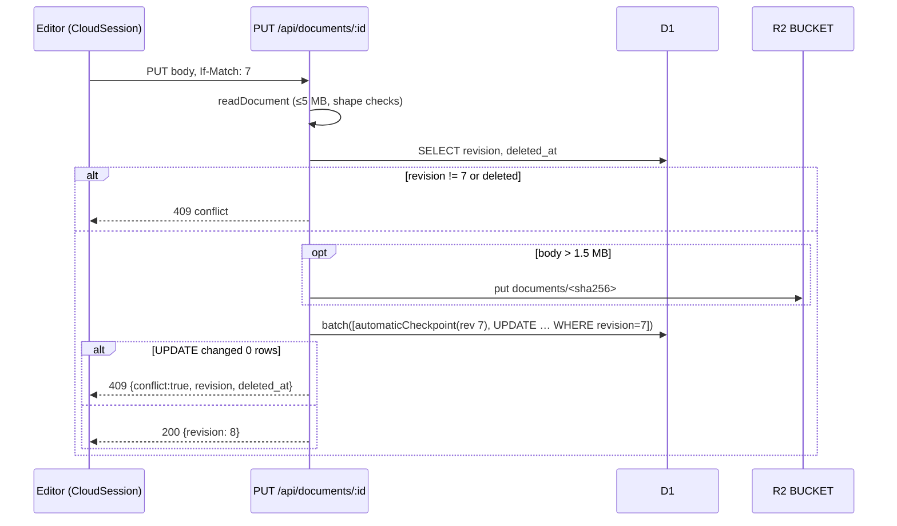

# Cloud API and Database

The Sites deployment exposes a small REST API for **personal cloud design files**: list, create, read, save, move to Trash, restore, plus named and automatic version history with restore. The routes in `app/api/documents/**` are thin wrappers; all behavior lives in host-neutral modules (`lib/documents.mjs`, `lib/document-versions.mjs`, `lib/document-bodies.mjs`, `lib/automatic-history.mjs`) that the self-hosted Node server also uses. Data is two D1 tables (`documents`, `document_versions`) managed by Drizzle migrations, with bodies over 1.5 MB stored once in R2 under a SHA-256 key. The most important thing to know: **every write is an optimistic compare-and-swap on `documents.revision` sent as `If-Match`**; a mismatch returns 409 and the client keeps the local copy rather than overwriting.

## At a glance

| Key files | Entry points | Depends on | Used by | Related docs |
| --- | --- | --- | --- | --- |
| [lib/documents.mjs](../../lib/documents.mjs), [lib/document-versions.mjs](../../lib/document-versions.mjs), [lib/document-bodies.mjs](../../lib/document-bodies.mjs), [lib/automatic-history.mjs](../../lib/automatic-history.mjs), [db/schema.ts](../../db/schema.ts), [drizzle/](https://github.com/ninefingerwoodshop-ops/pixlprfct/tree/main/drizzle), [web/cloud-session.js](../../web/cloud-session.js), [web/cloud-files.js](../../web/cloud-files.js), [web/cloud-history.js](../../web/cloud-history.js) | `app/api/documents/route.ts` and nested `[id]` routes; `cloudFiles()` in `web/app.js` | Cloudflare D1 (`env.DB`), R2 (`env.BUCKET`), Sites identity header `oai-authenticated-user-id` | Editor and project home on Sites; self-hosted server (`server/application.mjs`) | [README Hosting](../../README.md), [PROJECT_DELETION.md](../PROJECT_DELETION.md), [SELF_HOSTING.md](../SELF_HOSTING.md) |

## Responsibilities

- Validate and size-limit design JSON at the API boundary (`readDocument`).
- Resolve the owner from a trusted identity header (`requestUser`) and reject cross-origin writes (`checkOrigin`).
- Store bodies inline or in object storage, transparently (`storeBody`/`readBody`).
- Keep history: an automatic checkpoint of the previous state at most every 5 minutes, explicit named versions, and "Before restore" snapshots.
- Never hard-delete: Trash is `deleted_at`.
- On the client: debounce autosave, keep a recovery copy in browser storage, surface conflicts, and provide the Files and Version history dialogs.

## Routes (Sites)

Each `route.ts` imports `env` from `cloudflare:workers`, sets `dynamic='force-dynamic'`, and forwards `(request, env.DB, id, …, env.BUCKET)`.

| Route file | Methods | Calls |
| --- | --- | --- |
| [app/api/documents/route.ts](../../app/api/documents/route.ts) | `GET`, `POST` (`POST = GET`, same handler) | `documentApi(request, env.DB, null, env.BUCKET)` |
| [app/api/documents/[id]/route.ts](../../app/api/documents/%5Bid%5D/route.ts) | `GET`, `PUT`, `DELETE`, `PATCH` | `documentApi(request, env.DB, id, env.BUCKET)` |
| [app/api/documents/[id]/versions/route.ts](../../app/api/documents/%5Bid%5D/versions/route.ts) | `GET`, `POST` | `versionApi(request, env.DB, id, null, false, env.BUCKET)` |
| [app/api/documents/[id]/versions/[version]/route.ts](../../app/api/documents/%5Bid%5D/versions/%5Bversion%5D/route.ts) | `GET` | `versionApi(..., id, version, false, ...)` |
| [app/api/documents/[id]/versions/[version]/restore/route.ts](../../app/api/documents/%5Bid%5D/versions/%5Bversion%5D/restore/route.ts) | `POST` | `versionApi(..., id, version, true, ...)` |

### Behavior by request

| Request | Headers / body | Result |
| --- | --- | --- |
| `GET /api/documents?trash=1&search=…&before=…` | — | `{documents:[{id,name,revision,created_at,updated_at,deleted_at,created_by,can_delete}], next}`. 40 per page ordered by `updated_at DESC, id DESC`; `next` is a JSON cursor `[updated_at, id]` passed back as `before`. `search` (≤256 chars) is a case-insensitive substring match (`instr(lower(name),lower(?))`). `trash=1` lists only deleted files. |
| `POST /api/documents` | `content-type: application/json`, design JSON | Validates, stores body, inserts with `revision=1`, `created_by = actor.userId`. 201 with metadata (no body). |
| `GET /api/documents/:id` | — | Metadata plus resolved `body` (string). Trashed files are still readable (`deleted_at` set). |
| `PUT /api/documents/:id` | `If-Match: <revision>`, design JSON | 409 if revision differs or the file is in Trash. Otherwise one batch: `automaticCheckpoint(...)` then `UPDATE documents SET body,name,revision=revision+1,updated_at WHERE id,owner,revision AND deleted_at IS NULL`. Returns `{id,revision,updated_at,deleted_at:null}`. |
| `DELETE /api/documents/:id` | `If-Match` | Soft delete: sets `deleted_at`, bumps revision. Requires creator or `manage`. |
| `PATCH /api/documents/:id` | `If-Match` | Restore from Trash: clears `deleted_at`, bumps revision. Same permission as delete. |
| `GET /api/documents/:id/versions?before=…` | — | `{versions:[{id,label,name,revision,created_at,kind}], next}` (40 per page, cursor `[created_at,id]`). |
| `POST /api/documents/:id/versions` | `If-Match`, `x-version-label: <URI-encoded, 1–256 bytes>` | Copies the current row into `document_versions` (kind `named`) using `INSERT … SELECT … WHERE revision=?`. No body is accepted. 201 `{id,label,revision,created_at}`. |
| `GET /api/documents/:id/versions/:vid` | — | Version row with resolved `body`. |
| `POST /api/documents/:id/versions/:vid/restore` | `If-Match` | Batch: insert the current design as a version labeled `Before restore`, then overwrite `documents` with the version's `name`/`body` and bump revision. Returns the full restored file including `body`. |

### Errors

All errors are `{"error": "<message>"}` with `cache-control: no-store`.

| Status | Cause |
| --- | --- |
| 400 | Invalid JSON, invalid document shape, bad cursor, search too long, invalid version label |
| 401 | No `oai-authenticated-user-id` header ("Sign in to access cloud files.") |
| 403 | `Origin` differs from the request origin, `sec-fetch-site: cross-site`, or delete/restore by a non-creator |
| 404 | Malformed UUID, missing file/version, or file owned by someone else (ownership is part of every `WHERE`) |
| 405 | Unsupported method |
| 409 | Revision mismatch, file in Trash, concurrent change during restore. `PUT/DELETE/PATCH` conflicts include `{conflict:true, revision, deleted_at}` |
| 413 | Body over 5,000,000 bytes |
| 415 | Missing `content-type: application/json` |
| 428 | Missing or malformed `If-Match` |
| 503 | `env.DB` missing, or unexpected error ("Cloud storage is temporarily unavailable. Your local copy is still available.") — the error is logged with `console.error` |

## Document API (`lib/documents.mjs`)

Exports used across the repo:

| Export | Purpose |
| --- | --- |
| `DocumentError(status, message)` | Error class mapped to JSON responses by both hosts. |
| `requestUser(request)` | Returns `oai-authenticated-user-id` or throws 401. |
| `checkOrigin(request)` | For non-GET/HEAD: rejects a mismatched `Origin` or `sec-fetch-site: cross-site`. A missing `Origin` is allowed here (the self-hosted router adds a stricter check). |
| `readDocument(request)` | Streams the body with a 5 MB cap; strict UTF-8; requires `version` 1 or 2, `shapes` array ≤10,000, non-empty `name` ≤256 bytes; version 2 requires 1–100 `pages`. Returns `{body, name}`. |
| `expectedRevision(request)` | Parses `If-Match` (`"7"` or `7`) as a positive safe integer; 428 if absent. |
| `documentApi(request, db, id, bucket, guard, access)` | The handler. `guard` and `access` are only supplied by the self-hosted server. |

`access` defaults to `{userId: owner, manage: true}`. `can_delete` is `manage || created_by === userId`. On Sites every caller is the owner, so `can_delete` is always true. When `guard` is present (self-hosted libraries), PUT/DELETE/PATCH first load the previous body and call `guard({id, before, after, method})`; `access.fence` appends extra SQL conditions to every conditional write (see [Self-Hosted-Server](Self-Hosted-Server.md#write-fences)).

## Version history (`lib/document-versions.mjs`, `lib/automatic-history.mjs`)

Three kinds of entries land in `document_versions`:

| Entry | `label` | `kind` | Created by |
| --- | --- | --- | --- |
| Automatic backup | `Automatic backup` | `automatic` | `automaticCheckpoint()` inside every `PUT` (and every live-editing commit on self-hosted) |
| Named version | user-supplied | `named` | `POST /versions` |
| Pre-restore snapshot | `Before restore` | `named` (column default) | `POST /versions/:vid/restore` |

`automaticCheckpoint(db, {id, owner, revision, now, fence})` returns a prepared statement, not a promise, so it can be batched with the update:

```sql
INSERT INTO document_versions(id,document_id,owner,name,body,label,revision,created_at,kind)
SELECT ?,id,owner,name,body,'Automatic backup',revision,?,'automatic' FROM documents
WHERE id=? AND owner=? AND revision=? AND deleted_at IS NULL
AND NOT EXISTS(SELECT 1 FROM document_versions WHERE document_id=? AND owner=? AND kind='automatic' AND created_at>?)
```

with `created_at > now - HISTORY_INTERVAL` (`5*60*1000`). Because it runs before the `UPDATE` in the same batch, the checkpoint captures the **previously saved** state, at most once per 5 minutes per file. Versions copy the `body` column verbatim, so a version of a large design stores the same `@pixlprfct-r2:<hash>` pointer as the document and shares the R2 object.



## Body storage (`lib/document-bodies.mjs`)

| Function | Behavior |
| --- | --- |
| `storeBody(body, bucket)` | If the UTF-8 body is ≤1,500,000 bytes, returns it unchanged (stored inline in the row). Otherwise computes SHA-256, `bucket.put('documents/'+hash, bytes, {httpMetadata:{contentType:'application/json'}})`, and returns `'@pixlprfct-r2:'+hash`. Throws if no bucket. |
| `readBody(body, bucket)` | Returns inline bodies as-is. For the prefix, validates a 64-hex hash and returns `(await bucket.get('documents/'+hash)).text()`. |

The `BodyStore` interface is `{put(key, bytes, options?), get(key) → {text()} | null}`. On Sites it is the R2 binding; on the self-hosted server `server/database.mjs#databaseBodyStore` implements the same interface on the `document_bodies` table (keyed by the same hash, `INSERT OR IGNORE`-style).

Objects are immutable and content-addressed, so identical large bodies are stored once, and history can reference them without copying. Nothing ever deletes R2 objects or `document_bodies` rows.

## Database schema and migrations

[db/schema.ts](../../db/schema.ts) (Drizzle `sqlite-core`) defines:

| Table | Columns | Index |
| --- | --- | --- |
| `documents` | `id` text PK, `owner` text, `created_by` text nullable, `name` text, `body` text, `revision` int default 1, `created_at` int, `updated_at` int, `deleted_at` int nullable | `documents_owner_updated (owner, updated_at)` |
| `document_versions` | `id` text PK, `document_id`, `owner`, `name`, `body`, `label`, `revision` int, `created_at` int, `kind` text default `'named'` | `versions_document_created (document_id, created_at, id)` |

Timestamps are milliseconds since epoch (`Date.now()`). There are no foreign keys; `owner` is part of every query.

Migrations in [drizzle/](https://github.com/ninefingerwoodshop-ops/pixlprfct/tree/main/drizzle) (generated by `npm run db:generate` = `drizzle-kit generate`, config in [drizzle.config.ts](../../drizzle.config.ts): `schema: ./db/schema.ts`, `out: ./drizzle`, `dialect: sqlite`; journal in `drizzle/meta/_journal.json`):

| File | Adds |
| --- | --- |
| `0000_flaky_phalanx.sql` | `documents` table (without `created_by`) and `documents_owner_updated` index |
| `0001_round_ink.sql` | `document_versions` table (without `kind`) and `versions_document_created` index |
| `0002_lying_hemingway.sql` | `document_versions.kind text DEFAULT 'named' NOT NULL` (distinguishes automatic backups) |
| `0003_project_creators.sql` | `documents.created_by text`, backfilled with `owner` (on Sites the owner is the creator) |

Per the README, Sites applies these committed migrations before deployment. Tests apply them in order to an in-memory `node:sqlite` database through the D1 shim in [tests/cloud-db.mjs](../../tests/cloud-db.mjs) (`cloudDatabase()`), which is how `tests/cloud-documents.test.mjs`, `cloud-history.test.mjs`, `cloud-automatic.test.mjs` and `cloud-bodies.test.mjs` exercise the real handlers.

[db/index.ts](../../db/index.ts) exports `getDb()` (Drizzle over `env.DB`), but no API route uses it; the handlers use raw prepared statements so they can run unchanged against the self-hosted adapter. The self-hosted schema is created separately by `server/database.mjs#migrateDocuments` with the same columns plus more tables; the two must be kept in sync by hand.

### Adding a column

1. Edit `db/schema.ts`, run `npm run db:generate`, commit the new `drizzle/000N_*.sql` and snapshot.
2. Add the equivalent guarded `ALTER TABLE ... ADD COLUMN` to `migrateDocuments` in `server/database.mjs` (it checks existing columns per engine).
3. Update `meta` in `lib/documents.mjs` (the column list returned by list/read) if clients need the field.
4. Extend `tests/cloud-*.test.mjs`; the shim picks up new SQL files automatically.

## Client side

### `web/cloud-session.js`

`cloudRequest(path, options)` calls `/api/documents<path>`, appends `?workspace=` from the page URL if present (self-hosted), sets a 20 s timeout and JSON content type, and throws `Error` with `.status` and `.data` on non-2xx. A non-JSON response becomes "Cloud files are unavailable on this server."

`CloudSession` tracks one active cloud file:

| Field / method | Meaning |
| --- | --- |
| `active` | `{id, revision}` of the open cloud file, or `null` for a local file |
| `ack` | The snapshot string last acknowledged by the server |
| `changed()` | Called after edits: stores a recovery copy, then debounces `flush()` by `delay` (900 ms) |
| `flush()` | Loops `PUT /:id` with `If-Match` until `snapshot() === ack`; updates `active.revision`. On error stores `error`; a 409 blocks further automatic saves ("Cloud conflict — open Files") |
| `remember()` | Writes `{id, revision, body, clean}` to recovery storage under `pixlprfct.cloud.session` |
| `adopt(meta, ack)` / `detach()` | Switch to a cloud file / back to a local file |
| Hooks | `save`, `receive`, `equal`, `writeHeaders`, `beforeWrite` — overridden by team collaboration to add lease headers, route saves through live editing, and block writes without a lease |

### `web/cloud-files.js`

`cloudFiles({snapshot, load, status, toast, backupLocal, openLocal, recoveryOwner})` builds the **Your files** dialog and returns the API used by `web/app.js`: `{session, reloadLatest, saveCurrent, authorize, open, history, changed, beforeLocalOpen, localOpened, restore}`.

- Actions: **New cloud file**, **Save current as a cloud file**, **Save / retry**, **Version history**, **Open latest cloud version** (stores the current snapshot in `localStorage['pixlprfct.conflict-copy']` first), **Recover previous local edits**, **Recover local draft**, **Show Trash**, search, pagination, per-row **Open / Move to Trash / Restore** (shown only when `can_delete === true`).
- Recovery storage (`web/recovery-store.js`) uses `sessionStorage` and `localStorage`; keys are suffixed with `recoveryOwner:workspace` when not personal, so self-hosted accounts and workspaces do not collide.
- `restore(expectedId)` reopens the last session from recovery storage at startup; if the copy was clean it refetches the server version in the background and detects Trash.
- Opening an SVG-animation document redirects to the animator URL (`isSvgAnimation`).
- Event hooks: flush on `online` and when the page becomes hidden; `beforeunload` warns if dirty.
- On the static host the trigger is hidden; in desktop local mode it calls `pixlDesktop.connect()`.

### `web/cloud-history.js`

`openCloudHistory({session, useFile, closeFiles, toast})` renders the **Version history** dialog: list (paged), **Save version** (flush, then `POST /versions` with `x-version-label`), **Open copy** (fetch the version and `POST` it as a new cloud file), **Restore version** (flush, then `POST …/restore` with the session's write headers and `If-Match`). Each action rechecks that the active file has not changed.

## Connectors

"Connectors" here are **not** design-tool integrations. They are vendored scaffolding from the Sites starter template for server-side "connected apps": a request-scoped capability the hosting platform passes into the Worker as `ctx.props.CONNECTORS`, letting a Site's server routes call actions on apps the visitor has connected.

| File | Role |
| --- | --- |
| [lib/connector-contract.mts](../../lib/connector-contract.mts) | Types (`ConnectorBinding`, `ConnectorResult`, `ConnectorContext`, `ConnectorFailureStatus`) and `createConnectors(binding)` with `getContext()` and `invoke(connectorId, actionName, args)`. Throws if called in a browser. A transport failure returns `upstream_error` ("The action may have completed; check before trying again.") and is never retried. |
| [lib/connector-context.ts](../../lib/connector-context.ts) | `AsyncLocalStorage` holder: `runWithConnectorBinding`, `getConnectorBinding`. |
| [lib/connectors.ts](../../lib/connectors.ts) | `connectorsForRequest()` for server routes. |
| [lib/connector-errors.mts](../../lib/connector-errors.mts) | `connectorResponse(result)` validates a result with zod and projects it to a public JSON response (502 if unconfirmed); `connectorErrorRecovery()` adds a reconnect link for `reauthentication_required`. |
| [lib/connector-preview.d.ts](../../lib/connector-preview.d.ts) | Types for `virtual:sites-connector-preview` and `Env.CONNECTORS`. |
| [components/connector-error.tsx](../../components/connector-error.tsx) | Presentational error component. |
| [worker/index.ts](../../worker/index.ts) | Wraps every request in `runWithConnectorBinding(ctx.props?.CONNECTORS, …)`; in dev, uses `env.CONNECTORS` with a 60 s expiry. |
| [scripts/vite/connector-preview-plugin.mjs](../../scripts/vite/connector-preview-plugin.mjs), [scripts/connector-preview/](https://github.com/ninefingerwoodshop-ops/pixlprfct/tree/main/scripts/connector-preview) | Dev-only preview: the Vite plugin exposes `/__sites_connector_preview/invoke` and `/context` and relays through files in `.sites-runtime/connector-preview/`; `connector-preview-session.mjs <site-dir> <grants.json>` is started by a coding agent, checks each call against read-only grants (`protocol.mjs`, `host-binding.mjs`) and asks the agent over stdio JSON-RPC to perform it; `worker.mjs` is the auxiliary `ConnectorPreview` `WorkerEntrypoint` wired in `vite.config.ts` only for `serve`. |

No PixlPrfct route calls `connectorsForRequest()`. The connector code is inert infrastructure that ships with the Worker entry point; it can be ignored when working on design features.

## Invariants and gotchas

- **Ownership is in every `WHERE`.** A file owned by another user is a 404, never a 403, so IDs do not leak.
- **Revision is the only concurrency control.** The server never merges in the personal-file path. Clients must send the revision they last saw; the self-hosted live-editing path is the only place that merges ([Teams-Libraries-and-Collaboration](Teams-Libraries-and-Collaboration.md)).
- **D1 `batch()` ignores the `{requireLastChange:true}` option** the handlers pass (that option is implemented only by the self-hosted adapter). The handlers therefore also check `meta.changes` of the update explicitly. The checkpoint and update share the same `revision` condition, so a lost race inserts no checkpoint either.
- **Trash is reversible only.** There is no permanent delete endpoint ([PROJECT_DELETION.md](../PROJECT_DELETION.md)).
- **5 MB limit** applies to the JSON body; bodies above 1.5 MB require an R2 binding or the request fails with 503.
- **`can_delete` is computed on read**; the UI uses it to decide which actions to show, but the server rechecks on `DELETE`/`PATCH`.

## Known limitations

- Personal files only on Sites; no sharing, roles or libraries API (README "Current limits").
- No garbage collection of R2 objects or old versions; history grows without bound.
- List search is a substring scan within the owner's rows; there is no full-text index.
- No migration tool from D1 to the self-hosted database (SELF_HOSTING.md).

## Related pages

- [Hosting-Modes](Hosting-Modes.md)
- [Self-Hosted-Server](Self-Hosted-Server.md)
- [Teams-Libraries-and-Collaboration](Teams-Libraries-and-Collaboration.md)
- [Document-Model-and-File-Format](Document-Model-and-File-Format.md)
- [Web-Editor-Architecture](Web-Editor-Architecture.md)
- [Testing-and-Verification](Testing-and-Verification.md)

## Source of truth

- [app/api/documents/](https://github.com/ninefingerwoodshop-ops/pixlprfct/tree/main/app/api/documents), [worker/index.ts](../../worker/index.ts), [.openai/hosting.json](../../.openai/hosting.json)
- [lib/documents.mjs](../../lib/documents.mjs), [lib/document-versions.mjs](../../lib/document-versions.mjs), [lib/document-bodies.mjs](../../lib/document-bodies.mjs), [lib/automatic-history.mjs](../../lib/automatic-history.mjs)
- [db/schema.ts](../../db/schema.ts), [db/index.ts](../../db/index.ts), [drizzle/](https://github.com/ninefingerwoodshop-ops/pixlprfct/tree/main/drizzle), [drizzle.config.ts](../../drizzle.config.ts)
- [web/cloud-session.js](../../web/cloud-session.js), [web/cloud-files.js](../../web/cloud-files.js), [web/cloud-history.js](../../web/cloud-history.js), [web/recovery-store.js](../../web/recovery-store.js)
- `lib/connector-*`, [lib/connectors.ts](../../lib/connectors.ts), [scripts/connector-preview/](https://github.com/ninefingerwoodshop-ops/pixlprfct/tree/main/scripts/connector-preview)
- Tests: `tests/cloud-db.mjs`, `tests/cloud-documents.test.mjs`, `tests/cloud-history.test.mjs`, `tests/cloud-automatic.test.mjs`, `tests/cloud-bodies.test.mjs`, `tests/cloud-session.test.mjs`
- Docs: [README](../../README.md) (Hosting), [PROJECT_DELETION.md](../PROJECT_DELETION.md)
