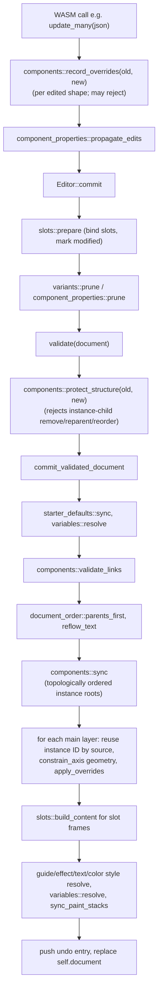

# Components, Variants and Slots

PixlPrfct components are ordinary frames tagged as a **main** (`Component::Master`) whose linked **instances** are full copies of the main's subtree, rebuilt by the Rust engine on every commit. Each instance layer records which main layer it mirrors (`source`) and a list of string **override paths**; everything not listed is re-copied from the main. Variant sets, component properties and slots are document-level definitions (`component_sets`, `component_properties`) layered on top of that one link model. The single most important thing to know: `components::sync` in [src/components.rs](../../src/components.rs) regenerates every instance subtree inside `commit_validated_document`, so any engine change that touches shapes must keep `source` links, override paths and stable instance IDs coherent, or the next commit will silently discard data.

## At a glance

| Key files | Entry points | Depends on | Used by | Related docs |
|---|---|---|---|---|
| [src/components.rs](../../src/components.rs), [src/variants.rs](../../src/variants.rs), [src/component_properties.rs](../../src/component_properties.rs), [src/slots.rs](../../src/slots.rs); [web/variants.js](../../web/variants.js), [web/component-properties.js](../../web/component-properties.js), [web/slots.js](../../web/slots.js), [web/instance-context.js](../../web/instance-context.js), [web/assets.js](../../web/assets.js), [web/asset-drag.js](../../web/asset-drag.js), [web/component-sort.js](../../web/component-sort.js) | WASM methods `create_component`, `create_component_selection`, `create_instance`, `place_instance`, `swap_instance`, `detach_instance`, `reset_override`, `reset_instance`, `push_style_overrides`, `combine_variants`, `add_variant`, `save_component_set`, `set_variant_property`, `save_component_property`, `set_component_property`, `wrap_in_slot`, `clear_slot`, `reset_slot`, `sort_components` | `Editor::commit` pipeline in [src/lib.rs](../../src/lib.rs), layout `constrain_axis`, style/variable resolvers | Inspector component panel in [web/app.js](../../web/app.js), Assets browser, libraries ([web/library-model.js](../../web/library-model.js)), MCP/agent API ([web/editor-api.js](../../web/editor-api.js)), design-file import | [README](../../README.md) "Create components from a selection", "Nested linked components"; [Interface reference log](../FIGMA_UI_REFERENCE.md) "Components and variants", "Component slots"; [TEAM_LIBRARIES.md](../TEAM_LIBRARIES.md) |

## User-visible behavior (brief)

- **Create component** (Ctrl/Cmd+Alt+K, inspector, context menu, Tools search). A selected ordinary frame converts in place; any other selection is wrapped in a transparent frame that becomes the main.
- **Instances** are inserted from the **Assets** rail (click, or drag a preview onto the canvas). Instances render the main's artwork; their children cannot be restyled, moved, reordered, added or deleted unless the instance is detached. Content and state (text, name, visibility, lock, control state) can be overridden.
- **Instance panel**: override list with per-row **Reset**, **Reset all overrides**, **Detach instance**, **Go to main component**, **Swap component** (dropdown), **Push text and styles to main**. Selecting a nested child adds **Go to nested main component** and **Select outer instance**; swap/variant pickers are disabled on non-root children with the help text "Independent nested-instance swapping is not available yet."
- **Variants**: **Combine as variants** (sibling mains) or **Add variant** creates a visible component-set frame. The set shows a **Properties** list; a main inside a set shows **Current variant**; an instance shows one dropdown per property.
- **Component properties**: Text and Visibility (boolean) properties bind one or more layers in a main; instances expose them as fields with Reset.
- **Slots**: a nested frame in a main becomes a slot (Properties → + → Slot, or **Wrap in slot**). In instances, slot frames accept arbitrary content, show Default/Modified status, Add instances, Reset slot and Delete contents. Empty slots show a "+" canvas overlay.
- **Component order** in the Assets/Components list is drag-sortable (or Alt+↑/↓) and saved in the document.

## Data model

All component state lives on `Shape` and `Document` in [src/lib.rs](../../src/lib.rs) and is serialized into `.pixl` files.

| Where | Field | Meaning |
|---|---|---|
| `Shape.component` | `Option<components::Component>` | `None`, `{"type":"master"}`, or `{"type":"instance","master":u32,"source":u32,"overrides":[String]}` |
| `Shape.slot` | `Option<slots::SlotState>` | `{property, modified}`; derived from slot property bindings, never trusted from the client (`slots::bind`) |
| `Shape.slot_origin` | `u32` | For default slot content in an instance, the main-side layer it was copied from (stable ID reuse) |
| `Document.component_sets` | `Vec<variants::ComponentSet>` | `{id, frame_id, name, properties[≤16], variants[{component_id, values[]}]}` |
| `Document.component_properties` | `Vec<component_properties::ComponentProperty>` | `{id, component_id, name, kind: "text"|"boolean"|"slot", targets[], slot_settings?}` |
| `Document.component_order` | `Vec<String>` | Keys `"set:<id>"` / `"component:<id>"` for the Assets ordering (validated in `validate` and `Editor::sort_components`) |

**Instance roots vs descendants.** An instance *root* has `master == source` (both equal the main's ID). A *descendant* has `master` = the same main and `source` = the ID of the corresponding layer inside the main's subtree. A nested instance inside a main is itself a root of a different master; when it is copied into an outer instance, its copies become descendants of the *outer* master whose `source` points at the nested instance layers inside the outer main. [web/instance-context.js](../../web/instance-context.js) `instanceContext(doc, shape)` walks this: it returns `{root, main, nestedMain, isRoot}` where `root` is the outermost instance root and `nestedMain` is found by following `source → source.component.master` chains.

## How it works: main → instance propagation

Every mutating WASM method builds a cloned `Document` and calls `Editor::commit` (or `commit_document`, which skips the pre-checks). The relevant stages:

### `components::sync`

`sync(doc, next)` (called from `commit_validated_document`, and also when loading documents) does:

1. **Native button labels.** For main components whose `control.kind == "button"` (non-starter), the first visible text descendant is copied into `control.label` and `typography` so it propagates as the native label.
2. **Dependency ordering.** Collects every instance root, computes which other roots live inside its main's subtree, and resolves them in dependency order. A cycle returns `"Component reference cycle: an instance cannot contain itself"`. This is why nested instances update correctly regardless of document paint order (tested in `nested-components.test.mjs`).
3. **Orphan handling.** If the master no longer exists or is no longer a `Master`, the instance's links are cleared (the layers become ordinary artwork). Deleting a main therefore "detaches" all its instances at the next commit rather than deleting them.
4. **Rebuild.** For each layer in the main's subtree (excluding slot contents):
   - The existing instance layer is found by `component.source == src.id`; its ID is reused, otherwise a fresh ID is allocated from `next`. Stable IDs are what let overrides, selection and prototype targets survive main edits.
   - The shape is cloned from the main, then the instance-owned fields are restored: `flow_name`, `layout_class`, `layout_class_generated`, `breakpoint_original`, and every path in `overrides` via `apply_overrides`.
   - Root position comes from the instance root; descendants are positioned with `constrain_axis` relative to the main parent vs the instance parent, honoring the child's (possibly overridden) constraints. Groups pass through with `Constraint::Scale` unless the group itself has a geometry override. `x`/`y` overrides on descendants preserve the old offset from the parent.
   - Slot frames get `slot.modified` carried over and their children built by `slots::build_content`.
5. The old subtree is spliced out and the rebuilt one spliced in at the same index. The document cap is 10,000 layers.

### Override recording (`record_overrides`)

`components::record_overrides(old, new)` runs inside `update_many` (and path join/split, property propagation, swap transfer). It:

1. **Detaches styles when values diverge**: edited typography clears `text_style`, edited fill/stroke paints clear `fill_style`/`stroke_style`, edited `layout_grids` clears `guide_style`, edited effects clear `effect_style`; `variables::detach_edited` removes variable bindings for directly edited properties. This applies to all layers, not only instances.
2. **Rejects slot or link edits** made through plain updates ("Use the slot actions…", "Use the component actions…").
3. **Enforces instance protection.** For instance layers, each changed top-level field (compared via `effective_value`, which normalizes absent `appearance`/`typography` to defaults so legacy documents compare correctly) is checked:
   - Always allowed: `name`, `text`, `hidden`, `locked`, `control_state`.
   - Root only: `x`, `y`, `width`; `layout_item` changes limited to `fill_width`/`min_width`/`max_width`/`grid_cell`; `auto_layout` changes limited to `hug_width`.
   - `control`: only content keys (`label`, `value`, `placeholder`, `helper_message`, `validation_message`, `invalid`, `selected_values`, `width_sizing`, `hide_helper`; plus `name` for radios).
   - Slot frames inside instances may additionally change `fill`, `appearance`, `stroke_width`, `effect_style`, `fill_style`, `stroke_style`, `variable_bindings`.
   - Anything else errors with `"Instance appearance is protected. Edit the main component instead."` Kind changes, or reparenting a descendant, error with "Detach the instance before changing its structure".
4. **Computes the override list.** For fields with a sub-field table (`subfields()`: `control`, `typography`, `appearance`, `constraints`, `layout_item`, `auto_layout`) it records per-property paths such as `typography.font_size`; other fields are recorded whole (`text`, `hidden`…). Paired fields are always recorded together: `layout_grids` + `guide_style`, and `prototype` + `additional_interactions`.

`validate_links` caps overrides at 64 per layer, requires uniqueness, and only accepts paths listed in `FIELDS`/`subfields()` (`valid_override`).

> **Note:** The README ("Nested linked components") describes "independent inner and outer appearance/text overrides" and says Push to main includes "paints/effects". The current code rejects appearance edits on instance layers (only slot frames are exempt), so in practice new overrides are content/state/geometry. Appearance override paths are still accepted when loading and pushing, which covers legacy documents (`component-swapping.test.mjs`: "legacy whole-style overrides survive").

### Structural protection (`protect_structure`, `validate_links`)

- `protect_structure(old, new)` (in `commit`) rejects removing, reparenting or reordering instance descendants (`"Detach the instance before removing/changing/reordering…"`). It skips the check when the main's own subtree structure changed in the same transaction (staged operations), when the outer root was detached, or for roots (whole instances can move, duplicate, delete and reorder freely).
- `validate_links` enforces: mains and instance roots must be frames; a descendant's parent must be an instance of the same master; no duplicate `source` within one root; ordinary (unlinked) layers may only sit under an instance if their parent is a **slot**; **main components cannot be nested** inside other mains or inside instances ("Nested main components are not supported; nest linked instances inside main components instead").

## Override model operations

| Operation | Function | Behavior |
|---|---|---|
| Per-property reset | `Editor::reset_override(id, path)` | Removes `path` and any `path.*` children (plus its pair partner). If the path is bound to a component property on that layer's source, delegates to `reset_component_property`. The next `sync` re-copies the main value. |
| Reset all | `Editor::reset_instance(id)` | Walks to `instance_root`, clears `overrides` on every layer in the subtree and sets `slot.modified = false`. Uses `commit_document`. |
| Detach | `Editor::detach_instance(id)` | Clears `component` and `slot` on subtree layers linked to the root's master (nested instances of other masters stay linked), then `restore_detached_button_labels` materializes a real text layer for native button labels. |
| Push to main | `Editor::push_style_overrides(id)` | For every layer under the root, takes override paths whose top-level field is in the eligible list (`name, text, fill, appearance, typography, hidden, locked, image, stroke_width, layout_grids, guide_style, effect_style, text_style, fill_style, stroke_style`), applies them to the `source` layer in the main via `apply_overrides`, runs `record_overrides` on that source (so if the source is itself a nested instance the value becomes an override there and the inner main is untouched), and removes the pushed paths from the instance. Geometry, constraints, auto layout and prototype overrides stay local. |

The inspector's override list ([web/app.js](../../web/app.js) `renderComponentProperties`) merges `additional_interactions` into `prototype`, hides `x`/`y` on roots, and maps paths to labels (e.g. `stroke_alignment` → "Stroke position").

## Swap component

`Editor::swap_instance(id, master)` (only from the instance root; the UI disables it for nested children):

1. Builds a source-ID mapping old main → new main with `match_children`: children are matched **by layer name and kind, recursively by hierarchy**; repeated sibling names match by occurrence in paint order. Instance-side renames do not affect matching because matching uses main-side names.
2. Slot properties with the **same name** on both mains map their target frames pairwise, so customized slot content survives swaps (and variant switches) even when the slot frames have different names.
3. Matched instance layers keep their IDs and override lists with `source` remapped; unmatched layers are dropped. Children of `modified` slots are carried over.
4. Runs `sync` to fill in the new main's remaining layers, then `component_properties::transfer_on_swap`: a text/boolean property that was overridden on the old instance is re-applied to the new main's property with the same name and kind, regardless of layer names.
5. Commits once with `commit_document` (one undo step).

## Nested instances

Linked instances may live inside a main (README "Nested linked components"). The engine handles them as ordinary instance roots that `sync` resolves before any outer root that depends on them. In outer instances, nested copies are descendants of the outer master. Consequences:

- Inner-main edits flow inner main → nested instance in outer main → outer instances, in one commit.
- An override on a nested copy is an outer-instance override; push to main writes it onto the nested source as an override, not into the inner main (`push-overrides.test.mjs`).
- Swapping the nested source inside the main propagates; deleting the inner main leaves the outer artwork as unlinked layers.
- Exposed instance-swap properties and independent swapping of nested instances in outer copies are not implemented.

## Variant sets

**Rust** ([src/variants.rs](../../src/variants.rs)):

- `ComponentSet` groups mains. `frame_id` (optional, 0 for legacy sets) is the visible container: an ordinary frame whose direct children are the variant mains. `validate_sets` enforces ≤1000 sets, 1–16 unique property names, ≤1000 variants, each variant a main in exactly one set, unique value combinations, and membership inside the container.
- `prune` (in `commit`) drops variants whose main was deleted or moved out of the frame, clears a deleted container, deletes empty sets, and keeps `set.name` equal to the container frame's name.
- `combine_variants(json)` requires ≥2 sibling mains not already in a set. Naming is inferred: `Property=Value, Other=Value` names become multiple properties (`named_properties`); `Button / Primary` style names with a shared prefix produce set name `Button` and values `Primary`; identical names produce `Default`, `Variant 2`… The mains are wrapped (`frame_selection`, padded 20px).
- `add_variant(id)` accepts a main, a set member, or a set frame; creates a set (`Property 1 = Default`) for a standalone main, upgrades legacy sibling sets to a visible container, then `duplicate_variant`.
- `duplicate_variant(id)` duplicates the main subtree, places it below the existing members (inside a frame) or to the right, picks the next free `Variant N` value for the last property, and grows the container.
- `save_component_set(json)` is the general authoring call (rename set/properties/values, add/remove properties). It trims values, validates before pruning, auto-creates a container for sibling sets (including sets authored directly through MCP), and renames every main to `Prop=Value, …` via `variant_name`.
- `set_variant_property(id, property, value)`: on a main, edits its value in the set; on an instance, picks the variant with that value that keeps the most other property values (ties by set order) and calls `swap_instance`. Sparse sets are therefore supported.
- `duplicate_definitions(doc, mapping)` clones a whole set when its container (or every legacy member) is duplicated; a single copied main stays standalone.

**JS** ([web/variants.js](../../web/variants.js)): `componentSet`, `componentSetFrame`, `canCombineVariants` (selection predicate), `renderVariantProperties` (instance dropdowns calling `set_variant_property`) and `renderVariantAuthoring` (set "Properties" rows with inline rename and remove; main "Current variant" rows with value field + chooser; the **Create property → Variant** 304px popover). All edits clone the set and call `save_component_set`. Plain `<select>` elements are upgraded to the shared custom dropdown by `installInspectorDropdowns` ([web/inspector-dropdown.js](../../web/inspector-dropdown.js)).

## Component properties

**Rust** ([src/component_properties.rs](../../src/component_properties.rs)):

- Kinds: `text` (binds `Shape.text` on text layers), `boolean` (binds visibility; `true` means visible, stored as `!hidden`), `slot` (see below). `field(p)` returns the override path the property owns: `"text"` or `"hidden"`.
- `validate_properties`: ≤10,000 properties; unique `(component_id, name)`; targets inside the main; text properties only on text layers; one property of a given kind per layer; non-slot properties need ≥1 target; properties cannot bind layers inside slot contents.
- `save_component_property(json)` creates/updates a definition and immediately assigns the first target's current value to every target (bound layers share one value). Slot properties call `slots::bind` instead.
- `set_component_property(id, property, json)` resolves bound layers for the main or the instance root (`targets()` maps main targets to instance layers via `source`) and routes the change through `update_many`, so it records normal overrides.
- `propagate_edits` (inside `update_many`): editing one bound layer directly (e.g. typing in a text layer) copies the value to every other bound layer under the same root; conflicting values in one edit error with "Bound component layers must share the same property value".
- `reset_component_property` removes the property's override path (and slot `modified`) on the bound instance layers.
- `prune` removes targets that left the main and preferred instances that are no longer mains; `duplicate_definitions` remaps definitions when mains are duplicated.

**JS** ([web/component-properties.js](../../web/component-properties.js)): `renderComponentProperties` renders a textarea/checkbox per property (mixed values show "Mixed values"/indeterminate), with **Reset** on instances and **Edit binding**/**Remove** on mains; `editComponentProperty` opens the modal binding dialog (Text/Visibility, layer checklist excluding layers already bound to that kind). Slot properties are delegated to `slots.js`.

## Slots

**Rust** ([src/slots.rs](../../src/slots.rs)):

- A slot is a `ComponentProperty` with `kind: "slot"` whose `targets` are nested frames in the main (not the main itself, not instances, not inside another slot: "Nest a separate component instance to use a slot inside another slot"). Slot properties may be unbound (zero targets).
- `SlotSettings`: `description`, `min_children`, `max_children`, `preferred_instances`, `only_preferred_instances`, `display_empty`, `fill_counter_axis`.
- `bind(doc)` sets `Shape.slot` on mains/ordinary layers from the property bindings. `prepare(old, doc)` (start of `commit`) marks an instance slot `modified` when its content differs from the previous commit, and sets `fill_width`/`fill_height` on **newly added** children of auto-layout slots with `fill_counter_axis`.
- `build_content` (from `sync`): a `modified` slot keeps the instance's own children (translated if the slot moved); an unmodified slot clones the main's default children, reusing IDs via `slot_origin`, and preserves their CSS identity.
- `clear_slot(id)` deletes content and marks the instance slot modified; `reset_slot(id)` clears `modified` so defaults return; `wrap_in_slot(json, name)` frames sibling layers inside a main (or reuses a single selected frame) and creates the slot property in one undo step.
- `validate_links` allows unlinked layers under an instance only when their parent is a slot; `record_overrides` lets slot frames change paint/effects.

**JS** ([web/slots.js](../../web/slots.js)): `slotProperty`, `slotOwner`, `slotWarnings`, `renderSlotProperty` (Default/Modified chip, add, reset/delete menu, "Limits" warning), `editSlotProperty` (settings dialog), `slotInstancePicker` (Add instances picker with library source dropdown, page folders, list/grid, live thumbnails via `assetAppearance`), `renderSlotOverlay` (empty-slot "+" targets positioned from pan/zoom).

> **Note:** Slot limits and "only preferred instances" are **advisory**. `slotWarnings` reports them in the UI; the engine does not enforce them (`slots.test.mjs`: "slot limits warn without blocking content").

## Assets panel, placement and sorting

| File | Role |
|---|---|
| [web/assets.js](../../web/assets.js) | `componentAssets(doc, query, page)` builds one asset per variant set plus each ungrouped main, searchable by name, page names and `Prop: value` labels. `assetAppearance` renders a live preview through `compileCssScene` (CSS renderer) with inherited variable modes. `renderAssets` renders cards in batches of 40 with a variant selector, Insert/Go to main menu and a "Protected" note for library mains. |
| [web/asset-drag.js](../../web/asset-drag.js) | `ASSET_MIME = 'application/x-pixlprfct-component'`; drag payload `{token, master}`. The per-session `assetDragToken` (`crypto.randomUUID()` in app.js) means drags from another tab/editor are ignored. `centeredPlacement` centers the main on the pointer. |
| [web/component-sort.js](../../web/component-sort.js) | `componentEntries` (sets + ungrouped mains ordered by `component_order`), `moveComponent`, `renderSortableComponents` (drag/drop with before/after indicator, Alt+↑/↓, live-region announcements). Persists via `Editor::sort_components`, which requires every key exactly once. |
| [web/instance-context.js](../../web/instance-context.js) | `instanceContext` (see Data model). |

Drop handling in app.js calls `editor.place_instance(master, x, y, parent)`, which stages `create_instance` + `move_into` so auto-layout parents insert in flow order and grids pin the pointed cell, in one undo step. `create_instance` only clones the root; `sync` populates children during commit.

Library-sourced mains are protected by JS policy in [web/library-model.js](../../web/library-model.js) (`instancePermissions`, `protectedInstanceError`, driven by `editor_meta.library_overrides`); see [Teams-Libraries-and-Collaboration](Teams-Libraries-and-Collaboration.md).

## Extension guide

**Allow a new instance override field.** Add the field to `FIELDS` (or a sub-key to `subfields()`) in `components.rs`; decide in `record_overrides` whether instances may change it (the `allowed` match); if it should be pushable, add it to the `push_style_overrides` list and the UI `pushFields` in app.js; add a label in the override list in app.js; add a test to `components.test.mjs`/`component-swapping.test.mjs`. If the field is an object with optional serialization, extend `effective_value` so legacy `None` compares equal to defaults.

**Add a component property kind.** Extend `validate_properties` (allowed kinds), `field`, `value`, `assign`; render it in `renderComponentProperties`/`editComponentProperty`; consider `transfer_on_swap` and `reset_override` delegation.

**Add a new structural operation on mains.** Build a staged `Editor` (pattern used by `place_instance`, `combine_variants`, `wrap_in_slot`) and commit once so undo is one step; if the operation edits instance structure on purpose, use `commit_document` (skips `protect_structure`) as `swap_instance`/`reset_instance` do.

After changing any WASM signature, rebuild with `npm run build:editor` so [web/editor-api.js](../../web/editor-api.js) is regenerated (see [Build-System](Build-System.md)).

## Invariants and gotchas

- Instance subtrees are **derived data**. Writing to an instance child outside the allowed fields fails; writing allowed fields without the recorded override path would be undone by the next `sync`. Always go through `update`/`update_many` so `record_overrides` runs.
- `source` uniqueness per root and ID reuse by `source` are what keep selection, prototype targets and overrides stable across main edits. Do not regenerate instance IDs.
- Deleting a main does not delete instances; `sync` unlinks them.
- `protect_structure` runs only in `commit`, not `commit_document`.
- `reset_component_property` for a slot property also strips any `"hidden"` override on the slot frame, because `field()` returns `"hidden"` for every non-text kind.
- The UI's `pushFields` list omits `text_style`, `fill_style` and `stroke_style`, which Rust does push; the button can be disabled when only those overrides exist.
- `set.name` is overwritten by the container frame name on every `prune`; rename sets via the frame or `save_component_set`.

## Known limitations

From code and README: no nested main definitions; no independent nested-instance swap in outer copies; no exposed instance-swap properties; no variable-driven component properties; slot limits are advisory; slot descriptions are plain text; native design-archive slot metadata is not preserved on `.fig` import (interface reference log "Component slots"); real-time multiplayer is out of scope here.

## Tests

| Test file | Covers |
|---|---|
| `tests/components.test.mjs` | Propagation across pages, text overrides, protected paint, stable IDs, constraints, auto layout, malformed links, drag of roots |
| `tests/component-selection.test.mjs` | Create component from shapes/multi-selection/frames |
| `tests/component-swapping.test.mjs` | Swap matching rules, repeated names, groups, legacy overrides, protected constraints |
| `tests/nested-components.test.mjs` | Three-level propagation, independent overrides, cycles, inner-main deletion |
| `tests/push-overrides.test.mjs` | Push to main, nested source overrides, no-op cases |
| `tests/component-properties.test.mjs` | Text/visibility bindings, reset, swap transfer, duplication, pruning |
| `tests/variants.test.mjs` | Combine, add, duplicate, sparse selection, naming, legacy upgrade |
| `tests/slots.test.mjs` | Defaults vs customization, clear/reset, libraries, copy/paste, swaps, limits |
| `tests/component-sort.test.mjs`, `tests/assets.test.mjs`, `tests/asset-placement.test.mjs`, `tests/instance-context.test.mjs` | Ordering, asset grouping/search/previews, drag placement, nested context |
| `tests/library-overrides.test.mjs`, `tests/browser/library-overrides.spec.mjs` | Library-protected instances |

Run with `npm test` (requires a built `web/pkg`).

## Related pages

[Rust-Document-Engine](Rust-Document-Engine.md) · [Document-Model-and-File-Format](Document-Model-and-File-Format.md) · [Styles-Variables-and-Paints](Styles-Variables-and-Paints.md) · [Prototyping-Behaviors-and-Controls](Prototyping-Behaviors-and-Controls.md) · [Layout-Auto-Layout-and-Grid](Layout-Auto-Layout-and-Grid.md) · [Teams-Libraries-and-Collaboration](Teams-Libraries-and-Collaboration.md) · [Import-Design-Files](Import-Design-Files.md) · [Testing-and-Verification](Testing-and-Verification.md) · [Glossary](Glossary.md)

## Source of truth

- [src/components.rs](../../src/components.rs) — `Component`, `FIELDS`, `subfields`, `record_overrides`, `protect_structure`, `validate_links`, `sync`, instance WASM methods
- [src/variants.rs](../../src/variants.rs), [src/component_properties.rs](../../src/component_properties.rs), [src/slots.rs](../../src/slots.rs)
- [src/lib.rs](../../src/lib.rs) — `Editor::commit`, `commit_validated_document`, `update_many`, `sort_components`
- [web/app.js](../../web/app.js) `renderComponentProperties`, asset drop handling; the JS modules listed above
- [README](../../README.md) sections "Create components from a selection" and "Nested linked components"; [Interface reference log](../FIGMA_UI_REFERENCE.md) "Components and variants — live reference 2026-10-29" and "Component slots — live reference 2026-10-30"
