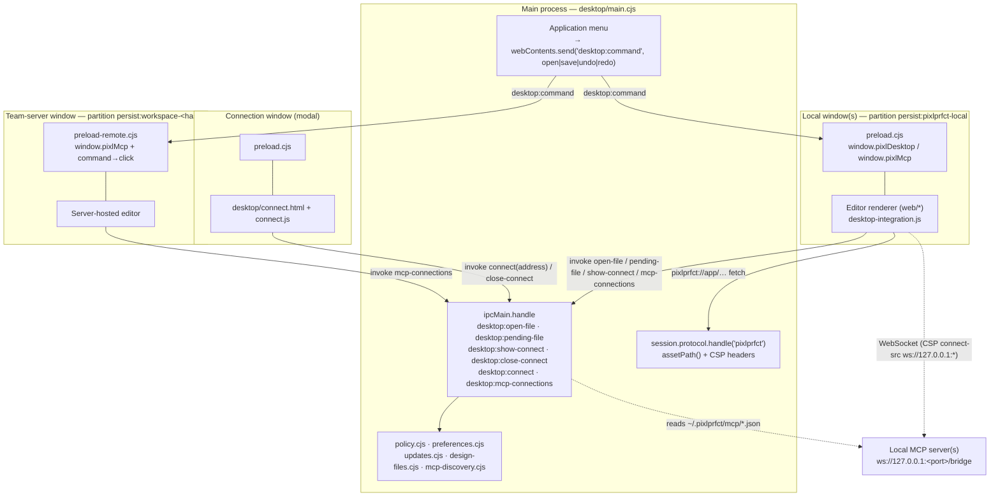
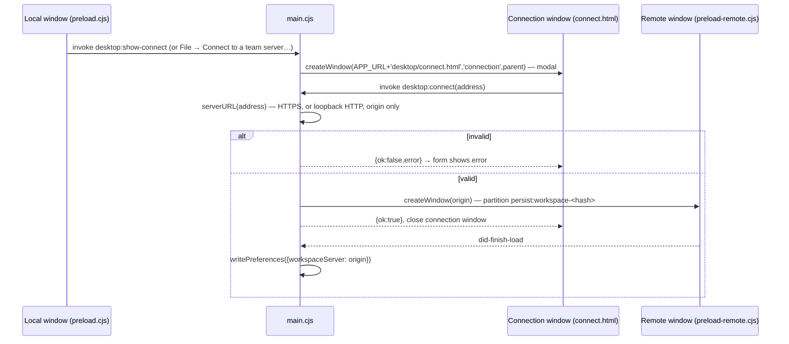

# Desktop App

The desktop app is an Electron 45 shell around the same static editor that ships in `web/`. It serves the files from a private, secure `pixlprfct://app/` protocol, with no HTTP server and no database. Local projects are stored in the browser storage of a dedicated persistent session partition. **File → Connect to a team server** opens a self-hosted PixlPrfct server in a separate window, with its own isolated session and no access to native features. The most important thing to know: **every native capability goes through six `ipcMain.handle` channels in [desktop/main.cjs](../../desktop/main.cjs), and each one checks which window and frame sent it.** The renderer never gets Node, the filesystem or raw IPC. Current builds are unsigned (Windows) or ad-hoc-signed (Mac test builds), and automatic updates are wired up only for signed Mac releases that embed an update feed.

## At a glance

| | |
| --- | --- |
| **Key files** | [desktop/main.cjs](../../desktop/main.cjs), [desktop/policy.cjs](../../desktop/policy.cjs), [desktop/preload.cjs](../../desktop/preload.cjs), [desktop/preload-remote.cjs](../../desktop/preload-remote.cjs), [desktop/builder.config.cjs](../../desktop/builder.config.cjs), [scripts/desktop/](https://github.com/ninefingerwoodshop-ops/pixlprfct/tree/main/scripts/desktop) |
| **Entry points** | `main.cjs` (Electron main; `main` in the generated `.desktop/app/package.json`); `npm run desktop:dev`, `desktop:pack`, `desktop:mac`, `desktop:win`, `desktop:mas`, `desktop:mas:dev`, `desktop:check` |
| **Depends on** | `electron` 45.1.0, `electron-builder` 26.18.0, `sharp` (icon generation), the built editor in `web/` (including `web/pkg/*.wasm` from `npm run build:editor`) |
| **Used by** | Renderer integrations: [web/desktop-integration.js](../../web/desktop-integration.js) (`installDesktop`, used by `app.js`, `project-home.js` and `svg-animation.js`), `agent-connection.js` (`window.pixlMcp`), `google-fonts.js`, `admin.js`, `account-ui.js` and `cloud-files.js` (all check `window.pixlDesktop`) |
| **Related docs** | [docs/DESKTOP.md](../DESKTOP.md), [CODE_SIGNING.md](../../CODE_SIGNING.md), [PRIVACY.md](../../PRIVACY.md), [docs/MCP.md](../MCP.md), [docs/MCP_SETUP.md](../MCP_SETUP.md) |

## Process model

Electron runs one **main process** (`main.cjs`). Each window has a sandboxed **renderer** (`sandbox:true`, `contextIsolation:true`, `nodeIntegration:false`, `webviewTag:false`, `webSecurity:true`) with one of three **preload** scripts. `app.enableSandbox()` applies the sandbox to every renderer.

Every window is recorded in `windows: Map<webContentsId, {win, base, role}>`. There are four roles:

| Role | Loaded URL | Preload | Session partition | Gets |
| --- | --- | --- | --- | --- |
| `local` | `pixlprfct://app/` (project home) and `/editor/*` | `preload.cjs` | `persist:pixlprfct-local` | `window.pixlDesktop` (file open, pending file, connect dialog, menu commands, `onlineFonts` flag), `window.pixlMcp`; read-only `pixlPanels.onClosing` notification |
| `connection` | `pixlprfct://app/desktop/connect.html`, a modal child window of 500×340 | `preload.cjs` (the URL is local) | `persist:pixlprfct-local` | Only `submitServer` and `closeConnect` succeed; the main process rejects every other local call for this role |
| `remote` | `https://<team server>/…` (or a loopback `http://` address) | `preload-remote.cjs` | `persist:workspace-<sha256(origin)[0:24]>` | Menu commands, which the preload turns into DOM clicks, and `window.pixlMcp`; read-only `pixlPanels.onClosing` notification |

| `panel` | Named same-workspace `/editor/panel.html` shell | `preload-panel.cjs` (empty) | Owner’s session | Adopted live controls; no native/MCP bridge or permission grants |

`createWindow(base, role, parent)` chooses the preload and session from `isLocalURL(base)`. Allowlisted panel windows preserve their opener, receive the bridge-free panel preload, reject nested windows/redirects/webviews, and cannot navigate beyond their shell. Their native menu commands route to the owner. Other windows opened by a page (`window.open`) are re-created through `createWindow` with the **same role**, but only when they stay in the same workspace. Every other URL goes to the OS browser (`shell.openExternal`), and only for `http(s)` URLs without embedded credentials.



## IPC channels

All renderer → main channels use `ipcRenderer.invoke` / `ipcMain.handle`. The guard function is `sender(event, role)`. It requires that the sending `webContents` is a registered window with that role, that `event.senderFrame` is the **main frame**, and that the frame URL is local (`pixlprfct://app`). For `connection`, the path must also be exactly `/desktop/connect.html`.

| Channel | Direction | Allowed sender | Payload → result | Purpose |
| --- | --- | --- | --- | --- |
| `desktop:open-file` | renderer → main | `local` | — → `{name, data: Uint8Array}` or `null` | Native Open dialog (`designFilters`), then `readDesign()` |
| `desktop:pending-file` | renderer → main | `local` | — → `{name, data}` or `null` | Collects a file the OS asked to open (argv, `open-file`, `second-instance`) for this window. One-shot. |
| `desktop:show-connect` | renderer → main | `local` | — → `undefined` | Opens (or focuses) the modal connection window |
| `desktop:close-connect` | renderer → main | `connection` | — | Closes the connection window |
| `desktop:connect` | renderer → main | `connection` | `address: string` → `{ok:true}` or `{ok:false, error}` | Validates with `serverURL()` and opens a `remote` window. Saves `workspaceServer` after `did-finish-load`. |
| `desktop:mcp-connections` | renderer → main | `local` **or** `remote`, main frame, same workspace | — → `[{url, pairingCode}]` | MCP bridge discovery, scoped to the requesting origin |
| `desktop:command` | main → renderer (`webContents.send`) | not sent to `connection` windows | `'open' \| 'save' \| 'undo' \| 'redo'` | Native menu commands |

Preload surfaces:

- `preload.cjs` exposes a frozen `pixlDesktop`: `platform`, `local:true`, `onlineFonts` (from the `--pixl-online-fonts=` additional argument), `openFile()`, `pendingFile()`, `connect()`, `submitServer(address)` (throws on `{ok:false}`), `closeConnect()` and `onCommand(cb)` (returns an unsubscribe function). It also exposes a frozen `pixlMcp.connections()` and the read-only `pixlPanels.onClosing(callback)` subscription used to preserve layouts during shutdown.
- `preload-panel.cjs` exposes nothing. Panel controls call their existing owner callbacks; the owner alone handles native capabilities and persistence.
- `preload-remote.cjs` exposes `pixlMcp.connections()` and a read-only `pixlPanels.onClosing(callback)` subscription. It handles `desktop:command` inside the preload: undo and redo inside text fields call `document.execCommand`, and otherwise it clicks `#open`, `#save`, `#undo` or `#redo` (falling back to `#home-import` for `open`). A remote page cannot call any native function other than MCP discovery.

Renderer side, `installDesktop({importFile, report, commands})` in [web/desktop-integration.js](../../web/desktop-integration.js) does nothing in browsers (`!window.pixlDesktop?.local`). In the desktop app it:

- subscribes to commands: `open` → `openFile()` then `importFile`; `undo`/`redo` inside text inputs → `execCommand`; anything else → `commands[name]()`
- calls `pendingFile()` once at startup

> **Note:** `desktop-integration.js` also handles an `import-pending` command, but `main.cjs` never sends it. Pending files are collected only by the startup call.

## Security policy ([desktop/policy.cjs](../../desktop/policy.cjs))

| Function | Rule |
| --- | --- |
| `APP_URL` | `pixlprfct://app/` |
| `isLocalURL(v)` | protocol `pixlprfct:`, host `app`, no username or password |
| `assetPath(root, url)` | Maps `/` → `web/project-home.html`, `/editor/*` → `web/*` and `/desktop/*` → `desktop/*`. Rejects `..`, `.`, dot-files, backslashes and NUL, and any path outside `root`. All other paths return 404. |
| `serverURL(v)` | Requires `https:`. `http:` is allowed only for `localhost`, `127.0.0.1` and `[::1]`. Rejects credentials, path, query and hash. Returns the **origin**, and is limited to 2048 characters. |
| `sameWorkspace(url, base)` | A local base matches only local URLs. A remote base matches only the same origin, with no credentials. |
| `externalURL(v)` | Only `http(s)` without credentials may be passed to `shell.openExternal`. |
| `partitionFor(base)` | `persist:pixlprfct-local`, or `persist:workspace-` + the first 24 hex characters of the SHA-256 of the origin. Local drafts and each team server never share cookies or storage. |
| `contentSecurityPolicy(url)` | The `CSP` constant for every asset, except `/editor/svg-animation-preview.html` (see below) |

The main CSP is:

```
default-src 'self'; script-src 'self' 'wasm-unsafe-eval'; style-src 'self' 'unsafe-inline' https://fonts.googleapis.com;
font-src 'self' data: https://fonts.gstatic.com; img-src 'self' data: blob: https:; media-src 'self' data: blob: https:;
connect-src 'self' ws://127.0.0.1:* https://fonts.googleapis.com https://fonts.gstatic.com; worker-src 'self' blob:;
object-src 'none'; base-uri 'self'; frame-ancestors 'none'; form-action 'self'
```

- **No inline scripts.** That is why the SVG Animator export preview loads a bundled player instead of using `srcdoc`. `wasm-unsafe-eval` exists for the Rust engine, and `ws://127.0.0.1:*` exists for the MCP bridge.
- The **SVG export preview** is the only document that may be framed (`frame-ancestors 'self'`). Its policy is `default-src 'none'; script-src 'self'; style-src 'unsafe-inline'; img-src data:; base-uri 'none'; form-action 'none'`. See [SVG-Animator](SVG-Animator.md#export).
- The protocol handler in `configureSession()` serves only `GET`/`HEAD` and returns `405` for other methods. It adds `X-Content-Type-Options: nosniff` and `Cache-Control: no-cache`, picks the content type from a fixed extension map, and calls `realpath()` again so that symlinks cannot escape `root`. It also answers two API stubs so that web code written for servers behaves:
  - `GET /api/installation` → `{"mode":"desktop"}`
  - `GET /api/documents` → `{"documents":[],"next":null}`

Navigation and permissions (in `createWindow` and `configureSession`):

- `will-navigate`: navigation outside the workspace is cancelled. `http(s)` targets open externally.
- `will-redirect`: redirects outside the workspace are cancelled.
- `setWindowOpenHandler`: always returns `deny`. Same-workspace URLs get a new app window, and anything else goes to the external browser.
- `will-attach-webview`: always prevented.
- Permissions: only `clipboard-sanitized-write` is granted, plus `clipboard-read` for `local` windows. The page must also still be in its own workspace. Everything else is denied, both by `setPermissionRequestHandler` and by `setPermissionCheckHandler`.
- Downloads: `will-download` always shows the native Save dialog, with overwrite confirmation.
- `will-prevent-unload` shows a synchronous "Changes may still be saving" dialog with the options Keep open or Close anyway.
- Fonts: in the local partition, `webRequest.onBeforeRequest` cancels requests to `fonts.googleapis.com` and `fonts.gstatic.com` unless the **View → Allow online fonts in local designs** preference is on. The renderer reads the same flag (`pixlDesktop.onlineFonts`). `google-fonts.js` rejects font loads with an explanatory message. Team-server windows are not filtered.

**Electron fuses** (`builder.config.cjs` → `electronFuses`) turn off `runAsNode`, `NODE_OPTIONS` and the inspector CLI arguments, and turn on ASAR integrity validation and `onlyLoadAppFromAsar`. `grantFileProtocolExtraPrivileges` is false. The app is packaged with `asar: true`.

## Local project storage

- The desktop app has no file-backed project store. The editor's normal `LocalDrafts`/`LocalPersistence` code writes to `localStorage` and `sessionStorage` **inside the `persist:pixlprfct-local` partition** under Electron's `userData` directory. That directory is the platform's app-data folder for the app name `PixlPrfct`, set by `app.setName`. Quotas and format match the browser editor, and browser drafts are not migrated.
- `.pixl` files are the portable format. Opening one through the dialog, the OS file association, argv or drag-and-drop **imports a copy** into local drafts. The original file is never written back. `readDesign()` ([desktop/design-files.cjs](../../desktop/design-files.cjs)) accepts `.pixl` and `.json` up to 5 MB, and `.fig` up to 64 MB. It reads one byte past the size reported by `stat` so it can detect files that change mid-read.
- Saving (Cmd/Ctrl+S → `desktop:command 'save'` → the editor's download) goes through `will-download` and the native Save dialog.
- `preferences.json` in `userData` holds `{onlineFonts:boolean, workspaceServer?:origin}`. It is written atomically (tmp file + rename, mode `0600`). Values are re-validated on read, and invalid server addresses are dropped (`normalizedPreferences`).
- For development only (unpackaged), `PIXL_DESKTOP_TEST_PROFILE=/abs/path` redirects `userData`, so tests never touch real drafts.

## Opening files and app lifecycle

- `requestSingleInstanceLock()` is skipped for MAS (`process.mas`). With the lock in place, a second launch forwards its file argument through `second-instance`. Without a file argument, the second launch focuses the local window.
- macOS `open-file` events received before `ready` are queued in `initialFiles`.
- `openNativeFile(file)` → `readDesign` → `createWindow(APP_URL)` → `pending.set(webContentsId, design)`. The new window collects the file through `desktop:pending-file` once it starts.
- At startup the app opens `preferences.workspaceServer || APP_URL`. In other words, **the last successfully loaded team server reopens automatically**. **File → All local projects** (Cmd/Ctrl+Shift+O) opens the local home.
- On non-Mac platforms the app quits when the last window closes. On Mac, `activate` re-creates a window.

## Team server connection flow



The team server provides its own login, accounts, teams and projects (see [Self-Hosted-Server](Self-Hosted-Server.md)). The desktop app adds no credentials and no OAuth or deep-link integration, so sign in uses the server's email/password flow. In local windows, the project home ([web/project-home.js](../../web/project-home.js)) hides the cloud scope and replaces the account links with **Connect to a team server…**. `admin.js` and `cloud-files.js` call `pixlDesktop.connect()` in the same way.

> **Gotcha:** `did-finish-load` fires when an HTTP error page finishes loading, too. Network failures go to `did-fail-load` (which shows an error dialog), but a reachable server that returns an error page is still remembered.

## MCP discovery

The local MCP server (`node mcp/server.mjs`, see [MCP-Server](MCP-Server.md)) publishes its bridge with `publishBridge()` from [desktop/mcp-discovery.cjs](../../desktop/mcp-discovery.cjs), a module the MCP server and the desktop app share:

- The discovery directory is `~/.pixlprfct/mcp/`. It is created with mode `0700` and **must** be private: owned by the user, with no group or other permission bits.
- Each running server writes a `<uuid>.json` file with `O_EXCL` and mode `0600`. The file holds `{url: "ws://127.0.0.1:<port>/bridge", pairingCode, allowedOrigins, instructions, pid}` and is removed when the server shuts down.

`discoverBridges(origin)` (the handler for `desktop:mcp-connections`):

- Reads at most 100 UUID-named files, with `O_NOFOLLOW` and a 16 KB size limit, and skips files that are not private.
- Requires `ws://127.0.0.1:<port>/bridge` with no query or credentials, a 43-character pairing code, and `allowedOrigins` that includes the requesting origin (`pixlprfct://app` for local windows, otherwise the remote window's origin).
- Requires that the publishing `pid` is still alive (`process.kill(pid, 0)`).
- Returns `{url, pairingCode: HMAC-SHA256(masterCode, origin)}`. The renderer only ever receives the **origin-scoped token**. The bridge (`mcp/bridge.mjs`) accepts either the master code or that scoped token for the connecting `Origin` header.

`web/agent-connection.js` uses `window.pixlMcp.connections` as its `discover` function. When it exists, the MCP connection window shows "Local MCP agents connect automatically" and reconnects after reloads or server restarts. Plain browsers fall back to manual URL and pairing-code entry.

> **Gotcha:** the MCP server's default `allowedOrigins` are `pixlprfct://app` and a few loopback dev ports. A team-server window can discover a bridge only if the MCP server is started with `--origin https://team.example` (or `PIXLPRFCT_EDITOR_ORIGIN`). That flag **replaces** the default list, so that MCP process is then no longer discoverable by local desktop windows.

## Auto-update ([desktop/updates.cjs](../../desktop/updates.cjs))

The feed is embedded in the app at build time and cannot be changed at runtime.

- `prepare.mjs` writes `.desktop/app/update-config.json = {"release":false,"feed":null}`. The checked-in [desktop/update-config.json](../../desktop/update-config.json) has the same content.
- `build.mjs` overwrites that file with `{release: mode==='release', feed: release ? updateFeed(PIXL_UPDATE_URL) : null}`.
- `updateFeed()` requires HTTPS with no credentials and no fragment.

`installUpdates()` sets up Electron's `autoUpdater` (Squirrel.Mac, `serverType: 'json'`) **only when** all of these hold: the app is packaged, it is not MAS, the platform is `darwin`, `config.release` is true, and `config.feed` is set.

- **Help → Check for updates…** calls `check()`. If updates are not configured, `check()` explains that "Automatic updates are not configured for this build".
- Checks are serialized with `busy`. After a download, the app asks the user to save and restart. It never quits on its own.
- **Windows has no auto-update.** Users install the new version over the old one, and the profile is preserved.

`scripts/desktop/update-feed.mjs signed.zip https://host/signed.zip feed.json [notes.txt]` writes a Squirrel.Mac JSON feed (`currentRelease` and `releases[].updateTo` with `url`, `sha256`, `size` and `pub_date`). It refuses to overwrite an existing file (`flag:'wx'`). `scripts/desktop/release-check.mjs PixlPrfct.app` verifies a release bundle:

- `codesign --verify --deep --strict`
- a `Developer ID Application` authority
- `spctl --assess`
- `stapler validate`
- `CFBundleShortVersionString` equal to `package.json` `version`

> **Note:** docs/DESKTOP.md contradicts itself here. One paragraph says "Automatic updates are not implemented". The later "Mac update delivery" section and the code describe the conditional updater above. PRIVACY.md says there is "no automatic update service", which holds for default builds because no feed is configured.

## Packaging

The pipeline is: `npm run build:editor` (WASM, generated API, design-file importer bundle, SVG preview bundle) → [scripts/desktop/prepare.mjs](../../scripts/desktop/prepare.mjs) → [scripts/desktop/build.mjs](../../scripts/desktop/build.mjs) → electron-builder with [desktop/builder.config.cjs](../../desktop/builder.config.cjs).

`prepare.mjs` creates an isolated `.desktop/app/`:

- copies all of `web/`, the main and preload `.cjs` files, `connect.{html,css,js}` (under `desktop/`), `LICENSE`, `PRIVACY.md`, `CODE_SIGNING.md`, `docs/licenses/` and a rewritten `LICENSING.md`
- writes a minimal `package.json` with no dependencies, `main: main.cjs` and the root package's version
- asserts that `web/pkg/pixlprfct_core_bg.wasm` exists
- uses `sharp` to render `web/favicon.svg` into `.desktop/icons/icon.png` (1024 px) and a single-image `icon.ico` (256 px PNG-in-ICO)

The server, database drivers, `node_modules` and secrets are never packaged.

`build.mjs` reads these flags:

| Flag(s) | Platform / arch | Targets | Output |
| --- | --- | --- | --- |
| (none) / `--mac` | Mac, `universal` (must run on macOS) | `dmg`, `zip` | `releases/desktop/` |
| `--dir` | Mac, host arch | `dir` (unpacked `.app`) | `releases/desktop/` |
| `--win` [`--arm64` \| `--x64`] | Windows, x64 by default | `nsis`, `zip` | `releases/desktop/` |
| `--mas` / `--mas-dev` | Mac App Store distribution / development | `mas` / `mas-dev` | `releases/desktop/app-store/` |
| `--sign-only` | Mac only | signed, not notarized | `releases/desktop/signed/` |
| `--release` | Mac or Windows | signed (and notarized on Mac) | `releases/desktop/release/` |

Builder config details:

- `appId` comes from `PIXL_DESKTOP_APP_ID` and defaults to the provisional `app.pixlprfct.desktop`.
- Artifacts are named `PixlPrfct-${version}-${os}-${arch}.${ext}`.
- `fileAssociations` covers `.pixl` (`application/vnd.pixlprfct+json`, role Editor). `.fig` and `.json` open through the dialog or argv but are not registered.
- **Mac**: minimum macOS 13.0, Hardened Runtime, `entitlements.mac.plist` (only `com.apple.security.cs.allow-jit`), and `ElectronTeamID` when `APPLE_TEAM_ID` is set.
- **Windows**: `nsis` with a per-user install, a selectable directory and shortcuts; app data is kept on uninstall (`deleteAppDataOnUninstall: false`). `requestedExecutionLevel: asInvoker`.
- **MAS**: `hardenedRuntime: false`. `entitlements.mas.plist` grants App Sandbox, `network.client` and `files.user-selected.read-write`. `entitlements.mas.inherit.plist` grants sandbox and inherit to helpers. `provisioningProfile` comes from `PIXL_MAS_PROFILE`. `build.mjs` fails early without `PIXL_DESKTOP_APP_ID`, a 10-character `APPLE_TEAM_ID`, and a readable `PIXL_MAS_PROFILE`.

## Signing status

[scripts/desktop/signing.mjs](../../scripts/desktop/signing.mjs) `configureSigning(config, {flags, platform, env})` chooses one of four modes:

| Mode | When | Effect |
| --- | --- | --- |
| `test` | no `--release`, `--sign-only` or MAS flag | `CSC_IDENTITY_AUTO_DISCOVERY=false`; Mac `identity:'-'` (ad-hoc) without notarization or Hardened Runtime; Windows `signExecutable:false` |
| `signed` | `--sign-only` (Mac only; cannot be combined with `--release`) | `forceCodeSigning`, Hardened Runtime, signed DMG, `notarize:false` |
| `release` | `--release` | `forceCodeSigning`. A Mac release **requires notarization credentials**: `APPLE_KEYCHAIN_PROFILE`, or `APPLE_ID` + `APPLE_APP_SPECIFIC_PASSWORD` + `APPLE_TEAM_ID`, or `APPLE_API_KEY` + `APPLE_API_KEY_ID` + `APPLE_API_ISSUER`. A partial set is rejected. Windows uses `WIN_CSC_LINK`/`WIN_CSC_KEY_PASSWORD` through electron-builder. |
| `app-store` | `--mas` / `--mas-dev` | `forceCodeSigning`, MAS identities and profile |

The current state, per [CODE_SIGNING.md](../../CODE_SIGNING.md) and DESKTOP.md:

- **Windows previews are unsigned.** The earlier SignPath Foundation application was not approved, and eligibility under the current source-available license must be reassessed.
- Mac direct-download builds can be signed with the owner's Developer ID, but **public Mac installers still await notarization**. Local Mac installs are ad-hoc-signed test builds.
- MAS submission has not been done.
- Releases come from the manually dispatched GitHub workflow `.github/workflows/windows-prerelease.yml`. It builds the Windows packages, runs the desktop, signing, preferences and design-file import tests, silently installs the app, checks that a main window appears, silently uninstalls it, and records `SHA256SUMS.txt` and `BUILD-PROVENANCE.json` (`signing: "unsigned"`). `.github/workflows/desktop.yml` ("Desktop test packages") builds Mac and Windows test packages as 14-day artifacts. Neither workflow publishes a release.

## Build and debug

```sh
npm ci && node node_modules/electron/install.js   # if lifecycle scripts are blocked
npm run desktop:dev        # build:editor + prepare + `electron .desktop/app`
npm run desktop:check      # node --test tests/desktop.test.mjs (policy unit tests)
npm run desktop:pack       # unpacked .app for this Mac
npm run desktop:win        # NSIS + ZIP (cross-buildable on a Mac; test on Windows)
PIXL_DESKTOP_TEST_PROFILE=/tmp/pixl-profile npm run desktop:dev   # throwaway profile
```

- `desktop:dev` always rebuilds the editor (WASM included). For a renderer-only change, re-run `node scripts/desktop/prepare.mjs`, then `npx electron .desktop/app`. The app runs from `.desktop/app`, not from `web/`.
- **View → Toggle Developer Tools** exists only when `!app.isPackaged`.
- Policy, preference, signing and update logic is plain CommonJS that takes its dependencies as parameters (`installUpdates({app, autoUpdater, dialog, config, platform})`, `configureSigning(config, {flags, platform, env})`), so it is unit-tested without Electron.
- Node: DESKTOP.md and CI use Node 24. `package.json` `engines` says `>=22.13.0`.

Tests:

| Test | Covers |
| --- | --- |
| [tests/desktop.test.mjs](../../tests/desktop.test.mjs) | Preview-only framing CSP, asset routing (only editor and `desktop/` files), HTTPS/loopback server validation, workspace navigation and partition isolation, external URL filtering |
| [tests/desktop-preferences.test.mjs](../../tests/desktop-preferences.test.mjs) | Online fonts must be an explicit opt-in, malformed preferences fail closed, Google-host detection, remembered workspace |
| [tests/desktop-signing.test.mjs](../../tests/desktop-signing.test.mjs) | A release cannot skip notarization; signed-only output is kept separate; test, Windows and MAS policies |
| [tests/desktop-updates.test.mjs](../../tests/desktop-updates.test.mjs) | Pinned HTTPS feed, serialized checks, no forced quit, manual-install path |
| [tests/mcp-discovery.test.mjs](../../tests/mcp-discovery.test.mjs) | Private, origin-scoped discovery; stale file cleanup; reconnect after restart or port change; simulated 40-minute sleep |
| `npm run test:sleep` (`scripts/acceptance/desktop-sleep.mjs`) | Manual real OS sleep/wake check against an installed app |

## web/native-pinch.js

`installNativePinch(target, {start, scale, end})` turns WebKit `gesturestart`/`gesturechange`/`gestureend` events, which report a cumulative scale, into incremental zoom factors for the canvas (`app.js`). It also stops the Ctrl+wheel handler from double-applying zoom (`nativePinchActive()`). It is part of the desktop assignment only by name: Electron is Chromium, which reports pinches as Ctrl+wheel events, so this module serves **Safari/WebKit browsers**, not the Electron app. It is tested in `tests/native-pinch.test.mjs`.

## Invariants and gotchas

- **Add new native capabilities only as `ipcMain.handle` channels guarded by `sender(event, role)`.** Do not expose `ipcRenderer` or generic `invoke`. Freeze anything passed to `contextBridge`.
- **Remote windows must never receive `preload.cjs`.** `createWindow` chooses the preload from `isLocalURL(base)`. Keep it that way, or a team server could read local files through `openFile`.
- **New static asset types** need an entry in the `types` map in `main.cjs`. Otherwise the protocol returns 404. New top-level folders also need a route in `assetPath`.
- **Anything that needs inline script or `eval`** breaks under the desktop CSP. The Playwright case "interactive export preview works under the packaged desktop content security policy" guards one such path.
- Keep the `files` list in `builder.config.cjs` in sync with what `prepare.mjs` copies.
- Pick the final `PIXL_DESKTOP_APP_ID` **before** the first signed distribution and keep it stable. Changing it orphans the user profile and the update channel.
- DESKTOP.md is mostly a dated log of local installs (alpha.2 → alpha.19). Treat the "Run and build", "Projects and files", "Security boundaries", MAS, signing and update sections as reference, and the dated sections as history.

## Related pages

- [Hosting-Modes](Hosting-Modes.md): desktop compared with the Sites, self-hosted and static hosts
- [Self-Hosted-Server](Self-Hosted-Server.md): what a "team server" is
- [MCP-Server](MCP-Server.md): the bridge, pairing and discovery from the agent side
- [SVG-Animator](SVG-Animator.md): the preview document and CSP exception
- [Web-Editor-Architecture](Web-Editor-Architecture.md): local drafts and persistence used inside the app
- [CI-CD-and-Releases](CI-CD-and-Releases.md), [Build-System](Build-System.md), [Testing-and-Verification](Testing-and-Verification.md)

## Source of truth

- Code: `desktop/*.cjs`, `desktop/connect.*`, `desktop/entitlements*.plist`, `desktop/update-config.json`, `scripts/desktop/*.mjs`, `web/desktop-integration.js`, `web/agent-connection.js`, `mcp/bridge.mjs` (scoped token check), `.github/workflows/desktop.yml`, `.github/workflows/windows-prerelease.yml`
- Docs: [docs/DESKTOP.md](../DESKTOP.md) (user-facing reference plus a per-alpha installation log), [CODE_SIGNING.md](../../CODE_SIGNING.md), [PRIVACY.md](../../PRIVACY.md), [docs/MCP.md](../MCP.md)
