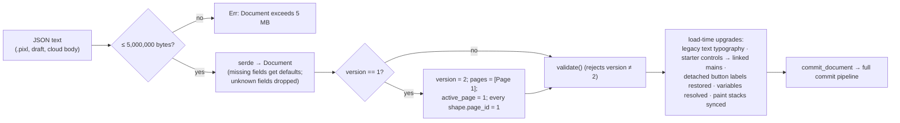
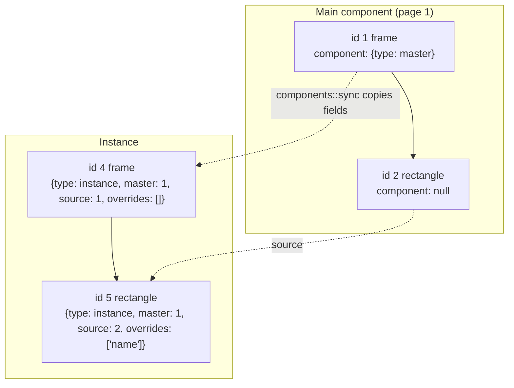

# Document Model and File Format

A PixlPrfct design is one JSON object — the serde serialization of the Rust `Document` struct in [src/lib.rs](../../src/lib.rs) — and the native `.pixl` file is exactly that JSON, unmodified, as returned by `Editor::snapshot()`. Layers are a **flat array of `Shape` records** linked by `parent_id` and `page_id`, with document-wide numeric IDs; components, variables, styles and linked libraries are stored as side tables that layers reference by ID. The current schema is `"version": 2`; version 1 files are migrated on load, anything else is rejected. Three related envelopes reuse the same `Shape` schema: the layer clipboard (`"format": "pixlprfct.layers"`, version 1), the `.pixllib` library package (`"format": "pixlprfct-library"`, version 1) and browser draft storage.

## At a glance

| Key files | Entry points | Depends on | Used by | Related docs |
| --- | --- | --- | --- | --- |
| Schema: [src/lib.rs](../../src/lib.rs) (`Document`, `Page`, `Shape`, …), [src/components.rs](../../src/components.rs), [src/variables.rs](../../src/variables.rs), [src/variants.rs](../../src/variants.rs), [src/component_properties.rs](../../src/component_properties.rs), [src/slots.rs](../../src/slots.rs), [src/grid.rs](../../src/grid.rs), [src/paint.rs](../../src/paint.rs), `src/*_styles.rs`, [src/editor_tools.rs](../../src/editor_tools.rs). Envelopes: [web/project-file.js](../../web/project-file.js), [web/clipboard.js](../../web/clipboard.js), [web/local-libraries.js](../../web/local-libraries.js), [web/local-drafts.js](../../web/local-drafts.js), [web/local-persistence.js](../../web/local-persistence.js), [web/document-merge.js](../../web/document-merge.js), [web/library-model.js](../../web/library-model.js) | `Editor::snapshot`, `Editor::load`, `Editor::copy_layers`/`paste_layers`, `projectFile()`, `readDesignFile()`, `libraryPackage()`/`parseLibraryPackage()` | `serde`/`serde_json` | Editor, cloud API and self-hosted server (store the body string), MCP server, archive/SVG importers (produce this schema) | [LIBRARIES.md](../LIBRARIES.md), [TEAM_LIBRARIES.md](../TEAM_LIBRARIES.md), [README](../../README.md) |

## Containers that carry a document

| Container | Shape on disk / in storage | Produced by | Read by | Size cap |
| --- | --- | --- | --- | --- |
| `.pixl` project file | The raw `Document` JSON (`application/json`), file name = sanitized `document.name` + `.pixl` | `projectFile(snapshot)` in [web/project-file.js](../../web/project-file.js) (download / "Export → pixl") | `readDesignFile` in [web/design-import.js](../../web/design-import.js) → `Editor::load` | 5,000,000 bytes (both sides) |
| Local draft | `localStorage["pixlprfct.drafts.v1"] = {version:1, activeId, files:[{id, name, body, updatedAt, deletedAt?}]}` where `body` is the document JSON string | `LocalDrafts` in [web/local-drafts.js](../../web/local-drafts.js) | same | browser quota |
| Crash-recovery copy | `sessionStorage["pixlprfct.local-recovery:<draftId>"] = {id, body, base, ack \| ackIsBase}` | `LocalPersistence.remember` in [web/local-persistence.js](../../web/local-persistence.js) | `LocalPersistence.recovery` | browser quota |
| Cloud / self-hosted document | `body` string column with the document JSON | [Cloud-API-and-Database](Cloud-API-and-Database.md), [Self-Hosted-Server](Self-Hosted-Server.md) | editor via `cloudRequest` | server-side checks |
| Layer clipboard | `{format:"pixlprfct.layers", version:1, origin, protected_library, components, shapes}` under MIME `application/x-pixlprfct-layers` and `text/plain` | `Editor::copy_layers` | `layerPayload` ([web/clipboard.js](../../web/clipboard.js)) → `Editor::paste_layers` | 5,000,000 chars |
| `.pixllib` library | `{format:"pixlprfct-library", version:1, release:{id, workspace, name, revision, body}}`, where `body` is a reduced `Document` | `libraryPackage` ([web/local-libraries.js](../../web/local-libraries.js)) | `parseLibraryPackage` → `mergeLibrary` ([web/library-model.js](../../web/library-model.js)) | 5,000,000 bytes |

`.fig` files (≤ 64 MB) and SVG are not native formats: they are converted into this schema by importers ([Import-Design-Files](Import-Design-Files.md)).

## Top-level `Document`

| Field | Type | Default if absent | Meaning |
| --- | --- | --- | --- |
| `version` | `u32` | **required** | Must be `1` (migrated) or `2`. |
| `name` | string | **required** | ≤ 256 bytes. Also used for the `.pixl` file name. |
| `shapes` | `Shape[]` | **required** | Every layer on every page, stored parents-first (see [Ordering](#hierarchy-and-ordering)). ≤ 10,000. |
| `pages` | `Page[]` | `[{id:1,name:"Page 1"}]` | 1–100 pages, in display order. |
| `active_page` | `u32` | `1` | Page shown on open; must exist. |
| `variables` | `{collections, values}` | empty | Variable collections/modes/values. |
| `component_sets` | `ComponentSet[]` | `[]` | Variant sets. |
| `component_order` | string[] | `[]` | Assets-panel order: `"set:<id>"` / `"component:<id>"`, unique, ≤ 11,000. |
| `component_properties` | `ComponentProperty[]` | `[]` | Exposed text/boolean/slot properties. |
| `color_styles`, `text_styles`, `effect_styles`, `guide_styles` | arrays | `[]` | Named shared styles (≤ 1,000 each). |
| `libraries` | opaque JSON array | `[]`, omitted when empty | Linked library records, managed in JS (see [Linked libraries](#linked-libraries-inside-a-project)). |

The JS SVG Animator stores its own documents with the same envelope plus `design_type: "svg-animation"` and `svg_animation: {...}` ([web/svg-animation-model.js](../../web/svg-animation-model.js) `newSvgAnimation`). Those never go through the Rust engine — [web/editor-entry.js](../../web/editor-entry.js) routes them to `svg-animation.html` — because serde would silently drop the unknown fields. See [SVG-Animator](SVG-Animator.md).

## Pages

```json
{ "id": 1, "name": "Page 1",
  "background": {"color": "#f5f5f5", "opacity": 1.0, "visible": true},
  "variable_modes": {"1": 2} }
```

`id` is non-zero, unique, not `u32::MAX`; `name` is non-blank and ≤ 256 bytes. `background` (optional) is validated by [src/page_background.rs](../../src/page_background.rs). `variable_modes` maps collection ID → mode ID for every layer on the page (layer-level `variable_modes` override it). Both optional fields are omitted when empty.

## Shapes (layers)

Every layer, regardless of kind, is one `Shape` struct. `kind` must be one of:

`frame`, `group`, `rectangle`, `ellipse`, `text`, `image`, `line`, `arrow`, `polygon`, `star`, `pen`, `pencil`.

The last six are "vector" kinds and must carry at least 2 `points`. Frames and groups are the only containers (`Shape::is_container` in [src/groups.rs](../../src/groups.rs)). Sections, slices, comments, annotations, measurements and spec markers are not separate kinds: they are ordinary shapes with `editor_meta.role` set (sections must be frames).

### Fields

Required in JSON (no serde default): `id`, `kind`, `name`, `x`, `y`, `width`, `height`, `fill`, `text`, `hidden`. Everything else has a default.

| Group | Fields | Notes |
| --- | --- | --- |
| Identity & tree | `id`, `page_id` (default 1), `parent_id` (0 = page root), `name`, `kind` | |
| Geometry | `x`, `y`, `width`, `height`, `rotation` (degrees, counter-clockwise), `aspect_ratio_locked`, `constraints {horizontal, vertical}` (`min`/`max`/`center`/`stretch`/`scale`) | `x`/`y` are **page (world) coordinates**, not parent-relative. |
| Visibility | `hidden`, `locked`, `clip_content` | |
| Legacy paint summary | `fill` (`#rrggbb`), `stroke_width` (default 2.0) | `fill` is rewritten from the first fill paint when `appearance.fills` exists. |
| Appearance | `appearance: Appearance?` | Paint stacks, opacity, blend mode, corner radii, strokes, dashes, caps/joins/tips, shadows, blurs. Absent = engine defaults. |
| Text | `text` (≤ 10,000 bytes; present on every kind, default content "Your next big idea"), `typography: Typography?` | `Typography`: `font_family`, `font_size`, `font_weight`, `line_height`, `letter_spacing(_unit)`, `text_case`, `align`, `vertical_align`, `sizing` (`fixed`/`width`/`height`), `wrap`. |
| Vectors | `points: [[x,y]]`, `handles: [[[x,y],[x,y]]]`, `closed` | Points and handles are **normalized to the layer box** (`0..=1`). `handles` is empty (straight segments) or has one in/out pair per point. |
| Raster image | `image: RasterImage?` | Required when `kind == "image"`. |
| Layout | `auto_layout: AutoLayout?` (frames only), `layout_item: LayoutItem`, `layout_grids: LayoutGrid[]` (≤ 8, frames only), `border_widths: [t,r,b,l]?` | `AutoLayout.direction` is `horizontal`/`vertical`/`grid`; `grid: GridLayout?` holds tracks/areas. `layout_item` holds fill/absolute flags, min/max sizes, margins and `grid_cell`. |
| CSS | `layout_class`, `layout_class_generated`, `layout_media`, `custom_css` (≤ 65,536 bytes), `breakpoint_original` | `layout_class` is engine-assigned unless a valid custom name is set. |
| Device frames | `device_chrome`, `device_chrome_breakpoints`, `device_chrome_hidden` | Opaque to Rust validation beyond types. |
| Components | `component: {type:"master"} \| {type:"instance", master, source, overrides}`, `slot: {property, modified}?`, `slot_origin` | See [Components](#components-instances-and-overrides). |
| Styles | `fill_style`, `stroke_style`, `text_style`, `effect_style`, `guide_style` (style IDs, 0 = none) | |
| Variables | `variable_bindings: {path → variableId}`, `variable_modes: {collectionId → modeId}` | |
| Prototype | `prototype: Prototype?`, `additional_interactions: Prototype[]`, `flow_name` | |
| Controls & behaviors | `control: Control?`, `control_state`, `behaviors: Behavior[]` | Native form controls (button, input, dropdown, checkbox, switch, radio, segmented, calendar, …). See [Prototyping-Behaviors-and-Controls](Prototyping-Behaviors-and-Controls.md). |
| Editor tools | `editor_meta: EditorMeta?` | `role`, comment `body`/`replies`, `text_path`, per-layer `motion` keyframes, `library_overrides`. |
| Runtime only | `measured_baseline` | `#[serde(skip)]` — never serialized. |

`#[serde(skip_serializing_if = ...)]` omits `slot`, `slot_origin` (when 0), `custom_css` (when empty), `breakpoint_original` and `editor_meta` when unset; most other fields are always written, so snapshots are verbose but stable.

### Hierarchy and ordering

- A layer's parent is `parent_id`; validation requires the parent to exist, be a frame or group, be on the same `page_id`, and the chain to be acyclic and ≤ 128 deep.
- Array order **is** z-order and auto-layout order. Each commit normalizes `shapes` to a pre-order traversal (`document_order::parents_first`): parent first, then its children in sibling order. Later siblings paint above earlier ones, except inside auto-layout frames with `canvas_stacking: "first"` (reversed; see `stacking::paint_order`).
- Empty groups are pruned automatically; group bounds are recomputed from children.

### IDs

| ID space | Assigned by | Rules |
| --- | --- | --- |
| Shape `id` | `Editor.next_id` (max existing + 1 on load) | Non-zero, unique across **all pages**, not `u32::MAX`. Stable for the life of the document; references (`parent_id`, prototype `target`, `component.master/source`, `pattern.source_id`, component-property `targets`, variant `component_id`) all use it. |
| Page `id` | `Editor.next_page_id` | Non-zero, unique, not `u32::MAX`. |
| Variable, collection, mode, style, component set, component property IDs | Engine on create (`ID 0 creates` in `save_*` commands) or JS (`mergeLibrary`, `ensureBaseTextDocument`) | Non-zero and unique within their own table. |
| Paint `id` | Client | Non-zero and unique within one fill or stroke stack. Used by `color_variables` and `appearance.fills.<id>.color` binding paths. |
| Team live-edit ranges | Server, applied with `Editor.reserve_ids(start, end)` | New shape/page IDs come from a per-session half-open range so concurrent editors do not collide. |

Clipboard and library imports always **remap** IDs (`paste_layers`, `mergeLibrary`), so IDs are not portable between documents.

## Versioning and migrations

`Document.version` is a single integer for the whole schema; additive changes are handled by serde defaults instead of version bumps.



Rust-side upgrades in `Editor::load` ([src/lib.rs](../../src/lib.rs)):

1. **v1 → v2:** add the default single page and assign every shape to page 1 (v1 had no pages).
2. **Legacy text:** a `text` shape without `typography` gets `Typography::default()` with `font_size = clamp(height × 0.66, 10, 72)` and `wrap = false`.
3. **Starter controls:** a `control` with `starter: true` and `starter_linked: false` becomes `starter_linked: true` and, if it has no component, a `master`.
4. **Detached buttons:** `components::restore_detached_button_labels` materializes a text layer for old detached native buttons.
5. Variables are resolved and paint stacks summarized before the normal commit.

JS-side normalizations applied before `load` in some paths:

- `migrateChromeDocument` ([web/frame-tools.js](../../web/frame-tools.js)) adds `device_chrome_breakpoints: {tablet: 600, desktop: 1024}` to frames that lack it and converts old fixed device chrome to `auto`/`auto-apple`.
- `ensureBaseTextDocument` ([web/base-text.js](../../web/base-text.js)) adds a "Typography Base" collection (`preset: "typography_base"`) with a "Text color" variable (`#222222`) and binds untouched neutral text colors to it.
- The editor's built-in starter document is still authored as `{version: 1, name: "Launch concept", shapes}` in [web/app.js](../../web/app.js) and relies on the v1 migration.

> **Note:** There is no downgrade path and no forward-compatibility marker. A newer file opened by an older engine loads only if its new fields are optional; unknown fields are silently discarded on the next save.

## Appearance, paints and embedded media

`Appearance` keeps two representations:

- **Paint stacks** — `fills: Paint[]?` and `strokes: Paint[]?` (≤ 64 each). A `Paint` is `{id, color, opacity, visible, blend_mode, gradient? | media? | pattern? | shader?}` with at most one of the four typed payloads. Gradients (`linear`, `radial`, `angular`, `diamond`) have 2–16 stops and normalized `start`/`end` (−10..10).
- **Legacy scalar summary** — `fill_enabled`, `fill_hidden`, `fill_opacity`, `gradient`, `stroke_enabled`, `stroke_hidden`, `stroke_color`, `stroke_opacity`, `stroke_gradient`, plus the shape's `fill`. When a stack exists, `sync_paint_stacks` recomputes these from it on every commit (first paint wins). Older documents may only have the scalar form.

> **Note:** README ("Free-angle rotation, masks, Boolean operations, paint stacks… are still pending"; "multiple fills remain pending") predates the `fills`/`strokes` stacks that the code now validates, resolves and binds to styles. The schema supports multiple paints per channel.

Other appearance fields: `opacity`, `blend_mode` (18 modes incl. `pass-through`), `corner_radius`/`corner_radii [tl,tr,br,bl]`, `stroke_alignment`, `stroke_cap`, `stroke_join`, `stroke_miter_limit`, `stroke_dash`/`stroke_dash_offset`, `stroke_start`/`stroke_end` tips, `shadows` (≤ 8, `drop`/`inner`, optional `color_variable`), `layer_blur` (≤ 100,000), `backdrop_blur` (≤ 200), `image_opacity`.

**Images, video and fonts:**

- **Embedded, never linked.** Bitmaps are base64 `data:` URLs inside the JSON. There is no external asset store; a `.pixl` file is self-contained.
- `kind: "image"` layers carry `image: {data_url, width, height, mode: "fill"|"fit", zoom: 1..10, offset_x, offset_y: 0..1}`. Accepted prefixes: `data:image/png;base64,`, `data:image/jpeg;base64,`, `data:image/webp;base64,`; ≤ 8192×8192; base64 payload ≤ 2,000,000 chars. [web/images.js](../../web/images.js) `readImage` rejects files > 10 MB, downsamples to ≤ 2048 px on the long side and re-encodes (JPEG stays JPEG at 0.9, others become PNG) before insert.
- Image/video **paints** (`paint.media`) allow PNG/JPEG/WebP/GIF images and MP4/WebM/QuickTime video, ≤ 16384×16384, ≤ 2,000,000 chars (image, poster) or 3,000,000 chars (video), modes `fill`/`fit`/`crop`/`tile`, seven filter values in −1..1.
- **Pattern** paints reference another layer by `source_id` (cycles rejected by `paint::validate_sources`); **shader** paints store `preset` (`mesh`/`noise`/`waves`/`custom`), `code` (≤ 16,000 chars) and an optional PNG `snapshot`.
- **Fonts are referenced by family name only** (`typography.font_family`, ≤ 100 chars of `[A-Za-z0-9 -]`). They are loaded at runtime from Google Fonts or system fonts ([web/google-fonts.js](../../web/google-fonts.js) `loadGoogleFont`); nothing is embedded in `.pixl`. Rendering on a machine without the font falls back.

> **Note:** README states "Fonts are limited to Manrope, DM Sans, Georgia, and the system monospace font." The code accepts any valid family name and suggests ~30 Google families (`fontSuggestions`); the README sentence is stale.

The whole serialized document must stay ≤ 5,000,000 bytes, so in practice only a handful of embedded images fit.

## Components, instances and overrides



- `component` is a tagged enum ([src/components.rs](../../src/components.rs)): `{"type":"master"}` on the root frame of a main component, or `{"type":"instance","master":M,"source":S,"overrides":[...]}` on **every** layer of an instance tree. `master` is the main component root; `source` is the corresponding layer inside the main. An instance root has `master == source`.
- Mains and instance roots must be frames. Nested mains are rejected; instances may be nested inside mains. Inside an instance, layers without a link are only allowed in slot content.
- Instances are **materialized**: their full subtree is stored in `shapes`, with their own IDs, and rebuilt from the main on every commit by `components::sync`.
- `overrides` lists field paths (≤ 64, unique) that the instance keeps instead of inheriting. Valid paths are the top-level names in `FIELDS` (`name`, `text`, `fill`, `appearance`, `typography`, `hidden`, `x`, `y`, `width`, `height`, `layout_item`, `auto_layout`, `prototype`, `variable_bindings`, style IDs, …) or `control.<subfield>`. They are recorded automatically by `record_overrides` when an instance layer is edited via `update_many`; the user never writes them directly.
- What an instance may change is narrower than the path list suggests: content/state fields (`name`, `text`, `hidden`, `locked`, `control_state`), root placement, some sizing and control content keys, and appearance only inside slots. See [Rust-Document-Engine](Rust-Document-Engine.md#invariants-and-gotchas).

**Variants** — `component_sets: [{id, frame_id?, name, properties: ["State","Size"], variants: [{component_id, values: ["Hover","Large"]}]}]` (≤ 16 properties, ≤ 1,000 variants, unique combinations). `frame_id` points at the visible container frame (omitted when 0, for legacy logical sets).

**Component properties** — `component_properties: [{id, component_id, name, kind: "text"|"boolean"|"slot", targets: [shapeIds], slot_settings?}]`. Text properties drive `text`; boolean properties drive `hidden` (inverted); slot properties mark a nested frame as a slot (`shape.slot = {property, modified}`) with `slot_settings` (`min_children`, `max_children`, `preferred_instances`, `only_preferred_instances`, `display_empty`, `fill_counter_axis`, `description`). See [Components-Variants-and-Slots](Components-Variants-and-Slots.md).

## Variables and styles

```json
"variables": {
  "collections": [{"id":1,"name":"Brand","preset":"","default_mode":1,
                   "modes":[{"id":1,"name":"Light"},{"id":2,"name":"Dark"}]}],
  "values": [
    {"id":1,"collection_id":1,"name":"Primary","kind":"color","control_path":"",
     "values":{"1":"#3366ff","2":"#99bbff"}},
    {"id":2,"collection_id":1,"name":"Accent","kind":"color","control_path":"",
     "values":{"1":{"alias":1},"2":{"alias":1}}}
  ]
}
```

- Kinds: `color`, `number`, `string`, `boolean`, `padding`, `margin`, `border_radius`, `border_width` (the last four take 1–4 CSS-shorthand numbers). Each variable needs a value for every mode of its collection; a value may instead be `{"alias": variableId}` (cycles rejected).
- ≤ 100 collections, ≤ 2,000 variables, ≤ 32 modes per collection, names ≤ 128 bytes.
- `preset` marks engine-managed collections (`typography_base`, `input_base`, `button_base`, …); `control_path` binds a control-starter variable to a control property.
- Layers bind with `variable_bindings: {"fill": 1, "appearance.fills.3.color": 2, "typography.font_size": 7, "auto_layout.padding": 9, ...}`. The full path vocabulary and its required kinds are in `variables::property_kind`. Mode selection: layer `variable_modes`, then ancestors, then page `variable_modes`, then `default_mode`.
- **Bound values are resolved into the document.** After every commit the literal value of each bound property equals the variable's resolved value (e.g. binding `fill` to "Primary" on a Dark page writes `"fill": "#99bbff"` and updates the first fill paint). Consumers that ignore variables can still render the document.
- Shadow colors bind through `shadow.color_variable`; color styles through `color_variables: {paintId → variableId}`.

Styles are named records referenced by ID from layers:

| Table | Record | Layer reference |
| --- | --- | --- |
| `color_styles` | `{id, name, description, paints: Paint[], color_variables}` | `fill_style`, `stroke_style` |
| `text_styles` | `{id, name, description, typography}` (family, size, weight, line height, spacing, case; alignment/wrapping/sizing stay local) | `text_style` |
| `effect_styles` | `{id, name, description, effects: {shadows, layer_blur(_enabled,_present), backdrop_blur(...)}}` | `effect_style` |
| `guide_styles` | `{id, name, grids: LayoutGrid[]}` | `guide_style` |

Like variables, style values are copied onto linked layers on every commit; editing a styled value directly on a layer detaches it (style ID set to 0). Details: [Styles-Variables-and-Paints](Styles-Variables-and-Paints.md).

## Prototype links

```json
"prototype": {"trigger":"click","delay":800,"action":"navigate","target":2,
              "transition":"instant","duration":300,"easing":"ease-in-out",
              "overlay_position":"center","overlay_x":0.0,"overlay_y":0.0,
              "close_on_outside":false,"backdrop_color":"#000000","backdrop_opacity":0.4},
"additional_interactions": [],
"flow_name": "Main flow"
```

- `action` is required: `navigate`, `overlay`, `swap` (need a `target` frame ID, any page), `back`, `close` (`target` must be 0).
- `trigger`: `click` (default), `mouseenter`, `mouseleave`, `mousedown`, `mouseup`, `afterdelay` (frames only, `delay` 1–600,000 ms). Each trigger at most once per layer; `prototype` is the first interaction and `additional_interactions` holds up to 5 more.
- `transition`: `instant`, `dissolve`, `slide-left/right/up/down` (slides not allowed for overlay/close/swap); `duration` ≤ 10,000 ms; `easing`: `linear`, `ease-in`, `ease-out`, `ease-in-out`.
- `flow_name` (frames only, ≤ 128 bytes) marks a flow starting point.
- Links to deleted frames are removed automatically on commit; links are remapped on duplicate, paste and library import. See [Prototyping-Behaviors-and-Controls](Prototyping-Behaviors-and-Controls.md).

## Linked libraries inside a project

`document.libraries` is typed as opaque JSON in Rust but has a fixed shape managed by `mergeLibrary` in [web/library-model.js](../../web/library-model.js):

```json
{ "id": "local:<projectId>", "workspace": "local", "name": "Brand kit", "revision": 3,
  "enabled": true, "page_id": 7,
  "maps": { "shapes": {"<srcId>": localId}, "collections": {}, "variables": {}, "sets": {},
            "properties": {}, "guides": {}, "effects": {}, "texts": {}, "colors": {} } }
```

Imported library content is copied into the project (shapes onto a dedicated page named `Library · <name>`), with every ID remapped through `maps`. Rust uses `maps.shapes` only to flag clipboard payloads as `protected_library`; JS `importedContentError` (installed as the engine write guard) rejects edits to mapped content. See [Teams-Libraries-and-Collaboration](Teams-Libraries-and-Collaboration.md) and [LIBRARIES.md](../LIBRARIES.md).

## Clipboard payload

`Editor::copy_layers(ids)` produces (struct `LayerClipboard` in [src/lib.rs](../../src/lib.rs)):

```json
{
  "protected_library": false,       // true if any copied layer is (an instance of) linked-library content
  "origin": "1730419200000-0.42",   // per-Editor random token (Date.now()-Math.random())
  "components": {},                 // original shape id -> Component link, honored only for same-origin pastes
  "format": "pixlprfct.layers",
  "version": 1,
  "shapes": [ /* full Shape records: selection + descendants, parents first */ ]
}
```

On copy the engine **detaches** document-specific references: `component`, all style IDs, `variable_bindings`, `variable_modes`, shadow `color_variable`s are cleared; prototype links to layers outside the copied set are dropped; roots get `parent_id: 0`; `page_id` is set to 1. Resolved values stay, so the paste looks identical.

On paste (`paste_layers(json, dx, dy, parent)`): payload ≤ 5,000,000 chars; `format`/`version` must match; a `protected_library` payload from another origin is refused ("Add the library from Assets in this project, then insert its protected component"); shapes are validated as a standalone document; IDs are reassigned from `next_id`; internal prototype targets and pattern `source_id`s are remapped; roots are placed under `parent` and offset by `dx`/`dy`. Component links from `components` are restored **only when `origin` matches this `Editor`** and the main still exists; slot state is dropped for foreign payloads. [web/clipboard.js](../../web/clipboard.js) writes the payload as both `application/x-pixlprfct-layers` and `text/plain`, and `createPasteContext().placement` decides parent/offset (+16 inside a target, +24 per repeat otherwise). The SVG importer reuses this envelope to insert parsed SVG (`placeSvg` in app.js).

## `.pixllib` library package

```json
{ "format": "pixlprfct-library", "version": 1,
  "release": { "id": "local:<projectId>", "workspace": "local", "name": "Brand kit",
               "revision": 3, "body": { /* reduced Document */ } } }
```

`parseLibraryPackage` enforces ≤ 5,000,000 bytes, matching `format`/`version`, non-empty `id`/`workspace` (≤ 200 chars, no control characters), non-blank `name` ≤ 256, integer `revision ≥ 1`, and a `body` with `pages`/`shapes` arrays and **no** `libraries`. `body` may be a JSON string or object. The body is built by `librarySnapshot(doc)`: main components (not those imported from other libraries) and their descendants, pattern-source dependencies, component sets whose variants are all included, their component properties, local styles and variables. Publishing fails if the library would depend on another library's components, styles, variables or patterns. Locally published releases live in IndexedDB `pixlprfct.libraries.v1` (store `releases`, key `workspace\nid` plus archived `\n@revision` rows).

## Annotated `.pixl` skeleton

Derived from real `Editor::snapshot()` output of the native crate (comments added; JSON itself has no comments). Most `Shape` fields are always serialized; the second shape shows only selected fields.

```jsonc
{
  "variables": {                          // always present; may be empty
    "collections": [{"preset":"","id":1,"name":"Brand","default_mode":1,
                     "modes":[{"id":1,"name":"Light"},{"id":2,"name":"Dark"}]}],
    "values": [{"control_path":"","id":1,"collection_id":1,"name":"Primary",
                "kind":"color","values":{"1":"#3366ff","2":"#99bbff"}}]
  },
  "version": 2,                           // schema version (1 is migrated on load)
  "name": "Checkout",
  "shapes": [
    {                                      // ---- a main-component frame on page 1
      "layout_class": "frame-1-1",         // engine-generated unique CSS class
      "layout_class_generated": true,
      "layout_media": [], "device_chrome": "", "device_chrome_breakpoints": null,
      "device_chrome_hidden": false,
      "control": null, "control_state": "", "behaviors": [],
      "border_widths": null, "rotation": 0.0, "aspect_ratio_locked": false,
      "variable_bindings": {"fill": 1},    // fill is bound to variable 1
      "variable_modes": {},
      "id": 1, "page_id": 1, "parent_id": 0,
      "clip_content": true, "image": null,
      "constraints": {"horizontal": "min", "vertical": "min"},
      "appearance": {
        "fills": [{"id":1,"color":"#99bbff","opacity":1.0,"visible":true,
                   "gradient":null,"blend_mode":"normal"}],   // resolved from the Dark mode
        "blend_mode": "pass-through", "opacity": 1.0, "corner_radius": 8.0, "corner_radii": null,
        "fill_enabled": true, "fill_hidden": false, "fill_opacity": 1.0,  // summary of fills[0]
        "stroke_enabled": false, "stroke_hidden": false, "stroke_color": "#000000",
        "stroke_opacity": 1.0, "stroke_dash": [], "stroke_dash_offset": 0.0,
        "stroke_cap": "round", "stroke_alignment": "center", "stroke_join": "round",
        "stroke_miter_limit": 10.0, "shadows": [], "gradient": null,
        "layer_blur": 0.0, "layer_blur_enabled": true, "layer_blur_present": false,
        "backdrop_blur": 0.0, "backdrop_blur_enabled": true, "backdrop_blur_present": false
      },
      "auto_layout": null, "layout_grids": [],
      "guide_style": 0, "effect_style": 0, "text_style": 0, "fill_style": 0, "stroke_style": 0,
      "prototype": {"trigger":"click","delay":800,"action":"navigate","target":2,
                    "close_on_outside":false,"overlay_position":"center","overlay_x":0.0,
                    "overlay_y":0.0,"backdrop_color":"#000000","backdrop_opacity":0.4,
                    "transition":"instant","duration":300,"easing":"ease-in-out"},
      "additional_interactions": [],
      "flow_name": "Main flow",
      "layout_item": {"grid_container":false,"margin":[0.0,0.0,0.0,0.0],"grid_cell":null,
                      "fill_width":false,"fill_height":false,"absolute":false,
                      "min_width":null,"max_width":null,"min_height":null,"max_height":null},
      "kind": "frame", "name": "Card",
      "x": 0.0, "y": 0.0, "width": 600.0, "height": 400.0,   // page coordinates
      "fill": "#99bbff",                   // legacy summary = fills[0].color
      "text": "Your next big idea",        // present on every kind
      "hidden": false, "locked": false,
      "component": {"type": "master"},
      "typography": null,
      "points": [], "handles": [], "closed": false, "stroke_width": 2.0
    },
    {                                      // ---- an instance child (abridged)
      "id": 5, "page_id": 1, "parent_id": 4, "kind": "rectangle", "name": "rectangle 2",
      "x": 720.0, "y": 20.0, "width": 160.0, "height": 120.0, "fill": "#d9d9d9",
      "component": {"type": "instance", "master": 1, "source": 2, "overrides": []}
      /* ...all other Shape fields... */
    },
    {                                      // ---- an image layer (abridged)
      "id": 9, "page_id": 1, "parent_id": 1, "kind": "image", "name": "Photo",
      "image": {"data_url": "data:image/jpeg;base64,/9j/4AAQ...", "width": 1600, "height": 1067,
                "mode": "fill", "zoom": 1.0, "offset_x": 0.5, "offset_y": 0.5}
      /* ... */
    }
  ],
  "pages": [{"background": {"color":"#f5f5f5","opacity":1.0,"visible":true},
             "variable_modes": {"1": 2},  // page uses the Dark mode of collection 1
             "id": 1, "name": "Page 1"}],
  "active_page": 1,
  "component_sets": [], "component_order": [],
  "guide_styles": [], "effect_styles": [], "text_styles": [],
  "color_styles": [{"id":1,"name":"Brand/Primary","description":"",
                    "paints":[{"id":1,"color":"#3366ff","opacity":1.0,"visible":true,
                               "gradient":null,"blend_mode":"normal"}],
                    "color_variables": {}}],
  "component_properties": []
  // "libraries": [...]  only written when non-empty
}
```

Map keys that are numeric IDs in Rust (`BTreeMap<u32, _>`) serialize as JSON strings (`"1"`), e.g. variable `values`, `variable_modes`, clipboard `components`.

## Limits

All values are exact constants from validation code.

| Area | Limit | Source |
| --- | --- | --- |
| Document JSON | ≤ 5,000,000 bytes (load input, each commit, `.pixl` export/import, clipboard, `.pixllib`) | `Editor::load`, `commit_validated_document`, `projectFile`, `readFile`, `paste_layers`, `parseLibraryPackage` |
| Shapes / pages | ≤ 10,000 shapes; 1–100 pages | `validate` |
| Names | document, page, shape ≤ 256 bytes; variables/collections/modes/sets/styles ≤ 128 | `validate`, module validators |
| Text | ≤ 10,000 bytes; `custom_css` ≤ 65,536 bytes | `validate` |
| Geometry | x, y, width, height, rotation finite and `abs ≤ 1,000,000`; width/height ≥ 1 (groups ≥ 0) | `validate` |
| Hierarchy | ≤ 128 levels, acyclic | `validate` |
| Vectors | ≤ 4,096 points, coordinates and handles in `0..=1`; vector kinds ≥ 2 points; `stroke_width` 0.1–100 | `validate` |
| Raster image layer | PNG/JPEG/WebP, ≤ 8,192 × 8,192, base64 payload ≤ 2,000,000 chars, `zoom` 1–10 | `validate` |
| Media paint | ≤ 16,384 × 16,384; image/poster ≤ 2,000,000 chars; video ≤ 3,000,000 chars | `paint::validate` |
| Image import (UI) | file ≤ 10 MB, decoded ≤ 16,384 px, downsampled to ≤ 2,048 px, data URL ≤ 2,000,000 chars | `readImage` in [web/images.js](../../web/images.js) |
| Paint stacks | ≤ 64 paints per channel; gradient 2–16 stops | `paint::validate_stack`, `validate_gradient` |
| Effects | ≤ 8 shadows; layer blur ≤ 100,000; backdrop blur ≤ 200 | `effect_styles::Effects::validate` |
| Strokes | ≤ 16 dash entries; miter limit 1–1,000 | `validate` |
| Typography | font size 1–512; line height 0.5–4; weight 100–900; family ≤ 100 chars | `text_styles::validate_typography` |
| Auto layout | gap/cross gap −100,000..100,000 (grid ≥ 0); padding 0–100,000 | `validate`, `grid::validate` |
| Grid | 1–128 columns, ≤ 128 explicit rows; cell column ≤ 128, row ≤ 10,000, spans 1–128 | `grid::validate` |
| Layout guides | ≤ 8 per frame, count 1–256 | `guide_styles::validate_grids` |
| Prototype | 1 + ≤ 5 interactions; delay 1–600,000 ms; duration ≤ 10,000 ms | `validate` |
| Variables | ≤ 100 collections, ≤ 2,000 variables, ≤ 32 modes | `variables::validate_variables` |
| Styles / sets / properties | ≤ 1,000 per style table; ≤ 1,000 component sets (≤ 16 properties, ≤ 1,000 variants); ≤ 10,000 component properties | module validators |
| Instance overrides | ≤ 64 paths per instance layer | `components::validate_links` |
| Dropdown control | ≤ 500 items, menu height 80–1,200, width 0–2,000 | `validate` |
| Editor meta | comment body ≤ 10,000; ≤ 100 replies; text path ≤ 4,096 points; motion ≤ 200 keyframes, duration 1–60,000 ms | `editor_tools::validate` |
| `.fig` import | ≤ 64 MB | [web/design-import.js](../../web/design-import.js) `FIGMA_LIMIT` |

## Invariants and gotchas

- **`.pixl` is the engine snapshot verbatim.** Anything the UI wants to persist must live in the Rust schema; JS-only fields are dropped by the next `load`/commit.
- **Do not hand-edit derived values.** Style-, variable-, component- and layout-derived fields are recomputed on load and every commit.
- **Coordinates are absolute page coordinates**; moving a parent rewrites every descendant's `x`/`y`.
- **IDs are document-local.** Every cross-document path (clipboard, library, design-file import) remaps them; never persist a shape ID outside its document.
- **Clipboard payloads are detached copies**, except component links pasted back into the same `Editor` session (`origin` match).
- **Merge semantics for teams:** [web/document-merge.js](../../web/document-merge.js) `mergeDocuments` does a field-level three-way merge where arrays of objects with unique `id`s merge by ID (so `shapes`, `pages`, styles and variables merge per record); other conflicting edits are reported as conflicts. Keep new array-of-record fields keyed by `id` to benefit from this.

## Related pages

- [Rust-Document-Engine](Rust-Document-Engine.md) — how documents are mutated, validated and committed
- [Components-Variants-and-Slots](Components-Variants-and-Slots.md) · [Styles-Variables-and-Paints](Styles-Variables-and-Paints.md) · [Prototyping-Behaviors-and-Controls](Prototyping-Behaviors-and-Controls.md) · [Layout-Auto-Layout-and-Grid](Layout-Auto-Layout-and-Grid.md)
- [Import-Design-Files](Import-Design-Files.md) · [Rendering-and-Export](Rendering-and-Export.md) · [SVG-Animator](SVG-Animator.md)
- [Teams-Libraries-and-Collaboration](Teams-Libraries-and-Collaboration.md) · [Cloud-API-and-Database](Cloud-API-and-Database.md) · [Self-Hosted-Server](Self-Hosted-Server.md) · [Glossary](Glossary.md)

## Source of truth

- [src/lib.rs](../../src/lib.rs) — `Document`, `Page`, `Shape`, `Appearance`, `Paint`, `Typography`, `Prototype`, `RasterImage`, `LayerClipboard`, `validate`, `Editor::load`, `copy_layers`, `paste_layers`
- [src/components.rs](../../src/components.rs) (`Component`, `FIELDS`, `record_overrides`), [src/variables.rs](../../src/variables.rs) (`property_kind`, `validate_variables`), [src/variants.rs](../../src/variants.rs), [src/component_properties.rs](../../src/component_properties.rs), [src/slots.rs](../../src/slots.rs), [src/paint.rs](../../src/paint.rs), [src/grid.rs](../../src/grid.rs), [src/editor_tools.rs](../../src/editor_tools.rs), `src/*_styles.rs`
- [web/project-file.js](../../web/project-file.js), [web/design-import.js](../../web/design-import.js), [web/clipboard.js](../../web/clipboard.js), [web/local-drafts.js](../../web/local-drafts.js), [web/local-persistence.js](../../web/local-persistence.js), [web/local-libraries.js](../../web/local-libraries.js), [web/library-model.js](../../web/library-model.js), [web/document-merge.js](../../web/document-merge.js), [web/images.js](../../web/images.js)
- [web/editor-api.js](../../web/editor-api.js) `modelReference` — generated copy of every Rust struct declaration
- Tests: [tests/wasm.test.mjs](../../tests/wasm.test.mjs) (v1 migration, round-trips), `tests/clipboard.test.mjs`, `tests/local-persistence.test.mjs`, `tests/libraries.test.mjs`
- Existing docs: [LIBRARIES.md](../LIBRARIES.md), [TEAM_LIBRARIES.md](../TEAM_LIBRARIES.md), [README](../../README.md)
