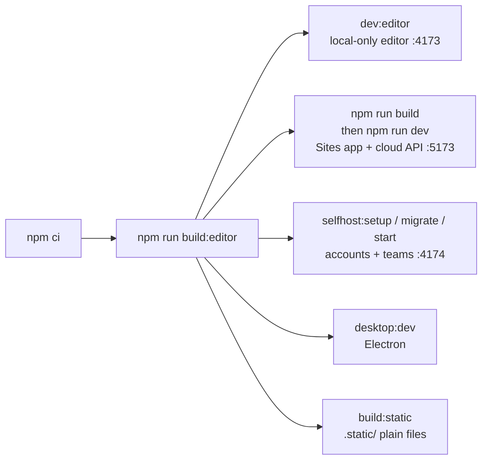

# Getting Started

Clone, build the Rust/WASM engine, and run one of the four hosts. **The fastest loop for editor work is `npm run build:editor` + `npm run dev:editor` (local-only editor on port 4173).** Use the full `npm run build` + `npm run dev` only when you need the cloud API, and the self-hosted server only when you are working on accounts, teams or libraries.

## At a glance

| | |
| --- | --- |
| **Prerequisites** | Rust + `wasm32-unknown-unknown` target, `wasm-pack` (installed as an npm devDependency), a native C/C++ linker for `cargo test`, Node.js 24 (22.13+ minimum per `package.json` `engines`) |
| **Install** | `npm ci` |
| **Fast editor loop** | `npm run build:editor && npm run dev:editor` → http://127.0.0.1:4173 |
| **Full Sites app** | `npm run build && npm run dev` → http://127.0.0.1:5173 |
| **Self-hosted server** | `selfhost:build → selfhost:setup → selfhost:migrate → selfhost:start` → http://127.0.0.1:4174 |
| **Desktop** | `npm run desktop:dev` |
| **Tests** | `npm test` (Rust + Node), `npm run test:browser` (Playwright, port 4198) |
| **Related docs** | [README](../../README.md), [SELF_HOSTING.md](../SELF_HOSTING.md), [DESKTOP.md](../DESKTOP.md), [MCP.md](../MCP.md) |

## 1. Prerequisites

```sh
# Rust toolchain + the WASM target
rustup target add wasm32-unknown-unknown

# Node 24 is recommended: the API and self-host tests use the built-in node:sqlite driver
node --version   # >= 22.13.0 required, 24.x recommended
```

> **Note:** `package.json` declares `"node": ">=22.13.0"`, while the README and test suite assume Node 24 (`node:sqlite`). Use Node 24 to avoid test failures.

`wasm-pack` comes from `devDependencies`, so `npm ci` provides it. `.npmrc` disables `audit`, `fund` and `update-notifier`.

## 2. Install and build

```sh
npm ci
npm run build:editor     # engine + editor assets only (fast path)
# or
npm run build            # build:editor + prepare-editor + vinext/Sites build into dist/
```

`build:editor` runs, in order: `generate-preloader.mjs` → `wasm-pack build --target web --out-dir web/pkg` → `generate-editor-api.mjs` → `build-figma-import.mjs` → `build.mjs`. See [Build System](Build-System.md) for what each step produces.

Generated and **not committed**: `web/pkg/`, `dist/`, `public/editor/`, `.static/`, `.desktop/`, `releases/`, `web/vendor/figma-import-worker.js`, `web/vendor/svg-animation-preview.js` (see `.gitignore`).

## 3. Pick a host



### a. Local-only editor (fastest)

```sh
npm run build:editor
npm run dev:editor          # scripts/serve.mjs → http://127.0.0.1:4173
```

Projects live in browser storage. No accounts, cloud files or team libraries. This overwrites deployment output, so re-run the full build before publishing.

### b. Sites (Cloudflare Worker) app with cloud API

```sh
npm run build
npm run dev                 # http://127.0.0.1:5173
```

The editor is served at `/editor/index.html` and the cloud API at `/api/documents`. Once, after the first build, apply the initial D1 migration locally:

```sh
node --import ./scripts/sites-env.mjs ./node_modules/wrangler/bin/wrangler.js \
  d1 execute DB --local --config dist/server/wrangler.json \
  --persist-to .wrangler/state --file drizzle/0000_flaky_phalanx.sql
```

After changing editor assets, run `node scripts/prepare-editor.mjs` to recopy them into `public/editor/`. `npm start` runs the built worker with Wrangler locally. See [Cloud API and Database](Cloud-API-and-Database.md).

### c. Self-hosted team server

```sh
npm run selfhost:build      # = build:editor
npm run selfhost:setup      # wizard → writes .env.selfhost (random secret, 0600)
npm run selfhost:migrate
npm run selfhost:start      # http://127.0.0.1:4174
```

Pick the local trial + SQLite. Register, then open the verification link from the newest `data/outbox/*.json` (dev email outbox; never served over HTTP). Never commit `.env.selfhost` or `data/`. See [Self-Hosted Server](Self-Hosted-Server.md).

### d. Desktop (Electron)

```sh
npm run desktop:dev         # builds editor, stages .desktop/app, launches Electron
```

If lifecycle scripts are blocked, run `node node_modules/electron/install.js` once. Set `PIXL_DESKTOP_TEST_PROFILE=/abs/path` to isolate a test profile. See [Desktop App](Desktop-App.md).

### e. Static host

```sh
npm run build:static        # writes .static/ — projects at /, editor at /editor/
```

Serve from its own origin (root-relative paths). Account, cloud and team features are stripped — see `web/static-host.js` and [Hosting Modes](Hosting-Modes.md).

### f. MCP server for AI agents

```sh
npm run mcp                 # node mcp/server.mjs
```

See [MCP Server](MCP-Server.md) for client configuration and the live-editor bridge.

## 4. Run the checks

The full pre-PR set from [CONTRIBUTING.md](../../CONTRIBUTING.md):

```sh
npm run build
npm test                    # cargo test && node --test tests/*.test.mjs
npm run lint
npm run typecheck
npx playwright install chromium   # once
npm run test:browser        # builds editor, serves on :4198, runs tests/browser/*.spec.mjs
node scripts/generate-editor-api.mjs --check   # = part of npm run mcp:check
cargo fmt --all --check
cargo clippy --all-targets --all-features -- -D warnings
```

Screenshot baselines are compared only on macOS 15 (1440×1000, dark, reduced motion). Linux runs functional browser checks only. Never run `test:browser:update` without inspecting every changed image. Details: [Testing and Verification](Testing-and-Verification.md).

## 5. Your first change — a quick orientation

| You want to change… | Start in | Then read |
| --- | --- | --- |
| How a document property behaves or validates | `src/lib.rs` or the matching `src/<feature>.rs` | [Rust Document Engine](Rust-Document-Engine.md) |
| A canvas tool or interaction | `web/app.js`, `web/toolbelt.js`, `web/canvas-tools.js` | [Canvas Tools and Editing](Canvas-Tools-and-Editing.md) |
| The right inspector | `web/compact-inspector.js`, `web/inspector-*.js` | [Web Editor Architecture](Web-Editor-Architecture.md) |
| What AI agents can do | `scripts/generate-editor-api.mjs`, `web/editor-api.js`, `mcp/` | [MCP Server](MCP-Server.md) |
| Accounts, teams, permissions | `server/*.mjs` | [Self-Hosted Server](Self-Hosted-Server.md) |
| Packaging/installers | `desktop/`, `scripts/desktop/` | [Desktop App](Desktop-App.md), [CI/CD and Releases](CI-CD-and-Releases.md) |

Before any UI change, read [Interface Design Guidelines](Interface-Design-Guidelines.md) — use shared controls and verify their behavior, accessibility and consistency.

## Troubleshooting

| Symptom | Likely cause / fix |
| --- | --- |
| `wasm-pack` fails with missing target | `rustup target add wasm32-unknown-unknown` |
| `cargo test` link errors | Install a native C/C++ toolchain (Xcode CLT on macOS, build-essential on Linux, MSVC on Windows) |
| Node tests fail importing `node:sqlite` | Use Node 24 |
| Editor loads but WASM 404s | `web/pkg/` missing — run `npm run build:editor` |
| Sites dev shows stale editor | Run `node scripts/prepare-editor.mjs` to recopy into `public/editor/` |
| `/api/documents` errors locally | Apply `drizzle/0000_flaky_phalanx.sql` (and later migrations) to the local D1 |
| `mcp:check` fails | `web/editor-api.js` is out of date — run `npm run mcp:catalog` and commit |
| Electron binary missing | `node node_modules/electron/install.js` |

## Related pages

[Repository Map](Repository-Map.md) · [Architecture Overview](Architecture-Overview.md) · [Build System](Build-System.md) · [Hosting Modes](Hosting-Modes.md) · [Testing and Verification](Testing-and-Verification.md)

## Source of truth

`package.json` (scripts), [README](../../README.md) "Run locally", [CONTRIBUTING.md](../../CONTRIBUTING.md), [SELF_HOSTING.md](../SELF_HOSTING.md) "Quick local trial", [DESKTOP.md](../DESKTOP.md) "Run and build", `playwright.config.mjs`, `scripts/serve.mjs`.
