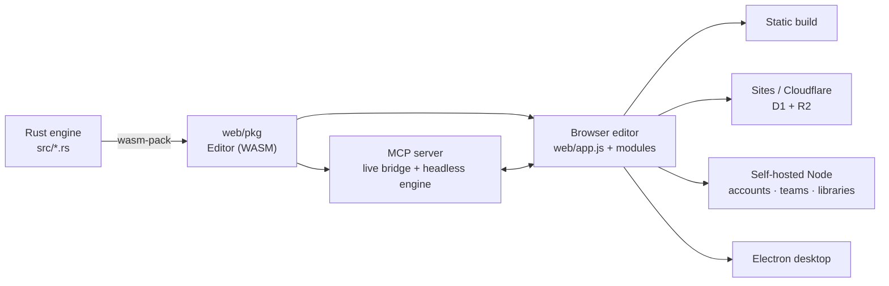

# PixlPrfct Engineering Wiki

**PixlPrfct (Pixel Perfect) is a browser-first editor for interface design, prototypes and vector animation, built on a Rust document engine compiled to WebAssembly.** The same editor runs as a static site, a Cloudflare/Sites app, a self-hosted team server and an Electron desktop app, and AI agents can edit designs through an MCP server. Current version: **0.1.1-alpha.21** — an early preview with known limitations; it is not a production-stability guarantee.

> This wiki is the structured entry point to the codebase. It was written from the source at commits `ea20b14`–`6f3d74b` (2026-11-01) and cross-checked against code; where existing docs disagree with code, pages say so in **Note** callouts. The detailed dated logs in `docs/` remain the historical record — see [Docs Index](Docs-Index.md).

Alpha.21 adds SVG Pen/Pencil and path editing, independent gradient animation, Add/Replace import, and shared panel windows. Follow the [Dev Log](https://ninefingerwoodshop-ops.github.io/pixlprfct/dev-log.html) or [download the preview](https://github.com/ninefingerwoodshop-ops/pixlprfct/releases/tag/v0.1.1-alpha.21).

## Start here

| If you want to… | Read |
| --- | --- |
| Build and run it in 5 minutes | [Getting Started](Getting-Started.md) |
| Understand how the pieces fit | [Architecture Overview](Architecture-Overview.md) |
| Find where something lives | [Repository Map](Repository-Map.md) |
| Know the rules before touching UI | [Interface Design Guidelines](Interface-Design-Guidelines.md) |
| See what's done and what's open | [Project Status and Roadmap](Project-Status-and-Roadmap.md) |
| Decode a term | [Glossary](Glossary.md) |

## Map of the wiki

### Core
- [Architecture Overview](Architecture-Overview.md) — engine, editor, renderers, hosts, agents
- [Rust Document Engine](Rust-Document-Engine.md) — `Editor`, commit pipeline, undo, WASM API, adding a mutation end-to-end
- [Document Model and File Format](Document-Model-and-File-Format.md) — `.pixl` v2, clipboard, `.pixllib`, migrations, limits
- [Web Editor Architecture](Web-Editor-Architecture.md) — `app.js` hub, `install*` modules, inspector, persistence, autosave
- [Rendering and Export](Rendering-and-Export.md) — Canvas/SVG/CSS renderers, PNG/JPEG/SVG/ZIP/HTML/framework export
- [Build System](Build-System.md) — npm scripts, wasm-pack, codegen, static/Sites/desktop outputs

### Editor features
- [Canvas Tools and Editing](Canvas-Tools-and-Editing.md) — tools, selection, vectors, text, clipboard, keyboard shortcuts
- [Layout, Auto Layout and Grid](Layout-Auto-Layout-and-Grid.md) — flex reflow, CSS grid, constraints, guides, breakpoints
- [Components, Variants and Slots](Components-Variants-and-Slots.md) — mains/instances, overrides, swaps, sets, properties, slots
- [Styles, Variables and Paints](Styles-Variables-and-Paints.md) — variables & modes, styles, paint stacks, strokes, effects
- [Prototyping, Behaviors and Controls](Prototyping-Behaviors-and-Controls.md) — interactions, player, Motion, JS behaviors, starter controls
- [Import: Design Files and SVG](Import-Design-Files.md) — `.fig` worker pipeline, editable SVG import
- [SVG Animator](SVG-Animator.md) — separate animation design type and SMIL export
- [Panel Workspace](Panel-Workspace.md) — tear-outs, icons, side flyouts and saved layouts
- [Icon Library](Icon-Library.md) — 679 MIT icons, font, Territory Track coverage

### Platforms and services
- [Hosting Modes](Hosting-Modes.md) — static vs Sites vs self-hosted vs desktop, runtime host detection
- [Self-Hosted Server](Self-Hosted-Server.md) — routes, config, databases, auth, schema, operations
- [Cloud API and Database](Cloud-API-and-Database.md) — `/api/documents`, D1/R2, versions, Drizzle migrations
- [Teams, Libraries and Collaboration](Teams-Libraries-and-Collaboration.md) — workspaces, roles, leases, edit together, protected libraries
- [Desktop App](Desktop-App.md) — Electron process model, IPC, security, packaging, updates
- [MCP Server](MCP-Server.md) — agent tools, live bridge, saved projects, command catalog

### Engineering practice
- [Testing and Verification](Testing-and-Verification.md) — Rust, Node, WASM, Playwright, acceptance scripts, evidence rules
- [CI/CD and Releases](CI-CD-and-Releases.md) — workflows, versioning, signing, release checklist
- [Contributing and Conventions](Contributing-and-Conventions.md) — PR process, code style, licensing
- [Interface Design Guidelines](Interface-Design-Guidelines.md) — AGENTS.md rules, tokens, approved extensions
- [Project Status and Roadmap](Project-Status-and-Roadmap.md) — implemented vs remaining, open B-items
- [Docs Index](Docs-Index.md) — every existing doc and where the wiki covers it
- [Glossary](Glossary.md)

## The system in one picture

## Ten facts every contributor should know

1. **The Rust `Editor` owns all document truth.** Every edit clones, validates, resolves styles/variables, lays out, syncs instances, runs a write guard, then commits atomically — one user action, one undo step (100-step full-snapshot history).
2. **The editor is vanilla ES modules.** `web/app.js` is the hub; ~45 `installX()` modules wire panels. No React in the editor.
3. **Three renderers share geometry.** Canvas 2D, SVG and HTML/CSS use the same `compositeGeometry()`/`paintLayers()`; the CSS compiler also produces HTML/framework exports.
4. **Instances are rebuilt from mains on every commit**, and instance appearance is protected — only content/state can be overridden outside slots.
5. **The same build runs on every host**, detected at runtime (`data-host="static"` → desktop bridge → `GET /api/installation`).
6. **Teams exist only on the self-hosted server.** "Edit together" is ~1 s HTTP polling with server-side three-way merge — not WebSockets, not CRDT.
7. **Agents use the same engine and rules.** MCP batches (≤ 200 ops) run on a scratch `Editor` and land as one undo step; `web/editor-api.js` is generated — run `npm run mcp:catalog` when the engine API changes.
8. **The SVG Animator is a separate document type** that bypasses the Rust engine and exports SMIL.
9. **Use consistent, working controls:** follow the project’s interface requirements, shared tokens and components; distinguish visual checks from functional verification.
10. **There is no automatic CI.** Run the full local check set and state your evidence in the PR; Windows releases are built by a manually dispatched workflow and are unsigned.

## Doc/code discrepancies found while writing this wiki

These are the most consequential mismatches; each is detailed on its page.

| Topic | Docs say | Code does | Page |
| --- | --- | --- | --- |
| Simultaneous editing | README, roadmap, SELF_HOSTING: not implemented | Self-hosted "Edit together" via polling + three-way merge | [Teams…](Teams-Libraries-and-Collaboration.md) |
| Paints & strokes | README: strokes centered; multi-paint, blend, alignment pending | Paint stacks (≤ 64), per-paint blend, inside/center/outside strokes implemented | [Styles…](Styles-Variables-and-Paints.md) |
| Instance overrides | README: independent appearance overrides, push includes paints/effects | Appearance edits on instances are rejected outside slots | [Components…](Components-Variants-and-Slots.md) |
| MCP tool count | MCP.md / matrix: 14 tools | 20 registered (14 + 6 opt-in installation tools) | [MCP Server](MCP-Server.md) |
| MCP `--origin` | Not documented | Replaces (not extends) the allowed origins | [MCP Server](MCP-Server.md) |
| Auto-update | DESKTOP.md: not implemented (one section) | Conditional Mac updater in `desktop/updates.cjs` | [Desktop App](Desktop-App.md) |
| CI | CAPABILITY_MATRIX: macOS visual CI job | No test workflow exists; CI is disabled | [CI/CD…](CI-CD-and-Releases.md) |
| Node version | `engines`: ≥ 22.13 | Tests/CI need Node 24 (`node:sqlite`) | [Getting Started](Getting-Started.md) |
| Fonts | README: four families | Any valid family; ~30 Google fonts suggested | [Document Model…](Document-Model-and-File-Format.md) |

## Maintaining this wiki

- The source of these pages is [`docs/wiki/`](https://github.com/ninefingerwoodshop-ops/pixlprfct/tree/main/docs/wiki) in the main repository (once merged); this GitHub Wiki is a published copy with links converted for the wiki. Edit in the repo and re-sync, so the two don't drift.
- Update the relevant page in the same PR as a behavior change. Pages describe **current** behavior; dated evidence belongs in `docs/` logs.
- Each page ends with **Source of truth** — start there when verifying or updating it.
