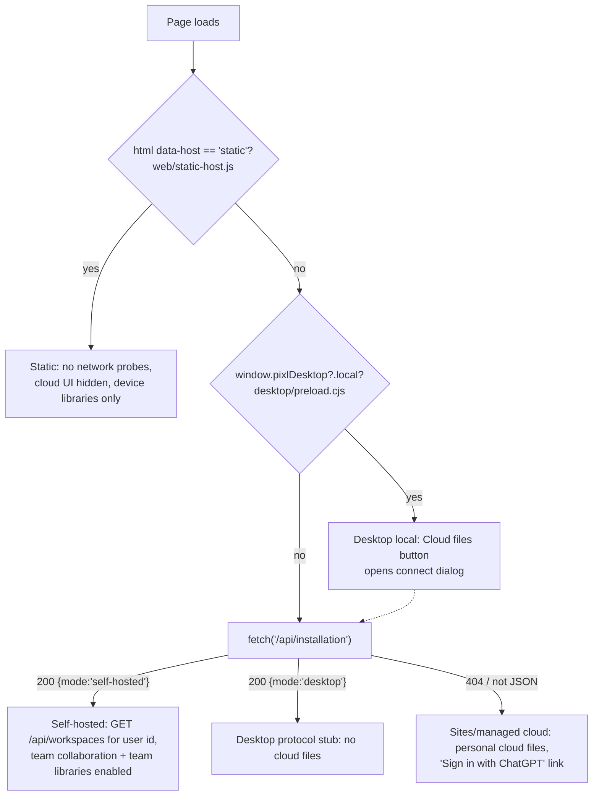

# Hosting Modes

PixlPrfct ships one editor (`web/`) that runs under four hosts: a Sites/Cloudflare Worker app, a self-hosted Node server, a static local-only build, and an Electron desktop app. The editor does not get a build flag per host; it detects the host at runtime from an HTML attribute, a desktop preload object, and the response of `GET /api/installation`, then turns features on or off. The single most important fact: **only the self-hosted Node server has accounts with organizations, teams, shared files, protected team libraries and collaboration**. The Sites host stores personal cloud files only, and the static and desktop hosts keep projects on the device.

## At a glance

| Key files | Entry points | Depends on | Used by | Related docs |
| --- | --- | --- | --- | --- |
| [web/static-host.js](../../web/static-host.js), [web/app.js](../../web/app.js) (startup block), [web/cloud-files.js](../../web/cloud-files.js), [worker/index.ts](../../worker/index.ts), [server/index.mjs](../../server/index.mjs), [scripts/build-static.mjs](../../scripts/build-static.mjs), [desktop/main.cjs](../../desktop/main.cjs), [.openai/hosting.json](../../.openai/hosting.json) | `npm run build` / `npm run dev` (Sites), `npm run selfhost:start` (Node), `npm run build:static` (static), `npm run desktop:dev` (Electron) | WASM engine in `web/pkg` (all hosts), D1 + R2 (Sites), SQLite/PostgreSQL/MySQL (Node) | Every editor page (`index.html`, `project-home.html`, `admin.html`, `account.html`, `setup.html`) | [README Hosting](../../README.md), [SELF_HOSTING.md](../SELF_HOSTING.md), [DESKTOP.md](../DESKTOP.md), [ADMIN_CONSOLE.md](../ADMIN_CONSOLE.md) |

## The four hosts

### (a) Sites / Cloudflare Worker app

The default `npm run build` target. It is a [vinext](https://www.npmjs.com/package/vinext) (Vite-based Next.js app-router implementation) application deployed as a Cloudflare Worker.

- **Build.** `npm run build` runs `build:editor` (WASM + generated editor API + bundles), then [scripts/prepare-editor.mjs](../../scripts/prepare-editor.mjs) copies `web/` into `public/editor/` (plus `LICENSE` and `docs/licenses`), then `scripts/run-framework.mjs build` builds the vinext app into `dist/`. `npm run start` runs `wrangler dev` against `dist/server/wrangler.json` locally.
- **Worker entry.** [worker/index.ts](../../worker/index.ts) wraps `vinext/server/fetch-handler`. Its only addition is `runWithConnectorBinding(ctx.props?.CONNECTORS, ...)`, which places a request-scoped "connected apps" capability into `AsyncLocalStorage` (see [Cloud-API-and-Database](Cloud-API-and-Database.md#connectors)). In `import.meta.env.DEV` it falls back to a local `env.CONNECTORS` service binding with a 60-second expiry.
- **Pages.** [app/page.tsx](../../app/page.tsx) renders `components/project-home.tsx`, which dynamically imports `web/project-home.js` and mounts the same project list the other hosts use. The editor itself is the static `public/editor/index.html`, served from the `/editor/` path.
- **API.** Only the document routes under `app/api/documents/**` exist. They call the shared [lib/documents.mjs](../../lib/documents.mjs) and [lib/document-versions.mjs](../../lib/document-versions.mjs) with `env.DB` (D1) and `env.BUCKET` (R2). There is no `/api/installation`, `/api/workspaces`, `/api/libraries` or collaboration route.
- **Bindings.** [.openai/hosting.json](../../.openai/hosting.json) declares `"d1": "DB"` and `"r2": "BUCKET"`. [vite.config.ts](../../vite.config.ts) reads it to generate local Wrangler bindings (`site-creator-d1`, `site-creator-r2` placeholder IDs). The production values are injected by the Sites control plane. [db/index.ts](../../db/index.ts) throws if `env.DB` is missing.
- **Identity.** Sites (the hosting platform) authenticates users and injects `oai-authenticated-user-id`, `oai-authenticated-user-email`, `oai-authenticated-user-full-name` (+ `-encoding`) headers. `lib/documents.mjs#requestUser` reads only `oai-authenticated-user-id`; that value becomes the document `owner`. Sign-in/out paths are `/signin-with-chatgpt` and `/signout-with-chatgpt` ([app/chatgpt-auth.ts](../../app/chatgpt-auth.ts)). In local dev, the vendored [scripts/vite/sites-vite-plugin.ts](../../scripts/vite/sites-vite-plugin.ts) strips incoming `oai-authenticated-user-*` headers and, when the `__sites_local_auth=1` cookie is set on a loopback request, injects a mock user `local_seedy` / `seedy@sites.test`.
- **Migrations.** The README states Sites applies the committed Drizzle migrations in `drizzle/` before deployment. See [Cloud-API-and-Database](Cloud-API-and-Database.md).

> **Note:** `app/chatgpt-auth.ts` (`getChatGPTUser`, `requireChatGPTUser`) and `db/index.ts` (`getDb`) are template helpers that no route in `app/` imports. The document routes use raw D1 (`env.DB.prepare`) through `lib/documents.mjs`, not the Drizzle client.

### (b) Self-hosted Node server

`server/index.mjs` is a plain `node:http` server with no framework. It serves the same `web/` files and adds accounts (Better Auth), organizations and teams, workspace-scoped files, file roles, editing handoff, simultaneous editing, comments, reviews, notifications, protected team libraries, an admin API and backups. It reuses `lib/documents.mjs` and `lib/document-versions.mjs` by rewriting the trusted identity header to the workspace owner key before calling them. Full detail: [Self-Hosted-Server](Self-Hosted-Server.md).

Routes for pages: `/` → `web/project-home.html`, `/account` → `account.html`, `/setup` → `setup.html`, `/admin` → `admin.html`, `/editor/<file>` → `web/<file>`. Everything under `/api/` goes to `server/application.mjs`.

### (c) Static local-only build

`npm run build:static` runs `build:editor` then [scripts/build-static.mjs](../../scripts/build-static.mjs) (default output `.static/`, or the first CLI argument):

1. Refuses to write into `/`, the repo root, or `web/` (the output directory is deleted and rebuilt).
2. Requires `web/pkg/pixlprfct_core_bg.wasm` to exist.
3. Copies `web/` to `<out>/editor/`, skipping dotfiles, `*.d.ts`, the wasm-pack `README.md`, and **`account.html`** (the only page removed, because sign-in needs a server).
4. Copies `web/project-home.html` to `<out>/index.html`, plus `LICENSE` and `licenses/`.
5. Rewrites every `<html` tag in `index.html` and `editor/*.html` to `<html data-host="static"`. It throws if a page has no `<html>` tag.
6. Writes an Apache `.htaccess`: `AddType application/wasm .wasm`, `Options -Indexes`, `ErrorDocument 404 /index.html`, deflate for text/wasm, `Cache-Control: no-cache` for every file (no URL carries a version), `X-Content-Type-Options`, `Referrer-Policy`.

The pages use root-relative paths, so the output must be served at the root of its own domain or subdomain.

What the `data-host="static"` mark strips at runtime (all via `staticHost` from [web/static-host.js](../../web/static-host.js)):

| Code | Effect when `staticHost` is true |
| --- | --- |
| `web/app.js` startup | Skips `fetch('/api/installation')`; the editor runs with `accountRuntime=null`. |
| `web/app.js` document menu | Omits **Cloud files…** and **Version history…** entries. |
| `web/cloud-files.js` | Hides the `#cloud-files` trigger; skips the installation probe that swaps the sign-in link. |
| `web/project-home.js` | Hides the `cloud` scope, never loads cloud files, replaces account links with a "Get the desktop app" link. |
| `web/admin.js` | Skips server probes; Admin shows local Content/Trash and the Database setup builder only. |

Libraries still work in the static build as **device libraries** (IndexedDB, `.pixllib` import/export); see [Teams-Libraries-and-Collaboration](Teams-Libraries-and-Collaboration.md#device-local-libraries).

### (d) Electron desktop

The desktop app packages the same `web/` build and serves it through a privileged custom scheme `pixlprfct://` registered in [desktop/main.cjs](../../desktop/main.cjs). The protocol handler answers two API paths itself: `/api/installation` → `{mode:'desktop'}` and `/api/documents` → `{documents:[],next:null}`, so the editor sees no cloud files. [desktop/preload.cjs](../../desktop/preload.cjs) exposes `window.pixlDesktop` with `local:true` and a file-system bridge (`design-files.cjs` reads `.pixl`, `.json`, `.fig`). The **Cloud files** button and the project home's "Connect to a team server…" call `pixlDesktop.connect()`, which opens `desktop/connect.html`; a connected window loads the self-hosted server's URL with [desktop/preload-remote.cjs](../../desktop/preload-remote.cjs), which forwards menu commands but deliberately exposes no local file-system bridge. In that window the editor is simply running on the self-hosted host. Details: [Desktop-App](Desktop-App.md).

## How the editor detects its host

Detection is three independent checks, evaluated in this order in `web/app.js`, `web/project-home.js`, `web/admin.js` and `web/cloud-files.js`:

The result is captured in `accountRuntime` in `web/app.js` and passed into the subsystems:

- `cloudFiles({recoveryOwner: accountRuntime?.mode==='self-hosted' ? accountIdentity ?? 'signed-out' : null, ...})` — on self-hosted, browser recovery keys are namespaced by user ID and workspace so two accounts on one browser do not share recovery copies.
- `createLibraryManager({selfHosted: accountRuntime?.mode==='self-hosted', ...})` — enables the **Teams** tab and `/api/libraries`.
- `installTeamCollaboration({enabled: accountRuntime?.mode==='self-hosted', ...})` — enables Share, editing leases, live editing, comments, reviews and the notifications inbox. It is further gated per file: only `?workspace=org:…` or `team:…` URLs activate it.
- On self-hosted, if `?cloud=<id>` is requested and `/api/workspaces` fails, startup throws "Sign in to open this shared project." On other hosts, cloud restore falls back to the last session in recovery storage (`cloud.restore()`).
- `web/cloud-files.js` starts with the Sites sign-in link (`/signin-with-chatgpt?return_to=%2Feditor%2Findex.html`) and swaps it to `/editor/account.html` ("Sign in or create account") when `/api/installation` reports `self-hosted`.

There is no explicit "Sites" mode value. A host that is neither static, desktop nor self-hosted is treated as the managed cloud host; this includes `npm run dev:editor` ([scripts/serve.mjs](../../scripts/serve.mjs), a bare static server on `127.0.0.1:4173` that serves `dist/`), where cloud requests simply fail with "Cloud files are unavailable on this server."

## Feature matrix

| Feature | Sites Worker | Self-hosted Node | Static build | Desktop (local) |
| --- | --- | --- | --- | --- |
| Accounts | Supplied by Sites (`oai-authenticated-*` headers, "Sign in with ChatGPT") | Better Auth email/password, email verification, TOTP 2FA, invitations | None (`account.html` removed) | None; can connect to a team server |
| Workspaces | Personal only | Personal, organization (`org:<id>`), team (`team:<id>`) | Device only | Device only (server workspaces after connecting) |
| Cloud files (list/create/save/trash/restore) | Yes, personal | Yes, all workspaces, with creator/admin delete rules | Hidden | Stubbed to empty list |
| Version history (named + automatic + restore) | Yes | Yes | No | No |
| Large bodies (>1.5 MB) | R2 `BUCKET`, content-addressed | `document_bodies` table, content-addressed | n/a | n/a |
| Device (local) projects | Yes (browser storage) | Yes (browser storage, keyed per user/workspace for recovery) | Yes | Yes (Electron profile) |
| Device libraries (`.pixllib`, IndexedDB) | Yes | Yes | Yes | Yes |
| Protected team libraries (`/api/libraries`) | No | Yes | No | Via connected server |
| File roles / Share dialog | No | Yes | No | Via connected server |
| Single-editor handoff (leases) | No | Yes | No | Via connected server |
| Simultaneous editing ("Edit together") | No | Yes (1 s HTTP polling) | No | Via connected server |
| Comments, reviews, notifications | No | Yes | No | Via connected server |
| Admin console | Setup builder + local content (no admin API) | Full: `/api/admin/*`, operations, mail check | Setup builder + local Content/Trash | Local mode |
| Backups | Platform-managed (not in repo) | `PIXL_BACKUPS`, `scripts/self-host/backup.mjs` | n/a | n/a |
| MCP live bridge | Client-side WebSocket to `ws://127.0.0.1:<port>/bridge` with pairing code | Same; server CSP explicitly allows `ws://127.0.0.1:*` | Same (no CSP set by `.htaccess`) | Same, plus automatic discovery via `~/.pixlprfct/mcp` (`desktop/mcp-discovery.cjs`) |
| MCP installation operator tools | n/a | `pixlprfct_installation_*` (local stdio, `--installation`) | n/a | n/a |

The live MCP bridge is implemented in the browser ([web/agent-transport.js](../../web/agent-transport.js), [web/agent-connection.js](../../web/agent-connection.js)) and is not host-dependent except through each host's Content-Security-Policy; the Sites app's CSP is not defined in this repo and was not verified. See [MCP-Server](MCP-Server.md).

## Where data lives

| Data | Sites | Self-hosted | Static | Desktop |
| --- | --- | --- | --- | --- |
| Cloud documents | D1 `documents` (owner = Sites user ID) | SQL `documents` (owner = `user:<id>`, `org:<id>` or `team:<id>`) | — | — |
| Version history | D1 `document_versions` | SQL `document_versions` | — | — |
| Large document bodies | R2 `documents/<sha256>` | SQL `document_bodies` | — | — |
| Accounts, sessions, orgs, teams, 2FA, rate limits | Sites platform | Better Auth tables in the same SQL database | — | — |
| Collaboration, comments, reviews, notifications, live state | — | SQL tables from `server/team-schema.mjs` and `migrateDocuments` | — | — |
| Team library releases | — | `component_libraries`, `component_library_versions`, `library_release_notes` | — | — |
| Device drafts and recovery copies | Browser `localStorage`/`sessionStorage` (`web/local-drafts.js`, `web/recovery-store.js`) | same | same | Electron profile under `userData` |
| Device libraries | IndexedDB `pixlprfct.libraries.v1` | same | same | same (Electron profile) |
| Dev email outbox | — | `./data/outbox/*.json` when `PIXL_LOCAL_DEVELOPMENT=true` and no SMTP | — | — |
| Backups | — | `PIXL_BACKUP_DIRECTORY` (default `./data/backups`) | — | — |

Nothing moves between hosts automatically. The self-hosting doc states that `selfhost:migrate` does not import an older D1 deployment; moving designs means exporting and importing `.pixl` files.

## Shared code across hosts

Both server hosts run the same request handlers, which is why behavior such as revision conflicts and automatic checkpoints is identical:

| Module | Sites | Self-hosted |
| --- | --- | --- |
| `lib/documents.mjs#documentApi` | Called directly with `env.DB`, `env.BUCKET` | Called with an adapter `db` (`prepare/bind/all/first/run`, `batch`) and `databaseBodyStore` |
| `lib/document-versions.mjs#versionApi` | Same | Same, plus a library `guard` and a write `fence` |
| `lib/document-bodies.mjs` | R2 bucket | `document_bodies` table with the same `put/get` shape |
| `web/document-merge.js` | — | Imported by `server/live-editing.mjs` |
| `web/library-model.js` | — | Imported by `server/libraries.mjs` (same checks as the editor) |
| `web/pkg` (WASM engine) | — | Loaded in Node by `server/live-editing.mjs#normalize` |

The `server/database.mjs` adapter mimics the D1 API (`prepare(sql).bind(...).all()/first()/run()` and `batch(statements)`) so these modules do not branch by host.

## Extension guide: adding a host-dependent feature

1. Decide which hosts support it. If it needs the self-hosted API, gate it on `accountRuntime?.mode==='self-hosted'` (pass a flag in from `web/app.js`, as `createLibraryManager` and `installTeamCollaboration` do), not on URL shapes.
2. Always also gate on `staticHost` before making any network request, so static pages make no failing requests.
3. If desktop local mode should route to a server, call `window.pixlDesktop.connect()` as `web/cloud-files.js` does.
4. Add the server route in `server/application.mjs` (see [Self-Hosted-Server](Self-Hosted-Server.md#extension-guide-adding-a-route)). If Sites should also support it, add an `app/api/**/route.ts` that calls a shared `lib/*.mjs` handler.
5. If the feature has a page that cannot work without a server, add it to `serverPages` in `scripts/build-static.mjs`.
6. Update `tests/static-build.test.mjs` and the self-host tests.

## Invariants and gotchas

- **Identity headers are host-specific and must never be trusted from clients on the Node server.** `server/index.mjs` deletes every `oai-authenticated-*`, `forwarded`, `x-forwarded-*`, `x-real-ip` and `cf-connecting-ip` request header, then `server/application.mjs` sets `oai-authenticated-user-id` to the workspace owner key itself. On Sites, the platform is responsible for that header.
- **The Sites host is personal-only.** `documentApi` without an `access` argument uses `{userId: owner, manage: true}`, so every file is owned by the signed-in user and is deletable by them.
- **The static build is detected by markup, not by URL or failed fetches.** Serving the raw `web/` folder without running `build-static.mjs` produces a page that will attempt `/api/installation`.
- **The desktop protocol stubs `/api/documents`.** Any new endpoint the editor calls unconditionally must also be handled (or harmlessly failed) by the `pixlprfct://` handler.
- **Docker vs. local development.** `Dockerfile.selfhost` runs `node server/index.mjs`; with `PIXL_LOCAL_DEVELOPMENT=true`, `readConfig` forces `host` to `127.0.0.1`, which is unreachable from outside the container. The MCP-generated compose file runs `scripts/self-host/container.mjs`, which overrides `host` to `0.0.0.0`.

## Known limitations

- No migration path between hosts (D1 → SQL, browser drafts → server) other than file export/import.
- Sites has no team features; README "Current limits" states managed cloud documents are private to the signed-in account.
- `npm run dev` is the Sites preview, not the self-hosted runtime; use `selfhost:start` to exercise accounts and teams.

## Related pages

- [Self-Hosted-Server](Self-Hosted-Server.md)
- [Cloud-API-and-Database](Cloud-API-and-Database.md)
- [Teams-Libraries-and-Collaboration](Teams-Libraries-and-Collaboration.md)
- [Desktop-App](Desktop-App.md)
- [Build-System](Build-System.md)
- [MCP-Server](MCP-Server.md)
- [Web-Editor-Architecture](Web-Editor-Architecture.md)

## Source of truth

- [web/static-host.js](../../web/static-host.js), [web/app.js](../../web/app.js) (search `accountRuntime`), [web/cloud-files.js](../../web/cloud-files.js), [web/project-home.js](../../web/project-home.js), [web/admin.js](../../web/admin.js)
- [worker/index.ts](../../worker/index.ts), [app/](https://github.com/ninefingerwoodshop-ops/pixlprfct/tree/main/app), [vite.config.ts](../../vite.config.ts), [.openai/hosting.json](../../.openai/hosting.json), [scripts/prepare-editor.mjs](../../scripts/prepare-editor.mjs), [scripts/vite/sites-vite-plugin.ts](../../scripts/vite/sites-vite-plugin.ts)
- [server/index.mjs](../../server/index.mjs), [server/application.mjs](../../server/application.mjs)
- [scripts/build-static.mjs](../../scripts/build-static.mjs), [tests/static-build.test.mjs](../../tests/static-build.test.mjs)
- [desktop/main.cjs](../../desktop/main.cjs), [desktop/preload.cjs](../../desktop/preload.cjs), [desktop/preload-remote.cjs](../../desktop/preload-remote.cjs)
- Docs: [README](../../README.md) (Hosting, Current limits), [SELF_HOSTING.md](../SELF_HOSTING.md), [DESKTOP.md](../DESKTOP.md), [ADMIN_CONSOLE.md](../ADMIN_CONSOLE.md)
