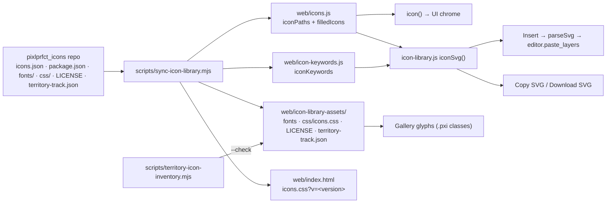

# Icon Library

The PixlPrfct icon library ("pxlprfct icons") is an MIT-licensed set of 679 stroke icons. Each icon is a single 24×24 path, and every icon comes in three weights (Light 1, Regular 1.5, Bold 2.5). The same set serves two purposes. Interface-only directional panel variants live separately in `interfaceIconPaths`; they render through `icon()` and are not advertised as downloadable font glyphs. It is the editor's own UI icon set (`icon()` in [web/icons.js](../../web/icons.js)). It is also a user-facing library that inserts icons into designs as editable vector layers ([web/icon-library.js](../../web/icon-library.js)). The canonical source is the **separate `pixlprfct_icons` repository**. This repo vendors that source through `scripts/sync-icon-library.mjs`, so **do not hand-edit `iconPaths`, `icon-keywords.js` or `icon-library-assets/`**. Add icons upstream and sync them here.

## At a glance

| | |
| --- | --- |
| **Key files** | [web/icons.js](../../web/icons.js), [web/icon-keywords.js](../../web/icon-keywords.js), [web/icon-library.js](../../web/icon-library.js), [web/icon-library.css](../../web/icon-library.css), [web/icon-library-assets/](https://github.com/ninefingerwoodshop-ops/pixlprfct/tree/main/web/icon-library-assets) |
| **Entry points** | Editor command **PixlPrfct Icon Library** (Actions panel, category *Libraries*), registered in `web/app.js` by `installIconLibrary(...)`; `icon(name, weight)` for UI chrome; `iconSvg(name, weight)` for portable SVG |
| **Depends on** | `workspace-window.js` (floating window), `svg-import.js` `parseSvg` and the engine's `paste_layers` (insertion), `inspector-dropdown.js` (restyles the weight `<select>`) |
| **Used by** | All editor chrome that renders `icon()`, `control-inspector.js` and `segmented-control.js` (icon pickers for starter controls), `mcp/reference.mjs` (`icons` topic), the SVG Animator, project home, and the product site's icon showcase |
| **Tooling** | [scripts/sync-icon-library.mjs](../../scripts/sync-icon-library.mjs), [scripts/territory-icon-inventory.mjs](../../scripts/territory-icon-inventory.mjs) |
| **Related docs** | [docs/TERRITORY_ICON_COVERAGE.md](../TERRITORY_ICON_COVERAGE.md), [site/assets/icons/README.md](../../site/assets/icons/README.md), [docs/LICENSING.md](../LICENSING.md) |

## Two renderings of one set

Every icon exists in two forms in this repo, and they must stay in sync:

| Form | Where | Used for |
| --- | --- | --- |
| **SVG path data** | `iconPaths` in `web/icons.js` (one `d` string per name, 24×24 viewBox) | `icon()` (inline SVG in the UI), `iconSvg()` (Insert, Copy and Download in the library), MCP reference, control icon pickers |
| **Icon font** | `web/icon-library-assets/css/icons.css` plus `fonts/pixlprfct-icons-{light,regular,bold}.woff2` | The library *gallery grid and preview* (`<span class="pxi pxi-<name> pxi-<weight>">`) and external users of the font |

The gallery shows **font glyphs**, but **Insert, Copy SVG and Download SVG produce SVG from `iconPaths`**. If upstream fonts and paths drift apart, a user sees one drawing and inserts another. `tests/icon-library.test.mjs` checks that every `iconPaths` name has a `.pxi-<name>::before` rule. It does not compare the drawings.



## Key modules

| File | Role |
| --- | --- |
| [web/icons.js](../../web/icons.js) | `iconPaths` (679 entries, generated), `filledIcons` (generated; currently `pixlprfct`, `territory-track`, `apple-logo`, `facebook-logo`, `google-logo`), `iconWeights = {light:1, regular:1.5, bold:2.5}`, `icon(name, weight='regular')`, `installIcons()` (fills `[data-icon]` and `[data-tool]` elements and the undo/redo buttons). It also exports the unrelated helper `componentLabelType`. The sync script replaces only the generated declarations, so hand-written code below them survives. |
| [web/icon-keywords.js](../../web/icon-keywords.js) | `iconKeywords`: search aliases per icon name (541 icons have keywords). Includes Territory Track names, SF Symbol names such as `brain.head.profile`, and category tags such as `rte` and `ios`. |
| [web/icon-library.js](../../web/icon-library.js) | `iconSvg(name, weight)` and `installIconLibrary({insert, notify})`. |
| [web/icon-library.css](../../web/icon-library.css) | Gallery layout: an auto-fill grid of 108 px cards, 32 px glyphs, and a detail footer. |
| [web/icon-library-assets/css/icons.css](../../web/icon-library-assets/css/icons.css) | `@font-face "PixlPrfct Icons"` at weights 300/400/700, with cache-busting `?v=<hash>` URLs. Defines `.pxi` (base), `.pxi-light`/`.pxi-regular`/`.pxi-bold`, and one `.pxi-<name>::before{content:"\eXXX"}` per icon. |
| `web/icon-library-assets/fonts/` | `pixlprfct-icons-{light,regular,bold}.{woff2,ttf}` — six font files (WOFF2 + TTF per weight), referenced by the CSS. The sync copies the upstream `fonts/` folder. |
| [web/icon-library-assets/territory-track.json](../../web/icon-library-assets/territory-track.json) | Territory Track coverage manifest (see below). |
| `web/icon-library-assets/LICENSE` | MIT notice ("Copyright (c) 2026 the pixlprfct contributors"). |
| [scripts/sync-icon-library.mjs](../../scripts/sync-icon-library.mjs) | Vendors the upstream repository into the editor. |
| [scripts/territory-icon-inventory.mjs](../../scripts/territory-icon-inventory.mjs) | Scans the Territory Track web (TerritoryIQ) and iOS sources for named icon references. Its `--check` mode fails on unmapped names. |
| `site/assets/icons/` | `LICENSE.txt` (MIT) and `README.md` covering attribution for the 18 inline SVG samples on the product site (`site/index.html`). The site links to the hosted gallery and ZIP instead of shipping a second copy. |

## Important APIs

### `icon(name, weight = 'regular') → string`

This function returns inline SVG markup. The `<svg>` has class `app-icon`, `viewBox="0 0 24 24"`, `aria-hidden="true"`, round caps and joins, `stroke-width = iconWeights[weight] ?? 1.5`, and a single `<path d>`. Icons named in `filledIcons` use `fill="currentColor" stroke="none"` instead. **Unknown names silently fall back to `iconPaths.rectangle`**, so a typo renders a rectangle instead of throwing. This is the function that all editor chrome uses (`button(label, glyph, …)` helpers across `web/`).

### `iconSvg(name, weight = 'regular') → string`

This is the portable export used by Insert, Copy and Download. It wraps `icon()`, adds `xmlns`, `width="24"` and `height="24"`, and replaces `currentColor` with `#222222` so the file has a concrete paint outside the app. Unlike `icon()`, it **throws `Unknown icon`** for names that are not in `iconPaths`.

### `installIconLibrary({insert, notify}) → open()`

This call builds a `workspaceWindow('PixlPrfct Icon Library', …)` that contains:

- a search field. Filtering is a substring match against `name + ' ' + keywords.join(' ')`. The query is lowercased, and spaces become hyphens, so "arrow up" matches `arrow-up-…`.
- a weight `<select>` built from `Object.keys(iconWeights)`. `installInspectorDropdowns` restyles it as the shared dropdown because it sits inside `.workspace-window`.
- a live count
- a grid of `aria-pressed` buttons, one per matching name, sorted alphabetically
- a detail footer with the preview glyph, the name, the CSS usage string (`pxi pxi-<name> pxi-<weight>`) and three actions: **Insert icon**, **Copy SVG** (`navigator.clipboard.writeText`, with a fallback message when the clipboard is unavailable) and **Download SVG** (`<name>-<weight>.svg`).

The returned function re-renders the window, opens it and focuses the search field.

## How icons are inserted into a design

In [web/app.js](../../web/app.js), inside `bind()`:

```js
const showIconLibrary=installIconLibrary({insert:(svg,name)=>safe(()=>placeSvg(parseSvg(svg,name))),notify:toast});
commands.push({label:'PixlPrfct Icon Library',category:'Libraries',run:showIconLibrary});
```

Insertion takes this path:

1. **Insert icon** calls `insert(iconSvg(selected, weight), '<name> <weight>')` and closes the window.
2. `parseSvg(text, name)` in [web/svg-import.js](../../web/svg-import.js) converts the SVG into an engine paste payload (`{shapes:[…]}`). This is the same importer used for pasted or dropped SVG files.
3. `placeSvg(payload)` centers the root at the viewport center in canvas coordinates. It calls `editor.paste_layers(json, x, y, frameAt(pageShapes(), start))`, so an icon dropped over a frame becomes that frame's child. It then selects the new layers, switches to the Select tool and shows the toast "SVG imported as editable layers".

The result is ordinary editable layers. `svgLayers` creates a root frame named `<name> <weight>`, with fill disabled, that holds a vector built from the path, using the chosen stroke width and a `#222222` stroke. **No link to the library is kept.** Changing the weight or the drawing later means inserting the icon again. Icon instances are not components.

Other consumers reference icons **by name**, not by inserting geometry:

- **Starter controls.** `control-inspector.js` and `segmented-control.js` offer every `iconPaths` name in a picker and store the name in control or segment config. Renaming an icon upstream breaks those references.
- **MCP.** `pixlprfct_reference` with `topic: 'icons'` returns the filtered `iconPaths` (`mcp/reference.mjs`), so agents can discover valid icon names for controls.

## Font and codepoint rules

- Codepoints are in the Private Use Area, starting at **U+E900** and assigned densely. The 679 icons currently occupy U+E900 to U+EBA6. All 679 codepoints are unique; this was checked against the vendored `icons.css`.
- **The list is append-only.** The first 546 entries (`align-bottom` … `grammar-check`) keep their original codepoints. The 133 additions in 0.9.0 (from `alien` onward) were appended after them, as TERRITORY_ICON_COVERAGE.md records: "All original 546 names, drawings and codepoints are preserved". Never renumber or reuse a codepoint, because existing font users would get the wrong glyph.
- The three weights are **separate font files** that share one family name and one codepoint map. The family is `"PixlPrfct Icons"`, and the weights map to `font-weight` 300/400/700. They are selected through `.pxi-light`, `.pxi-regular` or `.pxi-bold`. `font-synthesis: none` prevents the browser from faking weights.
- The SVG stroke widths (1, 1.5, 2.5) correspond to those font weights. Each font glyph is the *outlined* stroke at that width. That is why the path data needs only one drawing while the font needs three files.
- Cache busting happens at two levels. Each `@font-face` URL carries a content hash (`?v=1e99c62f9317`, and so on). `web/index.html` links `icons.css?v=<package version>` (currently `0.9.0`), and the sync script rewrites that query string. Desktop and browsers otherwise keep stale fonts that hide new glyphs.
- The upstream package tests check that glyphs are drawable, that SVGs stay within bounds, that codepoints are unique, and that font rebuilds are byte-identical (per TERRITORY_ICON_COVERAGE.md). Those tests live in `pixlprfct_icons`, not here.

## How to add an icon

1. **In `pixlprfct_icons`** (the canonical repo), add the icon to `icons.json` as `{ "<name>": { "path": "<24×24 d>", "keywords": [...], "filled": false } }`. Use a lowercase, hyphenated name. Draw for a 1.5 stroke with round caps and joins, and stay inside the 24×24 box. Rebuild the fonts there, so that the new name gets the **next** codepoint after the current highest one, and bump the package version.
2. **In this repo**, run:

   ```sh
   node scripts/sync-icon-library.mjs /path/to/pixlprfct_icons   # default: ../pixlprfct_icons
   ```

   The script reads `icons.json` and `package.json` and then:
   - rewrites the `export const iconPaths = {…};` block in `web/icons.js`
   - regenerates `web/icon-keywords.js` from entries that have `keywords`
   - rewrites (or inserts before `iconWeights`) the `filledIcons` declaration
   - copies `fonts/`, `css/`, `LICENSE` and `territory-track.json` into `web/icon-library-assets/`
   - updates the `icons.css?v=` query in `web/index.html`
3. Run `node --test tests/icon-library.test.mjs tests/territory-icon-coverage.test.mjs`.
4. Rebuild the editor (`npm run build:editor`) or refresh the served assets (`node scripts/prepare-editor.mjs`), so that `public/editor/` and the desktop bundle pick up the new files. See [Build-System](Build-System.md).
5. If the product site's samples or the icon count changed, update `site/index.html` and `site/assets/icons/README.md` by hand. The site pins a specific upstream commit.

**Editor-only UI icons.** Because `icons.js` is generated, an icon added only here is overwritten by the next sync. Add UI glyphs upstream too.

## Territory Track coverage

PixlPrfct is used to design Territory Track, so the library also acts as a semantic replacement for every named icon that the Territory Track web app (TerritoryIQ, Angular) and iOS app reference. The manifest maps referenced names to library entries. Mapping coverage and rendering tests do not establish the provenance or legal clearance of every drawing; preserve the published license and attribution notices.

`territory-track.json` (schemaVersion 1) contains:

- `sources`: the web and iOS commit hashes the scan was run against
- `ignoredReferences`: five scanner hits classified as non-icons (`web:stable`, `web:csv`, `web:pdf`, `web:down`, `web:up`)
- `references`: 599 entries of the form `{group, name, uses: ["file:line", …], target}`. `group` is one of `web`, `lucide`, `avatar`, `custom` or `ios`, and `target` is a PixlPrfct icon name. The doc reports that these 599 references resolve to 313 distinct symbols.

`scripts/territory-icon-inventory.mjs` exports `inventory(webRoot, iosRoot)`. It needs the `typescript` package, which is a dev dependency. The scan covers:

- **Web** (`client/src/app/**/*.ts|.html`): `appIcon`/`nfIcon` attributes and bindings, `<app-icon>`/`<nf-icon name>`, `ph-*` classes, `iconSvg`/`nfIconSvg`/`iconHtml` calls, properties named like `icon`/`leadingIcon`, methods whose names contain `icon`, and `*ICON*` registries. `NF_ICON_REGISTRY` maps to `lucide`, `ICON_SVG` maps to `avatar`, and inline path literals map to `custom`. The scan uses the TypeScript AST to follow conditional expressions and drop `||`/`??` fallbacks.
- **iOS** (Swift): `systemName:`, `systemImage:`, `systemImageName:`, `icon:` and `symbol:` arguments; tab tuples; and computed `icon`/`symbol` properties and functions. Comparison literals and `case "x":` labels are skipped.

CLI:

```sh
node scripts/territory-icon-inventory.mjs <TerritoryIQ> <TerritoryTrackIOS>            # print inventory JSON
node scripts/territory-icon-inventory.mjs <TerritoryIQ> <TerritoryTrackIOS> out.json   # write it
node scripts/territory-icon-inventory.mjs <TerritoryIQ> <TerritoryTrackIOS> --check    # fail on unmapped names
```

After an icon change in Territory Track, run `--check`. Any unmapped reference needs an upstream mapping, a new icon or keyword, or an `ignoredReferences` entry.

## Invariants and gotchas

- **Generated code.** Edits to `iconPaths`, `filledIcons` or `iconKeywords` are lost on the next sync. The sync uses regular expressions to replace those blocks, so keep their exact declaration forms: `export const iconPaths = {` … `\n};` and `export const filledIcons = …;`.
- **Searchability is a test requirement for Territory Track names.** `territory-icon-coverage.test.mjs` asserts that `iconKeywords[target]` includes each reference's `name`, that every target exists, and that every target exports a `<path d>` at all three weights.
- **`icon()` versus `iconSvg()` error behavior** differs: one falls back to a rectangle, the other throws.
- **Filled icons ignore the weight.** Logos in `filledIcons` render as fills, so the weight has no visible effect.
- **Licensing.** The icons are MIT, separate from the editor's custom Community License. Keep `web/icon-library-assets/LICENSE` and `site/assets/icons/LICENSE.txt` with any redistribution. [docs/LICENSING.md](../LICENSING.md) lists this file among the third-party notices.
- **Gallery depends on the font files.** If `fonts/` is missing or stale in a checkout, the gallery shows blank or wrong glyphs, but Insert still works because it uses `iconPaths`.

## Tests

| Test | Checks |
| --- | --- |
| [tests/icon-library.test.mjs](../../tests/icon-library.test.mjs) | Every `iconPaths` name has a CSS class. `iconSvg` produces `xmlns` and the right `stroke-width` for all three weights. `icon('asterisk')` defaults to 1.5. Unknown names throw. |
| [tests/territory-icon-coverage.test.mjs](../../tests/territory-icon-coverage.test.mjs) | Manifest integrity (no duplicates, targets exist, names are searchable, `uses` evidence is present, all five groups appear, specific required icons exist). A synthetic source tree checks that the scanner catches template branches, indirect maps, avatars, custom paths, Swift badges, shortcuts and tab tuples, and ignores conditional operands and `case` labels. |

## Related pages

- [Canvas-Tools-and-Editing](Canvas-Tools-and-Editing.md): paste and SVG placement on the canvas
- [Import-Design-Files](Import-Design-Files.md): `parseSvg`, the importer that turns inserted icons into layers
- [Components-Variants-and-Slots](Components-Variants-and-Slots.md): starter controls that store icon names
- [MCP-Server](MCP-Server.md): the `icons` reference topic
- [Web-Editor-Architecture](Web-Editor-Architecture.md), [Build-System](Build-System.md)

## Source of truth

- Code: `web/icons.js`, `web/icon-keywords.js`, `web/icon-library.js`, `web/icon-library.css`, `web/icon-library-assets/`, `scripts/sync-icon-library.mjs`, `scripts/territory-icon-inventory.mjs`, `web/app.js` (`installIconLibrary` wiring and `placeSvg`)
- Docs: [docs/TERRITORY_ICON_COVERAGE.md](../TERRITORY_ICON_COVERAGE.md) (coverage numbers and local verification on 2026-10-30), [site/assets/icons/README.md](../../site/assets/icons/README.md)
- Upstream: `github.com/ninefingerwoodshop-ops/pixlprfct_icons` (gallery at `ninefingerwoodshop-ops.github.io/pixlprfct_icons/`)
