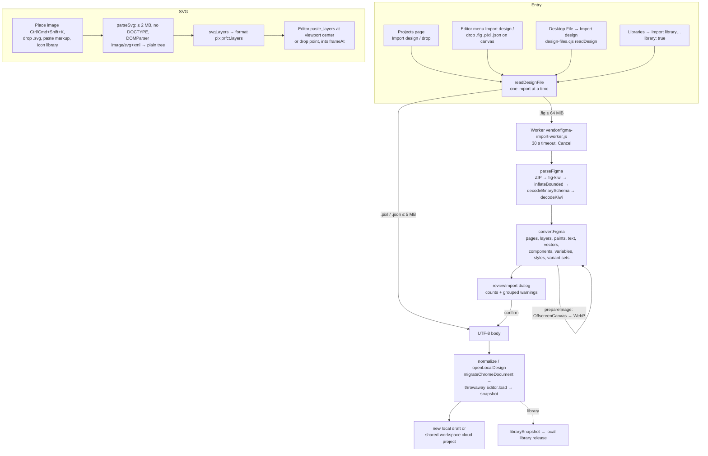

# Import: Design Files and SVG

PixlPrfct has three import paths into the native document model: **`.fig` design archives** (parsed locally in a Web Worker by [archive import modules](https://github.com/ninefingerwoodshop-ops/pixlprfct/tree/main/web/figma) and converted to a new native project), **editable SVG** (parsed on the main thread by [web/svg-import.js](../../web/svg-import.js) into a layer-clipboard payload pasted into the open page), and **native `.pixl`/JSON projects** (validated by loading into a throwaway Rust `Editor`). The key invariant shared by all three: **nothing is trusted until the Rust engine has loaded it**. Converters only emit plain document JSON; `Editor::load` / `Editor::paste_layers` validate, migrate and reflow it, and any failure leaves the open document untouched.

## At a glance

| | |
|---|---|
| **Key files** | [web/design-import.js](../../web/design-import.js), [archive parser](../../web/figma/parse.js), [archive converter](../../web/figma/convert.js), [library-data converter](../../web/figma/library-data.js), [import worker](../../web/figma/worker.js), [import-worker build script](../../scripts/build-figma-import.mjs), [web/svg-import.js](../../web/svg-import.js), [web/svg-path.js](../../web/svg-path.js), [web/svg-viewport.js](../../web/svg-viewport.js), [web/svg-gradients.js](../../web/svg-gradients.js), [web/project-file.js](../../web/project-file.js), [web/document-merge.js](../../web/document-merge.js) |
| **Entry points** | `readDesignFile(file, {library})` (design-import.js); `parseSvg(text, name)` → `svgLayers(tree)` (svg-import.js); `placeImage` / `placeSvg` / `importDesignFile` / `openLocalDesign` in [app.js](../../web/app.js); `importDesign` / `normalize` in [project-home.js](../../web/project-home.js); `importLibrary` in [library-manager.js](../../web/library-manager.js); `readDesign` in [desktop/design-files.cjs](../../desktop/design-files.cjs) |
| **Depends on** | npm `fflate` 0.8.3 (ZIP + deflate), `fzstd` 0.1.1 (Zstandard), `kiwi-schema` 0.5.0 (binary schema decoding), esbuild (worker bundle); WASM `Editor` (`load`, `paste_layers`, `snapshot`) |
| **Used by** | Projects page, editor PixlPrfct menu and canvas drop, desktop File menu, Libraries manager (design archive as a library), Icon library insert (`placeSvg`) |
| **Related docs** | [Design-file import guide](../DESIGN_FILE_IMPORT.md), README "Editable SVG import" and "design archive import", [fixture attribution](../../tests/fixtures/figma/README.md) |

## Pipeline

## `.fig` archive import

### User-visible behavior

Save a local `.fig` copy of a design archive, then use **Import design** on the Projects page, **PixlPrfct menu → Import design** in the editor, drop the file on the Projects page or canvas, or use desktop **File → Import design** (Ctrl/Cmd+O). A modal shows "Reading pages and layers…" with **Cancel**; then a summary (pages, editable layers, components, images) and a grouped "Items to review" list. **Import design** creates a separate project: from the Projects page in a self-hosted shared workspace it is saved to that workspace (`cloudRequest('', {method:'POST'})`), otherwise as a local draft. Importing from the editor first saves the current draft, then opens the import as a new draft. The original file is never modified, and canceling or a parse error does not replace the open design. In the Libraries manager, a `.fig` can be imported as a reusable local library instead (`readDesignFile(file, {library:true})` → `librarySnapshot`).

### Build and packaging

`npm run build:editor` runs [import-worker build script](../../scripts/build-figma-import.mjs), which bundles [import worker](../../web/figma/worker.js) with esbuild (ESM, es2022, minified) into `web/vendor/figma-import-worker.js` and concatenates the fflate, fzstd and kiwi-schema licenses into `web/vendor/figma-import-LICENSES.txt`. design-import.js loads the worker with `new Worker(new URL('./vendor/figma-import-worker.js', import.meta.url), {type:'module'})`. If the bundle is missing or stale, design-file import fails with "The design-file importer could not run".

### Parsing (`web/figma/parse.js`)

`parseFigma(data)`:

1. Reject non-`Uint8Array`, empty, or >64 MiB input.
2. If the file starts with `PK`, unzip with `fflate.unzipSync` and a filter that rejects >4096 entries, duplicate names, absolute paths, `..`/`.` segments, backslashes and NULs. Only `canvas.fig`, `meta.json` (≤1 MB) and `images/<40-hex sha1>[.png|.jpg|.jpeg|.webp|.gif]` are kept; their expanded total must stay ≤128 MiB.
3. Require the `fig-kiwi` magic, read the version, then two length-prefixed chunks: compressed schema and compressed message (a trailing thumbnail chunk in older files is ignored).
4. `inflateBounded(chunk, limit)` decompresses deflate (`fflate.Inflate`) or Zstandard (`fzstd.Decompress`, detected by magic `28 b5 2f fd`) in 1 KB pushes, aborting as soon as output exceeds the limit (2 MiB for the schema, 64 MiB for the message). For Zstandard, `checkZstd` pre-scans every frame header and rejects window sizes or declared content sizes above the limit **before** a decoder allocates buffers.
5. `decodeBinarySchema` (kiwi-schema) reads the embedded schema; `decodeKiwi(schema, data)` is a hand-written interpreter that walks the schema as data. It never calls kiwi-schema's `compileSchema`, which generates code with `new Function`; this keeps the desktop Content Security Policy intact. Limits: ≤4000 definitions, ≤2,000,000 decoded values, depth ≤96, arrays ≤200,000. Results use `Object.create(null)` so hostile field names such as `__proto__` cannot pollute prototypes.
6. Require `message.nodeChanges` with ≤50,000 nodes. Return `{version, message, images, meta}`.

### Conversion (`web/figma/convert.js`)

`convertFigma(parsed, fileName, {prepareImage})` returns `{body, report}` where `body` is a version-2 native document string:

- **Tree**: drops `REMOVED` nodes, indexes by GUID (duplicates are fatal), sorts children by fractional `parentIndex.position`, rejects cycles and nesting deeper than 96. Pages are `CANVAS` nodes in source order, excluding internal-only canvases; 0 or >100 pages are fatal.
- **Node types** (`types` map): `FRAME`, `SYMBOL`, `COMPONENT`, `INSTANCE`, `COMPONENT_SET`, `SECTION` → `frame`; `GROUP` → `group`; `RECTANGLE`/`ROUNDED_RECTANGLE` → `rectangle`; `ELLIPSE` → `ellipse`; `TEXT` → `text`; `LINE` → `line`; `VECTOR`, `BOOLEAN_OPERATION`, `REGULAR_POLYGON`, `STAR` → `pen`. A fill-less, resize-to-fit `FRAME` without auto layout becomes a `group`. Unknown types become empty containers with a warning.
- **Transforms**: The source 2×3 transform is converted to page-absolute x/y plus center-based rotation (`rotation = -atan2(b, a)`); mirrored/skewed transforms produce a warning. Instance children are scaled by instance size / source size.
- **Vectors**: `vectorCommands` decodes `fillGeometry` command blobs; open, unfilled paths fall back to `networkPaths` (decoding `vectorNetworkBlob`, ≤4096 vertices/segments). Compound or Boolean results become a transparent container frame with one editable `pen` child per sub-path ("Compound vectors were split…").
- **Paints**: up to 64 fills/strokes (`paints()`), solid and linear/radial gradients (≤16 stops; unsupported geometry → solid), blend modes, opacity. `IMAGE` paints become native image paints (`media`), deduplicated by hash; `prepareImage` in the worker decodes with `createImageBitmap`, rejects >64 megapixels, re-encodes to WebP (quality 0.85) when larger than 2048 px or 1.5 MB, and rejects results over 1.5 MB.
- **Effects**: drop/inner shadows (max eight), layer/background blur (multiple blurs merged).
- **Text**: base font family, size (1–512), weight from style name, alignment (justified → left), line height, letter spacing (px or %), case, text sizing. Mixed runs and italics use the base style. Text over 10 KB is fatal for that file.
- **Auto layout**: `stackMode` `HORIZONTAL`/`VERTICAL` maps to `auto_layout` (`stackSpacing`, per-side padding, `stackPrimaryAlignItems`/`stackCounterAlignItems`, `RESIZE_TO_FIT` → hug); `stackPositioning: ABSOLUTE` → `layout_item.absolute`. Other layout modes keep fixed positions with a warning.
- **Components**: main components become component masters; instances are expanded from their source into editable, **detached** layers with supported overrides applied. Missing sources produce a warning.
- **Library data** ([library-data.js](../../web/figma/library-data.js)): `importVariables` creates variable collections (≤32 modes) and color/number/string/boolean variables with aliases (cycles and unavailable aliases warn); color, effect and text styles become `color_styles`, `effect_styles`, `text_styles`; `importVariantSets` rebuilds `component_sets`. The report includes `variables`, `styles` and `variantSets` counts.
- **Report**: `warn(message, node)` groups by message with a count and up to three example layer names. Fatal limits: 10,000 converted layers, 5 MB serialized body.

Unsupported features that only warn include masks (imported as plain layers), prototypes, layout guides, image color adjustments and custom crops, custom stroke endpoints, exposed component properties/slot metadata, and unsupported paints/effects (gray fill or omitted).

> **Note:** Local variables (with aliases), color/effect/text styles and variant sets are imported (`library-data.js`; test "imported library variables, aliases, shared styles and variant sets remain reusable after merge"). Exposed component properties are still not imported, and unresolvable bindings fall back to saved values with a warning.

### Native validation and saving

`readDesignFile` resolves to `{body, report}`. The caller then normalizes:

- Projects page `normalize(body)`: SVG Animator documents go through `normalizeSvgAnimation`; everything else is `migrateChromeDocument` → `new Editor().load(...)` → `ensureBaseTextDocument` → `snapshot()`.
- Editor `openLocalDesign(body)`: the same validation via a throwaway `Editor`, saves the current draft first, then creates and opens a new draft.

`Editor::load` ([src/lib.rs](../../src/lib.rs)) rejects bodies over 5 MB, migrates version-1 documents to pages, runs `validate`, resolves variables, upgrades starter controls and commits through `commit_document`, which runs layout and text reflow. This is the step that catches converter bugs.

### Limits summary

| Limit | Value | Where |
|---|---|---|
| Source `.fig` | 64 MiB | `FIGMA_LIMIT` (design-import.js), `FIGMA_FILE_LIMIT` (parse.js), desktop `readDesign` |
| Kept ZIP contents | 128 MiB, ≤4096 entries | `parseFigma` |
| Expanded message / schema | 64 MiB / 2 MiB | `inflateBounded` |
| Source nodes | 50,000 | `parseFigma` |
| Pages | 100 | `convertFigma`, Rust `validate` |
| Converted layers | 10,000 | `convertFigma` |
| Converted project | 5 MB | `convertFigma`, `Editor::load` |
| Embedded image | ≤2048 px per side, ≤1.5 MB encoded | worker `prepareImage` |
| Parse time | 30 s | `parseInWorker` timer |
| `.pixl` / `.json` | 5 MB | `readFile` |

## Editable SVG import

### User-visible behavior

**Place image or SVG** (Ctrl/Cmd+Shift+K), drop an `.svg` on the canvas, paste SVG markup (`image/svg+xml` clipboard data or text starting with `<svg`), or insert from the Icon library. Shapes become editable layers inside a viewport frame named after the file; import is one undo step and fails entirely, before insertion, on unsupported content. SVG cannot replace a raster image layer.

### Implementation

`parseSvg(text, name)` rejects >2 MB input and any `<!DOCTYPE`/`<!ENTITY`, parses with `DOMParser` as `image/svg+xml` (inert XML; never inserted into the page DOM), and converts it to a plain `{tag, attrs, children}` tree (≤10,000 nodes, depth ≤64). `svgLayers(tree, name)` walks it and returns `{format:'pixlprfct.layers', version:1, shapes}`, which `placeSvg` in app.js passes to `Editor::paste_layers(json, x, y, frameAt(...))`, then selects the result.

| Module | Responsibility |
|---|---|
| [svg-import.js](../../web/svg-import.js) | Element walk; presentation attributes (`fill`, `stroke`, widths, caps/joins, `stroke-miterlimit`, dashes, opacities, `fill-rule`, `color`, `visibility`) and an inline `style` subset; opacity composition; converts `rect`, `circle`, `ellipse`, `line`, `polyline`, `polygon`, `path` to `pen` paths via `fromPoints`; `g`, `use` and `symbol` become frames (not `group` layers) with `clip_content` only where a symbol viewport clips. |
| [svg-path.js](../../web/svg-path.js) | `parsePath` (all absolute/relative commands, smooth and quadratic curves), `arcCubics` (W3C endpoint-to-center conversion, ≤90° cubic segments), `parseTransform`, `multiply`, `transformPoint`. Also used by vector tools. |
| [svg-viewport.js](../../web/svg-viewport.js) | `svgViewport(attrs, length, fallback)` resolves width/height/viewBox/`preserveAspectRatio` (meet/slice/none) into a matrix; `svgReferences(tree)` indexes IDs and resolves `<use href>`/`xlink:href` with cycle detection and expansion limits. |
| [svg-gradients.js](../../web/svg-gradients.js) | `gradientResolver(tree, viewport, color)`: linear and radial gradients (≤16 stops, `objectBoundingBox`/`userSpaceOnUse`, `gradientTransform`, `href` templates, `currentColor`, focal point), applied to fills and strokes; `pathBounds` uses curve extrema. `spreadMethod` other than `pad` is rejected. |

Rejected with a specific message: root `transform`, `filter`/`clip-path`/`mask`/markers/`vector-effect` attributes, event-handler attributes, external `href`, nested `<svg>` viewports, rotated/skewed symbol viewports, symbol transforms, filled compound paths and even-odd fills, non-uniformly transformed strokes, non-pixel units, unsupported paints (patterns, external URLs), and any other element (`text`, `image`, `style`, `foreignObject`, …). Anchors per path are limited to 4096.

> **Note:** README "Editable SVG import" says radial gradients and gradient strokes are unsupported; later README paragraphs and the code (`svg-gradients.js`, `stroke_gradient` in svg-import.js, `tests/svg-radial.test.mjs`) support radial fills and gradient strokes. Repeating/reflected gradients remain unsupported. README also calls SVG groups "groups"; code builds `frame` layers with no fill and no clipping.

The SVG Animator design type has its own sanitizing SVG importer; see [SVG-Animator](SVG-Animator.md).

## Native project files and merge

[web/project-file.js](../../web/project-file.js) `projectFile(snapshot)` produces the download for **Save file / Export editable project**: it checks the snapshot has `pages` and `shapes`, enforces 5 MB, sanitizes the file name and returns `{name: '<name>.pixl', data, type: 'application/json'}`. `.pixl` is the engine snapshot verbatim, so IDs and cross-page references survive a round trip. Re-importing goes through the same `readDesignFile` → `normalize` path as converted archive output.

[web/document-merge.js](../../web/document-merge.js) is not used by file import. It provides `mergeDocuments(base, local, remote, {prefer})`, a field-level three-way merge where arrays of objects with unique `id`s merge per ID (order conflicts reported separately), unchanged sides take the other side's value, and ambiguous edits are recorded in `conflicts` (the preferred side wins in the result). `PersonalHistory` uses it for per-user undo/redo in live sessions and pauses undo when a teammate's change conflicts. It is imported only by [live-session.js](../../web/live-session.js); see [Teams-Libraries-and-Collaboration](Teams-Libraries-and-Collaboration.md).

## Extension guide

**Support a new source property**: find the node's field name in a decoded fixture (`parseFigma(await readFile('tests/fixtures/figma/circle.fig'))` in Node), map it in `convertFigma`'s `walk`, keep values clamped to engine limits, and call `warn()` for anything partially supported so the review dialog shows it. Add a case to `tests/figma-import.test.mjs`; synthetic messages can be built with kiwi-schema's `encodeBinarySchema` as the existing tests do. Rebuild the worker (`node scripts/build-figma-import.mjs`).

**Support a new SVG feature**: extend the attribute allow-list and element switch in `svgLayers`; reject rather than approximate if fidelity is uncertain (partial import is a design non-goal). Add path/geometry cases to `tests/svg-import.test.mjs` and paint cases to `tests/svg-gradients.test.mjs` / `tests/svg-radial.test.mjs`.

## Invariants and gotchas

- Converters must emit valid native JSON but must not assume it will be accepted; always route through `Editor.load` / `paste_layers`.
- Never use kiwi-schema's `compileSchema` or any `eval`/`new Function`: the desktop CSP forbids it and the schema comes from the file.
- Every decompression path must be bounded before allocation (`checkZstd`, chunked `inflateBounded`).
- Only one design import runs at a time (`importing` flag in design-import.js).
- Imported instances are detached on import; library links, access rules and update relationships do not transfer.
- SVG import runs on the main thread; its 2 MB and 10,000-node caps are what keep it responsive.

## Tests

| File | Coverage |
|---|---|
| `tests/figma-import.test.mjs` (15) | Real deflate (`circle.fig`) and Zstandard (`vector-zstd.fig`) exports, open vector networks (`open-path.fig`), page order, rotation, paints/effects/auto layout/text, component expansion, images, warning report, fatal cycles/duplicates/limits, hostile schema names, unsafe archives and decompression bombs, desktop `readDesign`, variables/styles/variant sets, alias warnings |
| `tests/svg-import.test.mjs` (6) | Path grammar, arcs, transform order, atomic editable frame trees with history, rejection before insertion, miter limits |
| `tests/svg-gradients.test.mjs`, `tests/svg-radial.test.mjs`, `tests/svg-use.test.mjs` (4 each) | Linear/radial gradients, `<use>`/`<symbol>` |
| `tests/project-file.test.mjs` (2) | `.pixl` reopens in a fresh editor with cross-page components and variables; portable names; oversized projects cannot be exported |
| `tests/live-editing.test.mjs` | `mergeDocuments` / `PersonalHistory` behavior |
| [tests/browser/daily-workflow.spec.mjs](../../tests/browser/daily-workflow.spec.mjs) | Playwright: complex project import, edit, export and lossless re-import |
| [tests/browser/libraries.spec.mjs](../../tests/browser/libraries.spec.mjs) | Playwright: importing a design archive as a library (`tests/helpers/figma-library.mjs`) |

Run `npm run build:editor` before `node --test tests/figma-import.test.mjs tests/svg-*.test.mjs`. Binary fixtures come from OpenFig (MIT) and are test-only.

## Known limitations

- Only `.fig` archives; no `.jam`, `.deck`, URLs or REST JSON; no .fig export.
- The `.fig` format is proprietary and may change; fixtures cover archive versions 101 and 106.
- Mixed text runs, compound-path holes, masks, skew/reflection, image crops/filters, grid auto layout, layout guides, prototypes and exposed component properties are lost or approximated.
- SVG: no text, images, CSS `<style>`, masks, clip paths, filters, nested `<svg>`, even-odd/compound fills or repeating gradients.

## Related pages

[Canvas-Tools-and-Editing](Canvas-Tools-and-Editing.md) · [Layout-Auto-Layout-and-Grid](Layout-Auto-Layout-and-Grid.md) · [Document-Model-and-File-Format](Document-Model-and-File-Format.md) · [Rust-Document-Engine](Rust-Document-Engine.md) · [Build-System](Build-System.md) · [Desktop-App](Desktop-App.md) · [Teams-Libraries-and-Collaboration](Teams-Libraries-and-Collaboration.md) · [Styles-Variables-and-Paints](Styles-Variables-and-Paints.md) · [Components-Variants-and-Slots](Components-Variants-and-Slots.md) · [SVG-Animator](SVG-Animator.md) · [Icon-Library](Icon-Library.md)

## Source of truth

- [web/design-import.js](../../web/design-import.js), [archive parser](../../web/figma/parse.js), [archive converter](../../web/figma/convert.js), [library-data converter](../../web/figma/library-data.js), [import worker](../../web/figma/worker.js), [import-worker build script](../../scripts/build-figma-import.mjs)
- [web/svg-import.js](../../web/svg-import.js), [web/svg-path.js](../../web/svg-path.js), [web/svg-viewport.js](../../web/svg-viewport.js), [web/svg-gradients.js](../../web/svg-gradients.js)
- [web/project-file.js](../../web/project-file.js), [web/document-merge.js](../../web/document-merge.js), [web/project-home.js](../../web/project-home.js) (`importDesign`, `normalize`), [web/app.js](../../web/app.js) (`placeImage`, `placeSvg`, `importDesignFile`, `openLocalDesign`), [web/library-manager.js](../../web/library-manager.js) (`importLibrary`), [desktop/design-files.cjs](../../desktop/design-files.cjs)
- [src/lib.rs](../../src/lib.rs) (`Editor::load`, `Editor::paste_layers`)
- Docs: [Design-file import guide](../DESIGN_FILE_IMPORT.md), [README](../../README.md)
