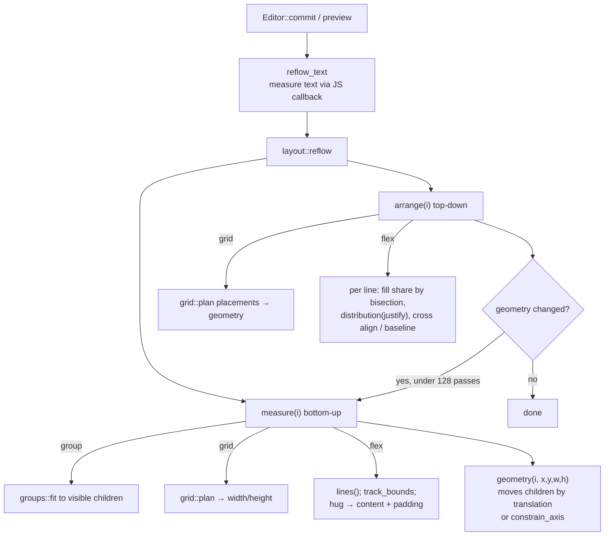

# Layout, Auto Layout and Grid

PixlPrfct resolves layout in Rust: [src/layout.rs](../../src/layout.rs) `reflow()` computes Flex-style auto layout (horizontal/vertical, wrap, hug/fill/fixed sizing, baseline, stroke-aware padding, automatic spacing, absolute children) and frame constraints, and [src/grid.rs](../../src/grid.rs) `plan()` computes CSS-Grid-style layout (tracks, spans, named areas, masonry). The browser modules in `web/` are inspectors, canvas handles and CSS translation on top of the engine. The most important thing to know: **geometry stored in the document is always the engine's computed result**. Every commit (and every preview) runs `reflow` to a fixed point, so JavaScript should set intent (`auto_layout`, `layout_item`, `constraints`) and let the engine place children, never position flow children by hand.

## At a glance

| | |
|---|---|
| **Key files** | [src/layout.rs](../../src/layout.rs), [src/grid.rs](../../src/grid.rs), [src/frame_enclosure.rs](../../src/frame_enclosure.rs), [src/guide_styles.rs](../../src/guide_styles.rs), [web/auto-layout-inspector.js](../../web/auto-layout-inspector.js), [web/layout-sizing.js](../../web/layout-sizing.js), [web/layout-spacing.js](../../web/layout-spacing.js), [web/grid-controls.js](../../web/grid-controls.js), [web/grid-canvas.js](../../web/grid-canvas.js), [web/grid-areas.js](../../web/grid-areas.js), [web/layout-css.js](../../web/layout-css.js) |
| **Entry points** | `Editor::auto_layout_selection` (Shift+A), `layout::reflow` (from `Editor::reflow_text` on every commit/preview), `Editor::grid_layout(id)`, `move_into_cells`, `move_into_before`, `shift_grid_track`/`move_grid_track`/`delete_grid_track`, `delete_grid_area`/`rename_grid_area`, `insert_enclosing_frame`, `move_and_enclose` |
| **Depends on** | `Shape` fields `auto_layout: AutoLayout`, `layout_item: LayoutItem`, `constraints: Constraints`, `layout_grids`, `layout_media`, `layout_class`; text measurement via `Editor::set_text_measurer` |
| **Used by** | Canvas tools (drag/drop into layouts), CSS canvas and HTML/framework export ([css-renderer.js](../../web/css-renderer.js)), components (instances inherit/override layout), design-file import (maps `stackMode`) |
| **Related docs** | [frames-auto-layout-comparison.md](../frames-auto-layout-comparison.md), [GRID_WORKFLOW_REVIEW.md](../GRID_WORKFLOW_REVIEW.md), [CSS_EDITING.md](../CSS_EDITING.md), README "Stroke-aware auto layout", "Grid auto layout", "Compact auto-layout controls" |

## Data model

Defined in [src/lib.rs](../../src/lib.rs) and [src/grid.rs](../../src/grid.rs):

| Struct / field | Meaning |
|---|---|
| `AutoLayout.direction` | `"horizontal"`, `"vertical"` or `"grid"`. `auto_layout: None` = freeform frame. |
| `gap`, `cross_gap: Option` | Main-axis gap; wrapped-line gap (inherits `gap` when `None`). Flex gaps may be negative (overlap); grid gaps may not. |
| `padding_top/right/bottom/left` | Non-negative padding. |
| `align` | Cross-axis: `start`/`center`/`end`. |
| `justify` | Main-axis: `start`/`center`/`end`/`between`/`around`/`evenly`. The last three are *automatic* and ignore the stored `gap`. |
| `align_content` | Wrapped lines: `start`/`center`/`end`/`between`/`around`/`evenly`/`stretch`. |
| `hug_width`, `hug_height` | Hug contents per axis (otherwise Fixed). |
| `wrap` | Break lines at the available main size. |
| `strokes_included` | Inside stroke reserves space before padding (`border_insets`). New layouts default `true`; old files without the field read `false`. |
| `text_baseline` | Horizontal layouts align first-line text baselines. |
| `canvas_stacking` | `"last"` (default, last child on top) or `"first"`; paint order only. |
| `grid: Option<GridLayout>` | `columns`, `rows`, `auto_rows`, flattened `GridOptions` (`areas`, `masonry`, `cell_containers`, `auto_flow`, `dense`, item/content alignment, gap units, auto track patterns). |
| `LayoutItem` | Per child: `fill_width`, `fill_height`, `absolute`, `min/max_width/height`, `margin[4]`, `grid_cell: Option<GridCell>`, `grid_container` (marks an engine-created cell wrapper). |
| `GridCell` | One-based `column`/`row` (`None` = auto placement), spans, `align_x/align_y`, `area` (named-area binding). |
| `GridTrack` | `mode` in `fixed`, `hug`, `fr`, `percent`, `em`, `auto`, `min-content`, `max-content`, `minmax`; `value`, optional `min`/`max`, `min_unit`/`max_unit`. |
| `Constraints` | `horizontal`/`vertical` each `min`/`max`/`center`/`stretch`/`scale` (`Constraint` enum). |

Sizing modes exposed in the UI map onto these fields: **Fixed** = not hugging and not fill; **Hug** = `hug_width/height` on a layout frame (or text `sizing:'width'|'height'`); **Fill** = `layout_item.fill_width/height` on a child of a layout. `sizingMode(shape, axis)` and `sizingPatch(shape, axis, mode)` in [web/layout-sizing.js](../../web/layout-sizing.js) are the only supported translation between the two, including the text sizing special cases.

## The reflow algorithm

`layout::reflow(doc)` builds a child index, then repeats `measure` (bottom-up) and `arrange` (top-down) over all roots until no shape's `(x, y, width, height)` changes, up to 128 passes. Text sizing is iterated outside it by `Editor::reflow_text`, which measures text through the JS callback, writes `measured_baseline`, calls `reflow`, and repeats to a fixed point (rejecting cyclic hug/fill dependencies).

### Measure (`measure`)

For each node after its children:

1. Groups are fitted to their visible children (`groups::fit`) and return.
2. Width/height are clamped by `limits()`: `min_*`/`max_*` from `layout_item`, but never below padding + included borders (`padding()`), so padding always imposes a minimum.
3. **Hug is switched off** on an axis when (a) any flow child fills that axis (no wrap), (b) the layout wraps on its main axis, or (c) the frame itself is a Fill child of another layout. A Fill child therefore disables parent hugging on that axis.
4. For flex: `flow()` = children that are not hidden and not `absolute`. `lines()` breaks items into rows using each item's `basis()` (fill items contribute their minimum, others their bounded visual size, plus margins). `track_bounds()` computes the extent from the lowest to the highest edge, so **negative gaps never shrink below the full child extent**. Hug size = main extent (or line stack for wrap) + padding; `cross_size()` uses ascent+descent when `text_baseline` is on.
5. For grid: `grid::plan()` with the hug flags gives the size.
6. `geometry()` writes the box. Children are translated with the frame when the frame has auto layout; otherwise each child is resolved through `constrain_axis()` with its constraints. Constraints inside groups resolve against the enclosing frame (`constraint_children` descends through groups), and a resized group scales its children (`Constraint::Scale`).

### Arrange (`arrange`)

For flex frames:

- Available main size = frame size − padding − included borders. Rows come from `lines()` again.
- Row heights: with wrap each row uses `cross_size()`; without wrap the single row gets the full cross size. `align_content: stretch` grows rows equally (a 64-step bisection handles negative cross gaps).
- **Fill sharing**: a 64-iteration bisection finds a common share such that Σ `bounded(share + child padding) + margin` fits the budget (available − gaps − fixed items). Each Fill child then gets its own bounded size, so min/max limits are respected individually.
- **Distribution**: `distribution(mode, count, spare)` returns `(leading offset, extra gap)`. `center` and `end` use the spare space (which can be negative, so centered overflow spreads both ways); `between`/`around`/`evenly` clamp spare to ≥0 (no negative automatic gaps on overflow) and a single item under `between` falls back to start.
- **Cross placement**: `align` start/center/end inside the row, or, when `text_baseline` and horizontal, offset = row baseline − item `baseline()` (text uses `measured_baseline`, fallback `font_size × 0.8`; non-text items align their bottom edge).
- Rotated children are placed by their visual bounds but keep their local size.
- Margins (`layout_item.margin`) are applied last.

Absolute children (`layout_item.absolute`) and hidden children never participate in flow or hug measurement; their constraints apply instead.

### Grid planning (`grid::plan`)

1. If `options.masonry`, delegate to `masonry_plan` (items go to the currently shortest column; `column` pins).
2. Column count = max(explicit columns, areas, explicit cell positions), clamped 1–128. Rows grow implicitly using `auto_rows` (or `auto_row_pattern`).
3. Placement runs twice: first items with explicit positions (named areas override `column/row/span`), then auto items in `auto_flow` order (`row` or `column`, optional `dense`). Collisions advance to the next free cell instead of dropping content.
4. `tracks(config, demands, gap, available, hug)` sizes each axis: start from fixed values or minimums; grow non-fixed tracks to satisfy spanning item demands (sorted by span, distributed equally up to each `max`); then finite `minmax` tracks take free space up to their limits (CSS Grid §11.6); then `fr` tracks share the remaining budget via an 80-step bisection that respects each track's min/max. A hugging container measures under max-content (no free space).
5. `resolved()` normalizes units first: `percent`/`em` → fixed pixels (`em` uses the frame's font size, default 16), `auto`/`min-content`/`max-content` → `hug`, and `minmax` with an `fr` max → `fr` with a minimum.

`Editor::grid_layout(id)` returns the `Plan` (`columns`, `rows`, gaps, offsets, `placements`) as JSON; the JS helper `gridPlan(frame)` in app.js caches it and overlays drag previews.

**Cell containers**: when `GridOptions.cell_containers` is true, `grid::ensure_containers` (run in `commit_validated_document`) wraps each occupied cell or named area in a vertical-Flex wrapper frame marked `layout_item.grid_container`. Named-area wrappers occupy the area and represent it in the layer tree; masonry wrappers are never merged. `refresh()` in app.js calls `editor.enable_grid_containers()` for any grid that lacks them, which migrates older documents.

`grid::validate` enforces: 1–128 columns, ≤128 explicit rows, non-negative gaps, valid units/alignment, unique non-overlapping named areas, track values in [0, 1e6] with `fr` ≥ 0.001, and a total span budget of 100,000 cells.

## Adding auto layout (Shift+A) and inference

`Editor::auto_layout_selection(json)` ([src/lib.rs](../../src/lib.rs)) uses the selection roots. A single existing frame/group is converted in place; anything else is first wrapped with `frame_selection`. It then calls `layout::infer(doc, id, single_wrapper)`:

- A rectangle that encloses a text sibling is treated as the background of a control: its paint and radius are promoted to the wrapper and it is removed from flow inference.
- Layers fully inside another sibling become `absolute` overlays.
- Direction = horizontal if the spread of item centers is larger in x; `align` is `center` when all heights match in a row.
- Padding: 10 for a single-object wrapper, 0 for groups, otherwise the smaller of the leading/trailing insets per axis (paired padding). Gap = average spacing (overlaps infer 0, not negative).
- Aligned 2D arrangements (repeated anchors, non-overlapping tracks, including sparse/L-shaped sets and unequal cells) infer a fixed `grid` with equal `fr` tracks and explicit `grid_cell`s. Overlapping equal tiles get collision-resolved explicit cells and the frame grows.

The recorded layout behaviors behind each rule are tabulated in [frames-auto-layout-comparison.md](../frames-auto-layout-comparison.md); tests live in `tests/figma-layout-parity.test.mjs`. Alt+Shift+A (`removeAutoLayout`) sets `auto_layout` to `None` while keeping computed geometry.

## Frame enclosure

[src/frame_enclosure.rs](../../src/frame_enclosure.rs) implements frame creation around existing layers:

- `insert_enclosing_frame(json)` (Frame tool) inserts the frame and adopts **sibling roots** whose rotated corners are fully inside it (`contains`, using `unrotate_point`).
- `move_and_enclose(json, parent, reparent)` commits a canvas move and adoption as one step when a moved frame now encloses siblings. The frontmost moved frame wins.
- Not eligible as enclosers: component frames, grid cell wrappers, editor-mark frames (sections etc.), variant-set frames, hidden/locked frames. Groups, components and nested frames are adopted whole; individual children are never pulled out of another tree.

## Constraints

Set in the Constraints inspector (`#constraint-horizontal/vertical`, multi-select via `updateMany`). `constrain_axis(position, size, old_origin, old_size, origin, parent_size, mode)` in [src/lib.rs](../../src/lib.rs): `min` keeps the offset, `max` keeps the far offset, `center` keeps the center offset, `stretch` keeps both (≥1 px), `scale` scales offset and size proportionally. Constraints apply to children of freeform frames, to absolute children of layout frames, and through groups to the enclosing frame. The K Scale tool bypasses constraints by scaling the whole subtree in JS (`scaleShapes`).

## Web modules

| File | Role |
|---|---|
| [auto-layout-inspector.js](../../web/auto-layout-inspector.js) | Flow strip (Freeform/Vertical/Horizontal/Grid), 3×3 alignment matrix (`alignmentPatch`; arrows move, X toggles automatic spacing), paired padding (`paddingPatch`), gap fields, Auto spacing button, variable bindings for spacing. |
| [layout-sizing.js](../../web/layout-sizing.js) | Width/height sizing dropdowns (`sizingOptions`, `sizingMode`, `sizingPatch`), size limits (`limitPatch`), mixed-value display for multi-select. |
| [layout-spacing.js](../../web/layout-spacing.js) | "Edit spacing on canvas": `spacingHandles` (padding, gaps, grid track edges up to 128 per axis), `spacingHit`, `changeSpacing` (Shift ×10, Alt mirrors the opposite padding, track drags convert that track to `fixed`), `drawSpacing`. |
| [layout-keyboard.js](../../web/layout-keyboard.js) | `layoutArrowOrder`: arrow keys on flow children reorder siblings (`arrange_many` forward/backward) instead of nudging. |
| [layout-class.js](../../web/layout-class.js) | `automaticLayoutClass` (`<slug>-<id>`), `validateLayoutClass` (reserved `px-*`, `layout`, duplicate checks), `renameLayoutSelector`. Rust assigns/deduplicates classes in `commit_validated_document`. |
| [layout-css.js](../../web/layout-css.js) | Two-way mapping between layout fields and CSS (`layoutDeclarations`, `applyLayoutDeclarations`, `parseLayoutCss`, `formatLayoutCss`) and responsive overrides (`layout_media`, `layoutMediaState`, `responsiveLayoutShapes`). |
| [layout-css-editor.js](../../web/layout-css-editor.js) | "Layout → Edit Layout CSS" window: live preview, class rename, **Add breakpoint**, Format, Apply (one undo step). |
| [layer-css-inspector.js](../../web/layer-css-inspector.js) | "CSS & responsive layout" section: class name field/copy, active breakpoint status, breakpoint preview buttons, **Restore width / Restore all widths**. |
| [layer-css-editor.js](../../web/layer-css-editor.js) | Per-layer arbitrary CSS (`custom_css`, ≤64 KB) via [layer-style.js](../../web/layer-style.js); stores only changed declarations. See [CSS_EDITING.md](../CSS_EDITING.md). |
| [grid-controls.js](../../web/grid-controls.js) | Grid inspector: `defaultGrid`, `renderGridControls` (tracks, gaps, areas, masonry, track disclosures, move earlier/later, delete), `renderGridCell` (child position/span/alignment, visual placement picker). |
| [grid-model.js](../../web/grid-model.js) | `gridTrackCss` (bounded fixed tracks emit `clamp(min,preferred,max)`), `gridAreaRows`, `gridAlignment`, `gridCss`. |
| [grid-canvas.js](../../web/grid-canvas.js) | `gridTracks`, `gridCellAt`, `gridDropTarget`, `drawGridCells`, `gridSpanResize`, `gridArrowMove` (arrow keys move an item one cell), `gridCreationPlacement` (new shapes join the cell under the pointer). |
| [grid-areas.js](../../web/grid-areas.js) | Named-area editing: `areaFromDrag`, `moveArea`, `resizeArea`, `nudgeArea`, `validArea`/`areasOverlap`, `nextAreaName`, `cycleArea`/`pageArea`, `drawAreaEditing`, history-aware selection restore. |
| [grid-ux.js](../../web/grid-ux.js), [grid-picker-drag.js](../../web/grid-picker-drag.js) | Visual placement picker cells/window and drag-to-span. |
| [grid-track-sort.js](../../web/grid-track-sort.js) | Drag-reorder track cards in the inspector (commits only on drop). |
| [grid-stack-drop.js](../../web/grid-stack-drop.js) | Pointer-based drop into an occupied cell's wrapper (stacking). |
| [grid-resize-feedback.js](../../web/grid-resize-feedback.js) | Limit boxes and warnings while resizing bounded tracks/areas; auto-scroll of the track list with pause and Alt/Option+R resume. |
| [grid-measurement.js](../../web/grid-measurement.js) | `measuredGridPlacement`: derive cells from the browser's resolved CSS grid (used when the CSS canvas is active). |
| [grid-area-track-values.js](../../web/grid-area-track-values.js) | Per-area track size editing (`areaTrackValues`, `editAreaTrack`). |
| [masonry.js](../../web/masonry.js) | `mountMasonry(root)`: DOM masonry for the CSS canvas and exported HTML (shortest column, `data-masonry-column` pins, switches off when a media query makes the grid Flex). |
| [layout-guides.js](../../web/layout-guides.js), [guide-controls.js](../../web/guide-controls.js) | Layout guides (see below). |
| [breakpoint-preview.js](../../web/breakpoint-preview.js), [device-chrome.js](../../web/device-chrome.js) | Breakpoint width preview and device frames (see below). |

## Responsive layout CSS and breakpoints

`parseLayoutCss(text, shape)` accepts exactly one `.<class>` rule plus optional `@media (min-width: Npx) [and (max-width: Npx)] { .<class> { … } }` blocks. Supported properties: `display` (`flex`/`grid`/`none`), `flex-direction`, `flex-wrap`, `gap`, `row-gap`, `column-gap`, `padding`, `justify-content`, `align-items`, `align-content`, `justify-items`, `grid-template-columns/rows/areas`, `grid-auto-columns/rows`, `grid-auto-flow`. Anything else is an error that disables Apply. The base rule updates the visual controls; media rules are stored as `layout_media: [{query, min, max, declarations}]`.

**On the canvas, media queries are evaluated against the outermost frame's width** (`layoutMediaState` walks to the root), not the browser viewport. Exports emit real `@media` queries, which use the viewport. `responsiveLayoutShapes` applies active rules and is consumed only by the CSS renderer ([css-renderer.js](../../web/css-renderer.js)); the CSS canvas turns on automatically while a layout or layer CSS preview is open, when controls need it, when backdrop blur is present, or via the `#css-canvas` toggle. `gridAreaEditingOverridden` disables visual area editing when an active breakpoint replaces the grid.

Breakpoint preview ([breakpoint-preview.js](../../web/breakpoint-preview.js)): `createBreakpointPreview(change).preview(root, width)` saves `{width, fill, hug, control}` in `root.breakpoint_original` and fixes the root width; `restore` and `restoreAllBreakpointWidths` put them back. Because the baseline is stored on the frame, preview widths survive autosave, reload and undo.

Device chrome ([device-chrome.js](../../web/device-chrome.js)): top-level frames can show a device shell (`device_chrome`: `iphone`, `iphone-notch`, `iphone-fold`, `ipad`, `phone`, `tablet`, `surface`, `desktop`, or responsive `auto`/`auto-apple`). `responsiveChromeType` picks phone/tablet/desktop from `device_chrome_breakpoints` (default 600/1024). `chromeInsets` offsets the frame label; presets in `FRAME_PRESETS` set the shell.

## Layout guides

Frames carry `layout_grids: Vec<LayoutGrid>` (`kind` `columns`/`rows`/`grid`, `count`, `size`, `gutter`, `margin`, `alignment` `stretch`/`start`/`center`/`end`, color, opacity, `visible`). `guideGeometry(frame, g, zoom)` in [layout-guides.js](../../web/layout-guides.js) is pure (skips square grids below 4 screen px or >4096 lines); `drawLayoutGuides` paints them; Shift+G toggles visibility; guides are excluded from export and feed snapping through `snapGuides`. [src/guide_styles.rs](../../src/guide_styles.rs) validates at most eight guides per frame (`validate_grids`) and manages reusable guide styles (`save_guide_style`, `apply_guide_style`, `remove_guide_style`, `resolve`).

## Keyboard in layout modes

| Mode | Keys |
|---|---|
| Any selection | Shift+A add auto layout; Alt+Shift+A remove; arrows reorder flow children / move grid items by one cell |
| Alignment matrix (focused) | Arrows move alignment; X toggles automatic spacing |
| Edit spacing on canvas | Tab / Shift+Tab choose handle; Arrow ±1, Shift+Arrow ±10; Alt+Arrow on padding mirrors the opposite side; Alt+Arrow on a track edge moves the track; Enter applies and exits; Escape cancels the drag or exits |
| Edit grid areas | Tab / Shift+Tab, PageUp/PageDown, Home/End cycle areas; Enter or F2 rename; Arrows move, Shift+Arrows resize; Delete/Backspace remove the area (items stay); Escape exits |
| Grid track list during resize | Alt/Option+R resumes paused auto-scroll |
| Any drag | Escape cancels (capture-phase handler in app.js) |

## How to add a new layout property

1. Add the field to `AutoLayout` / `LayoutItem` / `GridOptions` with a `#[serde(default)]` that preserves old files' behavior.
2. Validate it in `src/lib.rs` `validate` or `grid::validate`.
3. Use it in `layout::reflow` (`measure` and `arrange`) or `grid::plan`, and in `infer` if Shift+A should set it.
4. Mirror it in the CSS renderer and exports ([css-renderer.js](../../web/css-renderer.js), `layoutDeclarations`/`applyLayoutDeclarations` in layout-css.js) so canvas modes agree.
5. Add the inspector control (auto-layout-inspector.js or grid-controls.js) and component override handling if instances can override it.
6. Scale it in `scaleShapes` if it is a length.
7. Add a focused `tests/layout-*.test.mjs` that exercises engine geometry and the CSS path.

## Invariants and gotchas

- `reflow` is a fixed-point loop capped at 128 passes; cyclic hug/fill definitions are rejected by `reflow_text` rather than looping.
- Padding plus included borders is a hard minimum for any layout frame, even with a smaller `max_*`.
- `between`/`around`/`evenly` ignore the stored `gap`; switching back to start/center/end restores it. Automatic spacing never goes negative.
- Hidden and `absolute` children are invisible to flow, hug and grid placement.
- `canvas_stacking` changes paint and hit order only; layer-panel and layout order are untouched.
- The Canvas 2D renderer draws engine geometry and ignores `layout_media`; only the CSS canvas and exports honor breakpoints. Visual controls always edit the base layout (the inspector says so).
- Grid wrappers (`grid_container`) are created by the engine; do not create them from JS.

## Tests

`node --test tests/layout*.test.mjs tests/grid*.test.mjs tests/masonry.test.mjs tests/figma-layout-parity.test.mjs tests/constraints.test.mjs tests/frame-enclosure.test.mjs tests/breakpoint-preview.test.mjs tests/device-chrome.test.mjs tests/responsive-grid-areas.test.mjs tests/guide-styles.test.mjs tests/layout-guides.test.mjs tests/auto-layout-inspector.test.mjs`

| Area | Files (case count) |
|---|---|
| Flex engine | `layout` (4), `layout-sizing` (5), `layout-wrap` (6), `layout-baseline` (5), `layout-distribution` (3), `layout-overlap` (5), `layout-strokes` (5), `layout-stacking` (8), `layout-spacing` (4), `layout-keyboard` (2) |
| Inference/parity | `figma-layout-parity` (23), `constraints` (3), `parent-alignment` (2), `frame-enclosure` (8) |
| Grid | `grid-advanced` (35), `grid-resize-feedback` (16), `grid-areas` (13), `grid-canvas` (10), `grid-reorder` (9), `grid-area-track-values` (8), `grid-layout` (6), `grid-picker-drag` (5), `grid-track-sort` (5), `responsive-grid-areas` (5), `grid-ux` (4), `grid-bounded-tracks`, `grid-delete`, `grid-measurement`, `grid-stack-drop` (3 each), `masonry` (2) |
| CSS/responsive | `layout-css` (10), `layout-class` (6), `layer-style` (7), `css-renderer` (4), `breakpoint-preview` (6), `device-chrome` (12) |
| Guides | `layout-guides` (4), `guide-snap` (4), `guide-styles` (4) |

Rust has only three unit tests (`src/lib.rs` `mod tests`); layout is verified through the WASM build in Node. There is no Playwright spec dedicated to layout; [GRID_WORKFLOW_REVIEW.md](../GRID_WORKFLOW_REVIEW.md) records manual browser walkthroughs.

## Known limitations

- Inference is a set of measured heuristics, with documented limits; arbitrary compositions may infer differently.
- Canvas breakpoints use frame width; general CSS media queries in custom layer CSS use the browser viewport.
- design-file import maps horizontal/vertical stacks only; Imported grid layouts import with fixed positions.
- Multi-track selection is not implemented.

> **Note:** README "Grid auto layout" says direct drag reordering and direct track deletion of grid tracks are pending. Code has inspector drag reordering ([grid-track-sort.js](../../web/grid-track-sort.js)) and `Editor::delete_grid_track` (README's "Inspector and toolbar" section documents Delete row/column). Canvas-edge drag reordering of tracks is still not implemented.

## Related pages

[Canvas-Tools-and-Editing](Canvas-Tools-and-Editing.md) · [Rust-Document-Engine](Rust-Document-Engine.md) · [Document-Model-and-File-Format](Document-Model-and-File-Format.md) · [Rendering-and-Export](Rendering-and-Export.md) · [Components-Variants-and-Slots](Components-Variants-and-Slots.md) · [Styles-Variables-and-Paints](Styles-Variables-and-Paints.md) · [Import-Design-Files](Import-Design-Files.md) · [Interface-Design-Guidelines](Interface-Design-Guidelines.md) · [Testing-and-Verification](Testing-and-Verification.md)

## Source of truth

- [src/layout.rs](../../src/layout.rs) (`reflow`, `measure`, `arrange`, `lines`, `distribution`, `infer`, `drop_before`)
- [src/grid.rs](../../src/grid.rs) (`plan`, `tracks`, `resolved`, `masonry_plan`, `ensure_containers`, `validate`, `shift_track`, `move_track`, `delete_track`)
- [src/lib.rs](../../src/lib.rs) (`AutoLayout`, `LayoutItem`, `Constraints`, `constrain_axis`, `auto_layout_selection`, `move_into_cells`, `move_into_before`, `grid_layout`, `reflow_text`)
- [src/frame_enclosure.rs](../../src/frame_enclosure.rs), [src/guide_styles.rs](../../src/guide_styles.rs)
- `web/` modules listed in the table above
- Docs: [frames-auto-layout-comparison.md](../frames-auto-layout-comparison.md), [GRID_WORKFLOW_REVIEW.md](../GRID_WORKFLOW_REVIEW.md), [CSS_EDITING.md](../CSS_EDITING.md), [README](../../README.md)
