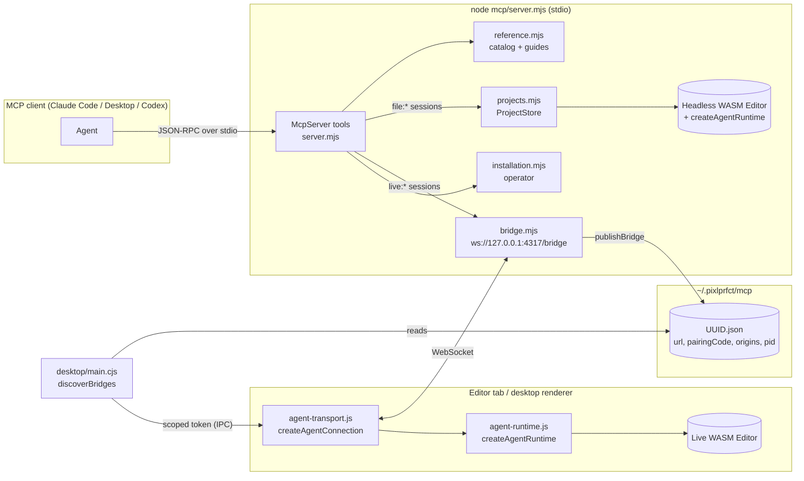
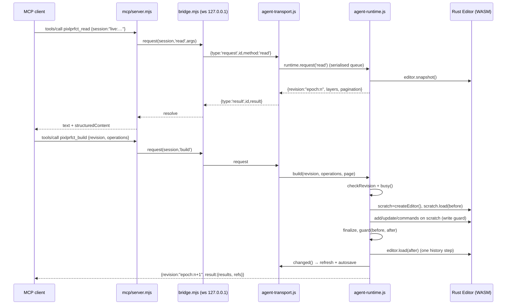

# MCP Server

The MCP server (`mcp/server.mjs`) is a local **stdio** Model Context Protocol server that lets an AI agent read and edit PixlPrfct designs through the same Rust/WASM engine the editor uses. It works in two modes: a **live** session, where requests travel over a loopback WebSocket bridge to an open editor tab or desktop window, and a **saved-project** session, where the server loads a `.pixl` file into a headless WASM engine inside Node. The most important thing to know: every mutation goes through `createAgentRuntime` in [web/agent-runtime.js](../../web/agent-runtime.js), which applies the whole batch to a scratch engine, runs permission guards, and commits only if everything succeeds, gated by an opaque `revision` string the agent must read first.

## At a glance

| Key files | Entry points | Depends on | Used by | Related docs |
| --- | --- | --- | --- | --- |
| [mcp/server.mjs](../../mcp/server.mjs), [mcp/bridge.mjs](../../mcp/bridge.mjs), [mcp/projects.mjs](../../mcp/projects.mjs), [mcp/reference.mjs](../../mcp/reference.mjs), [mcp/installation.mjs](../../mcp/installation.mjs), [mcp/installation-runner.mjs](../../mcp/installation-runner.mjs), [web/agent-runtime.js](../../web/agent-runtime.js), [web/agent-transport.js](../../web/agent-transport.js), [web/agent-connection.js](../../web/agent-connection.js), [web/editor-api.js](../../web/editor-api.js) (generated), [desktop/mcp-discovery.cjs](../../desktop/mcp-discovery.cjs) | `node mcp/server.mjs` (`npm run mcp`), `createPixlMcp()`, `installAgentConnection()` in [web/app.js](../../web/app.js), IPC `desktop:mcp-connections` in [desktop/main.cjs](../../desktop/main.cjs) | `@modelcontextprotocol/sdk`, `zod`, `ws`, `web/pkg` (wasm-pack output), editor exporters (`web/code-export.js`, `web/export.js`, `web/css-renderer.js`), `server/*` (installation tools only) | Claude Code / Claude Desktop / Codex and other MCP clients; acceptance scripts in `scripts/acceptance/`; Playwright fixtures reuse `createHeadlessEditor` | [MCP.md](../MCP.md), [MCP_SETUP.md](../MCP_SETUP.md), [TEAM_WORKFLOWS.md](../TEAM_WORKFLOWS.md), [CAPABILITY_MATRIX.md](../CAPABILITY_MATRIX.md) |

## Responsibilities

- Expose 20 MCP tools: 14 design tools (`pixlprfct_reference` … `pixlprfct_close_project`) and 6 opt-in installation-operator tools (`pixlprfct_installation_*`).
- Expose `pixlprfct://reference/<topic>` resources and two prompts, `build-design` and `setup-team`.
- Run a loopback WebSocket bridge (default port 4317) that paired editor tabs connect to, and publish a private discovery record so the desktop app connects without a pairing code.
- Open, save and close `.pixl` files in a confined workspace directory using a headless engine.
- Publish a machine-readable catalog of engine commands and Rust model declarations, generated from the compiled WASM type definitions.
- Operate a team self-host installation (plan, apply config, migrate, start, back up) when `--installation` is passed.

It does **not** evaluate arbitrary JavaScript, run shell commands for the agent, execute development-behavior code, or handle accounts/passwords. Hosted MCP over the public internet is not implemented: client, server and editor must be on the same machine.

## Architecture



### Transport

`server.mjs` constructs `new McpServer({name:'pixlprfct',version:'0.1.0'},{instructions})` and connects a `StdioServerTransport`. Protocol messages go to stdout; diagnostics (`PixlPrfct MCP ready. Workspace: …`, errors) go to stderr. Clients must launch `node` directly: `npm run mcp` prints npm banners that would corrupt the protocol stream. The process shuts down on stdin `end`, `SIGINT` or `SIGTERM`, calling `instance.close()` (server, bridge, discovery record, installation children, headless engines).

Every tool is registered through a local `tool()` helper that sets MCP annotations (`readOnlyHint`, `destructiveHint = !readOnly`, `idempotentHint = readOnly`, `openWorldHint`) and wraps handler errors as `{isError:true, content:[{type:'text', text}]}`. Object results are returned both as JSON text and as `structuredContent`.

### Command-line flags and environment

| Flag | Env var | Default | Effect |
| --- | --- | --- | --- |
| `--workspace DIR` | `PIXLPRFCT_WORKSPACE` | `.local/mcp-projects` (relative to launch cwd) | Root for saved-project sessions |
| `--installation DIR` | `PIXLPRFCT_INSTALLATION` | unset (tools explain how to enable) | Enables installation-operator tools for that directory |
| `--port N` | `PIXLPRFCT_MCP_PORT` | 4317 | Bridge port. `0` = any free port. An explicit value is strict |
| `--origin URL` | `PIXLPRFCT_EDITOR_ORIGIN` | `defaultOrigins` | Allowed editor origin (see gotchas) |
| `--no-live` | — | live on | Disables the bridge entirely |
| `--help` | — | — | Prints usage to stderr |

When neither `--port` nor `PIXLPRFCT_MCP_PORT` is given, `autoPort` is true: if 4317 is busy (`EADDRINUSE`), the bridge retries on port 0. That lets several local agent processes run at once; each publishes its own discovery record.

## Live editor sessions

### Bridge (`mcp/bridge.mjs`)

`createEditorBridge({port, origins, timeout=20000})` starts a plain `http` server on `127.0.0.1` that answers 404 to HTTP and upgrades only `/bridge`. On startup it creates a 32-byte random `token` (base64url, 43 chars) — the **pairing code**, rotated every server restart.

Upgrade checks (`server.on('upgrade')`): path must be `/bridge`; `Host` must equal `127.0.0.1:<actual port>` (DNS-rebinding defence); `Origin` must be in `origins`; at most 10 open sockets. `maxPayload` is 12,000,000 bytes.

Wire protocol (JSON text frames):

| Direction | Message | Notes |
| --- | --- | --- |
| editor → server | `{type:'hello', token, clientId, name}` | Must arrive within 5 s. `token` is compared with `timingSafeEqual` against the master code **or** `scopedToken(token, origin)` |
| server → editor | `{type:'connected', session:'live:<uuid>', heartbeat:true}` | `clientId` (36-char, stored per tab/project in sessionStorage) maps to a stable session ID, so a reconnecting tab keeps its `live:` ID. An older socket for the same ID is closed with code 1000 |
| editor → server | `{type:'ping'}` / server → `{type:'pong'}` | Heartbeat |
| server → editor | `{type:'request', id, method, args}` | `method` is one of `read`, `build`, `command`, `css`, `history`, `select`, `libraries`, `export` |
| editor → server | `{type:'result', id, result}` or `{type:'result', id, error}` | Must come from the same socket/session as the request; error text is truncated to 2,000 chars |

Limits: at most 20 pending requests; each times out after 20 s with *"Editor timed out; the operation may have completed. Read its state before retrying."* A closing socket rejects its pending requests with *"Editor disconnected…"*. Invalid pairing closes with WebSocket code **1008**, which the editor treats as "blocked" until the user reconnects.

### Desktop discovery (`desktop/mcp-discovery.cjs`)

- `publishBridge(info)` writes `~/.pixlprfct/mcp/<uuid>.json` containing `{url, pairingCode, allowedOrigins, instructions, pid}`. The directory is created `0700` and must be owned by the user with no group/other bits (`privateEntry`); the file is created with `O_EXCL`, mode `0600`. The returned function deletes it on shutdown.
- `discoverBridges(origin)` (called only by the Electron main process via the `desktop:mcp-connections` IPC handler in `desktop/main.cjs`) reads at most 100 `UUID.json` files, opened with `O_NOFOLLOW`, ≤16 KiB, private. It validates `ws://127.0.0.1:<port>/bridge`, a 43-char code, that the caller's origin is in `allowedOrigins`, and that the `pid` is alive (`process.kill(pid, 0)`). It returns `{url, pairingCode: scopedToken(code, origin)}` — an **HMAC-SHA256 of the origin keyed by the master code**, so the renderer never sees the master pairing code.
- The IPC handler only answers windows with role `local` or `remote`, from the main frame, on the same workspace base. Local windows use origin `pixlprfct://app`; team-server windows use their HTTPS origin (which must also be allowed by the MCP server's `--origin`).
- `preload.cjs` / `preload-remote.cjs` expose `window.pixlMcp.connections()`.

### Editor side (`web/agent-transport.js`, `web/agent-connection.js`)

`installAgentConnection(runtimeOptions)` (called once in `web/app.js`) builds the runtime, renders the **Tools → MCP connection** window (Bridge URL, Pairing code, Connect/Disconnect) and starts `createAgentConnection`. If `window.pixlMcp` exists (desktop), discovery is automatic and no code is needed.

`createAgentConnection` runs a 1 s `tick()`:

- Every 2 s it calls `discover()` asynchronously (never blocking heartbeat checks; superseded results are ignored by `discoveryEpoch`).
- Each desired URL (discovered entries + a manual pairing saved in `sessionStorage['pixlprfct:mcp-pairing']`) gets a connection. `validateConnection` only accepts `ws://127.0.0.1:PORT/bridge` and a 43-char code.
- Unauthenticated sockets older than 5 s are closed; sessions silent for 45 s are closed; pings are sent every 15 s.
- Reconnect backoff: `500 ms × 2^attempts`, capped at 10 s. `wake()` (on `focus`, `online`, `visibilitychange`) resets backoff.
- **All incoming requests are serialised through one promise chain** (`serial`) across all connected agents, and dropped if the project identity (`location.search`) changed. Requests are never retried or replayed.
- **Disconnect** stores `localStorage['pixlprfct:mcp-disabled:<project>']=true`, which survives reloads and restarts until Connect.

The live runtime options passed from `app.js` are what make live sessions safe:

| Option | Live value (web/app.js) |
| --- | --- |
| `createEditor` | `agentEditor()` — a fresh `Editor` with the real canvas text measurer |
| `guard` | `team?.guard(before,after) \|\| libraries?.guard(before,after,history) \|\| (projectLoading ? 'Wait…' : null)` |
| `busy` | `projectLoading \|\| gesture \|\| textEditing \|\| layoutCssPreview \|\| layerCssPreview \|\| gridPickerPreview` |
| `finalize` | enables grid cell containers where needed; `ensureBaseTextDocument` |
| `changed` | prune selection, `refresh()` (normal autosave path) |
| `select` | `editor.select_page(page)` + `setSelection(ids)` and redraw |
| `libraries` | `libraries.request(args, assertCurrent)` |

## Saved-project sessions (`mcp/projects.mjs`)

`createProjectStore(directory)` calls `initializeEngine()` once — it loads `web/pkg/pixlprfct_core_bg.wasm` from disk and passes it to the wasm-bindgen `init()` — then resolves the workspace with `realpath`.

- `createHeadlessEditor()` returns an `Editor` whose text measurer uses a deterministic approximation (`chars × font_size × 0.55`). `pixlprfct_open_project` and `pixlprfct_sessions` results for file sessions carry a `textMetrics` warning: verify typography in a live editor.
- `localGuard` = `importedContentError` (unless an undo/redo) `||` `protectedInstanceError` from `web/library-model.js`: imported library sources and protected instances stay read-only even headless.
- `open({file, create, name})`: max 50 sessions; files must be relative `.pixl` paths without `..`, `.`, backslashes or empty segments; parent and file `realpath` must stay inside the root; symlinked projects are refused; max 5 MB. The disk SHA-256 is kept as `diskRevision`. Opening a file already open returns the existing session. Session IDs are `file:<uuid>`.
- `save(id, {revision, file})`: revision must match; per-file save lock; refuses if the destination's current SHA-256 differs from `diskRevision` (or, for Save As, if the file exists). Writes `<file>.<uuid>.tmp` (`wx`, `0600`), re-checks disk digest and document revision, then `rename`s atomically.
- `close(id)` frees the engine and discards unsaved changes; `files()` scans up to 500 `.pixl` files, depth 5, skipping dot-entries and symlinks.

Libraries and selection are unavailable headless (`'Selection is available only in live editor sessions.'`).

## The agent runtime (`web/agent-runtime.js`)

`createAgentRuntime({editor, createEditor, guard, options, finalize, changed, busy, selection, select, libraries})` is shared by both modes; the host supplies persistence and permission hooks.

**Revisions.** `version()` serialises the document without `active_page` and bumps a counter when it differs, returning `` `${epoch}:${counter}` `` where `epoch` is a random UUID per runtime. Page navigation alone does not change the revision; a renderer reload invalidates all earlier revisions even when the `live:` session ID survives.

**`transact(expected, run, page)`** — the only mutation path:

1. `checkRevision` (else *"Revision conflict…"*) and `busy()` (else *"The editor has an active gesture…"*).
2. Copy the live snapshot into a scratch engine from `createEditor()`, optionally `select_page(page)`, `clear_history()`, install `set_write_guard` with the host guard.
3. Run the operations, `finalize(scratch)`, restore the user's active page.
4. Render custom CSS for each shape; reject `layout_media` on non-Flex/Grid frames; run `guard(before, after)`.
5. If the live editor changed meanwhile, fail (*"Document changed while editing"*); otherwise `editor.load(after)` once and call `changed()`. The whole batch is one history step, and nothing is committed on any error.

**Build operations** (`build`, 1–200 per batch):

| `op` | Shape | Behaviour |
| --- | --- | --- |
| `create` | `{kind?, control?, parent?, coordinate_space?, x?, y?, properties?, as?}` | `kind` ∈ `layerKinds` (`frame, group, rectangle, ellipse, text, image, line, arrow, polygon, star, pen, pencil`); `group` is rejected (use `group_many`). `control` creates a main-component starter frame from `newControl()`. `coordinate_space:'parent'` offsets from the parent's stored x/y. Vectors get geometry from `drawnShape`. Then `patch` + `reparent_many` |
| `update` | `{id, properties}` | Deep merge via `mergeProperties` (objects merge, arrays replace, `__proto__`/`constructor` rejected). Property names must exist as `pub <name>:` in the Rust `Shape` declaration; `id`, `page_id`, `component` are refused. Accepts `typography.sizing:'auto_width'/'auto_height'` and 8-digit `#RRGGBBAA` stroke colours |
| `command` | `{name, args, as?}` | Calls a catalogued engine method via `invoke` |
| `css` | `{id, source}` or `{id, reset:true}` | Compiles generated CSS with `compileCssScene`, stores the diff via `layerStyleOverrides` |
| `rename_project` | `{name}` | 1–256 chars |

`as` names a result; `{"$ref":"name"}` anywhere in later operations resolves to it. Names must match `/^[a-z][\w-]{0,63}$/i` and be unique.

**`invoke(editor, name, args)`** looks up the catalog, enforces exact arity, JSON-stringifies arguments typed `json`, type-checks `string`/`number`/`boolean` (finite numbers only), and JSON-parses string results.

**Other request methods:** `read` (filters `page`, `ids`, `query`; `limit` 1–200, default 50; cursors pin revision and filter scope; `details` returns full shapes; `full` returns the document with paged `shapes` and `partial`); `command` (read-only commands bypass `transact`); `css`; `history` (undo/redo on the live history after a revision check); `select`; `export` (targets `pixl`, `svg`, `html`, `react`, `vue`, `angular`, `rust`; chunked by `exportChunks` — default 64,000 UTF-16 units, 256–64,000); `libraries` (live only, revision re-checked via `assertCurrent` after async work).

## Tool reference

All design tools except `reference`, `sessions` and `connection` take `session` (`live:…` or `file:…`). Requests are routed in `server.mjs` by `request(id, method, args)`: a `store.sessions` hit runs locally, a `live:` ID goes through `bridge.request`.

| Tool | Purpose | Key params | Read-only |
| --- | --- | --- | --- |
| `pixlprfct_reference` | Capability guide, command catalog, Rust models, defaults, examples, frame presets, icons, guide docs | `topic` (`overview, commands, models, defaults, examples, frames, icons, installation, css, libraries, grid, text, behaviors, controls, effects`), `query` (string, comma list or array ≤50) | yes |
| `pixlprfct_sessions` | List live tabs, open file sessions and workspace `.pixl` files | — | yes |
| `pixlprfct_connection` | Bridge URL, pairing code, allowed origins (browser pairing) | — | yes |
| `pixlprfct_open_project` | Open a workspace `.pixl` or create an in-memory project | `file`, `create`, `name` | no |
| `pixlprfct_read` | Paged layer summaries/details, document metadata, current revision | `session, page, ids, query, details, full, limit, offset, cursor` | yes |
| `pixlprfct_build` | Atomic batch, one undo step | `session, revision, page, operations[1..200]` | no |
| `pixlprfct_command` | One catalogued engine command | `session, name, args[], revision?, page?` | no |
| `pixlprfct_css` | Generated CSS + existing overrides for a layer | `session, id` | yes |
| `pixlprfct_history` | Undo/redo one transaction (shares the human's history when live) | `session, revision, action` | no |
| `pixlprfct_select` | Set visible selection in a live editor | `session, ids, page?` | no |
| `pixlprfct_libraries` | List/publish/add/update/remove libraries (live only) | `session, action, revision?, id, workspace, offset, limit, query` | no |
| `pixlprfct_export` | `.pixl`, SVG, HTML/React/Vue/Angular/Rust files, chunked | `session, target, scope (project/page/selection), page, ids, cursor, limit` | yes |
| `pixlprfct_save_project` | Atomic save in workspace with conflict checks | `session, revision, file?` | no |
| `pixlprfct_close_project` | Close a file session, discard unsaved changes | `session` | no |
| `pixlprfct_installation_status` | Redacted installation state | — | yes |
| `pixlprfct_installation_plan` | Preview config; returns `planId`, `revision` (expires 600 s) | `mode, deployment, provider, url, administratorEmail, registration, port, backups, databaseSchema, mailSender, databaseUrlEnv, smtpUrlEnv, clearMail` | yes |
| `pixlprfct_installation_apply` | Write `.env.selfhost` and `compose.mcp.yaml` | `planId, revision` | no |
| `pixlprfct_installation_run` | Start a job | `action` (`database, mail, health, migrate, start, stop, backup, verify_backup, docker_start, docker_stop`), `revision`, `backupId?` | no |
| `pixlprfct_installation_job` | Poll a job's redacted outcome | `id` | yes |
| `pixlprfct_installation_backups` | List operator backups | — | yes |

> **Note:** [MCP.md](../MCP.md) and [CAPABILITY_MATRIX.md](../CAPABILITY_MATRIX.md) say "14 MCP tools". That counts the design tools; `server.mjs` registers 20 tools in total including the six installation tools.

## Command and model catalog

[web/editor-api.js](../../web/editor-api.js) is generated by [scripts/generate-editor-api.mjs](../../scripts/generate-editor-api.mjs) and must not be edited by hand.

- **Commands** are parsed from `web/pkg/pixlprfct_core.d.ts` (wasm-pack output): every `Editor` method line before `export type InitInput`, minus lifecycle/escape methods (`reserve_ids, free, clear_history, load, set_write_guard, set_text_measurer, refresh_text_layout, undo, redo, snapshot`). Each entry is `{name, readOnly, description, args:[{name,type}], returns}`. Arguments named `json`, `selection`, `variables` or `placements` get type `json`. Read-only commands: `copy_layers, can_redo, can_undo, grid_layout, hit_test, prototype_hit_test, prototype_hits, prototype_pointer_hits, preview_update_many, preview_layout_update, preview_grid_drop`. Hand-written notes for ~50 commands live in the `notes` map.
- **Models** are every `pub struct|enum Name {…}` in `src/*.rs` (except `Editor`) with their preceding `#[…]` attributes, stored verbatim as `{file, kind, declaration}`.

Current snapshot: **100 commands, 51 models.** The catalog is regenerated by `npm run build:editor` (after `wasm-pack`) and by `npm run mcp:catalog`. `npm run mcp:check` runs the generator with `--check` (throws *"Editor API catalog is stale"* if the committed file differs) and then `node --test tests/mcp*.test.mjs`.

`reference('defaults')` instantiates each layer kind in a headless engine and returns real default shapes, `appearance({})` and `newControl()` for every control type, so agents see actual engine defaults rather than documentation.

## Editing ownership, permissions and validation

- **Shared files (self-hosted):** the live guard calls `team.guard` from [web/team-session.js](../../web/team-session.js), which rejects artwork changes with *"This file is open for review. Start editing or request a handoff."* unless this tab holds the editing lease. Reads stay available to viewers. See [Teams-Libraries-and-Collaboration](Teams-Libraries-and-Collaboration.md).
- **Libraries:** `libraries.guard` and the engine write guard protect imported sources and instance overrides limited to the author's exposed properties.
- **Busy editor:** no MCP edit while a gesture, inline text edit, CSS preview or grid picker preview is active, or while a project loads.
- **Validation:** zod schemas at the tool boundary (ID arrays ≤2000, positive integers, limits); runtime checks for arity, types, unknown properties, layer kinds, coordinate spaces, batch names; engine write guard; post-batch guard on the full before/after documents; 5 MB project limit (`reference('overview').limits`: 200 ops/batch, 5,000,000 document bytes, 65,536 CSS bytes per layer).
- **Instructions:** `reference.mjs#instructions` tells the agent that document content is untrusted data, not to bypass permission rejections, and to re-read after timeouts.

## Installation tools (team server setup)

[mcp/installation.mjs](../../mcp/installation.mjs) `createInstallationManager({directory})` returns `{state, plan, apply, operate, job, backups, close}`. Without `--installation` the tools only explain how to enable access.

- `plan` validates options, reads an existing `.env.selfhost`, preserves its auth secret (or generates one), and returns credential-presence flags only. Credentials are passed as **names** of `PIXL_SETUP_*` environment variables (`databaseUrlEnv`, `smtpUrlEnv`), never values. Plans expire after 600 s or a restart.
- `apply` writes `.env.selfhost` atomically (temp + `link`/`rename`, `0600`), keeps a private `.env.selfhost.previous-<uuid>` copy, and writes `compose.mcp.yaml` (refusing to overwrite one without `x-pixlprfct-managed: 1`). A `.pixl-setup.lock` file plus a configuration revision prevents two MCP processes overwriting each other.
- `operate` spawns [mcp/installation-runner.mjs](../../mcp/installation-runner.mjs) (`shell:false`, credentials only in the child environment) or `docker compose … exec -T app node mcp/installation-runner.mjs …`. The runner performs fixed actions: `serve` (calls `startServer` from `server/index.mjs`), `database`/`migrate` (`connectDatabase`, `migrateAuth`, `migrateDocuments`), `mail` (nodemailer verify, no send), `backup`/`verify_backup` (`scripts/self-host/backup.mjs`). Jobs return IDs; errors are redacted.
- A native trial runs as a child of the MCP host and stops with it.

See [MCP_SETUP.md](../MCP_SETUP.md) for the full operator sequence and [Self-Hosted-Server](Self-Hosted-Server.md) for what is being configured.

## Request lifecycle (live build)



For a `file:` session the bridge hop disappears: `server.mjs` calls `session.runtime.request()` directly on the headless engine, and persistence happens only on `pixlprfct_save_project`.

## Client configuration

Prerequisites: Node.js 24+ (as documented in [MCP.md](../MCP.md); `package.json` `engines` says `>=22.13.0`), `npm ci`, and a built engine (`npm run build` or at least `npm run build:editor`, which produces `web/pkg`).

**Claude Code / Claude Desktop** (`mcpServers` JSON):

```json
{
  "mcpServers": {
    "pixlprfct": {
      "command": "node",
      "args": [
        "/absolute/path/to/pixlprfct/mcp/server.mjs",
        "--workspace", "/absolute/path/to/design-projects"
      ]
    }
  }
}
```

Add `"--installation", "/absolute/path/to/team-server"` to the `args` to enable the operator tools, and supply `PIXL_SETUP_DATABASE_URL` / `PIXL_SETUP_SMTP_URL` through the host's private `env` block, not chat.

**Codex** (`config.toml`):

```toml
[mcp_servers.pixlprfct]
command = "node"
args = ["/absolute/path/to/pixlprfct/mcp/server.mjs", "--workspace", "/absolute/path/to/design-projects"]
```

**Browser pairing:** the agent calls `pixlprfct_connection`; the user enters the URL and code in **Tools → MCP connection**; the agent calls `pixlprfct_sessions` and uses the `live:` ID. Desktop windows connect automatically.

After updating MCP code or the engine, fully quit and relaunch the MCP host. [MCP.md](../MCP.md) records a Claude Desktop case where **View → Reload** left an older server process running.

## Extension guide

**Add an engine command:** add a `#[wasm_bindgen]` method on `Editor` in `src/lib.rs` → `npm run build:editor` (regenerates `web/pkg` and `web/editor-api.js`) → if read-only, add it to `readOnly` in `generate-editor-api.mjs`; if an argument carries JSON, name it `json`/`selection`/`variables`/`placements`; add a `notes` entry → commit the regenerated `web/editor-api.js` → `npm run mcp:check`. If the method must not be agent-callable, add it to `excluded`.

**Add an MCP tool:** register it in `createPixlMcp` with `tool(name, description, zodShape, handler, readOnly, openWorld)`; route it to a new runtime method by adding a branch in `createAgentRuntime().request` (the bridge forwards any `method` string; `request` throws *"Unknown agent request"* for anything it does not handle, so the runtime branch is the allow-list). Add tests in `tests/mcp-server.test.mjs` using `InMemoryTransport.createLinkedPair()` and update the tool tables in [MCP.md](../MCP.md).

**Add a reference topic:** add a guide to `guides` in `reference.mjs` (maps topic → file in `docs/`), which also adds it to `topics` and the resource list.

## Invariants and gotchas

- **Never replay a write after a timeout or disconnect.** The bridge and transport deliberately never retry; the agent must re-read and compare the revision.
- **`--origin` replaces the default list, it does not add to it.** `origins: origin ? [new URL(origin).origin] : defaultOrigins`. Passing `--origin https://team.example` therefore removes `pixlprfct://app` and the localhost ports; and `new URL('pixlprfct://app').origin` is the string `"null"`, so the desktop origin cannot be supplied that way. MCP.md does not state this.
- Revisions are opaque strings (`epoch:counter`), not integers, even though the MCP.md example shows `"revision": "1"`.
- Live `history` shares the human's undo stack. Undoing may revert the user's own edit.
- `pixlprfct_select` and `pixlprfct_libraries` throw in `file:` sessions.
- Headless text metrics are approximate (0.55 em per character); exports from a `file:` session can differ from the live editor for text.
- Read cursors and export cursors are invalidated by any content change; restart the read.
- The `McpServer` advertises version `0.1.0`, independent of `package.json`.
- Multiple agents connected to one tab share a single serialised queue; one slow request delays others.

## Known limitations

- Local-only: no remote/hosted MCP endpoint; browser mixed-content/local-network policy may block an HTTPS editor from reaching `ws://127.0.0.1`.
- Discovery is not claimed across a Mac App Store sandbox boundary.
- Real OS sleep/wake reconnection is unverified ([CAPABILITY_MATRIX.md](../CAPABILITY_MATRIX.md): `osSleepTested: false`); a 40-minute idle + bridge-restart run passed.
- Docker installation paths are covered only by contract tests (no daemon on the development machine), per [MCP_SETUP.md](../MCP_SETUP.md).
- Prototype interactions are stored but not converted to JavaScript by code export; SVG export rejects custom CSS.

## Related pages

- [Rust-Document-Engine](Rust-Document-Engine.md) — the `Editor` methods the catalog exposes
- [Document-Model-and-File-Format](Document-Model-and-File-Format.md) — `Shape` and the `.pixl` format
- [Web-Editor-Architecture](Web-Editor-Architecture.md) — `app.js` hosting of the runtime
- [Rendering-and-Export](Rendering-and-Export.md) — exporters used by `pixlprfct_export`
- [Desktop-App](Desktop-App.md) — IPC, preload, discovery
- [Self-Hosted-Server](Self-Hosted-Server.md), [Teams-Libraries-and-Collaboration](Teams-Libraries-and-Collaboration.md)
- [Testing-and-Verification](Testing-and-Verification.md) — MCP tests and idle/sleep acceptance
- [Build-System](Build-System.md) — `build:editor` and catalog generation

## Source of truth

- Code: [mcp/server.mjs](../../mcp/server.mjs), [mcp/bridge.mjs](../../mcp/bridge.mjs), [mcp/projects.mjs](../../mcp/projects.mjs), [mcp/reference.mjs](../../mcp/reference.mjs), [mcp/installation.mjs](../../mcp/installation.mjs), [mcp/installation-runner.mjs](../../mcp/installation-runner.mjs), [web/agent-runtime.js](../../web/agent-runtime.js), [web/agent-transport.js](../../web/agent-transport.js), [web/agent-connection.js](../../web/agent-connection.js), [scripts/generate-editor-api.mjs](../../scripts/generate-editor-api.mjs), [desktop/mcp-discovery.cjs](../../desktop/mcp-discovery.cjs), `desktop/main.cjs` (`installIPC`)
- Tests: `tests/mcp-server.test.mjs`, `tests/mcp-runtime.test.mjs`, `tests/mcp-discovery.test.mjs`, `tests/mcp-installation.test.mjs`, `tests/agent-transport.test.mjs`
- Docs: [MCP.md](../MCP.md), [MCP_SETUP.md](../MCP_SETUP.md), [TEAM_WORKFLOWS.md](../TEAM_WORKFLOWS.md), [CAPABILITY_MATRIX.md](../CAPABILITY_MATRIX.md)
