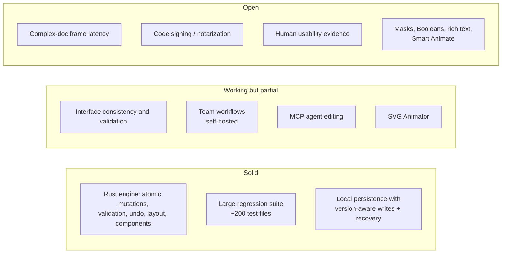

# Project Status and Roadmap

**PixlPrfct is an early design and animation editor (v0.1.1-alpha.21, Windows preview release) with known limitations.** The project's own evaluation sets the priority as preserving users' work and proving complete daily workflows before adding breadth. This page consolidates status from `roadmap.json`, [CAPABILITY_MATRIX.md](../CAPABILITY_MATRIX.md), [PROJECT_EVALUATION_2026-10-30.md](../PROJECT_EVALUATION_2026-10-30.md) and the [gap tally](../TT-Design-System-Gaps.md) as of 2026-11-01.

## At a glance

| | |
| --- | --- |
| **Version** | `0.1.1-alpha.21` (`package.json`); Windows prerelease builds on GitHub Releases |
| **Product direction** | Browser-first interface design, prototyping and vector animation |
| **Completion policy** | Individual feature releases do not establish completeness or compatibility with every external workflow. |
| **Implemented items** | 114 entries in `roadmap.json.implemented` |
| **Remaining items** | 12 entries in `roadmap.json.remaining` |
| **Last full verification** | 2026-11-01: 3 Rust + 1,053 JS tests; 143 Chromium scenarios, plus 25 final panel/site checks; native panel drag/restart acceptance; production build, lint, types, generated API and Rust formatting/Clippy |
| **Performance gate** | Latest recorded cross-environment p95: Linux 142–148.7 ms; macOS 219.3–221.4 ms, above the 100 ms target. Earlier local passing measurements do not close B33. |
| **Human pilot** | Planned ([PILOT_PLAN.md](../PILOT_PLAN.md)); **0 participants** so far |

## Where the docs say it stands

## Release timeline

| Date | Milestone (from `git log`) |
| --- | --- |
| 2026-10-23/24 | Initial commit; license, CI, Dependabot, security policy |
| 2026-10-25 | Rust-powered browser editor + framework project exports (#2); editable project export (#4) |
| 2026-10-27 | Layout behavior, nested groups, starter controls, icon library (#13) |
| 2026-10-29 | Protected team libraries (#14); first desktop prerelease (#16); static-host build (#19); preloader (#23); project Trash (#24); admin console + DB setup (#25); private Supabase schemas (#27); effect styles (#28) |
| 2026-10-30 | Performance + component authoring + MCP reliability (#29); Territory Track icon coverage (#30); component slots + frame enclosure (#31) |
| 2026-10-31 | Product site + SVG animator + team workspace (#33); Community License; SVG animator in Windows preview (#38); alpha.16–18 with grouped keyframes, easing, timing, reuse, reverse, duplicate, snapping |
| 2026-11-01 | Keyframe navigation (#48), Pause fix (#49), **alpha.19** published (#50); SVG canvas stretch/rotation handles (#51, published in alpha.20) |

| 2026-11-01 | **Alpha.21**: SVG Pen/Pencil, path edits, stage selection/movement, Add/Replace import, independent gradient animation, parent panel windows, icon docks and saved layouts; standalone Dev Log |

See [CI/CD and Releases](CI-CD-and-Releases.md) for the per-release table.

## Remaining scope

The [public roadmap](https://ninefingerwoodshop-ops.github.io/pixlprfct/roadmap.html) separates current capabilities from proposals. The list below summarizes the older detailed backlog; dated evaluation notes take precedence for current verification status.

1. Complete interface and workflow verification across supported tools, states and menus
2. Advanced typography (rich text, links); complete variable/style picker and metadata workflows
3. Broader SVG import and external vector clipboard interoperability
4. Masks, Boolean operations, advanced corner smoothing, slices
5. Direct drag grid-track reordering and multi-track selection
6. Set-label overlap; slot rich descriptions / bulk authoring / native design-archive slot metadata import
7. Prototype parity: interpolated transitions, sequential/conditional actions, drag and scroll interactions
8. Real-time simultaneous collaboration *(see note below)*
9. PDF export; comprehensive accessibility and performance validation
10. Complex-document edit latency; real installed-app OS-sleep acceptance
11. Cloud storage quotas; cleanup of unreferenced uploads
12. Shared-variable integration: scopes, code syntax, RGBA, component/prototype bindings, bulk metadata editing

> **Note — collaboration status is inconsistent across docs; the code settles it.** `roadmap.json` (2026-10-30), the README "Current limits" and SELF_HOSTING.md list real-time simultaneous collaboration as unimplemented. The code (since alpha.14, self-hosted only) implements **"Edit together"**: clients poll `/api/documents/:id/live` about once a second, the server does a field-level three-way merge (`web/document-merge.js`) normalized through the WASM engine, and overlapping edits return 409 with conflict paths. There is no WebSocket or CRDT. Item 8 should read "CRDT-grade real-time collaboration". Details: [Teams, Libraries and Collaboration](Teams-Libraries-and-Collaboration.md).

## Open gap-tally items (B-series, PixlPrfct side)

The gap tally (`docs/TT-Design-System-Gaps.md`) has two halves: **A** — gaps in the Territory Track (TerritoryIQ) codebase's design tokens, tracked for that app, not PixlPrfct; **B** — PixlPrfct editor/MCP limitations. Notable open B items:

| Item | Summary |
| --- | --- |
| B23 | Live MCP connection drops after ~35–40 min idle; simulated 40-min idle passes, **real OS sleep/wake unverified** |
| B31 | Set-label placement parity (collision suppressed; broader placement open) |
| B33 | "Editor feels clunky" — complex-document latency above 16.7 ms frame budget |
| B38 | Page Styles surface: folder/group commands, other style categories, exhaustive parity |
| — | Instances reportedly ignore a main component's no-fill setting |
| — | Text wrap breaks mid-word on long token names |
| — | Remaining slot parity details |
| — | Public release gates: Developer ID / notarization, HTTPS update feed hosting, real SMTP, signed update/rollback drill |
| — | Canvas comment pins, cross-workspace/public sharing, long production soak, human usability evidence |

Recently closed (local): B36 stale-tab overwrite and B37 unload protection after save failure (version-aware local writes, Web Locks, conflict copies), B29 bounded MCP export chunks, B17/B19 adding libraries to existing projects.

## Evaluation priorities (2026-10-30)

From [PROJECT_EVALUATION_2026-10-30.md](../PROJECT_EVALUATION_2026-10-30.md) and follow-ups:

1. **Data safety first** — P1 same-file stale-tab overwrite and P2 missing unload protection were found and then fixed locally (B36/B37).
2. **Interface verification is partial** — the evaluation records specific placement and typography-control gaps.
3. **Performance** — improved (indexed pruning, raster cache), still above frame budget for complex documents.
4. **Browser acceptance as a release gate** — Playwright suite and macOS baselines were added afterward; remote CI gates are currently disabled per CONTRIBUTING.

## Strategic direction (saved notes)

[PROJECT_IDEAS.md](../../PROJECT_IDEAS.md) (2026-10-28) records retained direction: grid/flex responsive editing, components/starters/variables, and additional PixlPrfct-only tools within the existing editing foundation. Treat it as resume notes, not a backlog of verified work.

## How status is maintained

| Artifact | Update when |
| --- | --- |
| `roadmap.json` | A capability is implemented or scope changes; keep `latestVerification` in sync with the matrix |
| [CAPABILITY_MATRIX.md](../CAPABILITY_MATRIX.md) | After verification — split engine / UI / visual / installed-released columns |
| `inspector-parity.json` | After inspecting inspector controls for a selection type |
| [TT-Design-System-Gaps.md](../TT-Design-System-Gaps.md) | Any B-item change; append dated resolutions, never delete |
| [RELEASE_ACCEPTANCE.md](../RELEASE_ACCEPTANCE.md) | Per build acceptance runs |

## Related pages

[Home](Home.md) · [Interface Design Guidelines](Interface-Design-Guidelines.md) · [Testing and Verification](Testing-and-Verification.md) · [CI/CD and Releases](CI-CD-and-Releases.md) · [Docs Index](Docs-Index.md)

## Source of truth

`roadmap.json`, [CAPABILITY_MATRIX.md](../CAPABILITY_MATRIX.md), [PROJECT_EVALUATION_2026-10-30.md](../PROJECT_EVALUATION_2026-10-30.md), [TT-Design-System-Gaps.md](../TT-Design-System-Gaps.md), `git log`.
