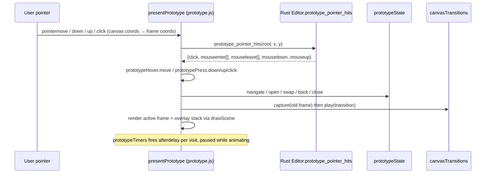
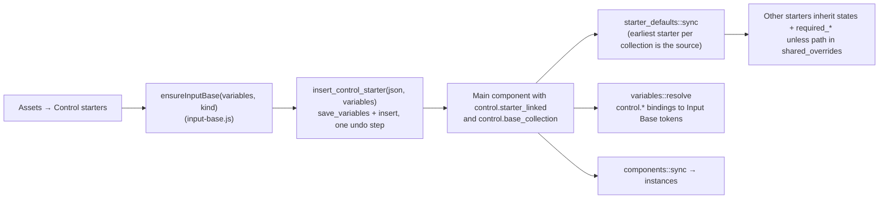

# Prototyping, Behaviors and Controls

PixlPrfct has four separate ways to make designs interactive, and they live in different places: **prototype interactions** (triggers → navigate/overlay/swap/back/close, stored on `Shape.prototype` and `Shape.additional_interactions`, validated in Rust and played back on a Canvas 2D presentation player), **Motion** (per-layer keyframe timelines in `editor_meta.motion`, edited in a docked bottom timeline and exported as CSS keyframes), **Development behaviors** (user JavaScript in `Shape.behaviors`, run only in a sandboxed preview iframe and in HTML/React/Vue/Angular exports), and **native controls** (`Shape.control`: real HTML form controls on main components, with "starter" presets driven by Input Base variable collections). The most important thing to know: none of the JavaScript behaviors or native controls run on the design canvas or in the prototype player; the canvas and player only paint, and prototype hit testing is done by the Rust engine on an isolated copy of the presented frame.

## At a glance

| Key files | Entry points | Depends on | Used by | Related docs |
|---|---|---|---|---|
| Prototype: [web/prototype.js](../../web/prototype.js), [web/prototype-interactions.js](../../web/prototype-interactions.js), [web/prototype-connections.js](../../web/prototype-connections.js), [web/prototype-hover.js](../../web/prototype-hover.js), [web/prototype-press.js](../../web/prototype-press.js), [web/prototype-timers.js](../../web/prototype-timers.js), [web/prototype-transition.js](../../web/prototype-transition.js); Rust `Prototype` + validation in [src/lib.rs](../../src/lib.rs). Motion: [web/motion.js](../../web/motion.js), `Motion` in [src/editor_tools.rs](../../src/editor_tools.rs). Behaviors: [web/behaviors.js](../../web/behaviors.js), [web/development.js](../../web/development.js). Controls: [web/controls.js](../../web/controls.js), [web/control-inspector.js](../../web/control-inspector.js), [web/control-parts.js](../../web/control-parts.js), [web/input-base.js](../../web/input-base.js), [web/dropdown-control.js](../../web/dropdown-control.js), per-type modules, [src/starter_defaults.rs](../../src/starter_defaults.rs) | `playPrototype` → `presentPrototype`; `renderPrototypeControls`; `installMotion`; `installDevelopment`; `installControlInspector`; WASM `prototype_pointer_hits`, `prototype_hits`, `prototype_hit_test`, `insert_control_starter`, `reset_starter_overrides`, plus generic `update` | Rust document engine, components (instance protection), variables (control tokens), CSS renderer ([web/css-renderer.js](../../web/css-renderer.js)), device chrome ([web/device-chrome.js](../../web/device-chrome.js)) | Prototype tab of the inspector, Motion mode, Development/Inspect panel, Assets → Control starters, HTML/framework export ([web/code-export.js](../../web/code-export.js), [web/framework-export.js](../../web/framework-export.js)), MCP | [development-behaviors.md](../development-behaviors.md), [starter-controls.md](../starter-controls.md), [dropdown-starter.md](../dropdown-starter.md), [AGENTS.md](../../AGENTS.md) (Motion layout), [Interface reference log](../FIGMA_UI_REFERENCE.md) "Motion reference" |

## Prototyping

### User-visible behavior

- The inspector's **Prototype** tab lists **Interactions** for the selected layer: up to six, one per trigger. Each has Trigger, Action (Navigate to frame, Open overlay, Swap overlay, Go back, Close overlay), destination, transition, duration, easing and overlay settings. Frames have a **Flow starting point** name.
- With prototype connections shown, a selected layer has a handle on its right edge; dragging it to a frame creates/retargets a connection (drawn as a bezier "noodle"; multiple interactions to the same target are offset).
- **Present** opens a full-window player dialog: Back, Restart, frame chooser, flow chooser, device chrome toggle, orientation (portrait/landscape, preview only), Show hotspots, Close.

### Data model and validation

`Prototype` ([src/lib.rs](../../src/lib.rs)):

| Field | Values / default |
|---|---|
| `trigger` | `click` (default), `mouseenter`, `mouseleave`, `afterdelay`, `mousedown`, `mouseup` |
| `delay` | ms, 1–600,000 (default 800); `afterdelay` only on frames |
| `action` | `navigate`, `overlay`, `swap` (need a frame `target`), `back`, `close` (`target` must be 0) |
| `transition` | `instant` (default), `dissolve`, `slide-left/right/up/down` (slides not allowed for overlay/close/swap) |
| `duration`, `easing` | ≤10,000 ms (default 300); `linear`, `ease-in`, `ease-out`, `ease-in-out` (default) |
| `overlay_position`, `overlay_x/y` | `center` (default), `manual`, corner positions; offsets ≤1e6 |
| `close_on_outside`, `backdrop_color`, `backdrop_opacity` | overlay modal settings (default `#000000`, 0.4) |

`Shape.prototype` is the primary interaction; `Shape.additional_interactions` holds up to five more. `validate` requires a primary when any additional exist and rejects duplicate triggers on one layer. `Shape.flow_name` (≤128 bytes, frames only) marks a flow start. JS helpers in [web/prototype-interactions.js](../../web/prototype-interactions.js): `interactions(shape)` (flatten), `withInteractions(shape, list)` (split back), `interactionFor(shape, trigger)`, `triggerLabels`.

Engine-side rules:

- `Editor::commit` and `commit_validated_document` strip `navigate`/`overlay`/`swap` interactions whose target frame was removed (`Shape::retain_interactions`).
- Duplication remaps internal targets; portable clipboard copies drop links to frames outside the copy (`prototype.test.mjs`).
- Components: `prototype` and `additional_interactions` are a paired override field; instance edits are rejected by `components::record_overrides`, so interactions come from the main. `flow_name` is **not** copied from the main to instances (`components::sync` keeps the instance's own value; `create_instance` clears it). See [Components-Variants-and-Slots](Components-Variants-and-Slots.md).

### Presentation player

- **Entry**: `playPrototype` in [web/app.js](../../web/app.js) picks the start frame (selected frame or its ancestor, else a flow start on the active page, else any flow start, else the first frame) and calls `presentPrototype(doc, start, editor, drawShape, prepare)`.
- **Frames**: `prototypeFrames(doc)` = visible frames not on library pages. `prototypeScene(doc, root)` isolates a frame subtree and forces it to clip.
- **State**: `prototypeState(doc, start)` holds a navigation history and an overlay stack (max 16). `navigate` clears overlays; `open` pushes; `swap` replaces only the top overlay; `back` pops an overlay first, then history; `start`/Restart resets. Going back from an overlay with a slide transition plays a dissolve instead.
- **Hit testing** is Rust: `Editor::prototype_hit_ids(root, x, y)` clones only the root subtree into a staged `Editor`, unlocks every layer, clips the root, and walks from the deepest hit up through ancestors collecting layers by trigger. `prototype_pointer_hits` returns the first click/mousedown/mouseup owner (deepest wins, so child clicks bubble to the nearest interactive ancestor) and full enter/leave lists. Hidden layers and clipping are respected; locks are ignored.
- **Hover** ([web/prototype-hover.js](../../web/prototype-hover.js)): `prototypeHover()` latches entered regions so moving across children does not re-fire `mouseenter`, and drops pending `mouseleave` when the screen changes.
- **Press** ([web/prototype-press.js](../../web/prototype-press.js)): `prototypePress()` tracks the primary pointer; a handled mousedown/mouseup suppresses the compatibility click. A press can open a menu overlay and the release can activate an item in it.
- **Timers** ([web/prototype-timers.js](../../web/prototype-timers.js)): `timedInteractions(scene)` lists visible frames with an `afterdelay` interaction; `prototypeTimers(fire)` owns one "visit" per screen, pauses elapsed time during repaint/animation, and invalidates callbacks on navigation (epoch counter).
- **Transitions** ([web/prototype-transition.js](../../web/prototype-transition.js)): `transitionSpec(config, reduced)` maps to Web Animations keyframes (dissolve = opacity, slides = translate ±100%); `canvasTransitions` snapshots the old canvas into a ghost element and animates both. `prefers-reduced-motion` makes every transition instant.
- **Device chrome / orientation**: `prototypeViewport` fits the frame plus optional device chrome ([web/device-chrome.js](../../web/device-chrome.js)); `prototypeOrientationDocument` re-lays out a rotated copy in a separate preview `Editor` so orientation changes never touch the real document.
- **Overlay placement**: `overlayPlacement(base, frame, position, x, y)`.

### Canvas connections

[web/prototype-connections.js](../../web/prototype-connections.js): `connectionHandle`/`connectionHit` (handle 12px right of the layer), `connectionTarget` (topmost visible frame under the pointer, honoring clipping), `connectedShape(source, target, index)` (retargets interaction `index`, keeping overlay/swap actions), `connectionCurve` (shared by drawing and hit testing), `connectionAt`, `drawConnections`. app.js handles the `prototype-link` gesture and commits through `update`, so a connection drag is one undo step.

## Motion

AGENTS.md requires Motion to use "a full-width docked timeline with tracks and a time ruler; animation properties belong in the right inspector" (detail in interface reference log "Motion reference").

- **Storage**: `shape.editor_meta.motion = {duration, looping, keyframes[]}` where each keyframe has `time`, `x`, `y` (translation offsets), `rotation`, `scale`, `scale_y`, `opacity`, optional `width`, `height`, `corner_radius`, and `properties` (which keys this keyframe sets; empty = all). Rust `editor_tools::validate` enforces duration 1–60,000 ms, ≤200 keyframes, strictly increasing times within the duration, scale 0.01–100, opacity 0–1 and the property name list.
- **Evaluation** ([web/motion.js](../../web/motion.js)): `motionValue(motion, time, shape)` linearly interpolates each key independently across the keyframes that set it (holding first/last values outside the range); `neutralKeyframe` supplies defaults from the shape. `motionScene(scene, time)` applies values to the animated layer **and its descendants** (scaling child offsets and text size) without mutating the document; app.js renders `motionTools.preview(scene)` while Motion mode is active.
- **Export**: `motionCss(shape)` emits `@keyframes px-motion-<id>` plus an `animation` rule on `.px-node-<id>` (linear timing, `infinite` when looping) and a reduced-motion opt-out; the CSS renderer includes it in HTML/CSS export.
- **UI**: `installMotion({current, shapes, change, select, draw})` creates `#motion-timeline` (resizable 120–600px, collapsible) with Play, auto-keyframing, current time, duration, time format, Loop, ruler/scrubber, tracks, zoom. Double-click a track to add a keyframe; drag or arrow keys to move keys (`moveMotionKeys`, `motionMoveDelta`); Delete removes (`removeMotionKeys`). The Motion inspector (Animations, Transform, Layout, Appearance with per-property keyframe diamonds) is added as a panel via `development.addPanel('motion', …)`, and shared inspector sections are temporarily moved into it. Edits are saved with `change({...shape, editor_meta: {...motion}})`.

> **Note:** Motion is distinct from the separate SVG Animator design type ([SVG-Animator](SVG-Animator.md)). Motion has no dedicated test file; its pure functions are tested in `tests/toolbar-tools.test.mjs` ("motion interpolates and previews without mutating documents, and exports real keyframes").

## Development behaviors

User-facing description is in [development-behaviors.md](../development-behaviors.md). Implementation:

- **Model**: `Shape.behaviors: Vec<Behavior {id, name, code, trigger, enabled, duration, distance}>`. Rust only deserializes it (no field validation beyond the 5 MB document limit); it survives save, duplicate and undo as ordinary shape data.
- **Snippets** ([web/behaviors.js](../../web/behaviors.js) `snippets`): fade, slide, stagger, hover lift, pulse, reveal on scroll, toggle children, accordion, tabs, modal, custom. `createBehavior(snippet)` sets duration 400 and distance 16.
- **Triggers** (in `mountBehaviors`): `load` (run immediately), `click`, `hover` (`pointerenter`), `view` (first `IntersectionObserver` intersection).
- **Runtime API**: `mountBehaviors(root, entries, report)` gives each body `element` and `api` (`children`, `find`, `on`, `animate`, `style`, `cleanup`, `duration`, `distance`); all listeners, animations and style changes are reverted on unmount. The same function also mounts native control runtimes (dropdowns, calendars, textareas, files, numbers, passwords, masonry) and the shared validation-message logic, which is why controls work in exports.
- **Validation**: `validateBehavior(code)` compiles with `new Function('element','api',code)`; `behaviorSource(shapes)` throws `"<layer> / <behavior>: <error>"` for enabled invalid code, which blocks export.
- **Preview** ([web/development.js](../../web/development.js) `installDevelopment`): the Development panel edits behaviors with a 450ms debounced save (flushed when switching items or previewing). **Run preview** exports the selection to HTML/CSS (`cssExport`), injects a strict CSP (`default-src 'none'; connect-src 'none'; form-action 'none'`, inline scripts only) and the behavior runtime into an `<iframe sandbox="allow-scripts">`, and reports runtime errors back via `postMessage` with a per-preview token.
- **Export**: HTML `script.js`; React effect with cleanup; Vue mounted/beforeUnmount; Angular afterViewInit/onDestroy; each framework export ships `behavior-runtime.js`. Rust export does not support behaviors.

## Native controls and starters

### Model

`Shape.control: Option<Control>` ([src/lib.rs](../../src/lib.rs)) with `kind` from `controlTypes` in [web/controls.js](../../web/controls.js): `segmented, button, checkbox, switch, radio, text, password, email, number, tel, url, search, date, datetime-local, month, week, time, range, color, file, hidden, image, submit, reset, select, textarea`. Other notable fields: `label`, `label_position`, `name`, `value`, `placeholder`, `helper_message`, validation (`required`, `pattern`, `min_length`, `max_length`, `min`/`max`/`step`, `validation_trigger`, `validation_message`, `invalid`), state flags (`disabled`, `readonly`, `checked`), `options`, `selected_values`, required-marker styling (`required_icon`, `required_svg`, size/weight/offset/color), `left_adornment`/`right_adornment` (icons), type-specific JSON blobs (`segmented`, `password`, `number`, `upload`, `textarea`, `calendar`), `dropdown: Option<DropdownControl>`, and `states: BTreeMap<state, ControlStyle {background, color, border_color, opacity, radius, parts}>`. `Shape.control_state` stores the current visual state(s) as a comma list (`controlStates`: default, required, hover, focus, active, selected, indeterminate, readonly, invalid, disabled).

> Rust does not validate `control.kind`; only dropdown settings (`bulk_style`, menu sizes, ≤500 unique item values, ≤30 pill limit) and variable bindings on `control.*` paths are checked. The JS `controlTypes` list is the effective whitelist.

### Rendering and export

- `controlMarkup(control, id)` produces real HTML (`<input>`, `<button>`, `<textarea>`, radio groups, custom dropdown backed by a hidden native `<select>`); `controlCss(control, id, {interactive, initialState, surface})` produces state CSS, with per-part declarations from [web/control-parts.js](../../web/control-parts.js) (`partNames`: label, input/value, placeholder, helper, validation, radio dot, switch thumb, dropdown menu/items/pills/actions, calendar parts…). Type modules provide `*Config`, `*Markup`, `*Css` and `mount*` runtimes: [number-control.js](../../web/number-control.js) (locale/currency/percent formatting), [password-control.js](../../web/password-control.js) (requirements, reveal toggle), [file-control.js](../../web/file-control.js) (accept rules, count/size limits), [calendar-control.js](../../web/calendar-control.js) (`calendarDays`), [textarea-control.js](../../web/textarea-control.js) (character count), [segmented-control.js](../../web/segmented-control.js), [dropdown-control.js](../../web/dropdown-control.js) (keyboard model, search, bulk actions, pills).
- The canvas shows controls through the CSS renderer; `controlPreviewStates` holds temporary main-component state previews that never leak into exports. [web/control-sizing.js](../../web/control-sizing.js) `hasHugControlHeight` marks kinds whose height comes from parts/variables rather than canvas resizing (the engine measures them through the `text_measurer` callback during `reflow_text`).

### Inspector

[web/control-inspector.js](../../web/control-inspector.js) `installControlInspector({resetShared, current, document, change, redraw, preview, selectChild})` renders **Design → Control**: control type, label/name/value, State and Combine states, field requirement/validation, input icons (library icon or custom SVG), required marker, type-specific sections (dropdown via [dropdown-inspector.js](../../web/dropdown-inspector.js) `renderDropdownInspector`, segmented via `renderSegmentedInspector`), **Appearance override** per state/part with Inherit/explicit value and variable binding, **Reset to shared defaults** (`reset_starter_overrides`) and **Try native control** (Development preview).

### Starters, Input Base and shared defaults

- [web/input-base.js](../../web/input-base.js) creates preset variable collections (`Collection.preset`: `input_base`, `dropdown_base`, `checkbox_base`, `switch_base`, `button_base`, `segmented_base`, `radio_base`, `calendar_base`) with tokens whose `Variable.control_path` names the control property they style (`inputTokens`, `dropdownTokens`, `checkboxTokens`, …; `addInputModes`, `ensureDropdownBase`, `inputBaseControl`).
- `Editor::insert_control_starter(json, variables)` saves the variables and inserts the starter in one staged commit, marking it `starter_linked` and a main component.
- [src/starter_defaults.rs](../../src/starter_defaults.rs): for starters sharing a `base_collection` (and not instances), the one with the **lowest layer ID** is the source. `sync` copies its `states` and `required_*` values and their `control.*` variable bindings onto the others, except paths listed in that starter's `shared_overrides` and dropdown-only parts. `record` (called from `update_many`, `bind_variable`, `set_variable_mode`) adds a path to `shared_overrides` whenever a starter's shared value or binding is edited. `sync_dropdown` binds new Dropdown Base / Calendar Base tokens to select/date starters. `reset_starter_overrides(id)` clears the list so inheritance resumes (mains only).
- `variables::save_variables` auto-binds newly added preset tokens to subscribed starters when the starter's value is still the default marker; deleting a token clears the corresponding control style so it falls back.
- Instances: `components::record_overrides` allows only content keys of `control` on instances (label, value, placeholder, helper/validation message, invalid, selected values, width sizing, hide helper; radio `name`) plus `control_state`; appearance is protected.

> **Note:** [starter-controls.md](../starter-controls.md) records that at the time (2026-10-26) the full JS suite had 31 failures from tests expecting appearance/layout/prototype overrides on protected instances. Current test titles (e.g. `prototype-multiple`, `strokes`, `shadows`) assert rejection instead, so that reconciliation appears to have happened; re-run `npm test` to confirm.

> **Note:** [web/setup-controls.js](../../web/setup-controls.js) is not a form-control module; it exports `mountSetup`, the self-hosting setup wizard UI. See [Self-Hosted-Server](Self-Hosted-Server.md).

## Extension guide

**Add a prototype trigger.** Add it to the trigger whitelist in `validate` ([src/lib.rs](../../src/lib.rs)); if pointer-driven, add it to the trigger array in `prototype_hit_ids` and the JSON in `prototype_pointer_hits`; add a label in `triggerLabels`; handle it in `presentPrototype`'s pointer handlers; add tests to `prototype-hover`/`prototype-press` style files.

**Add a prototype action or transition.** Extend the action/transition whitelists in `validate` (and the overlay slide exclusion), the target-removal rule in `commit` if it references frames, `prototypeState`, `transitionSpec`, `connections()` in prototype-connections.js, and the inspector options in `renderPrototypeControls`.

**Add a behavior snippet.** Append to `snippets` in behaviors.js; it must compile under `validateBehavior` (covered by "all built-in snippets parse").

**Add a native control kind.** Add it to `controlTypes`, implement markup/CSS (and a `mount*` runtime if interactive, registered in `mountBehaviors`), extend `newControl`, the inspector, `hasHugControlHeight` if applicable, and an Input Base preset in input-base.js if it should be a starter. If instances need new content overrides, add the key to the allowed list for `control` in `components::record_overrides` and to `subfields("control")`.

**Add a Motion property.** Extend `keys`/`neutralKeyframe`/`motionScene`/`motionCss` in motion.js, the `Keyframe` struct and property whitelist in `editor_tools.rs`, and the Motion inspector rows.

## Invariants and gotchas

- One trigger per layer; at most six interactions; `afterdelay` only on frames.
- Prototype hit testing ignores locks but respects `hidden` and clipping, and always clips the presented root even if canvas clipping is off.
- The player never mutates the document; orientation previews use a second `Editor` instance.
- Behaviors and native control runtimes execute only inside the sandboxed preview or exported code. Do not call `mountBehaviors` against the editor DOM.
- Starter shared-default source is chosen by lowest ID; deleting the source makes the next-lowest starter the source on the next commit.
- Motion previews are display-only (`motionScene` copies shapes); saved geometry never changes when scrubbing.

## Known limitations

- No smart-animate, scroll/overflow behaviors, variables-in-prototypes or conditional logic in prototypes (README lists variable-driven prototypes as pending).
- Behaviors are not available in the prototype player or Rust export; JSX/imports/framework syntax are rejected as bodies.
- Motion supports linear interpolation only and a fixed property set; there is no Motion-specific test file.
- Full framework production builds and screen-reader audits for controls were not performed (starter-controls.md, dropdown-starter.md).

## Tests

| Area | Files (`tests/`) |
|---|---|
| Prototype | `prototype`, `prototype-flows`, `prototype-hover`, `prototype-multiple`, `prototype-overlays`, `prototype-press`, `prototype-timers`, `prototype-transitions`, `device-chrome` |
| Motion | `toolbar-tools` (motion functions); browser `browser/editor.spec.mjs` |
| Behaviors | `behaviors`, `masonry` |
| Controls | `controls`, `dropdown-control`, `input-base`, `starter-defaults`, `button-starter`, `checkbox-starter`, `radio-starter`, `switch-starter`, `segmented-starter`, `number-starter`, `password-starter`, `textarea-starter`, `calendar-starter`, `file-starter` |

## Related pages

[Components-Variants-and-Slots](Components-Variants-and-Slots.md) · [Styles-Variables-and-Paints](Styles-Variables-and-Paints.md) · [Rendering-and-Export](Rendering-and-Export.md) · [SVG-Animator](SVG-Animator.md) · [Web-Editor-Architecture](Web-Editor-Architecture.md) · [Interface-Design-Guidelines](Interface-Design-Guidelines.md) · [Testing-and-Verification](Testing-and-Verification.md)

## Source of truth

- [src/lib.rs](../../src/lib.rs): `Prototype`, `Behavior`, `Control`, `DropdownControl`, `ControlStyle`, `validate` (prototype and dropdown rules), `prototype_hit_ids`, `prototype_pointer_hits`, `insert_control_starter`, `reset_starter_overrides`
- [src/editor_tools.rs](../../src/editor_tools.rs) (`Motion`, `Keyframe`, validation); [src/starter_defaults.rs](../../src/starter_defaults.rs)
- [web/prototype.js](../../web/prototype.js) and `prototype-*.js`; [web/motion.js](../../web/motion.js); [web/behaviors.js](../../web/behaviors.js), [web/development.js](../../web/development.js); [web/controls.js](../../web/controls.js), [web/control-inspector.js](../../web/control-inspector.js), [web/input-base.js](../../web/input-base.js), [web/dropdown-control.js](../../web/dropdown-control.js)
- Docs: [development-behaviors.md](../development-behaviors.md), [starter-controls.md](../starter-controls.md), [dropdown-starter.md](../dropdown-starter.md), [AGENTS.md](../../AGENTS.md), [Interface reference log](../FIGMA_UI_REFERENCE.md) "Motion reference"
