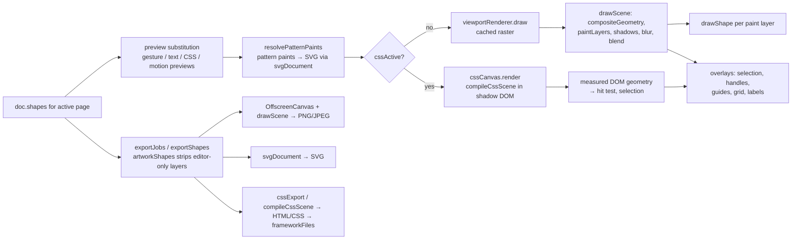

# Rendering and Export

PixlPrfct has three renderers for the same document: a **Canvas 2D** painter (the editor viewport and PNG/JPEG export), an **SVG serializer** (SVG export, and the source for textures, pattern paints and non-native gradients), and an **HTML/CSS compiler** (the optional "CSS canvas" viewport and the HTML/React/Vue/Angular/Leptos code export). They stay consistent mainly by sharing code rather than by comparing pixels: one geometry pass (`compositeGeometry()`), one paint-layer expansion (`paintLayers()`), one text measurer, and the SVG serializer reused inside the other two renderers for paints that Canvas or CSS cannot express natively. Features a renderer cannot reproduce are refused with an error (for example custom CSS or background blur in PNG/SVG export) instead of being silently dropped.

## At a glance

| Key files | Entry points | Depends on | Used by | Related docs |
|---|---|---|---|---|
| [web/appearance.js](../../web/appearance.js), [web/viewport-renderer.js](../../web/viewport-renderer.js), [web/shadows.js](../../web/shadows.js), [web/export.js](../../web/export.js), [web/css-renderer.js](../../web/css-renderer.js), [web/code-export.js](../../web/code-export.js), [web/framework-export.js](../../web/framework-export.js), [web/batch-export.js](../../web/batch-export.js) | `draw()` / `drawShape()` / `exportArtwork()` in [web/app.js](../../web/app.js); `codeExportFiles()`; MCP `export` method in [web/agent-runtime.js](../../web/agent-runtime.js) | Document JSON from the Rust engine (`editor.snapshot()`), `typography.js` text layout, `paints.js` | Editor viewport, export dialog, File › Export project, MCP `pixlprfct_export`, SVG Animator | [CSS_EDITING.md](../CSS_EDITING.md), [PERFORMANCE.md](../PERFORMANCE.md), [EFFECTS_GUIDES_AUDIT.md](../EFFECTS_GUIDES_AUDIT.md) |

## Pipeline overview

## Viewport rendering

### draw() in app.js

`draw()` (around line 883 of `web/app.js`) runs once per animation frame via `scheduleViewportDraw()`. Steps:

1. Resize the backing store to `clientSize × devicePixelRatio`, set the DPR transform, then `translate(pan)` and `scale(zoom)`.
2. Pick the scene: `pageShapes()` with `gesture.previews`/`gesture.preview` substituted (`commitPaintEdit()` applied). Resize/rotate of frames, groups and text asks the engine for a laid-out preview (`editor.preview_update_many` or `preview_layout_update` for grid parents) so auto layout reflows live without touching history. Text editing, grid picker, layout-CSS and layer-CSS previews replace the scene entirely; `motionTools.preview()` applies motion previews.
3. `resolvePatternPaints(previewPaints(scene), (source,box)=>svgDocument(source,box,1,null,textLayout))` — pattern paints get their `_svg` markup; video/shader paint previews get their current frame.
4. If `cssActive()` render through the CSS canvas, else `viewportRenderer.draw(scene, ctx, drawShape)`.
5. Draw overlays directly on the main context (never cached): device chrome, slot overlay, frame labels, component-set dashed outlines (`#9747ff`), editor marks (`drawEditorMarks`), layout guides, grid cells/areas, drop destinations, creation preview, pen anchors, selection boxes with 6/zoom px handles and the `W × H` label, marquee, gradient handles, prototype connections, auto-layout spacing handles.

### drawShape(shape, target)

Paints one **paint layer** of one shape (Canvas). It returns early for hidden shapes, groups and editor-only roles. Rotation is applied around `(x, y)` with `-rotation` degrees. Fill and stroke styles come from `canvasFill(ctx, shape, channel)` (`gradients.js`), which returns a solid color, a `CanvasGradient` (linear/radial), or, for `angular`/`diamond` gradients and all textures, a pattern produced by rendering SVG markup to an `Image` (`canvasSvgPaint()` in `paint-textures.js`). Shape kinds:

- **image** — clipped to the rounded outline; drawn from `rasterEntry(data_url)` (cached `Image`; a grey placeholder until loaded, then the viewport cache is invalidated and redrawn).
- **vectors** (`points`) — `Path2D(vectorPath(shape))`; closed paths stroke via `drawAlignedStroke()`, open paths via `drawVectorStroke()`.
- **text** — `textLayout(shape)` lines with `letterSpacing`, clipped to the box; text-on-path uses `pathGlyphs()` from `canvas-tools.js`.
- **rectangle / frame / ellipse** — `roundRect(radii(shape))` or `ellipse()`.

Paint opacities use `withPaintOpacity()` (multiplies `globalAlpha` by `fill_opacity`/`stroke_opacity`/`image_opacity`).

### Strokes

- `stroke-alignment.js` `drawAlignedStroke(ctx,s,geometry)`: center strokes call `ctx.stroke` directly. Inside/outside strokes draw a **double-width** stroke into an `OffscreenCanvas`, then keep only the part inside (`destination-in`) or outside (`destination-out`) the filled outline, then tint with `source-in`. Per-side borders (`s.border_widths`) are filled as an even-odd path from `boxBorderPath()` (`box-border.js`).
- `stroke-render.js` `drawVectorStroke(ctx,s,path)`: when arrowheads/endpoint tips exist (`strokeTips()`), paints the shaft and tips as one union on a surface, cuts tip regions out of the dashed shaft, then tints once — "translucent strokes and gradients must not darken where an arrowhead overlaps its shaft."
- `stroke-tips.js` `strokePadding()` computes how far a stroke reaches outside the box (0 / 0.5 / 1 × width for inside / center / outside, multiplied by the miter limit or √2 for square caps on vectors). It feeds hit bounds, effect buffers and export bounds.

### drawScene: compositing, shadows, blur, blend

`drawScene(shapes, context, paint)` in `appearance.js` converts to world coordinates (`sceneToWorld()`), computes `compositeGeometry()` once, and walks the tree in paint order (`paintChildren()` from `stacking.js`):

- Fast path: `blend_mode` pass-through, opacity 1, no visible shadows, no layer blur → paint directly into the target.
- Otherwise the layer and its descendants are painted into an offscreen surface sized by `effectSurfaceSize(box, density)`, inner shadows are applied on that surface (`source-atop`), drop shadows are drawn underneath, and the result is composited with `globalAlpha *= opacity` and `globalCompositeOperation` = blend mode (`plus-lighter` → `lighter`, `normal`/`pass-through` → `source-over`).
- Layer blur (or shadows combined with opacity/blend) uses a second surface sized from the `output` box and `target.filter = blur(layerBlur*density/2 px)`.
- Frames with `clip_content` clip children to a rounded rect.
- Each shape is expanded with `paintLayers()` (`paints.js`) into one pseudo-shape per fill/stroke paint; each gets its own `paint_blend_mode`.

`shadows.js` details:

- `compositeGeometry(shapes, styleOf)` returns per-shape `{content, output}` boxes: `content` = visual bounds + stroke padding (+ children, intersected with clip frames); `output` = `content` expanded by `shadowBounds()` (offset + max(0,spread) + 1.5 × blur) then `blurBounds()` (1.5 × layer blur). Hidden or zero-opacity shapes get `null`.
- `effectSurfaceSize(box, density)` caps every offscreen buffer: `scale = min(density, 8192/width, 8192/height, sqrt(16,777,216/(width*height)))`. Large effects are therefore rendered at reduced density rather than failing.
- `drawShadow()` builds an alpha mask, applies spread with `spreadAlpha()` (CPU dilate/erode on `ImageData`), tints it, and draws it with `filter: blur(blur*density/2 px)`.
- Disabled effects keep their values: `effectBlur(style,key)` returns 0 when `<key>_enabled === false` (`effect-values.js`).

### Paint sources: textures, media, shaders

- `paint-textures.js`: `textureSvg(s, channel)` emits an SVG `<pattern>` for pattern paints (tile types grid/horizontal/vertical/hexagonal, `patternLayout()`), image/video media (`mediaLayout()` for `mode` fill/fit/tile, `scale` and offsets; `paintFilter()` maps 7 adjustment sliders — exposure, contrast, saturation, temperature, tint, highlights, shadows — to an SVG color matrix) and shader snapshots. "Paint sources share the same SVG pattern in the canvas and CSS renderers." The Canvas path draws that markup as an image; up to 64 decoded images are cached and a `paint-texture-ready` window event invalidates the viewport cache when one loads.
- `readPaintMedia()` limits: images PNG/JPEG/WebP/GIF ≤ 10 MB, downscaled to 2048 px max edge, data URL ≤ 2,000,000 chars; videos MP4/WebM/MOV ≤ 2 MB, poster downscaled to 1024 px wide.
- `paint-shaders.js`: shader paints are GLSL fragment bodies (`shaderPresets` mesh/noise/waves or custom code using `u_color, u_secondary, u_scale, u_time, u_seed`) compiled into a shared WebGL context by `shaderSnapshot()` (default 384×384). The **rendered PNG data URL** (`shader.snapshot`) is what every renderer uses, so exports are static frames. `startPaintPreview()` animates a selected video/shader paint in the editor at ~12 fps (80 ms ticks); `previewPaints()` substitutes the live frame into the scene. WebGL missing → "Shader paints need WebGL."

### viewport-renderer.js: the artwork cache

`createViewportRenderer(render, {createSurface, maxPixels=16_777_216, padding=256, deferEdits=false})` returns `{draw, invalidate}`. app.js creates it with `deferEdits:true`.

- The cache key is `JSON.stringify(scene)`; the transform must be axis-aligned with equal X/Y scale.
- Direct (uncached) rendering when the buffer `(w+512)×(h+512)` would exceed `maxPixels` or 8192 px per edge, or when rotated/skewed.
- With `deferEdits`, a changed scene paints directly once; the next unchanged draw builds the cache ("Building and copying a large temporary raster on every keystroke is more expensive than its saved work").
- Reuse requires same key, scale and canvas size, an integer device-pixel offset (fractional pans repaint so text is not resampled), and movement within the 256 px overscan.
- Only artwork is cached; selection and other overlays are drawn every frame. Export never uses the cache.

[PERFORMANCE.md](../PERFORMANCE.md) reports pan redraw medians dropping from 11–22 ms to under 1 ms on a 727-layer file with this cache; small antialiasing differences between cached and direct rendering were observed (mostly 1/255).

### The CSS canvas

`mountCssCanvas(canvas, onLayout)` (`css-renderer.js`) inserts a `pointer-events:none` host before the `<canvas>`, with an open **shadow root** holding `<style>` and a `.px-scene` div transformed by `translate(pan) scale(zoom)`. `render(shapes, options, pan, zoom)` re-runs `compileCssScene()`, only replaces `innerHTML`/CSS when the output string changes, runs masonry layout (`masonry.js`), then measures every `[data-px-id]` node to return world-space geometry (including measured grid tracks via `measuredGrid()`). app.js uses that geometry for selection, handles and `cssCanvas.hit()`.

`cssActive()` is true when a layout/layer CSS preview is open, when `needsControlRenderer()` (any control layer, CSS Grid auto layout, `layout_media` breakpoints or `custom_css` on the page — the toggle is then forced on), when the user enables the "CSS canvas" toggle, or by default when any layer has background blur. See [CSS_EDITING.md](../CSS_EDITING.md) and [Layout-Auto-Layout-and-Grid](Layout-Auto-Layout-and-Grid.md).

## Image and SVG export (export.js)

| Function | Role |
|---|---|
| `exportShapes(page, ids, scope)` | `'selection'` → selected roots and descendants; otherwise whole page. Hidden trees dropped, parents outside the set re-rooted, editor-only layers removed by `artworkShapes()`. |
| `exportBounds(shapes)` | `compositeGeometry(...).bounds` — includes strokes, shadows and blur. Throws "Nothing visible to export". |
| `exportSize(box, scale, format, shapes)` | Validates and returns integer pixel size (see limits). |
| `rasterSettings(format, background, quality=90)` | MIME, extension, background (`#rrggbb`; JPEG defaults to `#ffffff`), JPEG quality 1–100 → 0.01–1. |
| `svgDocument(shapes, box, scale, background, textLayout, transformPaint)` | Builds the SVG string. |

### Export limits (exact, from code)

| Limit | Value | Where |
|---|---|---|
| Formats | `png`, `jpeg`, `svg` | `exportSize` |
| Scale | 0.25 – 8 | `exportSize` |
| Raster edge | ≤ 8192 px per side | `exportSize` |
| Raster area | ≤ 16,777,216 px (16 MP) | `exportSize` |
| Raster area + effect buffers | ≤ 67,108,864 px (peak of nested shadow/blur/aligned-stroke surfaces estimated by `peak()`) | `exportSize` |
| Effect buffer | "Effect buffer is too large" if `effectSurfaceSize()` had to reduce below the export scale | `exportSize` |
| Custom CSS / background blur | Refused for PNG/JPEG/SVG ("requires HTML/CSS export") | `exportSize` |
| Batch files | ≤ 100 per batch | `exportJobs` |
| ZIP | 1–1000 entries, ≤ 134,217,728 bytes (128 MB) total | `zipFiles`, `exportArtwork` |
| ZIP filenames | ≤ 65,535 bytes, no `/` or `\`, not `..` | `zipFiles` |
| Native `.pixl` | ≤ 5,000,000 bytes | `project-file.js` |
| MCP export chunk | 256 – 64,000 UTF-16 code units (default 64,000) | `export-chunks.js` |

### PNG/JPEG

`exportArtwork()` in app.js waits for `document.fonts.ready` and for every embedded image to decode, creates an `OffscreenCanvas(size.width, size.height)`, fills the background if any, sets `setTransform(scale,0,0,scale,-box.x*scale,-box.y*scale)`, calls the same `drawScene(shapes, output, drawShape)` as the viewport (uncached), and `convertToBlob({type, quality})`. If the browser returns a different MIME type it throws "This browser cannot encode …".

### SVG

`svgDocument()` resolves pattern paints, validates size via `exportSize(...,'svg')`, then emits `<svg width height viewBox="box">`, `clipDefinitions()` (frame clip paths, `scene.js`), a `<defs>` of `gradientSvg()` + `textureSvg()` for every paint layer, an optional background rect, and `sceneSvg(shapes, paint)`:

- groups → `<g opacity>`; blend modes → `style="isolation:isolate;mix-blend-mode:…"`; per-paint blend → nested `<g style="mix-blend-mode">`;
- shadows → `shadowFilter()` (feMorphology for spread, feGaussianBlur `stdDeviation = blur/2`, feOffset, feFlood, feComposite; inner shadows composited `atop` the artwork; list painted in reverse so the first effect is nearest);
- layer blur → `layerBlurFilter()` (`stdDeviation = blur/2`);
- clipping frames → `clip-path="url(#frame-clip-<id>)"`;
- shapes → `roundedSvg()`, `<ellipse>`, `vectorSvg()`, `textSvg()` (from the same `textLayout()` lines), `imageSvg()` with an image clip;
- aligned strokes → `alignedStrokeSvg()` using SVG masks with the same double-width technique as Canvas.

### Batch export and ZIP

`exportJobs(page, ids, options, name)` (`batch-export.js`) turns scope `frames` (visible top-level frames) or `layers` (selected roots, skipping descendants of other selected roots) into one job per root; `selection`/`page` produce one job. Slices (`editor_meta.role==='slice'`) export the page clipped to the slice rectangle. Filenames are sanitised (`<>:"/\|?*` and control chars → `_`, trailing dots/spaces removed, 100 chars, Windows reserved names prefixed with `_`, case-insensitive de-duplication `name (2)`). `zipFiles(files)` writes an uncompressed (stored) ZIP with UTF-8 names (flag 0x800) and a JS `crc32()`; no compression library is involved.

`export-chunks.js` `exportChunks(files, state, args, scope)` paginates MCP export output: if everything fits in `limit` it returns files inline, otherwise a manifest with per-file cursors. A cursor pins `revision`, `scope`, file name and offset; changing the document or options between chunks throws, and chunks never split a surrogate pair.

## HTML/CSS and framework export

### compileCssScene

`compileCssScene(shapes, {variables, pageModes, textLayout, interactive, responsiveExport})` is "One compiler [that] supplies both the isolated live DOM and the downloadable source." Per shape:

- Free-positioned layers get `position:absolute` with `left/top` relative to the parent; auto-layout children are `position:relative` flex/grid items (`fill_width` → `flex:1 1 0px` or `align-self:stretch`, min/max sizes, margins, negative gap handling).
- Auto-layout frames emit real Flexbox, or CSS Grid via `gridCss()` (`grid-model.js`); `layout_media` rules become `@media` blocks keyed by `layoutClass()`. In the editor (`responsiveExport:false`) `responsiveLayoutShapes()` resolves the active breakpoint into the shapes instead.
- Variables become custom properties `--px-<name>-<id>` (`variableName()`); bound properties use `var(--px-…, fallback)`; color variables use `rgb(from var(...) r g b / alpha)`. Variable modes are inherited down the tree.
- Shadows → `box-shadow` (inner → `inset`), layer blur → `filter: blur(blur/2 px)`, glass/background blur → `backdrop-filter`.
- Vector paths, images, gradients, paint stacks, dashed strokes and rotated non-container layers are rendered as **inline SVG** by calling `svgDocument([paint], box, 1, null, textLayout, bindPaint)` inside `` — with effects stripped from that paint copy because CSS applies them on the wrapper. The warning "Vector paths, images and gradient paint remain inline SVG inside CSS layout." is added to the export.
- Control layers use `controlMarkup()`/`controlCss()` (`controls.js`); custom per-layer CSS via `renderLayerStyles()` (`layer-style.js`); motion via `motionCss()`.

`cssExport(shapes, options)` normalises coordinates so the top-left visual bound is at 0,0, inherits root variable modes from `sourceShapes`, compiles with `interactive:true, responsiveExport:true`, and wraps the result in a standalone `<!doctype html>` page linking `styles.css`, plus `.px-scene{min-width;min-height}`.

### codeExportFiles and frameworkFiles

`codeExportFiles(doc, {scope:'project'|'page'|'selection', pageId, ids, textLayout, target})` (`code-export.js`) excludes library pages, runs `cssExport()` per page, and produces `index.html` / `page-<id>.html`, one CSS file per page (`page-<id>.css` for project scope, else `styles.css`), `behavior-runtime.js` and `script.js` (from `behaviors.js` `behaviorSource()`), `project.json` and `README.txt`. Targets:

| Target | Output |
|---|---|
| `html` | The files above |
| `react` | Vite project (`package.json` with `vite ^7`, `react ^19`): `index.html`, `main.jsx`, one `<Page>.jsx` + CSS per page (`reactMarkup()`), `behavior-runtime.js` |
| `vue` | Vite project (`vue ^3.5`, `@vitejs/plugin-vue`): `vite.config.js`, `main.js`, `<Page>.vue` per page |
| `angular` | Angular 20 CLI project: `angular.json`, `tsconfig.json`, `main.ts`, per-page component `.ts/.html/.css`, `behavior-runtime.d.ts` |
| `rust` | Leptos 0.8 (CSR, Trunk `index.html`) crate: `Cargo.toml`, `main.rs`, `page_N.rs`; refuses documents with enabled JavaScript behaviors |

Multi-page framework projects select the page with a `?page=` query parameter in the generated entry file.
| `pixl` | Not code: `projectFile(editor.snapshot())` downloads the native `.pixl` JSON |

The dialog is `showCodeExport()` (File › Export project); app.js zips the result with `zipFiles()` into `pixlprfct-<target>.zip`. Prototype interactions are not converted ("Prototype actions are not converted yet").

## SVG utilities: svg-path.js and svg-gradients.js

These are **import-side** helpers, not export: `svg-path.js` (`parsePath`, `arcCubics` following the W3C arc implementation notes, `parseTransform`, `multiply`, `transformPoint`) and `svg-gradients.js` (`pathBounds` using true Bézier extrema for `objectBoundingBox`, `gradientResolver`) are used by `svg-import.js`, `svg-viewport.js` and the SVG Animator modules. See [Import-Design-Files](Import-Design-Files.md) and [SVG-Animator](SVG-Animator.md).

## How the three outputs stay consistent

| Concern | Shared mechanism |
|---|---|
| Bounds and effect extents | `compositeGeometry()` / `shadowBounds()` / `blurBounds()` for Canvas buffers, SVG filter regions and export bounds |
| Paint stacks | `paintLayers()` in `drawScene`, `sceneSvg`, the SVG `<defs>`, and the CSS inline-SVG paint |
| Textures, patterns, shaders | `textureSvg()` markup drawn as an image on Canvas, embedded as `<pattern>` in SVG, inline in CSS; shaders use the stored snapshot |
| Angular/diamond gradients | `gradientSvg()` on all paths (Canvas rasterises it via `canvasSvgPaint()`) |
| Pattern paints | `resolvePatternPaints(shapes, svgDocument)` in `draw()`, `svgDocument()` and `compileCssScene()` |
| Text | One `textLayout()` (offscreen `measureText`) for Canvas and `textSvg()`; the same measurer is installed in Rust with `set_text_measurer` for auto sizing and layout |
| Blur radius | Canvas `blur(b/2 px)`, SVG `stdDeviation=b/2`, CSS `blur(b/2 px)` |
| Aligned strokes | Double-width stroke clipped by fill: Canvas composite ops, SVG masks |
| Editor-only layers | `artworkShapes()` in `exportShapes`, `svgDocument`, `cssExport` |
| Unsupported features | `exportSize()` refuses custom CSS and background blur for image/SVG; Leptos target refuses JS behaviors |
| Layout | Rust computes auto-layout geometry for Canvas/SVG; CSS uses real Flexbox/Grid, and the CSS canvas measures the DOM back into geometry |

Known gaps: README says "Plus darker is not yet supported" for blend modes; CSS layout can legitimately differ from engine layout (it is browser layout), which is why CSS Grid, controls and custom CSS force the CSS canvas in the editor. Cached vs direct canvas rendering shows small antialias differences (PERFORMANCE.md). There is no automated cross-renderer pixel comparison in `tests/`; consistency is covered by unit tests on the shared functions (`export.test.mjs`, `css-renderer.test.mjs`, `shadows.test.mjs`, `inner-shadows.test.mjs`, `layer-blur.test.mjs`, `stroke-alignment.test.mjs`, `viewport-renderer.test.mjs`, `batch-export.test.mjs`, `export-chunks.test.mjs`, `code-export.test.mjs`) and Playwright screenshots in `tests/browser/`.

## Extension guide: adding a new visual property

1. Add the field to the Rust model (`src/*.rs`) with serde defaults; rebuild so `editor-api.js` `modelReference` updates.
2. **Bounds**: if it extends outside the box, include it in `strokePadding()` or `compositeGeometry()`; otherwise export clips it.
3. **Canvas**: implement in `drawShape()` (per paint layer) or `drawScene()` (per layer/group compositing). Use `effectSurfaceSize()` for any offscreen surface.
4. **SVG**: implement in `svgDocument()`/`sceneSvg()` (or the `<defs>` emitters). If SVG cannot express it, throw from `exportSize()` with a message naming the alternative.
5. **CSS**: implement in `compileCssScene()`; if CSS cannot express it, route the layer through the inline-SVG paint path.
6. Add `exportSize()` buffer accounting if it needs extra raster memory.
7. Add unit tests for all three outputs, and update [inspector-parity.json](../../inspector-parity.json) if it is an inspector property.

## Invariants and gotchas

- `viewportRenderer.invalidate()` must be called when something outside the scene JSON changes the pixels (image decoded, font loaded, texture ready). app.js does this for images and `paint-texture-ready`.
- Export never shares the viewport cache; export raster must be byte-for-byte driven by `drawScene`.
- Shader and video paints export as their stored snapshot/poster frame, not animation.
- Text export depends on installed fonts: Canvas/PNG uses the browser's loaded fonts; SVG/HTML reference font names ("Fonts must be installed or supplied by your application").
- JPEG has no transparency: the transparent checkbox is disabled and background defaults to white.
- The CSS canvas lives in a shadow root; its CSS cannot leak into editor chrome and editor CSS cannot reach it.

## Related pages

[Web-Editor-Architecture](Web-Editor-Architecture.md) · [Styles-Variables-and-Paints](Styles-Variables-and-Paints.md) · [Layout-Auto-Layout-and-Grid](Layout-Auto-Layout-and-Grid.md) · [Prototyping-Behaviors-and-Controls](Prototyping-Behaviors-and-Controls.md) · [MCP-Server](MCP-Server.md) · [Document-Model-and-File-Format](Document-Model-and-File-Format.md) · [Testing-and-Verification](Testing-and-Verification.md)

## Source of truth

- [web/app.js](../../web/app.js) — `draw()`, `drawShape()`, `rasterEntry()`, `exportArtwork()`, `exportSummary()`
- [web/appearance.js](../../web/appearance.js) — `drawScene`, `sceneSvg`, `paintAttributes`, `roundedSvg`
- [web/shadows.js](../../web/shadows.js), [web/stroke-alignment.js](../../web/stroke-alignment.js), [web/stroke-render.js](../../web/stroke-render.js), [web/stroke-tips.js](../../web/stroke-tips.js)
- [web/paint-textures.js](../../web/paint-textures.js), [web/paint-shaders.js](../../web/paint-shaders.js), [web/gradients.js](../../web/gradients.js), [web/paints.js](../../web/paints.js)
- [web/viewport-renderer.js](../../web/viewport-renderer.js), [web/scene.js](../../web/scene.js)
- [web/export.js](../../web/export.js), [web/batch-export.js](../../web/batch-export.js), [web/export-chunks.js](../../web/export-chunks.js), [web/project-file.js](../../web/project-file.js)
- [web/css-renderer.js](../../web/css-renderer.js), [web/code-export.js](../../web/code-export.js), [web/framework-export.js](../../web/framework-export.js), [web/layout-css.js](../../web/layout-css.js)
- Docs: [PERFORMANCE.md](../PERFORMANCE.md), [CSS_EDITING.md](../CSS_EDITING.md), [EFFECTS_GUIDES_AUDIT.md](../EFFECTS_GUIDES_AUDIT.md), [README](../../README.md)
