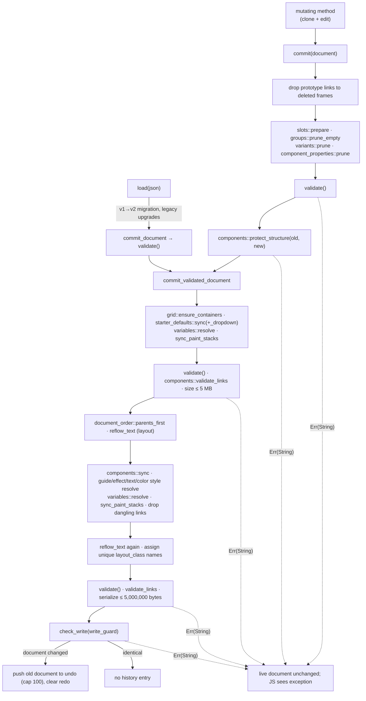
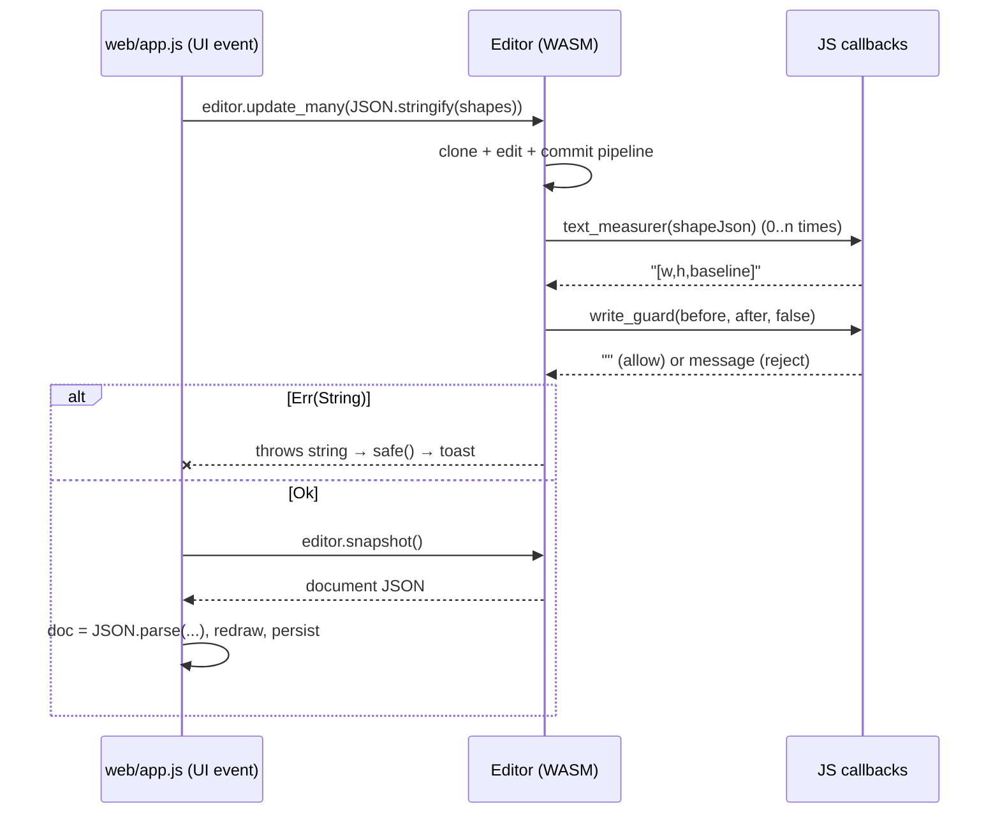

# Rust Document Engine

`pixlprfct-core` is the Rust crate in [src/](https://github.com/ninefingerwoodshop-ops/pixlprfct/tree/main/src) that owns the PixlPrfct document: its schema, every mutation, validation, layout, component synchronization, undo/redo and hit testing. It compiles to WebAssembly (via `wasm-bindgen`/`wasm-pack`) and exposes a single stateful class, `Editor`, whose methods take and return JSON strings. The single most important thing to know: **every edit is a whole-document transaction** — a method clones the document, changes the clone, and hands it to `Editor::commit`, which normalizes, validates, lays out, synchronizes components and only then swaps it in and pushes the previous document onto a 100-entry undo stack. If any step fails, the method returns an error string and the live document is untouched.

## At a glance

| Key files | Entry points | Depends on | Used by | Related docs |
| --- | --- | --- | --- | --- |
| [src/lib.rs](../../src/lib.rs) (schema, `validate`, `Editor`, commit pipeline, hit testing), 26 sibling modules in [src/](https://github.com/ninefingerwoodshop-ops/pixlprfct/tree/main/src), [Cargo.toml](../../Cargo.toml) | `Editor` (`#[wasm_bindgen]` struct), `Editor::commit` / `commit_validated_document` (private), `validate(&Document)` | `serde`, `serde_json`, `wasm-bindgen 0.2`, `js-sys 0.3` | [web/app.js](../../web/app.js), [web/agent-runtime.js](../../web/agent-runtime.js), [web/project-home.js](../../web/project-home.js), [web/prototype.js](../../web/prototype.js), [mcp/projects.mjs](../../mcp/projects.mjs), [server/live-editing.mjs](../../server/live-editing.mjs), 126 `tests/*.test.mjs` files | [README](../../README.md) "Architecture", [PERFORMANCE.md](../PERFORMANCE.md), [MCP.md](../MCP.md) |

## Crate layout and build targets

[Cargo.toml](../../Cargo.toml) declares package `pixlprfct-core` 0.1.0 (edition 2021) with `crate-type = ["cdylib", "rlib"]`:

- **`cdylib`** is what `wasm-pack build --target web --out-dir web/pkg` turns into `web/pkg/pixlprfct_core.js` + `pixlprfct_core_bg.wasm` + `pixlprfct_core.d.ts`. This runs as the first real step of `npm run build:editor` (see [package.json](../../package.json)). `web/pkg` is a build output and is not checked in.
- **`rlib`** lets `cargo test` (the first half of `npm test`) and any native Rust consumer link the crate directly. On native targets the JS callbacks are simply never set, so text keeps its stored dimensions (see `reflow_text`).
- Release profile: `opt-level = "s"`, `lto = true`; `[package.metadata.wasm-pack.profile.release] wasm-opt = false` (Binaryen is not run).
- Dependencies are deliberately minimal: `serde` (derive), `serde_json`, `wasm-bindgen`, `js-sys`. `js-sys` is used for the two callback types (`js_sys::Function`) and for `Date.now()`/`Math.random()` in `clipboard_origin()` on `wasm32`.

There is no build script and no feature flags. Target-specific code is limited to `clipboard_origin()` (`#[cfg(target_arch = "wasm32")]` vs. an `AtomicU64` counter natively).

After the WASM build, [scripts/generate-editor-api.mjs](../../scripts/generate-editor-api.mjs) parses `web/pkg/pixlprfct_core.d.ts` and every `pub struct`/`pub enum` in `src/*.rs` to regenerate [web/editor-api.js](../../web/editor-api.js) (`engineCommands` + `modelReference`). `npm run mcp:check` fails if that file is stale. See [Build-System](Build-System.md).

## Module map

`lib.rs` declares every module privately (`mod x;`); nothing but `Editor` and the public structs is visible from JS. Most modules contribute either validation/resolution helpers called from the commit pipeline, or an extra `#[wasm_bindgen] impl Editor { ... }` block (wasm-bindgen merges these into one JS class).

| File | Role | Exports on `Editor` |
| --- | --- | --- |
| [lib.rs](../../src/lib.rs) | Core schema (`Document`, `Page`, `Shape`, `Appearance`, `Paint`, `Gradient`, `DropShadow`, `Typography`, `AutoLayout`, `LayoutItem`, `LayoutGrid`, `Prototype`, `Constraints`, `RasterImage`, `Control`, `Behavior`, …), `validate`, `sync_paint_stacks`, constraint math (`constrain_axis`), curve flattening, the `Editor` struct, commit pipeline, history, hit testing, pages, clipboard | 60 members incl. constructor |
| [layout.rs](../../src/layout.rs) | Auto-layout engine: `reflow` (flex rows/columns, wrap, hug/fill, min/max, baseline, margins, border insets), `infer` (Shift+A layout inference), `drop_before` | — (used by `auto_layout_selection`, `move_into_before`, commit) |
| [grid.rs](../../src/grid.rs) | CSS-Grid-style layout: `GridLayout`/`GridTrack`/`GridCell`/`GridArea`/`GridOptions`, `plan` (track sizing incl. `fr`, `minmax`, auto tracks, areas, masonry), track shift/move/delete, `ensure_containers`, `drop_cell`, `validate` | — (grid methods live in lib.rs) |
| [components.rs](../../src/components.rs) | `Component` enum (`master` / `instance{master,source,overrides}`), override recording (`record_overrides`), propagation (`sync`), `validate_links`, `protect_structure`, `subtree`, legacy button-label repair | 10 |
| [variants.rs](../../src/variants.rs) | `ComponentSet`/`Variant`, `validate_sets`, `prune`, variant naming and switching | 6 |
| [component_properties.rs](../../src/component_properties.rs) | `ComponentProperty` (kinds `text`, `boolean`, `slot`), `propagate_edits`, `prune`, transfer on swap | 4 |
| [slots.rs](../../src/slots.rs) | `SlotSettings`/`SlotState`; slot binding and "modified" tracking in `prepare` (runs at the start of every `commit`) | 3 |
| [variables.rs](../../src/variables.rs) | `Variables`/`Collection`/`Mode`/`Variable`, alias resolution, property-path typing (`property_kind`), `resolve` (writes resolved literals into bound properties), `detach_edited` | 4 |
| [color_styles.rs](../../src/color_styles.rs), [text_styles.rs](../../src/text_styles.rs), [effect_styles.rs](../../src/effect_styles.rs), [guide_styles.rs](../../src/guide_styles.rs) | Named shared styles: each has `validate_styles`, `resolve` (push style values onto linked layers) and save/apply/remove methods. `effect_styles::Effects` also validates per-layer shadows/blurs; `text_styles::validate_typography` and `guide_styles::validate_grids` validate per-layer values | 3 + 3 + 4 + 3 |
| [paint.rs](../../src/paint.rs) | `Media` (image/video paint), `Pattern` (tile another layer), `Shader`; `validate`, `validate_stack`, `validate_gradient`, pattern-cycle check `validate_sources`, `remap_sources` for paste | — |
| [groups.rs](../../src/groups.rs) | `Shape::is_container` (frame or group), `roots`, `prune_empty`, `fit` (group bounds follow children) | 3 |
| [frame_enclosure.rs](../../src/frame_enclosure.rs) | A drawn/moved frame adopts fully enclosed, unlocked siblings (rotated-box test) | 2 |
| [layer_drop.rs](../../src/layer_drop.rs) | Layers-panel drag-and-drop (before/after/inside) | 3 |
| [arrangement.rs](../../src/arrangement.rs) | Z-order: front/back/forward/backward | 1 |
| [stacking.rs](../../src/stacking.rs) | `paint_order`: painting/hit order, honoring `auto_layout.canvas_stacking == "first"` | — |
| [document_order.rs](../../src/document_order.rs) | `parents_first`: stable reorder so parents precede children | — |
| [rotation.rs](../../src/rotation.rs) | `Shape::visual_bounds`, `Shape::unrotate_point` (counter-clockwise degrees about the layer origin) | — |
| [path_join.rs](../../src/path_join.rs), [path_split.rs](../../src/path_split.rs) | Join two open paths at nearest endpoints; split a path at an anchor | — (`join_paths`, `split_path` in lib.rs) |
| [stroke_alignment.rs](../../src/stroke_alignment.rs), [stroke_tips.rs](../../src/stroke_tips.rs) | Hit-test helpers: stroke reach for inside/center/outside alignment; arrowhead/endpoint tips | — |
| [page_background.rs](../../src/page_background.rs) | `PageBackground {color, opacity, visible}` | 1 |
| [starter_defaults.rs](../../src/starter_defaults.rs) | Control "starter" components: records which control fields a user changed (`shared_overrides`) and re-syncs the rest | — |
| [editor_tools.rs](../../src/editor_tools.rs) | `EditorMeta` (role: section/slice/comment/annotation/measurement/spec, text-on-path, per-layer `Motion` keyframes, `LibraryOverrides`) and its validation | — |

## The `Editor` object

```rust
#[wasm_bindgen]
pub struct Editor {
    clipboard_origin: String,                 // random per instance; regenerated by load()
    text_measurer: Option<js_sys::Function>,  // JS callback: Shape JSON -> "[w,h(,baseline)]"
    write_guard: Option<js_sys::Function>,    // JS callback: (before, after, history) -> "" | error
    document: Document,                       // the live document
    undo: Vec<Document>,                      // full previous documents (max 100)
    redo: Vec<Document>,
    next_id: u32,                             // next shape ID
    next_page_id: u32,                        // next page ID
}
```

`Editor::new()` starts with an empty version-2 document named "Untitled design" with one page `{id:1, name:"Page 1"}`, `next_id = 1`, `next_page_id = 2`. All fields are private; JS reads state only through `snapshot()` (a `serde_json::to_string` of the document).

## Mutation / command model

Every mutating export follows the same shape:

1. Parse arguments (JSON strings are deserialized with `serde_json`; failures become `Err(e.to_string())`).
2. Check preconditions against `self.document` (e.g. `selection_ids` requires a non-empty, unique list of layers on the **active page**).
3. `let mut document = self.document.clone();` and change the clone. Composite operations often build a throw-away "staged" `Editor` (same document, empty history) and call other methods on it — see `update_across_pages`, `insert_control_starter`, `preview_update_many`, `preview_layout_update`.
4. `self.commit(document)` (or `commit_document` for `load`).
5. Bump `next_id` only after a successful commit.

`update`/`update_many` take **complete `Shape` objects**, not patches. The JS side always sends the full shape (usually `{...existingShape, ...changes}`); the generated agent API (`build/update` in [web/agent-runtime.js](../../web/agent-runtime.js)) converts partial deep patches to full shapes before calling the engine. `update_many` additionally records component overrides and starter overrides per shape, propagates component-property edits, syncs grid-area sizes, and applies child constraints (`constrain_axis`) when a parent frame is resized. Groups never establish a constraint coordinate system: children use the enclosing frame unless the group itself was explicitly edited (then they scale).

### The commit pipeline



Things the pipeline does that are easy to miss:

- **Derived data is rewritten on every commit.** Style links (`fill_style`, `text_style`, `effect_style`, `guide_style`, `stroke_style`) and variable bindings are re-resolved and their literal values written back into each layer. The legacy scalar fields (`fill`, `appearance.fill_enabled`, `gradient`, `fill_opacity`, `stroke_color`, …) are recomputed from the first paint of `appearance.fills`/`strokes` by `sync_paint_stacks`. Component instances are rebuilt from their mains by `components::sync`, which may allocate new IDs (tracked through `next`).
- **Layout runs inside the transaction.** `reflow_text` calls `layout::reflow`; when text with auto sizing, baseline-aligned rows or auto-layout buttons exist and a text measurer is installed, it calls back into JS to measure and iterates to a fixed point (at most 130 passes) — otherwise it errors with "Text and frame sizing did not converge; use a fixed frame size".
- **`layout_class` names are generated here.** Each shape gets a unique CSS class: custom valid names are reserved first, then generated ones are slugged from the layer name plus ID (e.g. `frame-1-1`). Names starting with `px-` or equal to `layout` are reserved.
- **Order is normalized.** `parents_first` makes `document.shapes` a pre-order traversal (parent before children, sibling order preserved). Paint order is derived from this, not stored separately.

## History and undo

- `undo` and `redo` are `Vec<Document>` of **full document copies**. `commit_validated_document` pushes the previous document only when the new one differs (`document != self.document`), caps the stack at 100 by `self.undo.remove(0)`, and clears `redo`. One method call = one undo step, which is why composite operations go through a staged `Editor` and a single final `commit`.
- `undo()`/`redo()` first run the write guard with `history = true` against the target document, then swap documents with `std::mem::replace` (no re-validation — history entries were already valid).
- `select_page` changes `active_page` directly without committing: page navigation never creates or discards history.
- `load()` **does** create an undo entry when the loaded document differs. The editor calls `clear_history()` after opening a file; [web/app.js](../../web/app.js) also uses `load` for document renames (`document-name` change handler), which therefore are undoable.
- `clear_history()` empties both stacks. `can_undo()`/`can_redo()` drive the toolbar buttons.
- Team live editing layers a separate per-user history on top ([web/document-merge.js](../../web/document-merge.js) `PersonalHistory`, also 100 entries, three-way merges each undo against the current shared document). See [Teams-Libraries-and-Collaboration](Teams-Libraries-and-Collaboration.md).

> **Note:** Each history entry is a full `Document`. With a 5 MB document cap, 100 entries can in the worst case hold roughly 500 MB of history in WASM memory. [PERFORMANCE.md](../PERFORMANCE.md) records that the previous document is now moved (not cloned) into the stack, but there is no structural sharing.

## Validation and limits

`validate(&Document)` in lib.rs is the single gate. It is called by `commit` (once), `commit_validated_document` (twice), `load` (before migration fix-ups), `paste_layers` (on a synthetic document containing only the clipboard shapes) and `refresh_text_layout`. It delegates to per-module validators: `variables::validate_variables`, `variants::validate_sets`, the four `*_styles::validate_styles`, `component_properties::validate_properties`, `paint::validate_sources`, `grid::validate`, `editor_tools::validate`, `page_background::validate`, `text_styles::validate_typography`, `guide_styles::validate_grids`, `paint::validate_stack`/`validate_gradient`, `effect_styles::Effects::validate`. `components::validate_links` and `components::protect_structure` enforce component rules separately.

Highlights (exact constants; the full table is in [Document-Model-and-File-Format](Document-Model-and-File-Format.md#limits)):

| Rule | Constant |
| --- | --- |
| Document version | must equal `2` after load-time migration |
| Shapes per document | ≤ 10,000 |
| Pages | 1–100 |
| Serialized document | ≤ 5,000,000 bytes (checked on load input and after each commit) |
| Hierarchy depth | ≤ 128 ancestors, no cycles; parents must be a frame or group on the same page |
| Coordinates, sizes, rotation | finite, `abs ≤ 1,000,000`; width/height ≥ 1 (groups ≥ 0) |
| Vector points | ≤ 4096, normalized `0..=1`; vector kinds need ≥ 2 |
| Raster image | PNG/JPEG/WebP data URL, ≤ 8192×8192, base64 payload ≤ 2,000,000 chars |
| Paints per fill/stroke stack | ≤ 64 |
| Prototype interactions per layer | 1 primary + ≤ 5 additional, one per trigger |

Error messages are user-facing strings (they are shown verbatim in toasts), e.g. `"Invalid shape data"`, `"Rotated layers require fixed sizing"`, `"Instance appearance is protected. Edit the main component instead."`.

## Hit testing

`hit_test(x, y) -> u32` returns the topmost layer ID at a page coordinate, or `0`:

1. Iterate `stacking::paint_order(&shapes)` in reverse (topmost first). Paint order is a pre-order walk from roots, reversing siblings for auto-layout frames whose `canvas_stacking == "first"`.
2. Skip layers not on `active_page`, hidden, locked, or of kind `group` (groups are selected through their children).
3. Walk ancestors from the root down: any hidden/locked ancestor rejects the hit; the point is un-rotated through each ancestor (`unrotate_point`) and must lie inside the rounded rect of every `clip_content` ancestor (`in_rounded_rect`, which scales radii like CSS).
4. Un-rotate into the layer's own frame. Stroke bands are tested first (`stroke_alignment::hit`).
5. Paths (`points` non-empty): arrow tips (`stroke_tips::hit`), then distance to the flattened polyline within `max(stroke reach, 4.0)`; closed paths also use even-odd point-in-polygon. Cubic segments are flattened adaptively by `flatten_curve` (depth ≤ 12, tolerance 0.1).
6. Ellipses use the ellipse equation; everything else uses `in_rounded_rect`.

Prototype playback uses `prototype_hit_test`, `prototype_hits` and `prototype_pointer_hits`. They build a staged `Editor` containing only the presented frame's subtree (unlocked, root clipped), hit-test it, then walk up the ancestors collecting layers with matching triggers. `prototype_hits` returns `{"click":id,"mouseenter":[ids],"mouseleave":[ids]}`; `prototype_pointer_hits` adds `mousedown`/`mouseup`.

When CSS rendering is active (custom CSS, controls, backdrop blur), [web/app.js](../../web/app.js) `canvasHit` uses the CSS renderer's DOM-based hit test instead of `editor.hit_test`. See [Rendering-and-Export](Rendering-and-Export.md).

## Error handling conventions

- Every fallible export returns `Result<T, String>`. wasm-bindgen converts `Err(String)` into a thrown JS value (a string, not an `Error`), so JS wraps calls in `safe(action)` in [web/app.js](../../web/app.js), which catches and `toast(String(error))`s.
- Infallible readers return plain values: `snapshot() -> String`, `hit_test -> u32`, `can_undo -> bool`, `prototype_hits -> String`.
- Errors are **atomic**: nothing is written to `self` until the end of `commit_validated_document`. The test `load_is_atomic_and_roundtrips` in lib.rs asserts that a failing `load` leaves the snapshot unchanged.
- Internal invariants use `unwrap()` where validation guarantees them (e.g. `snapshot()` serialization; parent lookups in `hit_test`). A panic in WASM aborts the module instance, so new code should return `Err` for anything input-dependent.
- Callback failures are mapped to strings: a throwing write guard yields `"Library permissions could not be checked"`; a bad measurement yields `"Text measurement failed"` / `"Invalid text measurement"`.

## JS callbacks into Rust

| Setter | Called from | Contract |
| --- | --- | --- |
| `set_text_measurer(fn)` | `reflow_text` | `fn(shapeJson) -> string` returning `"[width,height]"` or `"[width,height,baseline]"` (buttons: label size). Values must be finite and `1..=1,000,000`. [web/app.js](../../web/app.js) measures with a 2D canvas (`measureCtx`); [mcp/projects.mjs](../../mcp/projects.mjs) `createHeadlessEditor` uses approximate metrics. |
| `set_write_guard(fn \| undefined)` | `check_write` (each commit, undo, redo) | `fn(beforeJson, afterJson, history: bool) -> string`; non-empty string rejects the transaction with that message. app.js installs `libraryWriteGuard` (team permissions + `libraries.guard`, built on `importedContentError` in [web/library-model.js](../../web/library-model.js)) only when needed (`syncLibraryGuard`). |
| `refresh_text_layout()` | app.js on `document.fonts` `loadingdone` | Re-measures and re-syncs **without** creating a history entry (font availability is environment state, not an edit). |

## Exported WASM API surface

`Editor` has 110 exported members: the constructor plus 109 methods across 15 `#[wasm_bindgen] impl Editor` blocks (wasm-bindgen also generates `free()`). JSON-typed parameters are named `json`, `selection`, `variables` or `placements`; "IDs" means a JSON array of layer IDs. Return `u32` IDs are new layer/page/set IDs; `String` returns are JSON.

| Area | Methods (file) | Notes |
| --- | --- | --- |
| Lifecycle & environment | `new()` (constructor), `load(json)`, `snapshot()`, `set_write_guard(fn?)`, `set_text_measurer(fn)`, `refresh_text_layout()`, `reserve_ids(start, end)`, `clear_history()` — lib.rs | `reserve_ids` confines new shape/page IDs to a server-assigned half-open range for live team editing ([web/team-collaboration.js](../../web/team-collaboration.js) → `LiveSession`); errors "This editing session exhausted its ID range. Reopen the file." |
| History | `undo()`, `redo()`, `can_undo()`, `can_redo()` — lib.rs | |
| Create layers | `add(kind, x, y) -> id`, `insert(shapeJson) -> id`, `insert_control_starter(shapeJson, variablesJson) -> id`, `reset_starter_overrides(id)` — lib.rs; `insert_enclosing_frame(shapeJson) -> id` — frame_enclosure.rs | `add` uses fixed defaults (frame 600×400 `#ffffff`, text 240×56 `#000000`, others 160×120 `#d9d9d9`). `insert` takes a complete `Shape`; ID and page are assigned by the engine. |
| Edit layers | `update(shapeJson)`, `update_many(shapesJson)`, `update_across_pages(shapesJson)`, `preview_update_many(shapesJson) -> docJson`, `preview_layout_update(shapesJson, id) -> {document, grid}` — lib.rs | Previews run on a staged editor and never commit. |
| Delete / duplicate | `remove(id)`, `remove_many(ids)`, `duplicate(id) -> id`, `duplicate_many(ids) -> idsJson`, `duplicate_many_offset(ids, x, y) -> idsJson` — lib.rs | Removal includes descendants. `duplicate*` offsets +24/+24. |
| Hierarchy & order | `move_into(shapesJson, parent)`, `move_into_before(shapesJson, parent, before)`, `reparent_many(ids, parent)`, `reorder(id, delta)` — lib.rs; `move_and_enclose(shapesJson, parent, reparent)` — frame_enclosure.rs; `arrange_many(ids, direction)` — arrangement.rs; `drop_layer(id, target, position)`, `drop_layers(ids, target, position)`, `duplicate_drop_layers(ids, target, position) -> idsJson` — layer_drop.rs; `group_many(ids) -> id`, `ungroup_many(ids)`, `rename_group(id, name)` — groups.rs; `frame_selection(ids) -> id` — components.rs | `position` is `before`/`after`/`inside`; `direction` is `front`/`back`/`forward`/`backward`. |
| Align / distribute | `align_many(ids, alignment)`, `distribute_many(ids, axis)` — lib.rs | `left/center/right/top/middle/bottom`; `horizontal/vertical`. |
| Auto layout & grid | `auto_layout_selection(ids) -> id`, `enable_grid_containers()`, `grid_layout(id) -> planJson`, `move_into_cells(shapesJson, parent, placementsJson)`, `preview_grid_drop(shapesJson, grid, parent, before, column, row) -> json`, `shift_grid_track(id, axis, index, delta) -> usize`, `move_grid_track(id, axis, index, before) -> usize`, `delete_grid_track(id, axis, index)`, `delete_grid_area(id, name)`, `rename_grid_area(id, old, new)` — lib.rs | Grid track edits compute changed shapes in grid.rs and commit via `update_many`. See [Layout-Auto-Layout-and-Grid](Layout-Auto-Layout-and-Grid.md). |
| Vector paths | `join_paths(ids) -> id`, `split_path(id, index) -> idsJson` — lib.rs | Join requires exactly two open, unlocked paths with the same parent. |
| Clipboard | `copy_layers(ids) -> clipboardJson`, `paste_layers(json, dx, dy, parent) -> rootIdsJson`, `paste_into_frames(json, frameIds) -> json`, `paste_replace(json, ids) -> json` — lib.rs | Payload format `pixlprfct.layers` v1; see [Document-Model-and-File-Format](Document-Model-and-File-Format.md#clipboard-payload). |
| Pages | `add_page() -> id`, `duplicate_page(id) -> id`, `duplicate_page_at(id, target, after) -> id`, `reorder_page(id, target, after)`, `select_page(id)`, `rename_page(id, name)`, `delete_page(id)` — lib.rs; `set_page_background(id, json)` — page_background.rs | `select_page` is not an edit. The last page cannot be deleted. |
| Components | `create_component(id)`, `create_component_selection(ids) -> id`, `create_instance(master, x, y) -> id`, `place_instance(master, x, y, parent) -> id`, `detach_instance(id)`, `swap_instance(id, master) -> id`, `reset_override(id, path)`, `reset_instance(id)`, `push_style_overrides(id)` — components.rs; `sort_components(orderJson)` — lib.rs | `sort_components` takes `["set:ID","component:ID",…]` (stored as `component_order`). |
| Variants | `combine_variants(ids) -> frameId`, `add_variant(id) -> id`, `duplicate_variant(id) -> id`, `save_component_set(json) -> id`, `remove_component_set(id)`, `set_variant_property(id, property, value) -> id` — variants.rs | |
| Component properties & slots | `save_component_property(json) -> id`, `remove_component_property(id)`, `set_component_property(id, property, valueJson)`, `reset_component_property(id, property)` — component_properties.rs; `wrap_in_slot(ids, name) -> id`, `clear_slot(id)`, `reset_slot(id)` — slots.rs | See [Components-Variants-and-Slots](Components-Variants-and-Slots.md). |
| Variables | `save_variables(json)`, `bind_variable(id, path, variable)`, `set_variable_mode(id, collection, mode)` — variables.rs; `set_page_variable_mode(id, collection, mode)` — variables.rs; `bind_shadow_color(id, index, variable)` — effect_styles.rs | `save_variables` replaces the whole `Variables` object. Variable `0` detaches. |
| Styles | `save_color_style(json, layer, stroke) -> id`, `apply_color_style(ids, style, stroke)`, `remove_color_style(id)`; `save_text_style(json, layer) -> id`, `apply_text_style(ids, style)`, `remove_text_style(id)`; `save_effect_style(json, layer) -> id`, `apply_effect_style(ids, style)`, `remove_effect_style(id)`; `save_guide_style(json, frame) -> id`, `apply_guide_style(ids, style)`, `remove_guide_style(id)` | Style ID `0` in `save_*` creates; layer `0` saves without applying; style `0` in `apply_*` detaches, keeping resolved values. See [Styles-Variables-and-Paints](Styles-Variables-and-Paints.md). |
| Hit testing (read-only) | `hit_test(x, y) -> id`, `prototype_hit_test(root, x, y) -> id`, `prototype_hits(root, x, y) -> json`, `prototype_pointer_hits(root, x, y) -> json` — lib.rs | |

The generated catalog in [web/editor-api.js](../../web/editor-api.js) lists 100 of these as `engineCommands`: everything except `new`, `load`, `snapshot`, `undo`, `redo`, `clear_history`, `reserve_ids`, `set_write_guard`, `set_text_measurer`, `refresh_text_layout` (and `free`). Eleven are marked `readOnly` (`copy_layers`, `can_undo`, `can_redo`, `grid_layout`, `hit_test`, the three `prototype_*` hit tests, `preview_update_many`, `preview_layout_update`, `preview_grid_drop`). Descriptions come from the `notes` map in the generator script.

## How JS calls in



- **Loading.** [web/app.js](../../web/app.js) does `import init, { Editor } from './pkg/pixlprfct_core.js'`, then `await init(); editor = new Editor();`, installs the text measurer, and loads the project body. Node tests and the MCP server pass the `.wasm` bytes explicitly (`init({module_or_path: await readFile(...)})`); [server/live-editing.mjs](../../server/live-editing.mjs) uses `initSync`.
- **Pattern in app.js.** Small wrappers call the engine and then `refresh()`: e.g. `function updateMany(shapes){ safe(()=>{ editor.update_many(JSON.stringify(shapes.map(reconcilePaints...))); refresh(); }); }`. `refresh()` calls `snapshot()` (`documentBody = editor.snapshot(); doc = JSON.parse(documentBody)`), re-syncs the library guard, redraws, and schedules persistence. The UI never mutates `doc` directly; it is a read-only mirror. app.js contains ~158 `editor.*(` call sites; inspector modules (`text-style-controls.js`, `effect-style-controls.js`, `text-editing.js`) call a few more.
- **Live previews** (dragging a width, CSS editing, grid drops) call `preview_update_many` / `preview_layout_update` / `preview_grid_drop` and draw the returned document without committing.
- **Throw-away editors.** Several consumers create an isolated `Editor` just to normalize or validate: `normalizeDocument` in app.js (`isolated.load(...); isolated.snapshot(); isolated.free()`), project-home's preview/normalize path, the prototype player (`presentPrototype` builds a `previewEditor`), the server's live-edit merge validation (`e.load(merged)` → 400 if invalid) and MCP's `createHeadlessEditor`.
- **Agents/MCP.** [web/agent-runtime.js](../../web/agent-runtime.js) `transact` loads the current snapshot into a scratch editor, installs the write guard, runs the requested `engineCommands` against it, then loads the result back — one undo step per agent transaction. [mcp/reference.mjs](../../mcp/reference.mjs) serves `modelReference` (the verbatim Rust struct declarations) to agents. See [MCP-Server](MCP-Server.md).

## Tests

- **Rust unit tests:** only three, in `mod tests` at the bottom of lib.rs — `history_restores_edits_and_invalidates_redo`, `load_is_atomic_and_roundtrips`, `hit_testing_respects_ellipses_visibility_and_order`. No other module has `#[cfg(test)]`.
- **WASM integration tests:** the bulk of engine coverage is Node `node:test` suites that import the compiled `web/pkg/pixlprfct_core.js` (126 files in [tests/](https://github.com/ninefingerwoodshop-ops/pixlprfct/tree/main/tests) do this), e.g. [tests/wasm.test.mjs](../../tests/wasm.test.mjs) (session, pages, v1 migration, atomic loads), `components.test.mjs`, `layout*.test.mjs`, `grid-*.test.mjs`, `clipboard.test.mjs`, `variables.test.mjs`. These require `npm run build:editor` (or at least the `wasm-pack` step) first.
- `npm test` = `cargo test && node --test tests/*.test.mjs`. Browser behavior is covered separately by Playwright (`tests/browser/`). See [Testing-and-Verification](Testing-and-Verification.md).

## How to add a new document property or mutation end-to-end

Worked example: a hypothetical per-layer `export_name: String` that is saved, validated, overridable on instances and settable through a dedicated command.

1. **Schema (Rust struct).** Add the field to `Shape` in [src/lib.rs](../../src/lib.rs) with a serde default so existing files still load (there is no per-field version bump):
   ```rust
   #[serde(default, skip_serializing_if = "String::is_empty")]
   pub export_name: String,
   ```
   `Shape` is constructed literally in exactly one place, `Editor::add` (`document.shapes.push(Shape { ... })`) — add the field there. Nested structs (`Appearance`, `AutoLayout`, `Typography`, …) follow the same rule; prefer `#[serde(default = "fn")]` for non-zero defaults, as the existing `default_*` functions do.
2. **Validation.** Add a check in `validate()` (or the owning module's validator) returning a short, user-readable `Err`. Bound every string length and numeric range and reject non-finite floats — validation is the only protection against malformed `.pixl` files, agent calls and pasted payloads.
3. **Cross-cutting behaviour.** Decide whether the field participates in:
   - component sync/overrides → add `"export_name"` to `FIELDS` in [src/components.rs](../../src/components.rs) and decide whether `record_overrides` allows instances to change it (the `allowed` match);
   - clipboard → `copy_layers`/`paste_layers` clear some per-document references (style IDs, variable bindings, components); clear yours if it holds an ID that is meaningless in another document, or remap it like `paint::remap_sources`;
   - variables → add its path to `variables::property_kind` and `assign`;
   - libraries → [web/library-model.js](../../web/library-model.js) `mergeLibrary` remaps IDs when importing a library.
4. **Mutation (optional).** Most properties need no new export — the inspector sends the whole shape through `update_many`. For a dedicated command, add a method to a `#[wasm_bindgen] impl Editor` block (lib.rs or the owning module): validate inputs, clone `self.document`, edit, `self.commit(document)`. Return `Result<_, String>`; use `u32`/`String`/`bool`/`f64`/`usize`/`i32` parameters and JSON strings for structures. Never write to `self.document` outside `commit*` (except navigation-like state such as `select_page`).
5. **Rebuild and regenerate.** `npm run build:editor` runs `wasm-pack` and regenerates [web/editor-api.js](../../web/editor-api.js). Add a description to the `notes` map in [scripts/generate-editor-api.mjs](../../scripts/generate-editor-api.mjs); if the command is read-only, add it to `readOnly`; if it takes JSON under a new parameter name, add the name to `jsonNames`. Commit the regenerated `web/editor-api.js` (`npm run mcp:check` verifies it).
6. **JS.** Call it from the UI via `safe(()=>{ editor.your_command(...); refresh(); })`, or set the field in the shape passed to `update`/`update_many`. Renderers ([web/appearance.js](../../web/appearance.js), [web/css-renderer.js](../../web/css-renderer.js), [web/export.js](../../web/export.js)) and code export read `doc` directly. If MCP agents should use it, it is already exposed through `engineCommands`; check [web/agent-runtime.js](../../web/agent-runtime.js) for any allow/deny lists.
7. **Tests.** Add a Rust `#[test]` in lib.rs `mod tests` for pure engine logic (round-trip through `snapshot()`/`load()`, rejection of invalid values, undo). Add or extend a `tests/<area>.test.mjs` that drives the compiled WASM like [tests/wasm.test.mjs](../../tests/wasm.test.mjs): set the value, assert it survives `snapshot()`→`load()`, `copy_layers`→`paste_layers`, `undo()`/`redo()`, and that an invalid value throws and leaves `snapshot()` unchanged. Add a Playwright spec only if UI is involved.

## Invariants and gotchas

- **Atomicity:** a method either commits one new document or leaves everything unchanged. Do not mutate `self` before `commit` succeeds; bump `next_id` after.
- **One method = one undo step.** Compose multi-step operations on a staged `Editor` and commit its document once.
- **Selection methods are page-scoped.** `selection_ids` rejects IDs that are not on `active_page`; `update_many` rejects a `page_id` change. Use `update_across_pages` for cross-page edits.
- **Do not trust stored derived values.** Anything resolved from styles, variables, components, layout or paint stacks is overwritten on the next commit. To change a styled/bound value, detach (style `0`, variable `0`) or edit the source.
- **Instance edits are restricted.** `record_overrides` only lets instances change `name`, `text`, `hidden`, `locked`, `control_state`, root `x`/`y`/`width`, some sizing keys of `layout_item`/`auto_layout`, and content keys of `control`; appearance-type fields are allowed only inside slot content. Others fail with "Instance appearance is protected. Edit the main component instead." Structural edits to instance children require `detach_instance`.
- **`load()` regenerates `clipboard_origin`.** Clipboard payloads copied before a `load` (including the rename-via-load path in app.js) count as foreign: component links and slot state are dropped on paste.
- **`load()` is undoable** unless followed by `clear_history()`.
- **Text measurement makes layout environment-dependent.** Native/headless editors without (or with approximate) measurers produce different text sizes than the browser.
- **Performance is O(document) per edit:** full clone, at least three full validations and two serializations per commit. See [PERFORMANCE.md](../PERFORMANCE.md) for measured costs (≈15 ms median name edit on a 727-layer private document at alpha.11).

## Known limitations

- Minimal native test coverage (3 Rust tests); correctness relies on the WASM test suite, which requires a prior `wasm-pack` build.
- Full-copy history without structural sharing (memory, see above).
- No `deny_unknown_fields`: unknown JSON keys are silently dropped on `load`. Documents with extra top-level data (e.g. SVG Animator documents with `design_type`/`svg_animation`) must never pass through the engine; [web/editor-entry.js](../../web/editor-entry.js) routes them to `svg-animation.html` instead.
- Single-threaded, synchronous API: long commits block the UI thread.

## Related pages

- [Document-Model-and-File-Format](Document-Model-and-File-Format.md) — schema, `.pixl`, clipboard, `.pixllib`, limits
- [Architecture-Overview](Architecture-Overview.md) · [Web-Editor-Architecture](Web-Editor-Architecture.md) · [Rendering-and-Export](Rendering-and-Export.md)
- [Layout-Auto-Layout-and-Grid](Layout-Auto-Layout-and-Grid.md) · [Components-Variants-and-Slots](Components-Variants-and-Slots.md) · [Styles-Variables-and-Paints](Styles-Variables-and-Paints.md) · [Prototyping-Behaviors-and-Controls](Prototyping-Behaviors-and-Controls.md)
- [Build-System](Build-System.md) · [Testing-and-Verification](Testing-and-Verification.md) · [MCP-Server](MCP-Server.md) · [Teams-Libraries-and-Collaboration](Teams-Libraries-and-Collaboration.md)

## Source of truth

- [src/lib.rs](../../src/lib.rs) — `validate`, `Editor::commit`, `commit_validated_document`, `reflow_text`, `hit_test`, `copy_layers`/`paste_layers`, `load`
- [src/components.rs](../../src/components.rs), [src/layout.rs](../../src/layout.rs), [src/grid.rs](../../src/grid.rs), [src/variables.rs](../../src/variables.rs) — the largest subsystems
- [Cargo.toml](../../Cargo.toml), [package.json](../../package.json) (`build:editor`, `test`, `mcp:check`), [scripts/generate-editor-api.mjs](../../scripts/generate-editor-api.mjs)
- [web/app.js](../../web/app.js) (`safe`, `refresh`, `snapshot`, `syncLibraryGuard`, `applyHistory`), [web/agent-runtime.js](../../web/agent-runtime.js) (`transact`)
- [tests/wasm.test.mjs](../../tests/wasm.test.mjs) and the other `tests/*.test.mjs` suites
- Existing docs: [README](../../README.md) ("Architecture" section), [PERFORMANCE.md](../PERFORMANCE.md), [MCP.md](../MCP.md)
