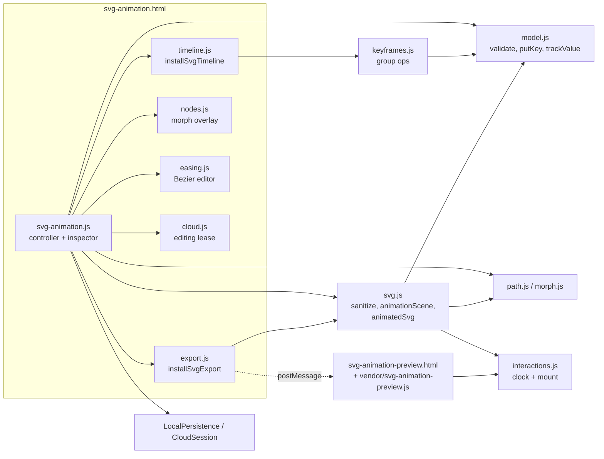
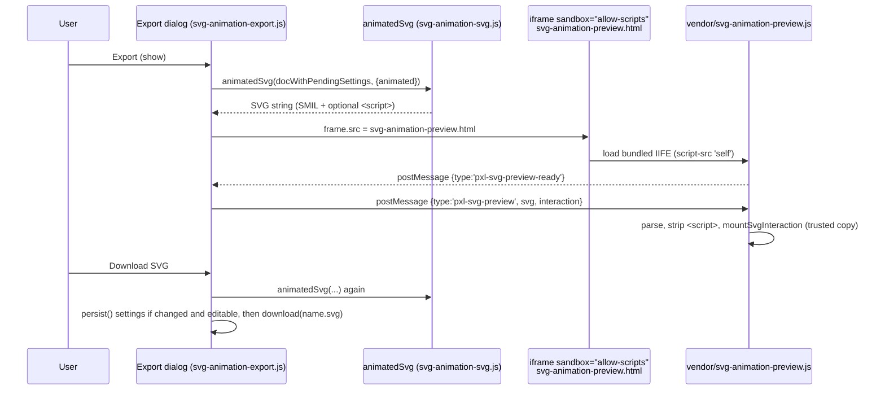

# SVG Animator

The SVG Animator is a separate design type (`design_type: "svg-animation"`) with its own page, `web/svg-animation.html`. It imports a static SVG, animates its elements on independent per-property keyframe tracks, and exports a native animated SVG (SMIL). It does **not** use the Rust engine or the shape serializer. The document keeps `shapes: []`, and all animation data lives in a versioned `svg_animation` member that only the `web/svg-animation-*.js` modules understand. The key fact: the editor preview and the exported file are built by the same function, `animationScene()` in `svg-animation-svg.js`. Preview and export agree because they share that code, so change it carefully.

## Alpha.21 drawing and workspace update

The [Windows alpha.21 preview](https://github.com/ninefingerwoodshop-ops/pixlprfct/releases/tag/v0.1.1-alpha.21) includes Pen and Pencil drawing, direct stage selection, base-path editing, Add/Replace SVG import, independent gradient animation, and detachable parent panels. [Panel Workspace](Panel-Workspace.md) explains icon docks, side flyouts, separate windows and saved layouts. The [Dev Log](https://ninefingerwoodshop-ops.github.io/pixlprfct/dev-log.html) records releases separately from proposed roadmap work.

### Drawing and editing paths

- **Pen:** click for corners or drag for Bézier handles. A stroke appears immediately. Enter, Escape, **Finish path**, or switching to Select keeps an open path; **Discard** cancels it. Closing a loop is optional. An open path can supply a motion route.
- **Pencil:** draw editable curves with 0–100% smoothing and round stroke ends; Shift constrains a straight line.
- **Select:** click artwork on the stage, including near thin strokes. Drag to move, use Shift to constrain, and delete a selected path with the keyboard, palette or inspector. Removing an element also removes its animation. Undo restores both.
- **Direct Selection:** move or nudge anchors/handles, insert a midpoint, remove anchors, change corner/smooth type, split or open a path, and join endpoints within the same element. Multi-node selection and joining separate objects remain future work.
- Base edits preserve existing animation. A path with a Morph track uses the separate timed-node workflow; topology changes are rejected when they would invalidate animation.

### Independent gradient animation

Choose a linear or radial gradient for Fill or Stroke. Gradient rotation is independent of the object's Rotation animator. Stop colors, offsets and opacity can be keyframed. Preview, Undo, `.pixl` save/reopen and native animated SVG export share the same model.

`fillGradientRotation` and `strokeGradientRotation` hold numeric angles. `fillGradient` and `strokeGradient` hold ordered stop arrays; every key in one track must contain the same number of stops. Imported inherited paint and supported named/HSL/currentColor stop values are normalized for editing. Solid color tracks remain separate properties.

### Add or replace artwork

**Import SVG** offers **Add** and **Replace**. Add preserves existing tracks and origins and remaps incoming IDs/references. Replace explicitly replaces the artwork and clears its animation. Both are atomic Undo operations with edit-permission and stale-document checks. Importing an exported animated SVG still imports static artwork; use `.pixl` to retain the editable timeline.

## At a glance

| | |
| --- | --- |
| **Key files** | [web/svg-animation.js](../../web/svg-animation.js) (controller), [svg-animation-model.js](../../web/svg-animation-model.js) (data model), [svg-animation-keyframes.js](../../web/svg-animation-keyframes.js) (group operations), [svg-animation-timeline.js](../../web/svg-animation-timeline.js) (dock UI), [svg-animation-svg.js](../../web/svg-animation-svg.js) (sanitize, scene, export), [svg-animation-interactions.js](../../web/svg-animation-interactions.js) (export player) |
| **Entry points** | `/editor/svg-animation.html?draft=<id>` (local) or `?cloud=<id>` → `start()` in `svg-animation.js`; export preview `/editor/svg-animation-preview.html` |
| **Depends on** | `svg-path.js` (`parsePath`), `local-drafts.js`, `local-persistence.js`, `local-recovery.js`, `cloud-session.js`, `team-session.js`, `inspector-settings.js`, `inspector-dropdown.js`, `context-menu.js`, `icons.js`, `desktop-integration.js`; esbuild (preview bundle) |
| **Used by** | Projects home (`design-browser.js` "New design → SVG Animation"), `project-navigation.js`, `editor-entry.js`, `cloud-files.js`, `app.js` (import redirect), `project-preview.js` (thumbnails) |
| **Related docs** | [docs/SVG_ANIMATION.md](../SVG_ANIMATION.md) (user workflow + verification log), [docs/DESKTOP.md](../DESKTOP.md), [Interface reference log](../FIGMA_UI_REFERENCE.md) |

## Responsibilities

- Import and **sanitize** arbitrary SVG into a safe, canonical subset with stable element IDs (`sanitizeSvg`).
- Hold a document of per-element, per-property **tracks** of keyframes with segment easing, and validate it (`validateAnimation`).
- Provide a dedicated docked **timeline**: multi-select, marquee, group drag with snapping, copy/paste, paste to another element, duplicate at playhead, reverse, retime, delete, and previous/next-keyframe navigation.
- Provide a right **inspector** for property values, keyframe easing (presets and a cubic-Bézier editor), selection timing, motion paths and morph nodes.
- **Play back** in the editor by seeking a live DOM scene once per animation frame.
- **Export** static SVG (first frame) or animated SVG. Interactive (hover or click) exports embed a small player.
- **Persist** as `.pixl` through local drafts or revision-checked cloud saves, using the shared editing lease for team files.

## Document model

`newSvgAnimation(name)` in [svg-animation-model.js](../../web/svg-animation-model.js) creates:

```jsonc
{
  "version": 2, "design_type": "svg-animation", "name": "Untitled animation",
  "shapes": [], "pages": [{ "id": 1, "name": "Animation" }], "active_page": 1,
  "svg_animation": {
    "version": 1,
    "svg": "<svg …/>",            // sanitized source artwork (≤ 2,000,000 chars)
    "duration": 3000,             // integer ms, 1–60000
    "loop": true,
    "tracks": [                   // ≤ 1000; one per (element, property)
      { "element": "pxv3", "property": "rotation",
        "keys": [ { "time": 0, "value": 0, "easing": "linear" },
                  { "time": 3000, "value": 360, "easing": [0.42,0,0.58,1] } ],
        "motion": { "d": "M…", "name": "Orbit", "rotate": "none" } // motionProgress only
      }
    ],
    "origins": { "pxv3": [256, 256] },   // transform origin per element, local units
    "interaction": { "trigger": "load", "onLeave": "reverse", "onClick": "restart" } // optional
  }
}
```

`shapes` must be empty, and `version` must be 2. A generic engine loader that sees this file finds no shapes. The type check (`isSvgAnimation`) sends the file to the SVG page before any engine code runs.

### Properties

`properties` in the model is the single registry. It sets each property's label, initial value and range. It also decides how the property is rendered:

| Key | Label | Value | Rendered as |
| --- | --- | --- | --- |
| `x`, `y` | Position X/Y | number ±100000 (offset from imported geometry) | `translate` wrapper → `animateTransform` |
| `rotation` | Rotation | degrees ±36000 | `rotate` wrapper |
| `scaleX`, `scaleY` | Scale X/Y | 0.001–100 (multiplier) | `scale` wrapper |
| `opacity` | Opacity | 0–1 | `opacity` attribute → `animate` |
| `fill`, `stroke` | Fill/Stroke color | `#rrggbb` only | attribute; interpolated per RGB channel |
| `strokeWidth` | Stroke width | 0–10000 | `stroke-width` |
| `strokeOffset` | Stroke offset | ±100000 | `stroke-dashoffset` |
| `motionProgress` | Path progress (%) | 0–100 | `animateMotion` along `track.motion.d` |
| `fillGradientRotation`, `strokeGradientRotation` | Gradient rotation | degrees ±36000 | gradient transform, independent of object wrappers |
| `fillGradient`, `strokeGradient` | Gradient stops | ordered stop arrays, fixed count across keys | native gradient stop animation |
| `morph` | Morph | node array (see below) | `d` attribute on a `<path>` |

Values with `attribute` bind to the element itself. Values without one (`x`, `y`, `rotation`, `scale*`) bind to generated wrapper groups. `motion: true` and `morph: true` mark the special cases.

### Keys and easing

- Keys are sorted by strictly increasing integer `time`, all within `[0, duration]`. A track holds at most 200 keys. `putKey` rounds times and clamps them to the duration.
- `easing` is a preset name (`linear`, `ease`, `ease-in`, `ease-out`, `ease-in-out`) or a custom `[x1,y1,x2,y2]` array. **All four values must lie in 0–1**, so overshoot and bounce curves are not possible (`validEasing`).
- **Easing belongs to the outgoing segment.** A key's curve controls the motion from that key to the next. `eased()` solves the cubic Bézier for x by 28 bisection steps, then evaluates y.
- `trackValue(track, time)` holds the first and last values outside the key range. It lerps numbers, lerps colors per channel, and lerps morph nodes point by point (`interpolateMorph`).
- `putKey` on a missing track also inserts a held key at 0 with the element's base value, so animation never starts partway through the timeline. `addAnimator` in the controller also adds an end key at `duration`.
- `resizeDuration` refuses to shorten the duration past any existing key. It never drops keys.

### Motion paths

`setMotionPath(animation, element, motion, origin)` creates a `motionProgress` track (0→100 over the duration) and stores `motion = {d, name, rotate}`, where `rotate` is `none`, `auto` or `auto-reverse`. The route is a **snapshot**. `captureMotionPath(source, target)` in [svg-animation-path.js](../../web/svg-animation-path.js) converts the source shape to path data (`pathGeometry` handles path, line, polyline, polygon, rect including rounded corners, circle and ellipse). It then maps the result into the target's parent coordinate space with `getScreenCTM()`. A valid route must be a single subpath with nonzero length, and it cannot be the target or one of the target's descendants. Later edits to the source shape do not change the animation. Replacing a route keeps the progress keys and the orientation.

### Morph

A morph value is `[{closed, points:[[ax,ay, inx,iny, outx,outy], …]}, …]`: each node stores its anchor, incoming handle and outgoing handle in local units. A value may hold up to 64 subpaths and 512 nodes in total. All coordinates must lie within ±100000 ([svg-animation-morph.js](../../web/svg-animation-morph.js)). Every key on a morph track must have the **same topology** (`sameMorphTopology`): the same subpath count, the same node count per subpath, and the same `closed` flags. That rule keeps both preview interpolation and SMIL `d` interpolation exact. `morphData` always serializes to `M` plus cubic `C` commands, with `Z` for closed subpaths. When a rect, circle or other shape gets a morph track, `animationScene` replaces it with a `<path>` that keeps the shape's paint, ID and transform.

### Interaction settings

`interaction` is optional. Older files without it use `interactionDefaults = {trigger:'load', onLeave:'reverse', onClick:'restart'}`. Valid values are `trigger ∈ load|hover|click`, `onLeave ∈ pause|reset|reverse|continue` and `onClick ∈ pause|restart|reverse|continue` (`validInteraction`).

## Module map

| File | Role |
| --- | --- |
| [svg-animation-drawing.js](../../web/svg-animation-drawing.js), [drawing model](../../web/svg-animation-drawing-model.js), [picking](../../web/svg-animation-picking.js) | Pen/Pencil, anchor editing and topology, stage selection and movement. |
| [svg-animation-gradient-inspector.js](../../web/svg-animation-gradient-inspector.js), [gradient model](../../web/svg-animation-gradient-model.js), [gradients](../../web/svg-animation-gradients.js) | Paint controls, stop validation/interpolation, gradient definitions and scene bindings. |
| [svg-animation-import.js](../../web/svg-animation-import.js), [import dialog](../../web/svg-animation-import-dialog.js) | Add/Replace operations, reference remapping and import choices. |
| [detachable-panels.js](../../web/detachable-panels.js), [panel-docks.js](../../web/panel-docks.js), [editor-dom.js](../../web/editor-dom.js) | Shared parent windows, icon strips and flyouts, cross-window live-control lookup. |
| [svg-animation.html](../../web/svg-animation.html) | Shell page: loads the shared UI CSS, `motion.css` and `svg-animation.css`, then `svg-animation.js`. `start()` builds all other markup. |
| [svg-animation.js](../../web/svg-animation.js) | Controller. Owns the module state (`doc`, `selected`, `currentTime`, `running`, `history`/`future`). Handles routing and loading (`start`), `commit`, `undo`, `play`/`stop`/`seek`, `render`, the layer list, the inspector (`propertyRow`, `morphInspector`, motion-path picker, easing and timing sections), import (`importSvg`, `importProject`), `example()`, `addShape`, `deleteElement`, local/cloud persistence and desktop hookup. |
| [svg-animation-model.js](../../web/svg-animation-model.js) | Pure data model: `properties`, `easings`, `validateAnimation`, `validValue`, `eased`, `trackValue`, `putKey`, `deleteKey`, `moveKey`, `resizeDuration`, `exportKeys`, `validateMotionPath`, `setMotionPath`. No DOM access, so tests import it under Node. |
| [svg-animation-keyframes.js](../../web/svg-animation-keyframes.js) | Pure multi-key operations over a selection of `{element, property, time}` refs: `keyframeId`, `adjacentKeyframeTime`, `keyframeEasing`/`setKeyframeEasing`, `keyframeMoveDelta`, `createKeyframeDrag` (snapping), `moveKeyframes`, `keyframeTiming`/`retimeKeyframes`, `deleteKeyframes`, `reverseKeyframes`, `copyKeyframes`, `pasteKeyframes`, `pasteKeyframesToElement`. Each operation returns a new animation, validated by `checked()`, or throws without side effects. |
| [svg-animation-timeline.js](../../web/svg-animation-timeline.js) | `installSvgTimeline({...})`: the docked `#motion-timeline` panel with transport controls, ruler/scrubber, tracks, playhead, marquee, snap guide, context menu, keyboard handling, zoom (1–32×) and resize/collapse. Holds the selection and the clipboard. |
| [svg-animation-easing.js](../../web/svg-animation-easing.js) | `easingEditor({value, mixed, disabled, change})`: preset dropdown, draggable Bézier handle SVG and X1/Y1/X2/Y2 fields. Handles support arrow keys, Home/End and Escape. |
| [svg-animation-morph.js](../../web/svg-animation-morph.js) | Morph value helpers: `validMorph`, `morphPath`, `sameMorphTopology`, `interpolateMorph`, `morphData`, `moveMorphPoint` (moving an anchor carries both of its handles). |
| [svg-animation-nodes.js](../../web/svg-animation-nodes.js) | `installMorphNodes(...)`: on-canvas overlay of anchors and handles, with pointer drag, keyboard nudging (1 unit; 10 with Shift) and Escape to cancel. |
| [svg-animation-path.js](../../web/svg-animation-path.js) | `pathKinds`, `pathGeometry`, `captureMotionPath`, `pathSampler` (uses `getPointAtLength` and computes a tangent angle for auto-rotate). |
| [svg-animation-svg.js](../../web/svg-animation-svg.js) | `sanitizeSvg`, `animationLayers`, `baseValue`, `animationScene` (wrapper construction and `seek`), `animatedSvg` (export serializer), `normalizeSvgAnimation`. |
| [svg-animation-transform.js](../../web/svg-animation-transform.js) | *(Included since alpha.20, PR #51.)* Canvas transform handles: `installTransformHandles({host, read, start, preview, restore, change, report})` draws an SVG overlay (`#svg-selection`) with four corner resize handles, four full-edge stretch targets and four rotation targets just outside the corners; `resizedValues(values, bounds, origin, handle, delta, {center, uniform})` computes new `scaleX`/`scaleY` and re-anchors `x`/`y` so the opposite edge/corner (or the center with Alt) stays fixed. Edits only the existing parent-space properties (`x`, `y`, `rotation`, `scaleX`, `scaleY`); imported geometry is never rewritten. |
| [svg-animation-interactions.js](../../web/svg-animation-interactions.js) | `interactionClock` (playback state machine), `mountSvgInteraction` (event wiring scoped to one `<svg>`), `interactionScript` (serializes both into a `<script>`). Both functions are **self-contained on purpose** because their source text is copied into exported files. |
| [svg-animation-export.js](../../web/svg-animation-export.js) | `installSvgExport(...)`: Export dialog with format, trigger, mouse-out, second-click and repeat options, a sandboxed preview iframe, and the Save settings and Download SVG actions. |
| [svg-animation-preview.html](../../web/svg-animation-preview.html) / [svg-animation-preview.js](../../web/svg-animation-preview.js) | Preview document for the export dialog. The JS entry is bundled into `web/vendor/svg-animation-preview.js`. |
| [svg-animation-cloud.js](../../web/svg-animation-cloud.js) | `installSvgCloudEditing(...)`: Start/Finish editing lease UI built on `TeamSession`, with sync every 20 s and write gating. |
| [svg-animation.css](../../web/svg-animation.css) | Three-column grid (296 px elements panel / canvas / 240 px inspector) above a timeline whose height comes from `--timeline-height`. Also styles the dialogs, morph overlay and easing editor. |



## How it works

### Opening a document

1. Routes: `projectUrl()` in [project-navigation.js](../../web/project-navigation.js) maps `design_type === 'svg-animation'` to `/editor/svg-animation.html`. The older generic URLs still work. `editor-entry.js` and `cloud-files.js` check `isSvgAnimation` and redirect, and importing a `.pixl` in `app.js` normalizes the file and then redirects. New documents come from `newDesign(name, template, 'svg-animation')` in `local-drafts.js`.
2. `start()` reads the route. For a local draft it calls `drafts.activate(id)` under `withDraftLock`. For a cloud file it calls `cloudRequest('/<id>')`. If the body is not an SVG animation, it redirects to `/editor/index.html`.
3. `normalizeSvgAnimation(doc)` validates the document, re-sanitizes `svg`, and builds a throwaway scene. That step fails early when a track points to a missing element.
4. The controller builds the DOM, installs the timeline, export dialog, morph overlay and persistence, then calls `render()`.

### Render and playback

`render()` sanitizes the stored SVG into an offscreen `#svg-measure` host. That copy resolves inherited paint and bounding boxes for `baseValue` and `originFor`. The controller then lists the layers (`animationLayers`: drawable elements outside `defs`, `clipPath`, `mask`, `pattern`, `marker`, `symbol` and `filter`) and builds `preview = animationScene(animation())`, which goes into `#svg-art`.

`animationScene` wraps each animated element in nested `<g>` groups so that every property gets its own transform channel. Reading from the outside in:

```
translate(x) → translate(y) → translate(origin) → rotate → scale(sx,1) → scale(1,sy) → translate(-origin) → [element]
```

A motion track adds its own outer wrapper (`translate(px py) rotate(angle)` sampled from the path) around a `translate(-origin)` pivot. The element's original `transform` stays on the element, inside the wrappers. Attribute tracks bind to the element itself, and inline styles for those attributes are removed so they cannot override the animated value. Each binding is `{node, track, attribute, type?, value(v)}`. `seek(time)` runs `trackValue` on every binding and writes the result.

`play()` drives a `requestAnimationFrame` loop. It computes `currentTime` from `performance.now()`, wraps the time when `loop` is on, and calls `paint()` (which runs `preview.seek` and repositions the selection outline) along with `timeline.update()`. Pause stops at the current time, and the next Play resumes from there. **Go to start** stops playback and seeks to 0. `timeline.update()` changes the Play/Pause icon only when the label changes. Before PR #49 it replaced the icon on every frame, which detached the button's pointer target partway through a click.

### Canvas transform handles (included since alpha.20)

PR #51 (`6f3d74b`) adds selection handles on the canvas, implemented in [svg-animation-transform.js](../../web/svg-animation-transform.js) and wired by the controller as `transformEditor`.

- **Geometry.** For the selected element the module reads `frame.getScreenCTM()` (the element's parent-space wrapper, exposed as `frames` by `animationScene`), removes the animation pose (`translate(x+origin) · rotate · scale · translate(-origin)`) and encloses the element's `getBBox()` in the animation's parent axes. For elements with their own imported rotation/skew this is an enclosing box, not an exact oriented box.
- **Preview without commits.** During a drag, `animationScene().seek(time, overrides)` takes per-element property overrides so the scene previews the new pose without touching the document. Dragging pauses playback.
- **Commit.** On release, changed `scaleX`/`scaleY`/`x`/`y`/`rotation` keys are written at the playhead as **one undo step**, preserving existing key easing. A click without movement writes nothing.
- **Modifiers and keyboard.** Shift keeps proportions (resize) or snaps rotation to 15°; Alt/Option resizes from the center. Focused handles accept arrows (1 SVG unit / 1°, Shift ×10 / 15°).
- **Cancellation.** Escape, pointer cancel, lost capture, leaving the window, seeking, selection change, play/undo, or losing the editing lease cancels the drag (`transformEditor.cancel()` is called from `commit`, `undo`, `seek`, `play` and `selectLayer`).
- **Limits.** Scales stay within the model range 0.001–100; dragging past the opposite edge stops at the minimum instead of flipping. Handles hide during morph-node editing and are disabled in read-only shared files.
- **Tests.** `tests/browser/svg-animation-transform.spec.mjs` (eight handle workflows). Included in Windows alpha.20 and later.

### Editing and history

All edits go through `commit(next)`. That call validates the document, rejects no-op changes, checks `canEdit()` (the team lease), pushes a JSON snapshot onto `history` (at most 80; redo is cleared), and then calls `changed()` and `render()`. `changed()` notifies `LocalPersistence` or `CloudSession`. Undo and redo swap whole-document snapshots. Every timeline group operation produces a single `commit`, so each one is one undo step.

The inspector has these sections for the selected element:

- **Add animator**
- A row per property with a keyframe diamond. The diamond adds or removes the key at the playhead.
- **Transform origin**
- **Motion path** picker and orientation
- **Morph** (`morphInspector`): node coordinates and Edit/Done nodes
- **Keyframe timing** (`keyframeTiming`/`retimeKeyframes`) and **Keyframe easing** (`keyframeEasing`/`setKeyframeEasing`), shown when keys are selected

The toolbar can add a rectangle or an ellipse (`addShape`). It does this by editing the sanitized source and re-sanitizing it. Deleting an element also removes its tracks and origins, including those of its descendants.

### Timeline interactions

`installSvgTimeline` takes callbacks rather than importing the controller: `read`, `change`, `selectKey`, `seek`, `time`, `play`, `playing`, `report`, `addKey`, `destination` and `editable`. It keeps the following state in its closure:

- `selection`: an array of `{element, property, time}` refs, identified by `keyframeId` (`JSON.stringify([element, property, time])`)
- `active`: the primary key, which drives the inspector
- `clipboard`: `{version:1, tracks:[…]}`, with key times relative to the earliest copied key
- zoom `magnification` (1–32), panel `height` (120 px up to 70% of the viewport) and `collapsed` (48 px)

The clipboard is cleared when the source SVG changes (`sourceSvg !== a.svg` in `render()`) and on reload. It never crosses projects or tabs.

| Gesture / key (timeline focused) | Implementation |
| --- | --- |
| Click; Shift/Cmd/Ctrl-click toggles | `choose()` → `setSelection` |
| Drag empty space (marquee); a modifier adds to the selection | `content.onpointerdown` → `.svg-keyframe-marquee` |
| Click a property or element label | Selects the keys of that track or element |
| Drag a selected diamond | `keyDrag` → `createKeyframeDrag(original, selection, anchor, playhead)` → `moveKeyframes` on release |
| Shift while dragging | Snaps the *grabbed* key to the playhead, unselected keys on any track, or 0/duration. The tolerance is `6 / scale` ms (6 screen px at any zoom). Snapping skips targets that would collide on a moving track. With no valid target, Shift snaps to 100 ms. |
| Alt while dragging | Bypasses snapping (`free`) |
| ← / → (Shift: ×10) | `move(±10 / ±100 ms)` |
| Cmd/Ctrl+A / C / V / Shift+V / D | select all / `copyKeyframes` / `pasteKeyframes` at the playhead / `pasteKeyframesToElement` / duplicate (copy plus paste at the playhead; the clipboard is untouched) |
| Delete / Backspace | `deleteKeyframes` |
| Alt/Option+← / → | `navigate(±1)` → `adjacentKeyframeTime`. Visits the nearest distinct key time on any track, does not wrap, pauses playback, and scrolls the playhead into view. It never changes the selection, clipboard or history. Also works on the ruler and while the context menu is open. |
| Right-click, Shift+F10, ContextMenu key | `menu()` → `showContextMenu` with Copy, Paste, Paste to selected element, Duplicate, Reverse, Delete, Select all, Previous keyframe and Next keyframe |
| Space | Play/Pause |
| Escape | Clears the selection, or cancels an active drag without adding history |
| Double-click a property row | Adds a key at that time (`addKey`) |
| Ruler: drag, ←/→, Home/End | Scrub (10 ms, or 100 ms with Shift) |

Operation semantics, all from [svg-animation-keyframes.js](../../web/svg-animation-keyframes.js):

- **Atomic.** Each operation works on a `structuredClone` and runs `validateAnimation`. If any key collides on its own track, falls outside `[0, duration]`, or breaks a document limit, the whole operation throws and nothing changes. `selectedKeys` also throws when a selection has gone stale ("The selected keyframes changed").
- **Group move** clamps the delta so that the whole group stops at 0 and at `duration` together. Keys may move into times that other selected keys are vacating.
- **Retime** (`retimeKeyframes(start, duration)`) scales times proportionally from the earliest selected key and rounds them to whole ms. If rounding creates an overlap, the call is rejected. A selection where every key has the same time can only be shifted.
- **Reverse** mirrors times within one shared `[start, end]` across all tracks. Every key inside that range on an affected track must be selected. Each key gets the *reversed* curve of the segment that now leaves it (`reversedEasing` swaps and inverts the control points: `[1-x2, 1-y2, 1-x1, 1-y1]`, mapped back to a preset name when one matches). The key at the end of the range keeps its outgoing curve.
- **Paste to element** requires the clipboard to come from exactly one source element. It rejects `morph` and `motionProgress` tracks because those are geometry-specific. Values are copied literally, so positions stay offsets and scales stay multipliers. If the destination has no origin, it gets one.

### Export



`animatedSvg(doc, {animated})` works as follows:

1. It builds the scene, so the wrappers and bindings match the editor exactly.
2. For each binding it appends one SMIL element:
   - `animateMotion` (with `path`, `rotate` = `0`/`auto`/`auto-reverse`, and `keyPoints` = progress/100) for motion tracks
   - `animateTransform` (with `type` = `translate`/`rotate`/`scale`) for wrapper tracks
   - `animate` (with `attributeName`) for attribute tracks
3. Every SMIL element uses `calcMode="spline"`, `fill="freeze"`, `dur="<duration>ms"`, `keyTimes` = time/duration, and `keySplines` taken from each key's easing except the last. `exportKeys` pads held keys at 0 and at `duration` so that the keyTimes span 0–1.
4. Static export (`animated:false`) emits only the first frame: the scene after `seek(0)`, with no animation elements and no script.
5. Editor-only `data-layer-name` attributes are removed. The motion guide and morph overlay never enter the scene.

**On-load** exports use `begin="0s"` and `repeatCount="indefinite"` when looping. They contain no script.

**Hover and click** exports use `begin="indefinite"` and `repeatCount="1"`, and they add `tabindex="0"`, `role="button"`, an `aria-label`, and an inline `<script>` produced by `interactionScript(settings, duration, loop)`. That script is the stringified source of `mountSvgInteraction` and `interactionClock`, plus a JSON options literal that holds only validated enums, numbers and booleans. The embedded runtime is a few dozen lines with no network access and no imports. Apart from a `pagehide` cleanup listener, it listens only on the exported `<svg>`. It works like this:

- `mountSvgInteraction` calls `root.pauseAnimations()` and calls `beginElement()` on every animation.
- `interactionClock` keeps `time`, `direction` and `playing` and advances them with `requestAnimationFrame`. It handles looping, reverse playback and stopping at the ends.
- Each frame calls `root.setCurrentTime(time/1000)`, so SMIL still does all interpolation. The script only controls the document clock.
- `pointerenter`/`pointerleave` and `focusin`/`focusout` drive hover. A click drives activation. Enter and Space work in both modes.

For motion tracks in interactive exports, the wrapper keeps its static `transform` and is marked `data-pixl-motion`. If scripts are disabled (for example in ``), the file still shows the correct initial pose. The player removes that attribute when it mounts.

**Preview isolation.** The dialog never uses `srcdoc`, because that would inherit the editor's CSP and the desktop policy blocks inline scripts. Instead the iframe gets `sandbox="allow-scripts"` with no `allow-same-origin`, which gives it an opaque origin, and loads a dedicated document. The preview entry point validates the message: the source must be `parent`, the SVG must be a string under 10 MB, and the interaction must be valid with a duration of 60 s or less. It then removes every `<script>` from the SVG and mounts the trusted bundled controller in place of the embedded one. The CSP for that page is `default-src 'none'; script-src 'self'; style-src 'unsafe-inline'; img-src data:`. It is set in the page `<meta>`, in `desktop/policy.cjs` `contentSecurityPolicy()` (which adds `frame-ancestors 'self'`), and in `server/index.mjs` (which adds `X-Frame-Options: SAMEORIGIN` for this one path). See [Desktop-App](Desktop-App.md).

**Building the preview bundle.** [scripts/build.mjs](../../scripts/build.mjs) runs esbuild with `entryPoints: ['web/svg-animation-preview.js']`, `bundle: true`, `format: 'iife'` and `target: 'es2022'`, and writes `web/vendor/svg-animation-preview.js`. It runs as part of `npm run build:editor`. The bundle is a classic script so that the opaque-origin sandbox can load it without module CORS. **After any change to `svg-animation-interactions.js` or `svg-animation-preview.js`, rebuild.** Otherwise the export preview runs the old player while downloads embed the new one.

Export settings in the dialog are kept in a `pending` copy. **Save settings** and **Download SVG** write them through `save()` (which goes through `commit`, so it is undoable) only when they changed and the file is editable. **Cancel** discards them. Read-only shared files can still preview and download with temporary settings.

### Persistence

- **Native file**: `downloadProject()` → `projectFile(snapshot)` produces `<name>.pixl` (JSON, 5 MB limit). **Download .pixl copy** sits in the left footer, and desktop Cmd/Ctrl+S maps to the same function. Importing a `.pixl` normalizes it and creates a **new local draft**. Importing an `.svg` offers Add (preserve tracks) or Replace (clear tracks and origins). Importing an *exported* animated SVG brings back only static artwork, because the editable timeline lives only in `.pixl`.
- **Local**: `LocalDrafts` and `LocalPersistence` (shared with the main editor) store the draft in `localStorage`, and per-tab recovery lives in `sessionStorage`. `localRecovery` renders conflict recovery in the footer.
- **Cloud**: `CloudSession` performs revision-checked saves. Unsaved cloud edits are mirrored to `sessionStorage` under `pixlprfct.svg-cloud-recovery:<id>`. If the server body changed meanwhile, the page shows a 409-style conflict and offers **Save on this device** (copy to a local draft) or a download.
- **Shared/team files**: when `record.collaboration` is set, `installSvgCloudEditing` creates a `TeamSession`. The user must **Start editing** (acquire the lease) before writes. `session.beforeWrite` throws a 423 when the file is not editable, and `writeHeaders` adds the lease headers. Files in simultaneous (`live`) editing mode are read-only here, because SVG timelines do not take part in the engine's merge protocol.
- The server stores the body as an ordinary document: `readDocument` in `lib/documents.mjs` checks only the generic `version`, `shapes` and `pages` fields.

### Import sanitization

`sanitizeSvg(source)` is a security boundary. It runs on every import, every `render()` and every export:

- It rejects input over 2 MB, any `<!DOCTYPE`/`<!ENTITY`, a non-SVG root, and more than 5,000 elements.
- It copies only allowlisted tags: shapes, `g`, `defs`, `use`, `symbol`, gradients, `clipPath`, `mask`, `pattern`, `marker`, `text`/`tspan`, `image`, and a filter subset. It copies only allowlisted attributes and paint/style properties. `safePaint` rejects `javascript:`, `data:`, `http(s):`, `@`, `expression(` and comments, and it rejects every `url()` that is not a local `#id`.
- `href` may only be a local `#id`, or a base64 PNG, JPEG or WebP data URL on `<image>`. Event attributes, scripts, `foreignObject`, existing animation and external resources are dropped. Each removal adds a user-visible warning.
- `<style>` rules are flattened onto the matching elements through `CSSStyleSheet` before the stylesheet nodes are removed. Unsupported selectors and at-rules produce warnings.
- **IDs are rewritten** to `pxv<n>`. An ID that already has that form is kept, which makes the process idempotent. All `#id` and `url(#id)` references are remapped. The original name is kept in `data-layer-name` for the Elements list.
- Attributes are sorted into canonical order, so re-sanitizing unchanged input produces identical output. A read-only reopen therefore does not register as an edit.

## Extension guide

**Add a new animatable property** (for example `fill-opacity`):

1. Add an entry to `properties` in `svg-animation-model.js` with `label`, `initial`, `min`/`max`, and `attribute: 'fill-opacity'`. Attribute properties need no other scene code: `animationScene` binds them and `animatedSvg` emits `<animate attributeName>` automatically.
2. Make sure the attribute is in the sanitizer allowlist (`paint` or `attrs` in `svg-animation-svg.js`). Otherwise imported values are stripped and `baseValue` falls back to `initial`.
3. A new transform-like property needs its own wrapper in `animationScene` and an `animateTransform` type. Keep the wrapper order consistent with the editor seek code. Both use the same bindings.
4. Add the property to the **Add animator** list in `svg-animation.js` (`renderInspector`).
5. Add model tests (interpolation, validation) and a browser case that compares exported SMIL values with the preview. The existing export tests sample `getCTM`/`getPointAtLength` at several times.

**Add a timeline command**: write it as a pure function in `svg-animation-keyframes.js` that takes `(animation, selection, …)` and returns `{animation, selection}`. Run the result through `checked()` and throw on any conflict. Wire it into `installSvgTimeline` through `apply(result)`, which enforces `editable()` and produces one commit. Add a menu item in `menu()` with an `enabled` predicate. If you add a shortcut, put it in the viewport keydown handler and update the `viewport.title` help text.

**Change the export player**: edit `svg-animation-interactions.js`. Keep both functions free of closures over module scope, because they are stringified. Then run `node scripts/build.mjs` (or `npm run build:editor`) to refresh `web/vendor/svg-animation-preview.js`.

## Invariants and gotchas

- **One scene builder.** The editor preview, thumbnails (`project-preview.js` calls `animatedSvg(file, {animated:false})`), the export preview and downloads all go through `animationScene`. Do not special-case the editor.
- **Element IDs are the track keys.** Track `element` values are sanitized `pxv<n>` IDs. Anything that rewrites the SVG must keep IDs stable (`sanitizeSvg` keeps existing `pxv` IDs). Choosing **Replace** in **Import SVG** clears all tracks and origins; **Add** preserves them and remaps incoming references.
- **Easing is per outgoing segment.** Moving, reversing or duplicating keys must keep that relationship. The final key's easing has no effect until a key follows it.
- **Duration never drops keys.** Shrinking past a key is an error, and paste, duplicate and retime never extend the duration.
- **The model throws and the UI reports.** Controller callbacks go through `safe()` or `safely()`, which turn an `Error.message` into the `#svg-notice` toast and re-render.
- **The clipboard is in memory and scoped to the tab**, and it is cleared when the artwork changes.
- **Solid color tracks are 6-digit hex only.** Gradient stop animation uses its own properties; adding a solid color track replaces that channel’s gradient or `none` paint.
- **The preview bundle is a build artifact** checked into `web/vendor/` and copied to `public/editor/vendor/`. Do not hand-edit it.
- **The Rust engine and MCP do not understand this type.** The MCP server (see [MCP-Server](MCP-Server.md)) does not edit SVG animation documents, and live collaboration, comments and libraries are not available here.

## Known limitations

These come from docs/SVG_ANIMATION.md and the validation limits in code:

- Limits: 2 MB of SVG source, 5,000 elements, 1,000 tracks, 200 keys per track, 60 s maximum duration, and a 5 MB `.pixl` file.
- Easing control values are limited to 0–1, so overshoot, bounce and spring curves are not possible.
- Morph cannot add or remove nodes, cannot match unrelated shapes automatically, cannot select multiple nodes, and cannot convert text or groups to paths.
- Pen creates open paths that can be used as routes. A motion route is a snapshot; later path edits do not update an already assigned route.
- There are no scroll or programmatic triggers. Video export and editable animation-project import are not supported.
- Fonts are not embedded in exports. Arcs are converted to cubic curves for motion routes. Native SVG and preview path sampling use slightly different flattening tolerances; the tests accept ≤ 0.25 SVG units for curved motion and ≤ 0.03 for morph.
- Interactive exports run only when the SVG is inline or embedded with `<object>`. Browsers do not run scripts in `` or CSS backgrounds.
- The cloud tests use a mocked API. No deployed multi-user server has been certified.

## Tests

| Suite | What it covers |
| --- | --- |
| [tests/svg-animation.test.mjs](../../tests/svg-animation.test.mjs) (12 tests, `node --test`) | Design-type routing and `.pixl` round trip, acceptance by `readDocument`, independent interpolation, segment and custom easing, held export endpoints, validation failures, motion-path retention, morph interpolation and serialization, interaction defaults, and `interactionClock` click and hover state machines |
| [tests/svg-animation-keyframes.test.mjs](../../tests/svg-animation-keyframes.test.mjs) (24 tests) | Navigation, group easing, moves, drag snapping (tolerance, ties, collisions, stale input), retiming, reversal, copy/paste, paste to element, and geometry-specific restrictions |
| [tests/browser/svg-animation.spec.mjs](../../tests/browser/svg-animation.spec.mjs) (43 Playwright cases) | End-to-end create → import → animate → export → reopen; sanitization; local tab conflicts; cloud revision conflicts and lease headers (mocked); every timeline gesture; morph and motion-path export versus preview agreement; interactive export playback with and without scripts; read-only gates; the desktop CSP preview case; and the Pause regression |
| [tests/desktop.test.mjs](../../tests/desktop.test.mjs), [tests/self-host-preview.test.mjs](../../tests/self-host-preview.test.mjs) | The preview page's CSP and framing headers on desktop and on the self-hosted server |

Run them with:

```sh
node --test tests/svg-animation.test.mjs tests/svg-animation-keyframes.test.mjs
npx playwright test tests/browser/svg-animation.spec.mjs   # builds the editor and serves on :4198
```

## Related pages

- [Web-Editor-Architecture](Web-Editor-Architecture.md): the shared modules (local drafts, cloud session, dropdowns, context menu)
- [Document-Model-and-File-Format](Document-Model-and-File-Format.md): the `.pixl` envelope that this type reuses
- [Prototyping-Behaviors-and-Controls](Prototyping-Behaviors-and-Controls.md): the main editor's Motion mode, which is a different feature
- [Import-Design-Files](Import-Design-Files.md): SVG import into the *design* engine (`svg-import.js`), which is a separate path from `sanitizeSvg`
- [Desktop-App](Desktop-App.md): the preview CSP and the packaged protocol
- [Teams-Libraries-and-Collaboration](Teams-Libraries-and-Collaboration.md): editing leases
- [Testing-and-Verification](Testing-and-Verification.md), [Build-System](Build-System.md)

## Source of truth

- Code: `web/svg-animation*.js`, `web/svg-animation*.html`, `web/svg-animation.css`, `scripts/build.mjs` (preview bundle), `desktop/policy.cjs` and `server/index.mjs` (preview headers), `web/project-navigation.js` (routing)
- Docs: [docs/SVG_ANIMATION.md](../SVG_ANIMATION.md). It is a dated, changelog-style user guide that maps each feature to PR #37–#49 and alpha.15–alpha.21, records verification, and lists reference screenshots under `.local/svg-animation/`.
