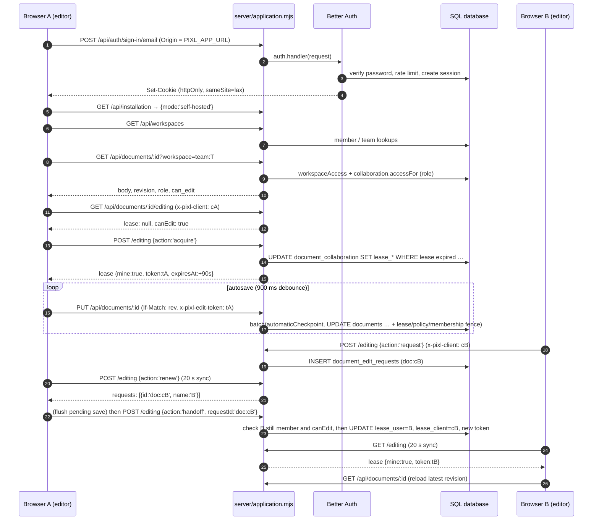

# Self-Hosted Server

The self-hosted server (`server/*.mjs`) is a dependency-light Node 22.13+/24 HTTP server that serves the editor files and a JSON API with accounts, organizations, teams, workspace-scoped design files, file roles, editing handoff, simultaneous editing, comments, reviews, notifications, protected team libraries, admin summaries, daily backups and an email outbox. It stores everything in one SQL database (SQLite via `node:sqlite`, PostgreSQL via `pg`, or MySQL/MariaDB via `mysql2`) behind a small D1-compatible adapter so the same document handlers run here and on the Sites Worker. The most important thing to know: **identity and workspace membership are re-derived from the Better Auth session on every request, and every write is "fenced" by SQL `EXISTS` clauses that re-check the editing lease, the file's sharing-policy revision and current membership inside the same statement**, so a stale or revoked client loses the write instead of overwriting data.

## At a glance

| Key files | Entry points | Depends on | Used by | Related docs |
| --- | --- | --- | --- | --- |
| [server/index.mjs](../../server/index.mjs), [server/application.mjs](../../server/application.mjs), [server/config.mjs](../../server/config.mjs), [server/database.mjs](../../server/database.mjs), [server/auth.mjs](../../server/auth.mjs), [server/collaboration.mjs](../../server/collaboration.mjs), [server/live-editing.mjs](../../server/live-editing.mjs), [server/libraries.mjs](../../server/libraries.mjs), [server/team-activity.mjs](../../server/team-activity.mjs), [server/operations.mjs](../../server/operations.mjs) | `npm run selfhost:setup`, `selfhost:migrate`, `selfhost:start`; `node server/index.mjs`; Docker `Dockerfile.selfhost` | `better-auth` 1.7.14, `pg`, `mysql2`, `nodemailer`, `qrcode` ([server/package.json](../../server/package.json)); [lib/documents.mjs](../../lib/documents.mjs), [lib/document-versions.mjs](../../lib/document-versions.mjs); `web/document-merge.js`, `web/library-model.js`, `web/pkg` | Browser editor, desktop app "connect to team server", MCP installation tools | [SELF_HOSTING.md](../SELF_HOSTING.md), [ADMIN_CONSOLE.md](../ADMIN_CONSOLE.md), [MCP_SETUP.md](../MCP_SETUP.md), [PROJECT_DELETION.md](../PROJECT_DELETION.md), [TEAM_WORKFLOWS.md](../TEAM_WORKFLOWS.md) |

## Key modules

| File | Role |
| --- | --- |
| `index.mjs` | `startServer(config,{migrate,deliver})`: connects the DB, optionally migrates, refuses to start on an uninitialized DB, builds `operations`, `auth` and `createApplication`, serves static files and security headers, converts Node requests into Fetch `Request`s for `/api/*`. Runs standalone when invoked directly. |
| `config.mjs` | `readConfig(env)`: validates every environment variable and returns the config object. `providers` maps provider names to engines. |
| `database.mjs` | `connectDatabase(config)` (SQLite/PostgreSQL/MySQL adapters with a D1-like API), `migrateDocuments(db,engine)`, `databaseBodyStore(db,engine)`, `postgresSQL()` dialect rewriter, `postgresPoolOptions()`. |
| `team-schema.mjs` | `migrateTeamFeatures(db,engine)`: live editing, release notes, notifications, preferences, reviews tables. |
| `auth.mjs` | `createAuth()` (Better Auth with organization+teams and twoFactor plugins), `createDelivery()` (SMTP or dev outbox), `smtpOptions()`, `migrateAuth()`. |
| `application.mjs` | `createApplication({config,db,auth,operations})`: the API router. |
| `workspace-access.mjs` | `workspaceAccess(db,userId,workspace)`: resolves `personal`, `org:<id>`, `team:<id>` into an access object. |
| `collaboration.mjs` | `collaborationService`: file roles, sharing policy, editing leases/handoff, comments, write fences. `EDIT_LEASE_MS = 90_000`. |
| `live-editing.mjs` | `liveEditing()`: simultaneous-editing join/poll/commit with server-side three-way merge. |
| `libraries.mjs` | `libraryService()`: team library publish/release/permissions API and the document `guard`; `libraryMembers()`. |
| `team-activity.mjs` | `teamActivity()`: notifications inbox, preferences, review requests, comment fan-out. |
| `admin.mjs` | `adminData()`: read-only organization overview and paginated people search. |
| `onboarding.mjs` | `onboarding()`: first-run checklist data for a workspace. |
| `operations.mjs` | `operations()`: hourly backup tick, 15-second email outbox tick, failure ring buffer, status and SMTP verification. |
| `input.mjs` | `readJSON(request, limit=50_000)`: bounded, strict-UTF-8 JSON object reader. |

## How a request flows

`server/index.mjs` handles all non-API traffic itself and wraps API traffic:

1. Sets on every response: `X-Content-Type-Options: nosniff`, `X-Frame-Options: DENY`, `Referrer-Policy: same-origin`, `Permissions-Policy: camera=(), microphone=(), geolocation=()`, a CSP (`default-src 'self'; script-src 'self' 'wasm-unsafe-eval'; ... connect-src 'self' ws://127.0.0.1:* ...; frame-ancestors 'none'`), and `Strict-Transport-Security` unless `config.local`. `/editor/svg-animation-preview.html` gets a stricter CSP and `X-Frame-Options: SAMEORIGIN` so it can be framed by the animator.
2. For `/api/*`: copies headers, **deletes** `oai-authenticated-*`, `forwarded`, `x-forwarded-*`, `x-real-ip`, `cf-connecting-ip`, sets `x-pixl-client-ip` from the socket peer (used by Better Auth rate limiting), buffers the body up to 5,100,000 bytes (413 above), builds a Fetch `Request`, and calls the application handler. `Set-Cookie` headers are forwarded individually.
3. Static: only `GET`/`HEAD`; route map `/`→`project-home.html`, `/account`, `/setup`, `/admin`, `/editor/<path>`→`web/<path>`. Path traversal and unknown extensions return 404. `Cache-Control: no-store`.
4. Timeouts: `requestTimeout=30000`, `headersTimeout=10000`.

Inside `createApplication` (order matters):

1. `GET /api/health` and `GET /api/installation` are public.
2. Any non-`GET`/`HEAD` request must pass `checkOrigin` **and** have `Origin` exactly equal to `config.baseURL` (missing Origin is rejected). This applies to auth endpoints too.
3. `/api/auth/*` goes to Better Auth.
4. Everything else requires a session with `emailVerified` (`sessionFor`), else 401.
5. Errors: `DocumentError` → `{error}` with its status. Anything else → generic 503, `operations.failure(path,503)`, and only `error.name` is logged (never driver messages or connection strings).

### Route table

`:id` is a 36-character UUID. Most routes accept `?workspace=personal|org:<id>|team:<id>` (default `personal`).

| Method | Path | Handler | Behavior |
| --- | --- | --- | --- |
| GET | `/api/health` | inline | `SELECT 1`; `{status:'ready'}` |
| GET | `/api/installation` | inline | `{mode:'self-hosted',provider,registration,localDevelopment,emailVerification:true}` (used for host detection) |
| any | `/api/auth/*` | `auth.handler` (Better Auth) | Sign-up/in, verification, password reset, sessions, `organization/*` (orgs, members, invitations, teams), `two-factor/*`. `POST /api/auth/two-factor/enable` responses gain a `qrCode` data URL generated from `totpURI`. |
| GET | `/api/installation/operations` | `operations.status` | Installation admin only. Uptime, backup state, mail state, recent failures. |
| POST | `/api/installation/verify-mail` | `operations.verifyMail` | Installation admin only. `nodemailer.verify()`; no message sent. |
| POST | `/api/installation/check` | inline | Installation admin only. `{database,accounts,email,https,provider}`. |
| GET | `/api/onboarding` | `onboarding.mjs` | `{shared:false}` for personal; otherwise `{shared,manage,organizationId,teammates,firstProject,library}`. |
| GET, PUT | `/api/notifications/preferences` | `activity.preferences` | `{mode:'all'|'mentions'|'none', email:boolean}`; default `mentions`, email off. |
| GET, PATCH | `/api/notifications` | `activity.inbox` | GET `?unread=1&before=<json cursor>` (100 per page); PATCH `{ids[≤100], read}`. |
| GET | `/api/admin/overview?organization=` | `adminData` | Org owner/admin only. Org name/slug/role, member count, teams with counts. |
| GET | `/api/admin/people?organization=&q=&role=&team=&email=&offset=` | `adminData` | Org owner/admin only. 50 per page; `LIKE` search escaped with `!`. |
| GET | `/api/workspaces` | inline | User profile, `administrator` flag, organizations (with the caller's role), teams (all teams in orgs the caller owns/administers, plus teams they belong to). |
| GET | `/api/teams/:id/members` | inline | Verifies `team:<id>` access, returns `teamMember` rows. |
| GET | `/api/libraries` | `libraries.api` | Published libraries in the workspace, filtered to those whose source file the caller can read. |
| GET | `/api/libraries/:id[?revision=]` | `libraries.api` | One release body and notes. |
| GET | `/api/libraries/:id/releases` | `libraries.api` | Up to 100 releases with notes. |
| GET | `/api/libraries/:id/usage?offset=` | `libraries.api` | Maintainers only. Projects linking this library (scans 100 docs per page). |
| GET | `/api/libraries/:id/access` | `libraries.api` | Published flag, caller rights, policy, members (managers only). |
| PUT | `/api/libraries/:id` | `libraries.api` | Publish a release (`{notes?, rollbackRevision?}`), `If-Match` = source document revision. Requires maintainer rights and the editing lease. |
| PATCH | `/api/libraries/:id` | `libraries.api` | Set `{maintainers, components}` policy. Owner/admin only. |
| PATCH | `/api/libraries/:id/lifecycle` | `libraries.api` | `{retired:boolean}`. Maintainers. |
| GET, PUT | `/api/documents/:id/sharing` | `collaboration.sharing` | Describe/replace `{defaultRole, overrides, editingMode}`; `If-Match` = policy revision. |
| GET, POST | `/api/documents/:id/editing` | `collaboration.editing` | Lease state; POST `{action:'acquire'|'renew'|'release'|'request'|'handoff', requestId?}`. Requires `x-pixl-client`. |
| GET, POST, PATCH | `/api/documents/:id/comments` | `collaboration.comments` | List (`?offset=`, 100 per page), post, resolve. Posting triggers `activity.commentEvent`. |
| GET, POST, PATCH | `/api/documents/:id/reviews` | `activity.reviews` | List, request, decide. |
| GET | `/api/documents/:id/members` | inline | Members who can access the file (for @mentions). |
| GET, POST, PUT | `/api/documents/:id/live` | `live` (live-editing.mjs) | Simultaneous-editing poll/join/commit. |
| GET, POST | `/api/documents` | `documentApi` | List (`?trash=1&search=&before=`) / create. |
| GET, PUT, DELETE, PATCH | `/api/documents/:id` | `documentApi` | Read / save / move to Trash / restore from Trash. |
| GET, POST | `/api/documents/:id/versions` | `versionApi` | List / create named version (`x-version-label`). |
| GET | `/api/documents/:id/versions/:vid` | `versionApi` | Read a version body. |
| POST | `/api/documents/:id/versions/:vid/restore` | `versionApi` | Restore (saves "Before restore" first). |

Collaboration routes (`sharing|editing|comments|reviews|members|live`) return 400 "Save this file in a shared workspace to collaborate." in the personal workspace. The document and version semantics are documented in [Cloud-API-and-Database](Cloud-API-and-Database.md#document-api-libdocumentsmjs); the self-hosted additions are below.

### How documents are wrapped

For `/api/documents/**` the router:

1. Resolves `access = workspaceAccess(db, user.id, ?workspace)` → `owner` is `user:<id>`, `org:<id>` or `team:<id>`.
2. For shared workspaces with an `:id`: `collaboration.accessFor` (403 if file role `none`). A `PUT` on a file whose `editing_mode` is `live` is refused (409 "Reopen it in the updated editor"). Mutations obtain `fence = collaboration.writeAccess(..., {lease: PUT || restore})`.
3. Overwrites `oai-authenticated-user-id` with `owner`, then calls `documentApi(..., guard, {userId, manage: access.manage || installationAdmin, fence})` or `versionApi(..., guard, fence)`. `guard` is `libraries.guard` (protected library checks) for any change with an `after` body.
4. For shared workspaces, post-filters list results by `accessFor` and annotates each with `role`, `can_edit`, and `can_delete` (creator/admin **and** `canEdit`). Single-file GETs get `role`, `can_edit`, `collaboration:true`.

## Configuration (`server/config.mjs`)

There is no `.env.selfhost.example` in the repo. `npm run selfhost:setup` ([scripts/self-host/setup.mjs](../../scripts/self-host/setup.mjs)) interactively writes `.env.selfhost` (mode 0600, refuses to overwrite) with a 48-byte random `BETTER_AUTH_SECRET`, validating through `readConfig`. Variables:

| Variable | Default | Rules / effect |
| --- | --- | --- |
| `PIXL_APP_URL` | required | Origin only (no path/query/credentials). HTTPS required unless local development. Becomes `baseURL`, the only trusted origin. |
| `PIXL_LOCAL_DEVELOPMENT` | `false` | `true` requires a loopback `PIXL_APP_URL`, allows HTTP, forces `host=127.0.0.1`, disables HSTS and secure cookies, makes SMTP/admin email optional and enables the private outbox. |
| `BETTER_AUTH_SECRET` | required | ≥32 chars; rejected if it contains `REPLACE` or `CHANGE_ME`. Protects sessions and encrypted 2FA secrets; must stay stable (backups include it). |
| `PIXL_DATABASE_PROVIDER` | `sqlite` | `sqlite`; `postgres`, `supabase`, `render`, `neon` → engine `postgres`; `mysql`, `mariadb` → engine `mysql`. |
| `DATABASE_URL` | — | Required for non-SQLite. Protocol must match engine. Remote PostgreSQL may not use `sslmode=disable|allow|prefer|no-verify`. TLS is required unless local development **and** a loopback DB host. |
| `PIXL_SQLITE_PATH` | `./data/pixlprfct.sqlite` | Directory created with mode 0700. `:memory:` supported (tests). |
| `PIXL_DATABASE_SCHEMA` | — | PostgreSQL only, `^[a-z_][a-z0-9_]{0,62}$`. Each pooled connection runs `set_config('search_path',…)` and verifies `current_schema()`. |
| `PIXL_DATABASE_CA_FILE` | — | PostgreSQL only. PEM CA passed to `pg` `ssl.ca` with `rejectUnauthorized:true`. URL `ssl*` parameters are stripped so they cannot weaken verification. |
| `SMTP_URL` | — | `smtp://` or `smtps://`; required unless local. `smtps` → port 465 implicit TLS; otherwise 587 with `requireTLS` (except loopback in local dev). |
| `SMTP_FROM` | — | Required unless local. |
| `PIXL_ADMIN_EMAIL` | — | Required unless local. The installation administrator (must be a verified account with this email). Never auto-assigned to the first user. |
| `PIXL_REGISTRATION` | `open` | `closed` sets Better Auth `disableSignUp` (invitees must already have accounts). |
| `PORT` | `4174` | Integer 1–65535. |
| `HOST` | `0.0.0.0` | Ignored (forced `127.0.0.1`) in local development. |
| `PIXL_BACKUPS` | off | `true` enables the daily backup tick (SQLite and PostgreSQL only). |
| `PIXL_BACKUP_DIRECTORY` | `./data/backups` | Created 0700. |
| `PIXL_POSTGRES_BIN` | PATH | Directory holding `pg_dump`, `initdb`, `pg_ctl`, `pg_restore` for backups. Read by `backup.mjs`, not `readConfig`. |
| `PIXL_DEPLOYMENT` | `native` | Used only by the MCP installation operator (`mcp/installation.mjs`): `native` or `docker`. |
| `NODE_EXTRA_CA_CERTS` | — | Standard Node setting, documented as an alternative CA mechanism. |

## Database layer (`server/database.mjs`)

`connectDatabase(config)` returns `{connection, query(sql,args,mode), batch(statements,{requireLastChange}), close(), prepare(sql).bind(...).all()/first()/run()}`. The `prepare/bind/batch` surface mirrors Cloudflare D1, which is why `lib/documents.mjs` works unchanged.

| Engine | Driver | Notes |
| --- | --- | --- |
| SQLite | `node:sqlite` `DatabaseSync` | `PRAGMA journal_mode=WAL; foreign_keys=ON; busy_timeout=5000`. Batches use `BEGIN IMMEDIATE`. Synchronous driver wrapped in async functions. |
| PostgreSQL | `pg.Pool` (max 10, 10 s connect timeout) | SQL is written SQLite-style; `postgresSQL()` quotes camelCase Better Auth identifiers (`organizationId`, `userId`, `teamId`, `teamMember`), rewrites `instr(lower(name),lower(?))` to `strpos(...)`, and converts `?` to `$n`. `numbers()` converts BIGINT columns (`revision`, `created_at`, …) returned as strings. |
| MySQL/MariaDB | `mysql2` pool (limit 10) | Rewrites `"user"` to `` `user` ``; `supportBigNumbers` + `numbers()`. TLS with `rejectUnauthorized:true` unless loopback local dev. |

`batch()` runs statements in one transaction; with `{requireLastChange:true}` it throws `DocumentError(409)` and rolls back if the last statement changed zero rows. This is how fenced conditional writes become atomic "compare-and-swap" operations.

Dialect-specific idioms recur across modules: "insert if absent" is `INSERT OR IGNORE` (SQLite), `INSERT IGNORE` (MySQL) or `INSERT ... ON CONFLICT (id) DO NOTHING` (PostgreSQL); "database now in ms" (`collaboration.mjs#databaseNow`) is `julianday` arithmetic, `UNIX_TIMESTAMP(CURRENT_TIMESTAMP(3))*1000`, or `EXTRACT(EPOCH FROM clock_timestamp())*1000`.

### Migrations

There are no numbered migration files for the self-hosted schema. `npm run selfhost:migrate` ([scripts/self-host/migrate.mjs](../../scripts/self-host/migrate.mjs)) and `startServer({migrate:true})` run:

1. `migrateAuth(createAuth(..., {migrating:true}))` — Better Auth's `getMigrations(...).runMigrations()` creates/updates its own tables (with `validateSchema:false` while migrating).
2. `migrateDocuments(db, engine)` — first `migrateTeamFeatures`, then `CREATE TABLE IF NOT EXISTS` for document tables, additive `ALTER TABLE ... ADD COLUMN` checks (via `PRAGMA table_info`, `SHOW COLUMNS`, or `information_schema`), backfill `documents.created_by = substr(owner,6)` for `user:` owners only, and index creation.

Everything is additive and repeatable. `startServer` without `migrate` probes `SELECT id FROM documents LIMIT 1` and exits with "Initialize the database with npm run selfhost:migrate first." if it fails.

### Tables

Better Auth tables are created by the library; the columns below are the ones this code reads. Application tables are created by `database.mjs` and `team-schema.mjs`. `TEXT` columns become `LONGTEXT` on MySQL.

```mermaid
erDiagram
  user ||--o{ member : "userId"
  organization ||--o{ member : "organizationId"
  organization ||--o{ team : "organizationId"
  team ||--o{ teamMember : "teamId"
  user ||--o{ teamMember : "userId"
  documents ||--o| document_collaboration : "document_id"
  documents ||--o{ document_versions : "document_id"
  documents ||--o{ document_comments : "document_id"
  documents ||--o{ document_edit_requests : "document_id"
  documents ||--o{ document_reviews : "document_id"
  documents ||--o| component_libraries : "id = library id"
  component_libraries ||--o{ component_library_versions : "library_id"
  component_library_versions ||--o| library_release_notes : "same id lib@rev"
  documents ||--o{ live_versions : "document_id"
  documents ||--o{ live_clients : "document_id"
  documents ||--o{ live_mutations : "document_id"
  documents ||--o{ team_notifications : "document_id"
  user ||--o| notification_preferences : "user_id"
  documents }o--o{ document_bodies : "body '@pixlprfct-r2:hash'"

  user {
    string id PK
    string name
    string email
    bool emailVerified
    bool twoFactorEnabled
  }
  organization {
    string id PK
    string name
    string slug
  }
  member {
    string id PK
    string organizationId
    string userId
    string role "owner,admin,member (comma list)"
  }
  team {
    string id PK
    string name
    string organizationId
  }
  teamMember {
    string id PK
    string teamId
    string userId
  }
  documents {
    varchar id PK
    varchar owner "user:|org:|team:"
    varchar name
    text body
    int revision
    bigint created_at
    bigint updated_at
    bigint deleted_at
    varchar created_by
  }
  document_versions {
    varchar id PK
    varchar document_id
    varchar owner
    varchar name
    text body
    varchar label
    int revision
    bigint created_at
    varchar kind "named|automatic"
  }
  document_bodies {
    varchar id PK "sha256"
    text body
  }
  document_collaboration {
    varchar document_id PK
    varchar owner
    varchar default_role
    text roles "JSON userId->role"
    int revision
    varchar lease_user
    varchar lease_client
    varchar lease_token
    bigint lease_expires
    varchar editing_mode "handoff|live"
    bigint next_live_id
  }
  document_edit_requests {
    varchar id PK "doc:client"
    varchar document_id
    varchar owner
    varchar user_id
    varchar client_id
    bigint created_at
  }
  document_comments {
    varchar id PK
    varchar document_id
    varchar owner
    varchar thread_id
    varchar author_id
    varchar author_name
    text body
    text anchor "JSON page,layer"
    int resolved
    int revision
    bigint created_at
    bigint updated_at
  }
  document_reviews {
    varchar id PK
    varchar document_id
    varchar owner
    varchar requester_id
    varchar reviewer_id
    int document_revision
    varchar status
    text note
    int revision
    bigint created_at
    bigint updated_at
  }
  component_libraries {
    varchar id PK "= source document id"
    varchar owner
    varchar name
    int revision
    text policy "JSON maintainers,components,retired"
    bigint updated_at
  }
  component_library_versions {
    varchar id PK "lib@rev"
    varchar library_id
    varchar owner
    varchar name
    text body
    int revision
    bigint created_at
  }
  library_release_notes {
    varchar id PK "lib@rev"
    varchar library_id
    varchar owner
    int revision
    text notes
  }
  live_versions {
    varchar id PK "doc:rev"
    varchar document_id
    varchar owner
    int revision
    text body
  }
  live_mutations {
    varchar id PK "doc:user:mutation"
    varchar document_id
    int revision
  }
  live_clients {
    varchar id PK "doc:client"
    varchar document_id
    varchar owner
    varchar client_id
    varchar user_id
    varchar token
    int policy_revision
    bigint id_start
    bigint id_end
    text cursor
    bigint expires_at
  }
  team_notifications {
    varchar id PK "source:kind:user"
    varchar owner
    varchar document_id
    varchar user_id
    varchar actor_id
    varchar actor_name
    varchar kind
    varchar target_id
    bigint created_at
    bigint read_at
    varchar email_state
    int email_attempts
    bigint email_next
  }
  notification_preferences {
    varchar user_id PK
    varchar mode
    int email
  }
```

Better Auth also owns `session`, `account`, `verification`, `invitation`, `twoFactor` and `rateLimit` (database-backed rate limiting); exact columns are defined by `better-auth` 1.7.14. There are no foreign-key constraints on application tables; relationships are enforced in code. Indexes: `documents_owner_updated`, `versions_document_created`, `comments_document_created`, `edit_requests_document_created`, `notifications_user_created`, `reviews_document_created`.

## Authentication (`server/auth.mjs`)

`createAuth(config, db, deliver)` configures Better Auth with:

- **Email/password:** 12–128 character passwords, `requireEmailVerification`, `disableSignUp` when registration is closed, `revokeSessionsOnPasswordReset`, reset email via `send`.
- **Email verification:** sent on sign-up and on sign-in of unverified accounts, auto sign-in after verification, 1-hour expiry. There is no email OTP login; email is used for verification links, password reset links and invitations. TOTP is used for 2FA.
- **Sessions:** 7-day expiry, refreshed daily, 10-minute "fresh" window for sensitive actions, cookie cache disabled. Cookies `httpOnly`, `sameSite=lax`, `secure` unless local. Client IP header: `x-pixl-client-ip` (set by `index.mjs`). IDs are UUIDs.
- **Rate limits** (database storage, 100/min default): sign-in 10/min, sign-up 5/5 min, password reset 5/5 min, verification resend 5/5 min, `two-factor/*` 10/min. Behind a reverse proxy all clients share the proxy's bucket.
- **Plugins:** `organization({teams:{enabled:true}, requireEmailVerificationOnInvitation:true, sendInvitationEmail})` — invitation emails link to `/account?invitation=<id>`; `twoFactor({issuer:'PixlPrfct'})`.

`createDelivery(config, deliver)` returns `send({to,subject,text})`: SMTP via nodemailer when `SMTP_URL` is set; otherwise in local development it writes `./data/outbox/<uuid>.json` (dir 0700, file 0600; never served or logged); otherwise it throws. Tests inject `deliver`.

"Installation administrator" (`isAdmin`) = verified session whose email equals `PIXL_ADMIN_EMAIL`. It gates `/api/installation/*` and grants `manage` for document deletion, but `/api/admin/*` still requires owner/admin membership in the selected organization.

## Workspaces and roles (`server/workspace-access.mjs`)

`workspaceAccess(db, userId, workspace)` returns:

| Workspace | `owner` | `manage` | Membership requirement |
| --- | --- | --- | --- |
| `personal` | `user:<userId>` | `true` | none |
| `org:<orgId>` | `org:<orgId>` | member role contains `owner` or `admin` | row in `member` |
| `team:<teamId>` | `team:<teamId>` | org owner/admin | row in `member` of the team's org, **and** a `teamMember` row unless `manage` |

It also returns `memberRole`, `organizationId`, `teamId`. Malformed workspace strings → 400; missing membership → 403 "You no longer have access…". File-level roles (`none`, `viewer`, `commenter`, `editor`, derived `owner`) are layered on top by `collaboration.mjs`; see [Teams-Libraries-and-Collaboration](Teams-Libraries-and-Collaboration.md#roles-and-permissions).

## Write fences

`collaboration.writeAccess(request, id, access, {lease})` returns `{...state, fence:{sql, args}}`. The fence is appended to the final `UPDATE`/`INSERT ... SELECT` of a write and requires, atomically:

1. `document_collaboration.revision` equals the policy revision the caller was authorized under (sharing changes bump it).
2. If `lease` and mode `handoff`: `lease_token`, `lease_user`, `lease_client` match and `lease_expires > databaseNow`.
3. If `lease` and mode `live`: a `live_clients` row with this user, client, token, current policy revision and unexpired `expires_at`.
4. `membershipFence`: the caller still has the same `member.role` in the org, and for teams still has a `teamMember` row or an owner/admin role.

Before building the fence, `writeAccess` also checks `canEdit` (403) and the headers `x-pixl-client` / `x-pixl-edit-token` (423 "Editing is paused…" or "Reconnect to simultaneous editing…"). Comments and reviews use the same membership and policy fences without the lease.

## Live editing protocol (`server/live-editing.mjs`)

> **Note:** The brief for this page expected a WebSocket protocol. There is none. Simultaneous editing is plain HTTPS polling on `/api/documents/:id/live`. The only WebSocket in the product is the local MCP bridge (`ws://127.0.0.1:<port>/bridge`), unrelated to team editing.

All requests require `x-pixl-client: <uuid>` (per editor window), file role ≠ `none`, and `editing_mode = 'live'` (else 409).

| Request | Body | Server behavior | Response |
| --- | --- | --- | --- |
| `GET /live?since=<rev>` | — | Archives the current body into `live_versions` (`<doc>:<rev>`), lists unexpired `live_clients` whose users can still access the file | `{revision, body?, presence[]}` (`body` only if `since` ≠ current) |
| `POST /live` (join/heartbeat) | `{since, cursor:{page,x,y}\|null}` | First call per `(doc, client)`: allocates an ID range `[start, start+100000)` from `max(next_live_id, max shape/page id + 1)` and inserts `live_clients` (fenced, `requireLastChange`). Every call: rotates the token if the policy revision changed, updates cursor, extends `expires_at` by 90 s | `{revision, body?, presence, token, range:[start,end], canEdit, role}` |
| `PUT /live` (commit) | `{mutationId:uuid, baseRevision, document}` (≤5.1 MB) | Up to 5 attempts: `writeAccess` (live token), idempotency check in `live_mutations`, load base from `live_versions` at `baseRevision`, normalize the submitted doc through the WASM `Editor`, `mergeDocuments(base, local, current)`; conflicts → 409; else normalize merged doc, `libraries.guard`, then batch `automaticCheckpoint` + `live_mutations` insert + fenced `UPDATE documents` | `{revision, body, presence}`; 409 `{error, conflicts[], revision, body}` on overlap; 409 "The file is busy…" after 5 races |

`presence[]` items are `{client, userId, name, cursor, mine}`. The client side is described in [Teams-Libraries-and-Collaboration](Teams-Libraries-and-Collaboration.md#simultaneous-editing-edit-together).

## Operations (`server/operations.mjs`)

`operations(config, db, {deliver})` is started by `startServer` and stopped on `SIGINT`/`SIGTERM`:

- **Backup tick** — hourly (and once at start); if `PIXL_BACKUPS=true`, engine is SQLite/PostgreSQL, and `latest.json` is older than 24 h, calls `backup(config, <dir>/<ISO>-<uuid>)` and records the result. Failures go into the failure ring buffer as `backup`.
- **Mail tick** — every 15 s when SMTP (or a test `deliver`) exists: resets `sending` rows older than 5 min to `pending`, claims up to 20 `pending` rows with `email_attempts < 5`, re-checks preference and current file access, sends a content-free email linking to `/editor/index.html?cloud=<doc>&workspace=<owner>&comment|review=<target>`, marks `sent`/`skipped`, or backs off `min(1h, 60 s × 2^attempts)`. Delivery is at least once.
- **status()** — `{database, uptimeSeconds, backup:{enabled,busy,lastAt,bytes,verifiedRestore}, mail:{configured,lastFailureAt}, recentFailures[≤50]}`. Route IDs in failures are replaced by `:id`.

## Scripts and containers

| File | Purpose |
| --- | --- |
| [scripts/self-host/setup.mjs](../../scripts/self-host/setup.mjs) | Interactive `.env.selfhost` writer (local trial vs. internet; provider; admin email; DB URL; SMTP). Rejects values containing newlines, `"` or backticks. |
| [scripts/self-host/migrate.mjs](../../scripts/self-host/migrate.mjs) | Connects, runs auth + document migrations, prints a sanitized error on failure. |
| [scripts/self-host/backup.mjs](../../scripts/self-host/backup.mjs) | `backup.mjs create <abs-folder>` / `verify <abs-folder>`. SQLite: `VACUUM INTO database.sqlite`; verify runs `PRAGMA integrity_check`. PostgreSQL: `REPEATABLE READ` transaction + `pg_export_snapshot()`, `pg_dump --format=custom --snapshot=…`, per-table row count + SHA-256 fingerprint; verify restores into a throwaway socket-only cluster (`initdb`, `pg_ctl`, `pg_restore`) and compares fingerprints. Writes `manifest.json`, `auth-secret` (0600) and `restore-proof.json`. MySQL is refused. |
| [scripts/self-host/container.mjs](../../scripts/self-host/container.mjs) | Starts the server with `host:'0.0.0.0'` regardless of local mode; used by the MCP-generated compose file. |
| [Dockerfile.selfhost](../../Dockerfile.selfhost) | Stage 1: `rust:1-bookworm` builds `web/pkg` with wasm-pack. Stage 2: `npm ci --omit=dev` from `server/package.json` + `server/package-lock.json`. Final `node:24-bookworm-slim`, copies `server`, `lib`, `scripts/self-host`, `mcp/installation-runner.mjs`, `web` and the WASM; runs as `node`; `CMD node server/index.mjs`; exposes 4174. |
| [compose.selfhost.yaml](../../compose.selfhost.yaml) | One `app` service, `env_file: .env.selfhost`, `HOST=0.0.0.0`, SQLite path in the `pixlprfct-data` volume, port bound to `127.0.0.1:4174`, `no-new-privileges`, `cap_drop: ALL`, `init: true`. |

The MCP server can plan and run these steps (`pixlprfct_installation_status|plan|apply|run|job|backups`); see [MCP_SETUP.md](../MCP_SETUP.md) and [MCP-Server](MCP-Server.md).

## Sequence: sign in, open a shared file, hand off editing

## Extension guide: adding a route

1. Put the handler in a new or existing `server/*.mjs` module that receives `db` (and `engine` if it writes dialect-specific SQL). Throw `DocumentError(status, message)` for client errors; the router turns it into `{error}`.
2. Wire it in `createApplication` **after** `sessionFor` unless it must be public. Match paths with an anchored regex and check `request.method`.
3. Resolve workspace access with `accessFor(request, session)` (or `workspaceAccess`) and file rights with `collaboration.accessFor`. Never accept a user ID, owner or role from the request body or headers.
4. Read bodies with `readJSON(request, limit)`.
5. For writes, use `collaboration.writeAccess(...).fence` or `collaboration.policyFence(...)` and put the fence SQL into the conditional statement; use `db.batch([...], {requireLastChange:true})` when several statements must commit together.
6. Use `?` placeholders and SQLite-style SQL; if you use a new camelCase Better Auth column, add it to the `postgresSQL()` quoting regex. Use the `INSERT OR IGNORE`/`INSERT IGNORE`/`ON CONFLICT` triplet for idempotent inserts.
7. New tables or columns go into `migrateTeamFeatures` or `migrateDocuments` as `CREATE TABLE IF NOT EXISTS` / guarded `ALTER TABLE ... ADD COLUMN`, using `LONGTEXT` on MySQL.
8. Add tests next to `tests/self-host.test.mjs`, `tests/team-collaboration.test.mjs`, `tests/live-editing.test.mjs` or `tests/team-activity.test.mjs`; browser scenarios live in `tests/browser/team*.spec.mjs` and `live-editing.spec.mjs`.

## Invariants and gotchas

- Mutations without an `Origin` header equal to `PIXL_APP_URL` are rejected, including from API clients. Reverse proxies must preserve `Origin`.
- `server/live-editing.mjs` loads `web/pkg/pixlprfct_core.js` and its `.wasm` from disk at first use. The server must be deployed with a built `web/pkg` (the Dockerfile builds it).
- `server/libraries.mjs` and `server/live-editing.mjs` import from `web/` (`library-model.js`, `document-merge.js`). Changes to those editor modules change server enforcement.
- Bodies larger than 1.5 MB are stored once in `document_bodies` keyed by SHA-256 and referenced as `@pixlprfct-r2:<hash>` (the prefix name is shared with the R2 implementation).
- 5 MB is the design size limit (`lib/documents.mjs`); `index.mjs` buffers at most 5.1 MB per API request.
- File deletion rights come from creator or `manage`, not from library maintainership or editing rights ([PROJECT_DELETION.md](../PROJECT_DELETION.md)). Historical shared files without `created_by` are admin-only.

## Known limitations and risks

- No retention or cleanup for `live_versions` (one full body copy per revision reached while a live file is polled), `live_mutations`, expired `live_clients`, `team_notifications`, or unreferenced `document_bodies`. Long-lived live-mode files will grow the database.
- List endpoints filter shared-workspace results after the SQL page is fetched (`accessFor` per row), so pages can contain fewer than 40 items and cost one query per file.
- MySQL/MariaDB has no application backup or restore verification. SELF_HOSTING.md says PostgreSQL providers other than Supabase, MySQL, real SMTP and the Docker image have not been integration-tested.
- SELF_HOSTING.md still states updates "support shared saved documents, not simultaneous cursor presence or live merging". Since alpha.14 the code implements opt-in simultaneous editing with presence ([TEAM_WORKFLOWS.md](../TEAM_WORKFLOWS.md), "Alpha.14 additions"); the older paragraph is outdated.
- No independent security audit (per SELF_HOSTING.md).

## Related pages

- [Hosting-Modes](Hosting-Modes.md)
- [Cloud-API-and-Database](Cloud-API-and-Database.md)
- [Teams-Libraries-and-Collaboration](Teams-Libraries-and-Collaboration.md)
- [MCP-Server](MCP-Server.md)
- [Desktop-App](Desktop-App.md)
- [Testing-and-Verification](Testing-and-Verification.md)

## Source of truth

- [server/](https://github.com/ninefingerwoodshop-ops/pixlprfct/tree/main/server) (all modules), [server/package.json](../../server/package.json)
- [lib/documents.mjs](../../lib/documents.mjs), [lib/document-versions.mjs](../../lib/document-versions.mjs), [lib/document-bodies.mjs](../../lib/document-bodies.mjs), [lib/automatic-history.mjs](../../lib/automatic-history.mjs)
- [scripts/self-host/](https://github.com/ninefingerwoodshop-ops/pixlprfct/tree/main/scripts/self-host), [Dockerfile.selfhost](../../Dockerfile.selfhost), [compose.selfhost.yaml](../../compose.selfhost.yaml), [mcp/installation.mjs](../../mcp/installation.mjs)
- Tests: `tests/self-host.test.mjs`, `tests/self-host-preview.test.mjs`, `tests/team-collaboration.test.mjs`, `tests/team-session.test.mjs`, `tests/live-editing.test.mjs`, `tests/team-activity.test.mjs`, `tests/team-onboarding-operations.test.mjs`, `tests/mcp-installation.test.mjs`, `tests/browser/team.spec.mjs`
- Docs: [SELF_HOSTING.md](../SELF_HOSTING.md), [ADMIN_CONSOLE.md](../ADMIN_CONSOLE.md), [MCP_SETUP.md](../MCP_SETUP.md), [PROJECT_DELETION.md](../PROJECT_DELETION.md), [TEAM_WORKFLOWS.md](../TEAM_WORKFLOWS.md)
