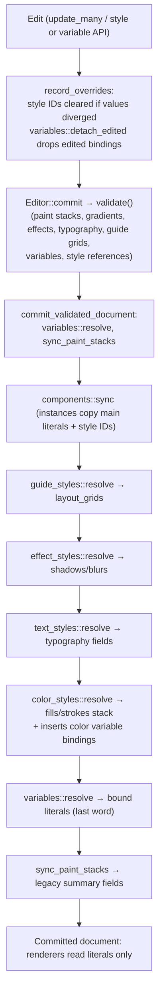

# Styles, Variables and Paints

Everything that decides how a layer looks — paint stacks, strokes, effects, typography, layout guides — is stored as literal values on each `Shape`, and reusable definitions (variables, color/text/effect/guide styles) are **re-applied onto those literals by the Rust engine on every commit**. A layer references a style by ID (`fill_style`, `stroke_style`, `text_style`, `effect_style`, `guide_style`) or a variable by property path (`variable_bindings`), and the resolvers in `commit_validated_document` overwrite the literal fields from the definition. The most important rule: a direct edit that changes a styled or bound value **detaches** that style or binding and keeps the edited literal (`components::record_overrides`, `variables::detach_edited`). Renderers and exporters therefore only ever read resolved literals.

## At a glance

| Key files | Entry points | Depends on | Used by | Related docs |
|---|---|---|---|---|
| Rust: [src/variables.rs](../../src/variables.rs), [src/color_styles.rs](../../src/color_styles.rs), [src/text_styles.rs](../../src/text_styles.rs), [src/effect_styles.rs](../../src/effect_styles.rs), [src/guide_styles.rs](../../src/guide_styles.rs), [src/paint.rs](../../src/paint.rs), [src/stroke_alignment.rs](../../src/stroke_alignment.rs), [src/stroke_tips.rs](../../src/stroke_tips.rs), [src/page_background.rs](../../src/page_background.rs), `Paint`/`Appearance`/`Gradient`/`DropShadow` in [src/lib.rs](../../src/lib.rs). JS: [web/paints.js](../../web/paints.js), [web/paint-popover.js](../../web/paint-popover.js), [web/paint-stack-inspector.js](../../web/paint-stack-inspector.js), [web/variable-manager.js](../../web/variable-manager.js), [web/variables.js](../../web/variables.js), [web/appearance.js](../../web/appearance.js), [web/shadows.js](../../web/shadows.js) and the other modules below | WASM: `save_variables`, `bind_variable`, `set_variable_mode`, `set_page_variable_mode`, `save_color_style`/`apply_color_style`/`remove_color_style`, `save_text_style`/`apply_text_style`/`remove_text_style`, `save_effect_style`/`apply_effect_style`/`remove_effect_style`/`bind_shadow_color`, `save_guide_style`/`apply_guide_style`/`remove_guide_style`, `set_page_background`; plus generic `update`/`update_many` for literal paint edits | `Editor::commit` pipeline, components sync | Canvas renderer (`drawScene` in appearance.js), SVG/PNG export, CSS renderer and HTML/CSS export, archive/SVG import, libraries, MCP | [README](../../README.md) "Local variables", "Browser CSS and glass materials"; [Interface reference log](../FIGMA_UI_REFERENCE.md) "Dark palette and paint picker", "Reusable effect styles", "Page Styles and text inspector"; [EFFECTS_GUIDES_AUDIT.md](../EFFECTS_GUIDES_AUDIT.md); [CSS_EDITING.md](../CSS_EDITING.md) |

## User-visible behavior (brief)

- **Fill / Stroke sections**: multiple paints per channel (rows with swatch, hex, opacity, visibility, remove, drag order). Clicking a swatch opens the paint picker: Custom/Libraries tabs, six paint types (solid, gradient, image, video, pattern, shader), HSV spectrum, hue/opacity rails, EyeDropper sampling, Hex/RGB/CSS/HSL/HSB fields, per-paint blend mode, WCAG contrast checker, page swatches, and "New color variable".
- **Strokes**: weight or per-side border widths, position (inside/center/outside), dash pattern/offset, cap, join, miter limit, start/end tips on open paths.
- **Effects**: up to eight drop/inner shadows plus one layer blur and one background blur; "Glassmorphism" preset.
- **Styles**: the unselected-page inspector lists Text, Color and Effect styles (slash-delimited groups) with **Create style**; each section header has an "Apply styles" picker. Layout guides (grid/columns/rows) can be saved as guide styles on frames.
- **Variables**: rail button **Variables** opens a full-page (or floating) workspace with collections, modes, typed values and aliases. **Design → Variables** binds layer properties and overrides collection modes per layer or page.
- **Page**: page background color/opacity/visibility (affects the canvas workspace backdrop).
- **Layer CSS**: generated CSS for a layer can be edited (`custom_css`; see [CSS_EDITING.md](../CSS_EDITING.md)).

## Data model

| Location | Field | Notes |
|---|---|---|
| `Shape` | `fill: String` | Legacy summary of the topmost fill color (`#rrggbb`) |
| `Shape.appearance` | `Option<Appearance>` | `None` on legacy shapes; JS `appearance(shape)` / Rust `effective_value` substitute defaults |
| `Appearance` | `fills`, `strokes: Option<Vec<Paint>>` | Paint stacks, **topmost first**. `None` = legacy single-paint format; `Some([])` = explicitly no paints. Max 64 per channel |
| `Appearance` | `fill_enabled`, `fill_hidden`, `fill_opacity`, `gradient`, `stroke_*` equivalents, `stroke_color` | Legacy summary fields, rewritten from the top paint by `sync_paint_stacks` |
| `Appearance` | `blend_mode` (layer; includes `pass-through`), `opacity`, `corner_radius`, `corner_radii: Option<[f64;4]>`, `image_opacity` | Layer-level appearance |
| `Appearance` | `shadows: Vec<DropShadow>`, `layer_blur(_enabled/_present)`, `backdrop_blur(_enabled/_present)` | Effects (`_present` keeps a zero blur row visible; `_enabled=false` hides without losing the value) |
| `Appearance` | `stroke_dash`, `stroke_dash_offset`, `stroke_cap`, `stroke_join`, `stroke_miter_limit`, `stroke_alignment`, `stroke_start`, `stroke_end` | Stroke geometry |
| `Shape` | `stroke_width`, `border_widths` | Uniform weight or per-side widths (rendered by [web/box-border.js](../../web/box-border.js)) |
| `Paint` | `{id, color, opacity, visible, gradient?, media?, pattern?, shader?, blend_mode}` | At most one of gradient/media/pattern/shader (`paint::validate`) |
| `Gradient` | `{kind: linear|radial|angular|diamond, start, end, stops[2..16], radial_transform?, focal?, focal_radius}` | Object-relative coordinates in [-10,10] |
| `Shape` | `fill_style`, `stroke_style`, `text_style`, `effect_style`, `guide_style` | Style references (0 = none) |
| `Shape` | `variable_bindings: Map<path, variable_id>`, `variable_modes: Map<collection, mode>` | Bound property paths; per-layer mode overrides |
| `Page` | `variable_modes`, `background: Option<PageBackground>` | Page-level mode overrides; `{color, opacity, visible}` |
| `Document` | `variables: {collections, values}`, `color_styles`, `text_styles`, `effect_styles`, `guide_styles` | Definitions (≤1000 styles of each kind; ≤100 collections, ≤2000 variables) |

## How resolution works

Order matters: variables resolve **after** styles, so a color style whose paint is linked to a color variable (`ColorStyle.color_variables`) writes binding paths like `appearance.fills.<paintId>.color` onto the layer and the variable pass then fills in the mode-specific color. Instances get their main's style IDs and bindings from `components::sync` before the style passes run, so style changes reach instances in the same commit.

## Variables

**Model** ([src/variables.rs](../../src/variables.rs)): `Variables { collections: Vec<Collection>, values: Vec<Variable> }`. `Collection { id, name, modes: Vec<Mode>(1..32), default_mode, preset }`. `Variable { id, collection_id, name, kind, values: BTreeMap<mode_id, Value>, control_path }`.

- **Types**: `color` (`#rrggbb` only), `number`, `string`, `boolean`, and box shorthands `padding`, `margin` (negatives allowed), `border_radius`, `border_width` (1–4 numbers, CSS order, optional `px`).
- **Aliases**: a mode value `{"alias": <variable id>}` must point to a same-type variable; chains are capped at 64 and cycles rejected (`resolved`).
- **Mode inheritance** (`modes_for`): the layer's own `variable_modes`, then each ancestor's, then the page's, then the collection's `default_mode`.
- **Bindable paths** (`property_kind`): `fill`, `appearance.stroke_color`, `appearance.fills.<id>.color`/`appearance.strokes.<id>.color` (colors); `x`, `y`, `rotation`, `width`, `height`, opacities, blurs, `stroke_width`, corner radius and individual corners, size limits, typography font size/weight/line height, auto-layout gap/cross gap/paddings (numbers); `text`, `typography.font_family` (strings); `hidden`, `clip_content` (booleans); `auto_layout.padding`, `appearance.corner_radii`, `border_widths`, `layout_item.margin` (box types); and many `control.*` paths for native controls (state colors, part paddings/radii, adornments, required icon). Shadow colors bind through `DropShadow.color_variable` instead (`Editor::bind_shadow_color`).
- **Validation** (`validate_variables`): unique IDs, a value per mode, values match type, page/layer modes reference existing modes, bindings match property type and the layer actually has that property (e.g. `typography.*` only on text, `control.*` only on controls).

**API**:

| Method | Behavior |
|---|---|
| `save_variables(json)` | Replaces the whole `Variables` object (≤1 MB). Then repairs dependents: deleted variables unbind shadow colors (clearing `effect_style`), color-style links (keeping the last resolved color and detaching layers), page/layer modes and layer bindings (non-control properties keep their last resolved literal; native control style properties are cleared so they inherit). New control-preset variables (`control_path`) are auto-bound on subscribed starter controls (`control.base_collection`). |
| `bind_variable(id, path, variable)` | Binds (or with 0 unbinds) one path; resolves mutually exclusive bindings (`stroke_width` vs `border_widths`, `corner_radius` vs `corner_radii.*`, `auto_layout.padding` vs individual paddings). Runs `record_overrides` so instance protection applies. |
| `set_variable_mode(id, collection, mode)` / `set_page_variable_mode(page, collection, mode)` | Mode overrides; mode 0 removes. |

**Detach on edit** (`detach_edited`): when a bound property's resolved value differs from the previous commit, the binding is removed and the new literal stays. Paint-color bindings compare the whole paint (color, gradient, media, pattern, shader) of the bound paint ID.

**JS**:

| File | Role |
|---|---|
| [web/variable-manager.js](../../web/variable-manager.js) | `editVariables` workspace (full page / floating via `floatingWindow`), collections sidebar, slash groups (`variableGroups`), search/type filter (`filterVariables`), mode columns, alias creation/detach (`resolveVariableValue`, `copyVariableValueToAllModes`), `normalizeVariableHex` (accepts hashless, shorthand, mixed case). Edits a draft and calls `save_variables`. Also seeds control base collections via `input-base.js` (`addInputModes`, `ensureDropdownBase`). |
| [web/variables.js](../../web/variables.js) | `installVariables`: rail button, **Design → Variables** binding UI (`variableProperties`), mode selectors calling `bind_variable`/`set_variable_mode`/`set_page_variable_mode`. |
| [web/color-variable-picker.js](../../web/color-variable-picker.js) | `variableColor` (JS mirror of mode inheritance + alias resolution) and the Custom/Libraries color picker used by control style fields. |

> **Note:** README "Local variables" lists RGBA colors, scopes, standalone variable-library publishing and variable-driven component properties as pending; code confirms colors are 6-digit hex only and there is no scope field.

## Paints

### Stacks and the legacy summary

[web/paints.js](../../web/paints.js) is the canonical JS model: `paints(shape, channel)` returns the stack (synthesizing a single legacy paint from `fill`/`stroke_color` when `appearance.fills` is absent); `withPaints` writes a stack back and **rewrites the legacy summary** from `stack[0]`; `addPaint` prepends (new paints go on top); `removePaint`, `movePaint`, `updatePaint`. `paintLayers(shape)` expands a shape into per-paint pseudo-shapes, iterating each stack **bottom to top** (fills, then strokes) for the canvas and SVG renderers, so "top rows render last". `paintBindingPath` maps a paint to its variable path (`appearance.fills.<id>.color`, or `fill` in legacy format); converting a legacy layer to a stack migrates its `fill` binding to the paint path.

Legacy property editors (presets, multi-select, native inputs) still edit the summary fields; `reconcilePaints(next, previous)` folds such edits into the top paint, and `paintEdit`/`commitPaintEdit` let the single-paint controls edit the *selected* paint via a temporary `_paintEdit` marker. In Rust, `sync_paint_stacks` (in `commit_validated_document`) recomputes the summary from the stack's first paint after every commit, keeping older consumers (layout bounds, legacy export paths) consistent.

[web/paint-state.js](../../web/paint-state.js) `setPaintState(shape, channel, 'add'|'show'|'hide'|'remove')` handles section-level add/visibility; hidden paints stay in the stack.

### Paint types

| Mode (`paintMode`) | Data | Rust validation | JS |
|---|---|---|---|
| solid | `color`, `opacity` | hex, 0–1 | — |
| gradient | `Gradient` (linear/radial/angular/diamond) | `validate_gradient`: 2–16 sorted stops, non-degenerate endpoints, invertible `radial_transform`, focal circle | [gradients.js](../../web/gradients.js) (`defaultGradient`, `gradientGeometry`, `radialGeometry`, `canvasFill`, `gradientSvg`, `insertGradientStop`, `sampleGradient`), [gradient-edit.js](../../web/gradient-edit.js) (canvas handles, hit testing, angle snapping, stop insertion), [gradient-controls.js](../../web/gradient-controls.js) |
| image / video | `media: {kind, data_url, poster, width, height, mode: fill|fit|crop|tile, scale, offset, rotation, filters[7]}` | base64 data URLs only (png/jpeg/webp/gif ≤2 MB; mp4/webm/mov ≤3 MB), ≤16384 px | [paint-textures.js](../../web/paint-textures.js) (`emptyMedia`, `mediaLayout`, `paintFilter`, `canvasTexture`, `textureSvg`) |
| pattern | `pattern: {source_id, tile_type: grid|horizontal|vertical|hexagonal, scale, spacing, offset}` | `validate_sources` rejects self/circular sources (including through parent/child edges); `remap_sources` rewrites IDs on paste/duplicate | `emptyPattern`, `patternLayout`, `resolvePatternPaints` |
| shader | `shader: {preset: mesh|noise|waves|custom, color, scale, time, seed, code ≤16 KB, snapshot}` | snapshot must be an image data URL | [paint-shaders.js](../../web/paint-shaders.js) (`shaderPresets`, `customShaderTemplate`, `shaderSnapshot`, preview loop) |

Every paint also has `blend_mode` (17 CSS blend modes, `normal` default). The layer's own `appearance.blend_mode` additionally accepts `pass-through`.

### Paint UI modules

| File | Role |
|---|---|
| [web/paint-stack-inspector.js](../../web/paint-stack-inspector.js) | `installPaintStacks`: Fill/Stroke rows, add/remove/reorder/visibility, per-row variable binding indicator. `selectPaint`/`selectedPaint`/`editingPaint` track the active row per `shape:channel`. |
| [web/paint-popover.js](../../web/paint-popover.js) | `installPaintPopovers({current, change, document, bind, saveVariables, hosts, idPrefix, colorStyles})`: the 240px picker. Custom tab (mode toolbar, spectrum via `installColorPicker`, EyeDropper, format fields, gradient stop sub-picker, blend mode, contrast check via `contrastRatio`); Libraries tab (color variables by collection, color styles, "Create color style"); "New color variable" creates a variable in every mode and binds it. Reused (with `hosts`/`idPrefix`) by style editors. |
| [web/color-picker.js](../../web/color-picker.js) | `installColorPicker` spectrum/hue control, `hexToHsv`/`hsvToHex`; cancelling a saturation drag restores the preview without an edit. |
| [web/paint-colors.js](../../web/paint-colors.js) | `colorChannels`/`channelsColor` (Hex/RGB/CSS/HSL/HSB), `contrastRatio` (WCAG, alpha-composited). |
| [web/paint-preview.js](../../web/paint-preview.js), [web/paint-picker-icons.js](../../web/paint-picker-icons.js) | Style row thumbnails (`paintPreview`) and mode icons. |

## Strokes

- **Alignment** (`stroke_alignment`: inside/center/outside). Rust [src/stroke_alignment.rs](../../src/stroke_alignment.rs) `reach(s)` gives how far the stroke extends outside the geometry (0, w/2, w; open paths always centered) and `hit` does stroke-aware hit testing including rounded corners and join style. JS [web/stroke-alignment.js](../../web/stroke-alignment.js) `drawAlignedStroke` renders inside/outside strokes by stroking at double width into an offscreen surface masked by the fill; `alignedStrokeSvg` emits the SVG mask equivalent. Per-side `border_widths` bypass this and fill a box-border path.
- **Tips** (`stroke_start`/`stroke_end`: none, line, triangle, reverse_triangle, diamond, circle; legacy arrows use `legacy_arrow`). Rust [src/stroke_tips.rs](../../src/stroke_tips.rs) `hit` follows cubic tangents for hit testing; JS [web/stroke-tips.js](../../web/stroke-tips.js) `strokeTips`, `endpointStyle`, `strokePadding` (shared by canvas, SVG, effect and export bounds). Tips are suppressed on closed paths.
- [web/stroke-popovers.js](../../web/stroke-popovers.js) (stroke settings popovers: dash, cap, join, per-side widths) and [web/stroke-render.js](../../web/stroke-render.js) (`drawVectorStroke`).
- Validation in `validate` ([src/lib.rs](../../src/lib.rs)): ≤16 dash entries with non-zero sum, cap butt/round/square, join miter/round/bevel, miter limit 1–1000.

## Effects

- `DropShadow { kind: drop|inner, x, y, blur, spread, color, color_variable, opacity, visible }`; `Effects::validate` caps at 8 shadows, layer blur ≤100,000, background blur ≤200.
- [web/effect-editor.js](../../web/effect-editor.js): pure helpers `effectEntries`, `addEffect`, `editEffect`, `removeEffect`, `convertEffect` (preserves applicable values when switching type), `moveShadow`, `defaultShadow`. [web/effect-values.js](../../web/effect-values.js) `effectBlur` returns 0 for disabled blurs. [web/shadow-controls.js](../../web/shadow-controls.js) `renderShadowControls` draws the effect rows.
- [web/shadows.js](../../web/shadows.js): rendering math — `visibleShadows`, `shadowBounds` (3σ Gaussian tails, spread), `drawShadow`, `shadowFilter`, `layerBlurFilter`, `blurBounds`, `effectSurfaceSize`. Inner shadows never expand export bounds.
- [web/glass-controls.js](../../web/glass-controls.js): `glassPreset` (18% white tint, inside 1px stroke at 35%, radius 20, background blur 20, soft drop shadow) and the Glassmorphism fields shown when background blur is active. Background blur renders through CSS `backdrop-filter`; raster/SVG exporters reject it rather than omit it (README "Browser CSS and glass materials").

## Styles

All four style kinds follow the same pattern: a definition list on `Document`, a `validate_styles` (unique trimmed case-insensitive names ≤128 bytes, descriptions ≤2000), a `resolve` that copies the definition onto every referencing layer, `save_*_style(json, layer)` (ID 0 creates; a non-zero layer applies it in the same undo step), `apply_*_style(selection, id)` (0 detaches, keeping the resolved values) and `remove_*_style(id)` (detaches users, keeping values).

| Style | Shares | Stays local | Detaches when |
|---|---|---|---|
| Color (`ColorStyle {paints, color_variables}`) | Whole ordered paint stack for fill or stroke; per-paint color variable links | Stroke geometry/weight | Paint stack or summary values diverge, or a paint color binding changes |
| Text (`TextStyle {typography}`) | font family, size, weight, line height, letter spacing (+unit), text case | Alignment, vertical alignment, wrapping, box sizing (`style_values` normalizes these before comparing) | Normalized typography differs, or a `typography.*` binding changes |
| Effect (`EffectStyle {effects}`) | Shadows and both blurs (including enabled/present flags) | Paints, opacity, geometry | `Effects::from_appearance` differs or a blur binding changes |
| Guide (`GuideStyle {grids}`) | `layout_grids` (≤8, frames only) | — | `layout_grids` differ |

Applying a style removes conflicting variable bindings on that layer (e.g. text style removes `typography.font_*` bindings). UI: [web/color-style-controls.js](../../web/color-style-controls.js) (`installColorStyleControls`, 304px editor reusing the paint popover), [web/text-style-controls.js](../../web/text-style-controls.js) (`installTextStyleControls`, `parseLetterSpacing` accepting px or %), [web/effect-style-controls.js](../../web/effect-style-controls.js) (`createEffectStyleControls`, `effectStyleValues`), [web/guide-controls.js](../../web/guide-controls.js) (`renderGuideControls`, `newLayoutGuide`, `guideLabel`), and [web/page-styles.js](../../web/page-styles.js) (`installPageStyles`: Text/Color/Effect categories with slash groups shown when nothing is selected).

## Page background, layer CSS and appearance rendering

- [src/page_background.rs](../../src/page_background.rs) `set_page_background(page, json)`; [web/page-background.js](../../web/page-background.js) `installPageBackground` sets the `#workspace` CSS background (color over a checkerboard). Default `#1e1e1e`. Raster exports take their own background parameter (`rasterSettings` in [web/export.js](../../web/export.js)).
- [web/layer-style.js](../../web/layer-style.js): parser/formatter for per-layer custom CSS (`custom_css`), scoped to the stable selector `.px-node-__self__` so copies and instances keep their CSS. 64 KB limit. Detail in [CSS_EDITING.md](../CSS_EDITING.md).
- [web/appearance.js](../../web/appearance.js): `appearance(shape)` (defaults for legacy shapes), `radius`/`radii`/`roundedContains`/`roundedSvg`, `paintAttributes`, `withPaintOpacity`, and `drawScene`/`sceneSvg` — the Canvas 2D and SVG scene painters that consume `paintLayers`, shadows and blurs. See [Rendering-and-Export](Rendering-and-Export.md).

## Interaction with components

Instances inherit all appearance from their main; `record_overrides` rejects paint, stroke, effect, corner and opacity edits on instance layers ("Instance appearance is protected"), except on slot frames. Style IDs and bindings are copied by `components::sync`, then resolved, so editing a style updates instances immediately. Tests: `paint-opacity`, `stroke-alignment`, `strokes`, `shadows`, `layer-blur`, `corners`, `effect-styles`, `guide-styles` all include "instances reject … overrides" cases. See [Components-Variants-and-Slots](Components-Variants-and-Slots.md).

## Extension guide

**Make a new property bindable to variables.** Add the path and type to `property_kind` in `variables.rs`; ensure `assign` can write it (generic JSON-pointer fallback works for simple fields); add a layer-capability check in `validate_variables`/`bind_variable` if the property is conditional; expose it in `variableProperties` ([web/variables.js](../../web/variables.js)); add a case to `tests/variables.test.mjs`.

**Add a paint type.** Add the optional struct to `Paint` and validation in `paint::validate` (keep the "one type per paint" rule); add a `paintMode` branch and `clearPaintTypes` key in paints.js; render in `paintLayers` consumers (appearance.js, paint-textures.js `canvasSvgPaint`) and the CSS renderer; add a mode button in paint-popover.js `paintModes`; extend `detach_edited`'s paint comparison tuple; test in `paint-modes.test.mjs`.

**Add a shared field to a style kind.** Update the struct, its `apply`/`resolve`, the divergence check in `record_overrides`, and the corresponding controls file.

## Invariants and gotchas

- Stacks are **topmost first** everywhere (JS and Rust summary). Render order reverses them.
- `appearance.fills == None` and `Some([])` mean different things (legacy vs explicitly empty). Do not normalize one into the other.
- Variable resolution runs twice per commit (before and after component sync); the final pass is authoritative.
- Renaming styles to an existing name (case-insensitive) fails validation.
- Deleting a variable keeps literals for ordinary properties but **clears** native-control state values so the control falls back to its base styling.
- Guide styles may only reference frames; text-style typography validation restricts font family characters to ASCII letters, digits, space and `-`.
- Every validation failure is atomic: the document and history are untouched (tests check this pattern throughout).

> **Note:** README "Current limits"/"Browser CSS" paragraphs still say "Strokes are currently centered; multiple paints, stroke alignment and background blur remain pending" and that compact paint rows "do not implement … blend modes, multi-paint stacks". The code implements paint stacks, per-paint and layer blend modes, stroke alignment and background blur; those README sentences are stale.

## Known limitations

From code and docs: colors are opaque hex (alpha lives in paint/stop opacity, not in variables); no variable scopes; no per-gradient-stop variable bindings; AI image generation and shader-library workflows are not implemented (interface reference log "Dark palette and paint picker"); Animation and Layout guide entries are absent from the page Create style menu; background blur cannot be exported to raster/SVG.

## Tests

| Area | Test files (`tests/`) |
|---|---|
| Variables | `variables`, `variable-color-input`, `variable-workspace`, `box-variables`, `shadow-variables` |
| Styles | `color-styles`, `text-styles`, `effect-styles`, `guide-styles`; browser `browser/styles.spec.mjs` (with snapshots) |
| Paints | `paint-stacks`, `paint-state`, `paint-modes`, `paint-opacity`, `paint-preview`, `gradients`, `gradient-edit`, `stroke-gradients`, `svg-gradients`, `color-picker-cancel` |
| Strokes | `strokes`, `stroke-alignment`, `stroke-tips`, `layout-strokes` |
| Effects | `effect-editor`, `shadows`, `inner-shadows`, `layer-blur`, `glass-preset` |
| Other | `appearance`, `corners`, `page-background`, `layer-style` |

## Related pages

[Rendering-and-Export](Rendering-and-Export.md) · [Components-Variants-and-Slots](Components-Variants-and-Slots.md) · [Prototyping-Behaviors-and-Controls](Prototyping-Behaviors-and-Controls.md) (control style variables) · [Document-Model-and-File-Format](Document-Model-and-File-Format.md) · [Rust-Document-Engine](Rust-Document-Engine.md) · [Teams-Libraries-and-Collaboration](Teams-Libraries-and-Collaboration.md) · [Import-Design-Files](Import-Design-Files.md) · [Interface-Design-Guidelines](Interface-Design-Guidelines.md)

## Source of truth

- [src/variables.rs](../../src/variables.rs), [src/color_styles.rs](../../src/color_styles.rs), [src/text_styles.rs](../../src/text_styles.rs), [src/effect_styles.rs](../../src/effect_styles.rs), [src/guide_styles.rs](../../src/guide_styles.rs), [src/paint.rs](../../src/paint.rs), [src/stroke_alignment.rs](../../src/stroke_alignment.rs), [src/stroke_tips.rs](../../src/stroke_tips.rs), [src/page_background.rs](../../src/page_background.rs)
- [src/lib.rs](../../src/lib.rs): `Paint`, `Appearance`, `DropShadow`, `Gradient`, `validate`, `sync_paint_stacks`, `commit_validated_document`
- [web/paints.js](../../web/paints.js), [web/paint-popover.js](../../web/paint-popover.js), [web/variable-manager.js](../../web/variable-manager.js), [web/appearance.js](../../web/appearance.js), [web/shadows.js](../../web/shadows.js)
- [README](../../README.md) "Local variables", "Browser CSS and glass materials"; [Interface reference log](../FIGMA_UI_REFERENCE.md); [EFFECTS_GUIDES_AUDIT.md](../EFFECTS_GUIDES_AUDIT.md); [CSS_EDITING.md](../CSS_EDITING.md)
