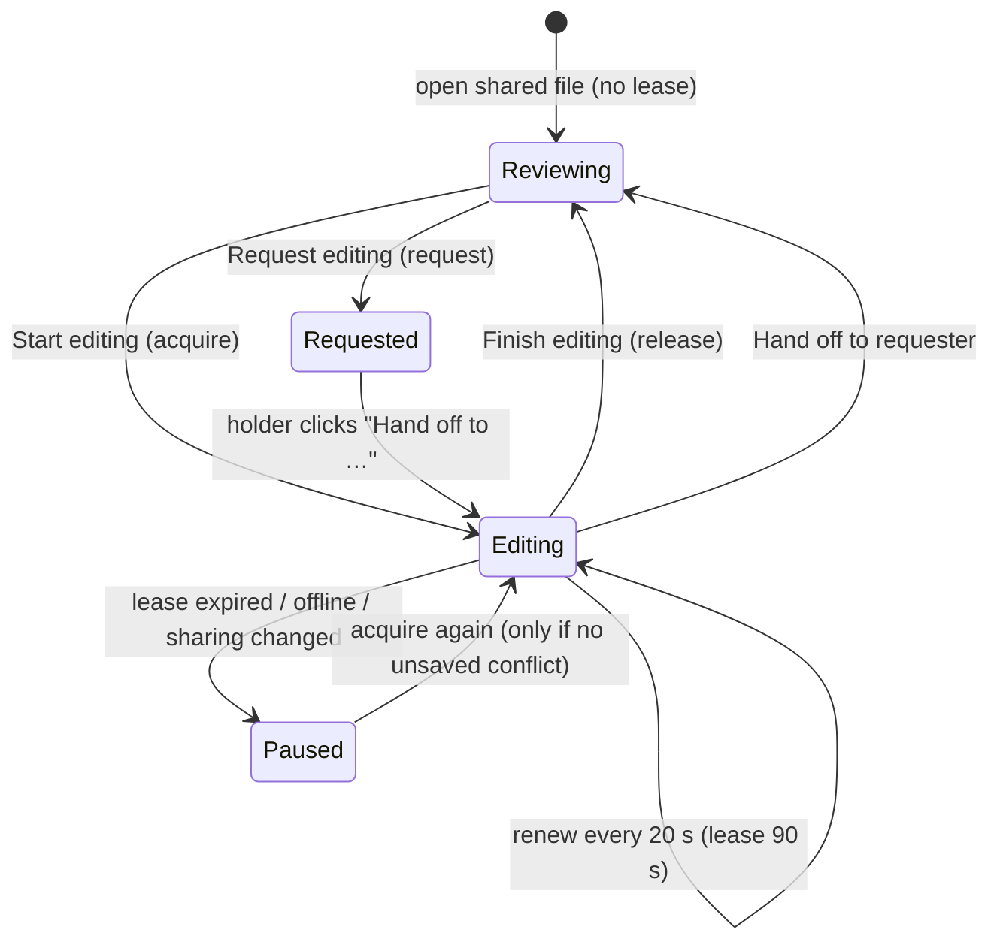
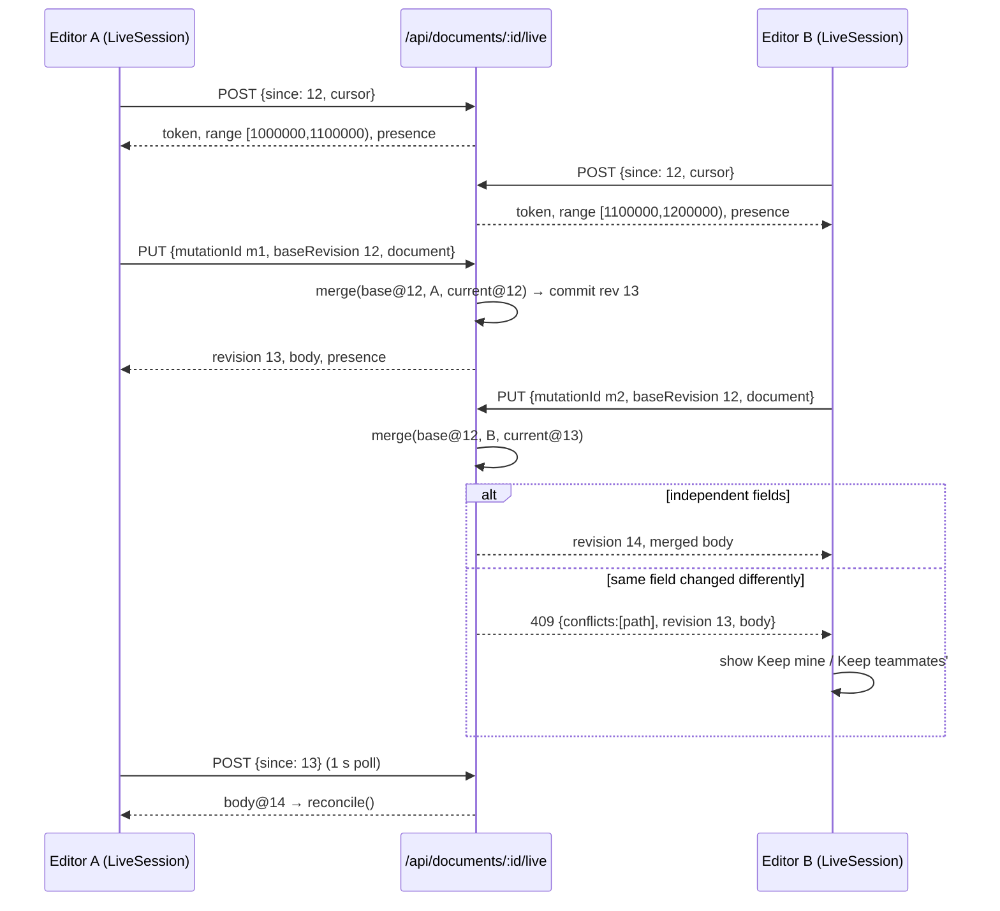
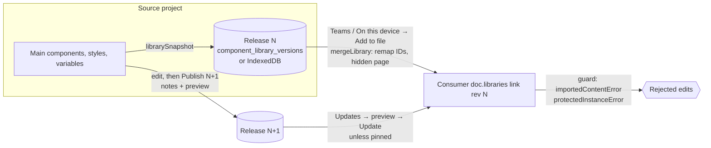

# Teams, Libraries and Collaboration

This page covers everything that lets more than one person work on PixlPrfct designs: workspaces and roles, protected component libraries (team and device), single-editor handoff, opt-in simultaneous editing, comments, reviews and notifications. All multi-user features run **only on the self-hosted server** (`server/`); the Sites host has personal files only, and the static/desktop-local hosts have device libraries only. The most important thing to know: **every rule is enforced twice** — in the editor through a WASM write guard (`editor.set_write_guard`) that rejects disallowed mutations, and on the server through the same `web/library-model.js` checks plus SQL write fences — so UI gating is never the security boundary. Simultaneous editing exists in code (1-second HTTP polling with a field-level three-way merge and explicit conflicts); it is not CRDT-based real-time multiplayer, and the README's "Current limits" still describes real-time multiplayer as unimplemented.

## At a glance

| Key files | Entry points | Depends on | Used by | Related docs |
| --- | --- | --- | --- | --- |
| Client: [web/team-collaboration.js](../../web/team-collaboration.js), [web/team-session.js](../../web/team-session.js), [web/live-session.js](../../web/live-session.js), [web/document-merge.js](../../web/document-merge.js), [web/team-activity.js](../../web/team-activity.js), [web/team-onboarding.js](../../web/team-onboarding.js), [web/library-manager.js](../../web/library-manager.js), [web/library-model.js](../../web/library-model.js), [web/local-libraries.js](../../web/local-libraries.js), [web/library-catalog.js](../../web/library-catalog.js), [web/library-changes.js](../../web/library-changes.js), [web/library-release-ui.js](../../web/library-release-ui.js). Server: [server/collaboration.mjs](../../server/collaboration.mjs), [server/live-editing.mjs](../../server/live-editing.mjs), [server/libraries.mjs](../../server/libraries.mjs), [server/team-activity.mjs](../../server/team-activity.mjs), [server/workspace-access.mjs](../../server/workspace-access.mjs), [server/onboarding.mjs](../../server/onboarding.mjs) | `installTeamCollaboration()` and `createLibraryManager()` in `web/app.js`; `teamOnboarding()` in `web/project-home.js`; `/api/documents/:id/{sharing,editing,comments,reviews,members,live}`, `/api/libraries/**`, `/api/notifications*`, `/api/onboarding` | Cloud session ([Cloud-API-and-Database](Cloud-API-and-Database.md)), Better Auth orgs/teams, WASM `Editor` (`set_write_guard`, `reserve_ids`, `snapshot`, `load`) | Editor UI, MCP bridge (`pixlprfct_libraries`, editing gate) | [TEAM_WORKFLOWS.md](../TEAM_WORKFLOWS.md), [TEAM_LIBRARIES.md](../TEAM_LIBRARIES.md), [LIBRARIES.md](../LIBRARIES.md), [TEAM_RELEASE_WORK.md](../TEAM_RELEASE_WORK.md) |

## Implemented vs. not implemented

| Area | Status in code |
| --- | --- |
| Personal / organization / team workspaces | Implemented (self-hosted only) |
| Workspace roles owner/admin/member; team membership | Implemented via Better Auth organization plugin |
| File roles viewer/commenter/editor/none with per-member overrides | Implemented |
| Single active editor with 90 s leases, request and handoff | Implemented |
| Simultaneous editing ("Edit together"), presence avatars, live cursors | Implemented: HTTP polling every 1 s, three-way JSON merge, explicit conflict choice, per-session undo |
| Comments with threads, page/layer anchors, resolve, @mentions | Implemented |
| Review requests bound to a document revision | Implemented |
| Notification inbox, preferences, opt-in email | Implemented |
| Protected team libraries with maintainers, component grants, release notes, history, usage, pin, rollback, retire | Implemented |
| Device libraries (IndexedDB) and `.pixllib` export/import | Implemented on all hosts |
| `.fig` library import | Snapshot only (see [Import-Design-Files](Import-Design-Files.md)) |
| Character-level text merging / CRDT, WebSocket push | **Not implemented** (polling + whole-field merge) |
| Canvas comment pins, spotlight/follow, voice | **Not implemented** (TEAM_WORKFLOWS.md) |
| Public links, cross-workspace or anonymous sharing | **Not implemented** |
| Live synchronization with external source libraries | **Not implemented** |
| Publishing a library that contains another library's instance or pattern | Refused by `librarySnapshot` |
| Nested instance-swap overrides | **Not implemented** (README "Current limits") |
| Any team feature on the Sites host | **Not implemented**; no routes exist |

> **Note:** Docs disagree about simultaneous editing. README "Current limits" says real-time multiplayer is unimplemented; [SELF_HOSTING.md](../SELF_HOSTING.md) says updates do not support "simultaneous cursor presence or live merging"; the opening paragraph of [TEAM_WORKFLOWS.md](../TEAM_WORKFLOWS.md) says simultaneous editing is not implemented. The same file's "Alpha.14 additions" section and [TEAM_RELEASE_WORK.md](../TEAM_RELEASE_WORK.md) describe "Edit together", and the code (`server/live-editing.mjs`, `web/live-session.js`) implements it. The accurate statement is: opt-in, poll-based simultaneous editing with explicit conflicts exists on the self-hosted server; real-time, conflict-free multiplayer does not.

## Workspaces and roles

### Workspaces

A workspace is a string carried in the page URL (`?workspace=`) and sent on every API call. `server/workspace-access.mjs#workspaceAccess` turns it into an access object with an `owner` key that partitions all data (`documents.owner`, `component_libraries.owner`, …):

| Workspace | Owner key | Who can enter | `manage` |
| --- | --- | --- | --- |
| `personal` (default) | `user:<userId>` | The user | Always |
| `org:<orgId>` | `org:<orgId>` | Any org member | Org owner/admin |
| `team:<teamId>` | `team:<teamId>` | Team members, plus org owners/admins | Org owner/admin |

Project home ([web/project-home.js](../../web/project-home.js)) lists personal, organization and team workspaces from `GET /api/workspaces` in a dropdown. New designs in shared workspaces are created directly on the server; personal device drafts stay in the browser until saved as a cloud file. Membership is rechecked on every request, so removing someone from an org or team cuts off access immediately (downloaded copies cannot be revoked).

Organizations, invitations, teams and membership changes are Better Auth `organization` plugin endpoints under `/api/auth/organization/*`, driven from `web/account.js` and `web/admin.js` ([ADMIN_CONSOLE.md](../ADMIN_CONSOLE.md)).

### Roles and permissions

File roles are stored per file in `document_collaboration` (`default_role` plus a JSON `roles` map of user ID → role). `server/collaboration.mjs#record` derives the effective role:

- `owner` if the caller has workspace `manage` or created the file (`documents.created_by`).
- Otherwise `roles[userId]`, else `default_role` (default `editor`).

| Capability | none | viewer | commenter | editor | owner |
| --- | --- | --- | --- | --- | --- |
| See/open the file | No (403, hidden from lists) | Yes | Yes | Yes | Yes |
| Read comments and reviews | No | Yes | Yes | Yes | Yes |
| Post comments, be a reviewer, decide own review | No | No | Yes | Yes | Yes |
| Resolve or reopen a thread | No | No | Own thread | Any | Any |
| Edit artwork (needs lease or live token too) | No | No | No | Yes | Yes |
| Request a review | No | No | No | Yes | Yes |
| Change Share settings and editing mode | No | No | No | No | Yes |
| Move to Trash / restore | No | No | No | No | Creator or workspace owner/admin (and `canEdit`) |

Library permissions are a separate layer on the library source file (see below). Holding the editor file role does not bypass library protection, and library maintainership does not grant deletion.

## Editing modes

Each shared file has `document_collaboration.editing_mode`: `handoff` (default) or `live`. The file owner switches it in **Share → Editing mode** (`PUT /sharing` with `editingMode`). Every sharing change increments the policy `revision` and clears the lease, which invalidates all outstanding edit tokens.

### Handoff mode (single active editor)

Server: `collaboration.editing()` handles `POST /api/documents/:id/editing` with `action`:

| Action | Precondition | Effect |
| --- | --- | --- |
| `acquire` | `canEdit`, not in Trash; lease expired, already yours, or held by a removed member | New `lease_token` (UUID), `lease_expires = now + 90 s`; else 423 "Another teammate is editing. Request a handoff." |
| `renew` | Your token and unexpired | Extends 90 s |
| `release` | Your token | Sets `lease_expires = 0` |
| `request` | — | Upserts `document_edit_requests` row `doc:client` (requests older than 10 min are pruned) |
| `handoff` | Your unexpired token; target request <10 min old; target still a member with `canEdit` (rechecked via `workspaceAccess` for the target) | Moves the lease to the requester's user and client with a new token; deletes the request |

`GET /editing` (and every POST) returns `describe()`: `{editingMode, revision, documentRevision, userId, role, canEdit, canComment, manage, serverNow, lease:{userId,name,mine,expiresAt,token?}, requested, requests[]}`; managers also get `defaultRole`, `members[]`, `overrides`.

Client: `TeamSession` ([web/team-session.js](../../web/team-session.js)) holds `state`, a per-window `client` UUID, and a `deadline` computed from server time minus 3 s of slack. `headers()` returns `x-pixl-client` and `x-pixl-edit-token`. `editable()` is true only for the lease holder before the deadline. `accept(state)` reloads the latest saved revision when a new lease arrives or the revision moved and there is no unsaved work; with unsaved work it sets an issue instead of overwriting ("Editing changed while you had unsaved work…"). `installTeamCollaboration` polls `sync()` every 20 s and on focus/online/visibility, renewing the lease if held.

Saves in handoff mode go through the normal `PUT /api/documents/:id`; the server fence requires the lease token, client ID and user to match and the lease to be unexpired **in database time** at commit. `session.beforeWrite` throws 423 locally if `!model.editable()`, so the autosave loop stops without losing the recovery copy.

### Simultaneous editing ("Edit together")

Client: `LiveSession` ([web/live-session.js](../../web/live-session.js)), owned by `TeamSession.live`. When `state.editingMode === 'live'`:

1. **Join and heartbeat.** `poll()` sends `POST /live {since: session.active.revision, cursor}` every second while the tab is visible (interval in `team-collaboration.js`), skipping while a save is pending or the user is mid-gesture (`busy()`: dragging, text editing, CSS previews). The response gives a live `token`, a reserved shape-ID `range`, `canEdit`, `role`, `presence`, and `body` if the server revision moved. The token deadline is 80 s locally (server: 90 s).
2. **ID ranges.** `editor.reserve_ids(start, end)` makes the WASM engine allocate new shape/page IDs only inside the client's 100,000-wide range, so two people creating layers never collide. Ranges come from `document_collaboration.next_live_id`; the server refuses new sessions when IDs approach 2³²−1.
3. **Incoming changes.** `reconcile(data)` runs `mergeDocuments(base = session.ack, local = current snapshot, remote = server body)`. Without conflicts it loads the merged document (keeping the user's active page) and advances `ack`/`revision`.
4. **Outgoing changes.** `CloudSession.save` is replaced by `live.save()`: `PUT /live {mutationId, baseRevision, document}`. The mutation ID is stable for the same `(id, revision, body)` so retries are idempotent (`live_mutations`). The server merges `base` (from `live_versions` at `baseRevision`), the submitted document and the current document, normalizes through the WASM engine, runs `libraries.guard`, and commits with an automatic checkpoint. `receive()` merges the returned body into anything typed since submission.
5. **Undo.** The editor's `undo/redo/can_undo/can_redo` are wrapped: in live mode they use `PersonalHistory` (100 entries) which replays the user's own before/after pairs through `mergeDocuments`; if a teammate changed the same fields, undo throws "A teammate changed this edit. Undo is paused to preserve their work." History resets on reopen.
6. **Presence.** Avatars (initials) and cursors (`.team-cursor`, repositioned every 100 ms) for other clients on the same page; cursor positions are page coordinates sent with each poll.

**Merge rules** (`web/document-merge.js#mergeDocuments`): a field-level three-way merge. If only one side changed a value, that side wins. Arrays of objects with unique `id`s merge per ID (adds and removals from both sides survive; order conflicts only if both sides reordered differently). Any value both sides changed differently is a **conflict path**; `prefer` (`'remote'` by default, or `'local'`) decides the provisional value. Depth over 60 is a conflict.

**Conflict recovery.** When a merge reports conflicts (client-side in `reconcile`/`receive`, or server-side 409 `{conflicts, revision, body}`), `LiveSession.conflict` is set, saving pauses, and the editing bar shows **Keep my overlapping edits** / **Keep teammates' overlapping edits**. `resolve(prefer)` re-merges with that preference (independent edits survive either way), adopts the remote revision as the new base, and resumes saving. If the merged JSON is not a valid design (WASM `load` fails), the server returns 400 advising to keep a local copy. Recovery snapshots stay in browser storage; **Files** offers saving a copy or opening the latest version.

### Write gating in the editor

`installTeamCollaboration` returns `guard(before, after)`; `web/app.js` combines it with the library guard into `libraryWriteGuard = (before, after, history) => team.guard(...) || libraries.guard(...) || ''` and installs it with `editor.set_write_guard(...)` whenever a shared file or protected library content is open (`syncLibraryGuard`). The WASM engine calls it on every committed mutation, undo and redo; a non-empty string rejects the change. `team.guard` allows a change only when `model.editable()` or when the artwork is unchanged (`sameArtwork` ignores `active_page`), so viewers can still switch pages. The MCP bridge shares this gate (TEAM_WORKFLOWS.md).

## Comments, reviews and notifications

**Comments** (`collaboration.comments`): `GET ?offset=` (100 per page, the client loads up to 2,000); `POST {id, body, threadId?, anchor?}` with a client-generated UUID so retries are idempotent; `body` 1–10,000 bytes; replies inherit the thread's anchor; `anchor = {page, layer?}` (positive integers). `PATCH {id, resolved}` with `If-Match: <comment revision>` resolves or reopens a thread (root comments only). Comments never change the document revision. The panel shows **Show location** to select the anchored page/layer.

**Mentions** are inline tokens of the form `@[Name]` followed by `(userId)` in parentheses, inserted by `mentionPicker` (members from `GET /members`) and rendered by `displayMentions` ([web/team-activity.js](../../web/team-activity.js)).

**Reviews** (`server/team-activity.mjs#reviews`): an editor requests review of the **saved** revision (`POST {id, reviewerId, documentRevision, note ≤2000}`; the client flushes first). The assigned reviewer (must be able to comment) can `PATCH {id, status:'approved'|'changes_requested'}` with `If-Match: <review revision>`; `canceled` is allowed for an editor who is the requester or a file owner/manager. A review whose `document_revision` differs from the current file is returned with `stale:true` and cannot be decided — edits after approval visibly invalidate it.

**Notifications**: `commentEvent` fans out `mention` (mentioned users), `reply` (earlier authors in the thread), and `comment` (everyone else with access); reviews emit `review_requested`, `review_approved`, `review_changes_requested`, `review_canceled`. Rows are idempotent (`<source>:<kind>:<user>`), never sent to the actor, and filtered to people who can currently access the file. `GET /api/notifications` applies the user's preference (`all`, `mentions` = everything except `comment`, `none`), rechecks access per row, and hides trashed files. `installActivityInbox` renders the bell with All/Unread. Opt-in email is sent by the server outbox ([Self-Hosted-Server](Self-Hosted-Server.md#operations-serveroperationsmjs)) and contains only a link.

**Onboarding**: `GET /api/onboarding` + [web/team-onboarding.js](../../web/team-onboarding.js) render a checklist on project home (workspace ready, invite teammates, first shared design, design-system library), linking to Admin → People for managers.

## Libraries

### Data model

A published library is a **snapshot of a source project**, identified by the source document's ID and its workspace. Consumers store links in their own document under `doc.libraries[]`:

| Field | Meaning |
| --- | --- |
| `id`, `workspace` | Source identity (`local:<projectId>` / `local` for device libraries) |
| `revision` | Release currently merged into this document |
| `page_id` | Hidden page that holds the imported definitions (hidden from page navigation, prototype targets and code export per TEAM_LIBRARIES.md) |
| `maps` | Per-kind ID maps from source IDs to local IDs: `shapes`, `collections`, `variables`, `sets`, `properties`, `guides`, `effects`, `texts`, `colors` |
| `pinned` | Consumer pinned this release; updates require unpinning |
| `enabled` | `false` hides the library's cards in Assets while placed instances stay linked |

Key functions in [web/library-model.js](../../web/library-model.js) (shared by editor and server):

| Function | Role |
| --- | --- |
| `librarySnapshot(doc)` | Builds the publishable body: main components not imported from another library, their descendants, complete variant sets, local styles (text/color/effect/guide), local variables and collections, and pattern-tile dependencies. Clears `libraries`. Throws if nothing is publishable or if the content depends on another library (instances, patterns, variables, base collections). |
| `mergeLibrary(doc, release)` | Adds or updates a link: allocates non-colliding local IDs per kind (reusing existing map entries so instance identity survives updates), places shapes on the link's hidden page, remaps parents, instance masters/sources, slots, interactions and bindings. Refuses an update that removes a component still used by an instance. |
| `importedContentError(before, after)` | Rejects any change to linked definitions (shapes' content, variables, sets, properties, styles) or to the link record except `enabled`/`pinned`. |
| `protectedInstanceError(before, after)` | Rejects detaching an instance or changing its master/source (except an allowed variant switch within the same set) and any override the author did not allow. |
| `instancePermissions(doc, shape)` | Reads the main component's `editor_meta.library_overrides` → `{properties, sizing, variants}` (author-approved overrides; all default `false`). |
| `sourceEditError(before, after, access)` | In the source project, limits non-maintainers to the component subtrees they were granted; blocks changes to other components, shared settings/definitions, and moving or deleting a granted main component. |

**Author-approved overrides**: in the source project the author enables per main component, under **Library instance permissions**, (1) exposed text/visibility properties, (2) sizing/layout (dimensions, positions, layout-item settings, constraints), (3) variant switching within the published set. They take effect for consumers only after a new release is published and accepted. Styling, hierarchy and detach stay protected regardless of file role.

### Team libraries (self-hosted)

`server/libraries.mjs#libraryService(db, bodies, {canReadDocument})` provides `api()` and `guard()`.

- **Policy** (JSON in `component_libraries.policy`): `{maintainers:[userId], components:{<mainComponentId>:[userId]}, retired?:boolean}`. `accessFor(row, access)` → `{manage, editAll: manage || maintainer, components:[ids granted to me]}`.
- **Publish** — `PUT /api/libraries/:id` with `If-Match` = the source document revision, `{notes?, rollbackRevision?}`. Requires `editAll` (first publish therefore requires owner/admin) and, in shared workspaces, the editing lease. One batch inserts `library_release_notes` and `component_library_versions` (`<id>@<rev>`, body = `librarySnapshot(source)` or an archived body for rollback), inserts/updates `component_libraries`, and **bumps the source document revision**, so any in-flight save authorized under the old policy loses its compare-and-swap.
- **Permissions** — `PATCH /api/libraries/:id {maintainers, components}`: owner/admin only; members must be current workspace members and component keys must be existing main components. Also bumps the source revision.
- **Lifecycle** — `PATCH /api/libraries/:id/lifecycle {retired}`: maintainers. Retired libraries cannot be newly added (`guard` refuses) but existing links keep working.
- **Read** — list (only libraries whose source file the caller can read, and whose source is not in Trash), single release (`?revision=`), `releases` (≤100 with notes), `usage` (maintainers; scans workspace files 100 at a time, only files the caller can read), `access`.
- **Guard** — called by the document and version APIs for every create/update/restore/delete. It applies `sourceEditError` when the file is a published source; rejects detaching libraries whose definitions are still used; requires link workspaces to match; refuses changing a pinned link's revision, source identity or ID maps; verifies **every linked definition equals what `mergeLibrary` would produce from the stored release** (`importedContentError(after, expected)`); and finally runs `protectedInstanceError`. Deleting or restoring a published source requires `editAll`.

### Device ("local") libraries

[web/local-libraries.js](../../web/local-libraries.js) `LocalLibraries` stores releases in IndexedDB `pixlprfct.libraries.v1`, object store `releases` (keyPath `key`):

- Current release key `<workspace>\n<id>`; archived copies `<workspace>\n<id>\n@<revision>` with `archived:true`. Local publishes use `id = 'local:'+sourceProjectId`, `workspace = 'local'`.
- `publish(sourceId, document, {notes, rollbackRevision})`, `list()`, `get(item, revision)`, `history(item)`, `retire(item, retired)`, `import(release)` — all in read/write transactions so multiple windows serialize.
- `libraryPackage(release)` / `parseLibraryPackage(text)` define the `.pixllib` format: `{format:'pixlprfct-library', version:1, release:{id, workspace, name, revision, body}}`, ≤5 MB, body must have `pages` and `shapes` and no nested `libraries`.
- Import rejects an older revision than the stored one, and a same-revision release with a different body.

Device libraries work on every host. In a shared workspace, **Import library** only accepts a release already published in that workspace (LIBRARIES.md).

### Library manager UI

`createLibraryManager({..., selfHosted})` in [web/library-manager.js](../../web/library-manager.js) builds the **Manage libraries** dialog with tabs **This file** (publish, permissions, export), **Teams** (self-hosted) or **On this device**, and **Updates**, plus **Import library…** and **Export library…**. Release operations open `previewRelease()` from [web/library-release-ui.js](../../web/library-release-ui.js), which diffs releases with `libraryChanges(previous, next)` ([web/library-changes.js](../../web/library-changes.js): added/removed/changed per shapes, sets, properties, styles, variables) and accepts release notes. [web/library-catalog.js](../../web/library-catalog.js) `libraryCatalog(doc, catalog, project, session, {offset, limit≤200, query})` gives bounded, paginated discovery for the MCP `pixlprfct_libraries` tool. On self-hosted, the manager's `guard()` refuses edits until source permissions have loaded ("Checking library permissions. Try again in a moment.").

## Key modules

| File | Role |
| --- | --- |
| `web/team-collaboration.js` | `installTeamCollaboration()`: editing bar, Share dialog, comments/reviews panel, presence, cursors, polling timers; wires `CloudSession` hooks and WASM undo wrappers. Active only when `enabled` (self-hosted) and the workspace is `org:`/`team:`. |
| `web/team-session.js` | `TeamSession` (lease state, headers, `editable`, `guard`, `sync`, `action`) and `sameArtwork`. |
| `web/live-session.js` | `LiveSession`: live poll, save, receive, reconcile, conflict resolve, personal undo. |
| `web/document-merge.js` | `mergeDocuments`, `PersonalHistory`, `sameValue`; also imported by `server/live-editing.mjs`. |
| `web/team-activity.js` | `installActivityInbox`, `mentionPicker`, `displayMentions`, `activityStyles`. |
| `web/team-onboarding.js` | `teamOnboarding()` checklist on project home. |
| `web/library-*.js`, `web/local-libraries.js` | See Libraries above. |
| `server/collaboration.mjs` | Roles, sharing, leases, handoff, comments, fences. |
| `server/live-editing.mjs` | Live join/poll/commit with server merge and WASM normalization. |
| `server/libraries.mjs` | Library API and guard; `libraryMembers()`. |
| `server/team-activity.mjs` | Inbox, preferences, reviews, comment fan-out, `recipients()`. |

## Extension guide

**Add a new file role capability.** Extend `roles`, `canEdit`/`canComment` in `server/collaboration.mjs`, return it from `describe()`, add a label to `roleNames` in `web/team-collaboration.js`, and gate both the UI (`render()`) and the server handler. Write tests in `tests/team-collaboration.test.mjs`.

**Add a new author-approved override kind.** Add the flag to `editor_meta.library_overrides` and `instancePermissions()`, teach `protectedInstanceError()` which instance fields it unlocks, expose it in the Library instance permissions inspector, and cover it in `tests/library-overrides.test.mjs` and `tests/browser/library-overrides.spec.mjs`. The server picks it up automatically because it imports `library-model.js`.

**Add a new notification kind.** Emit it through `event({kind, targets})` in `server/team-activity.mjs`, decide whether `mentions` mode should include it (the filter excludes only `comment`), and make sure `operations.mailTick` builds a sensible link (`review_*` kinds link with `review=`, others with `comment=`).

## Invariants and gotchas

- The server never trusts client role, owner or lease claims; `x-pixl-client` and `x-pixl-edit-token` only identify which lease the caller claims to hold, and the fence checks it in SQL at commit.
- Any sharing change resets leases and rotates live tokens. Clients must handle 423 by pausing, not retrying blindly.
- A file in `live` mode refuses ordinary `PUT /api/documents/:id` (409); clients must use `/live`. Old clients therefore cannot save to live files.
- `PersonalHistory` lives in memory; reopening a file clears undo.
- Live polling archives a full copy of the body into `live_versions` per revision and nothing prunes it.
- Library publish and permission edits bump the **source document's** revision. An editor working in the source will see a revision change and must reload.
- Imported library definitions sit on a hidden page; code that iterates pages (export, prototype, navigation) must skip `doc.libraries[].page_id`.

## Known limitations

- Polling latency (1 s for live, 20 s for handoff status) and whole-document PUTs; large documents increase latency (TEAM_WORKFLOWS.md).
- A crashed handoff editor holds the slot until the 90 s lease expires.
- Text is merged per field, not per character; two people editing the same text layer conflict.
- No public or cross-workspace sharing; consumers can only use libraries published in the same workspace.
- Acceptance is with synthetic accounts only; TEAM_RELEASE_WORK.md records zero human participants.

## Related pages

- [Self-Hosted-Server](Self-Hosted-Server.md)
- [Cloud-API-and-Database](Cloud-API-and-Database.md)
- [Hosting-Modes](Hosting-Modes.md)
- [Components-Variants-and-Slots](Components-Variants-and-Slots.md)
- [Styles-Variables-and-Paints](Styles-Variables-and-Paints.md)
- [MCP-Server](MCP-Server.md)
- [Import-Design-Files](Import-Design-Files.md)

## Source of truth

- Client: [web/team-collaboration.js](../../web/team-collaboration.js), [web/team-session.js](../../web/team-session.js), [web/live-session.js](../../web/live-session.js), [web/document-merge.js](../../web/document-merge.js), [web/team-activity.js](../../web/team-activity.js), [web/team-onboarding.js](../../web/team-onboarding.js), [web/library-manager.js](../../web/library-manager.js), [web/library-model.js](../../web/library-model.js), [web/local-libraries.js](../../web/local-libraries.js), [web/library-catalog.js](../../web/library-catalog.js), [web/library-changes.js](../../web/library-changes.js), [web/library-release-ui.js](../../web/library-release-ui.js), `web/app.js` (`syncLibraryGuard`, `libraryWriteGuard`)
- Server: [server/collaboration.mjs](../../server/collaboration.mjs), [server/live-editing.mjs](../../server/live-editing.mjs), [server/libraries.mjs](../../server/libraries.mjs), [server/team-activity.mjs](../../server/team-activity.mjs), [server/workspace-access.mjs](../../server/workspace-access.mjs), [server/onboarding.mjs](../../server/onboarding.mjs), [server/team-schema.mjs](../../server/team-schema.mjs)
- Tests: `tests/team-collaboration.test.mjs`, `tests/team-session.test.mjs`, `tests/live-editing.test.mjs`, `tests/team-activity.test.mjs`, `tests/libraries.test.mjs`, `tests/library-lifecycle.test.mjs`, `tests/library-overrides.test.mjs`, `tests/local-libraries.test.mjs`, `tests/browser/team.spec.mjs`, `tests/browser/live-editing.spec.mjs`, `tests/browser/libraries.spec.mjs`, `tests/browser/library-overrides.spec.mjs`, `tests/browser/team-activity.spec.mjs`, `tests/browser/team-onboarding.spec.mjs`
- Docs: [TEAM_WORKFLOWS.md](../TEAM_WORKFLOWS.md), [TEAM_LIBRARIES.md](../TEAM_LIBRARIES.md), [LIBRARIES.md](../LIBRARIES.md), [TEAM_RELEASE_WORK.md](../TEAM_RELEASE_WORK.md), [README](../../README.md) ("Current limits")
