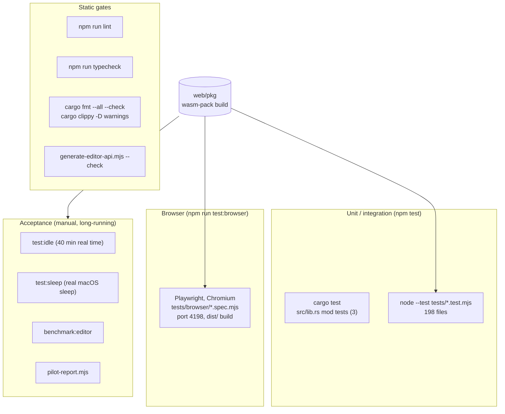

# Testing and Verification

PixlPrfct's regression suite is overwhelmingly JavaScript: 198 `node:test` files in `tests/` (1,053 tests in the alpha.21 release run) that exercise the compiled Rust/WASM engine, the editor modules, the MCP server and the server/cloud code, plus 22 Playwright specs that drive a real Chromium editor. The Rust crate itself has only **3** unit tests; engine behaviour is tested through the WASM bindings from Node. The single most important rule: in this project "verified" means a named check was actually run and its evidence recorded — local tests passing is reported separately from installed builds, shipped releases and interface verification, and none of those is implied by the others.

## At a glance

| Key files | Entry points | Depends on | Used by | Related docs |
| --- | --- | --- | --- | --- |
| `tests/*.test.mjs`, [tests/cloud-db.mjs](../../tests/cloud-db.mjs), `tests/helpers/*.mjs`, `tests/fixtures/figma/*.fig`, `tests/browser/*.spec.mjs`, [tests/browser/fixtures.mjs](../../tests/browser/fixtures.mjs), [playwright.config.mjs](../../playwright.config.mjs), `scripts/acceptance/*.mjs`, `src/lib.rs` (`mod tests`), [inspector-parity.json](../../inspector-parity.json) | `npm test`, `npm run test:browser`, `npm run mcp:check`, `npm run desktop:check`, `npm run test:idle`, `npm run test:sleep`, `npm run benchmark:editor` | Built `web/pkg` (wasm-pack), Node `node:test` + `node:sqlite`, Rust toolchain, `@playwright/test` + Chromium, `@modelcontextprotocol/sdk` client | Developers before PRs; release preparation; the Windows prerelease workflow runs a subset | [RELEASE_ACCEPTANCE.md](../RELEASE_ACCEPTANCE.md), [CAPABILITY_MATRIX.md](../CAPABILITY_MATRIX.md), [PERFORMANCE.md](../PERFORMANCE.md), [PILOT_PLAN.md](../PILOT_PLAN.md), [AGENTS.md](../../AGENTS.md), [CONTRIBUTING.md](../../CONTRIBUTING.md) |

## Test layers



## Prerequisites

| Requirement | Why |
| --- | --- |
| Node.js 24 (CI and docs use 24; `package.json` `engines` is `>=22.13.0`) | `node:sqlite` (`DatabaseSync`) is used by `tests/cloud-db.mjs`, `server/database.mjs`, `scripts/self-host/backup.mjs`. It is available unflagged from 22.13; the project documents and tests on 24 |
| Rust stable + `wasm32-unknown-unknown`, `wasm-pack` | `cargo test`; building `web/pkg` |
| `npm ci` | Dependencies from the committed `package-lock.json` |
| `npm run build:editor` before `npm test` | 126 of the Node test files import `../web/pkg/pixlprfct_core.js` and read `pixlprfct_core_bg.wasm`; `web/pkg/` is git-ignored |
| `npx playwright install chromium` | Browser suite |
| macOS for screenshot comparison | `snapshot()` in `tests/browser/fixtures.mjs` calls `toHaveScreenshot` only when `process.platform === 'darwin'` |

## How to run each layer

| Command | What it runs |
| --- | --- |
| `npm test` | `cargo test && node --test tests/*.test.mjs` |
| `node --test tests/grid-layout.test.mjs` | One file (any subset of `tests/*.test.mjs`) |
| `node --test --test-name-pattern "atomic" tests/mcp-runtime.test.mjs` | Filter by test name |
| `npm run mcp:check` | Catalog drift check (`generate-editor-api.mjs --check`) + `node --test tests/mcp*.test.mjs` |
| `npm run desktop:check` | `node --test tests/desktop.test.mjs` |
| `npm run lint` / `npm run typecheck` | ESLint (ignores `dist`, `.next`) / `tsc --noEmit --incremental false` |
| `cargo fmt --all --check`; `cargo clippy --all-targets --all-features -- -D warnings` | Rust format/lint gates (listed in CONTRIBUTING and CAPABILITY_MATRIX; not npm scripts) |
| `npm run test:browser` | `playwright test` (builds the editor, then serves `dist/`) |
| `npm run test:browser -- tests/browser/daily-workflow.spec.mjs --grep responsiveness --workers=1` | Latency gate alone (documented in RELEASE_ACCEPTANCE step 4) |
| `npm run test:browser -- --grep-invert responsiveness --workers=1` | Functional browser suite without the latency gate |
| `npm run test:browser:update` | Rewrites screenshot baselines. Inspect every changed image before committing |
| `npm run test:idle` | `scripts/acceptance/mcp-idle.mjs 40` |
| `npm run test:sleep -- 40` | `scripts/acceptance/desktop-sleep.mjs` (macOS only) |
| `npm run benchmark:editor [-- file.pixl]` | `scripts/acceptance/benchmark.mjs` |
| `node scripts/acceptance/pilot-report.mjs results.json` | Pilot metrics |

The full pre-PR list in [CONTRIBUTING.md](../../CONTRIBUTING.md): `npm run build`, `npm test`, `npm run lint`, `npm run typecheck`, `npm run test:browser`, `node scripts/generate-editor-api.mjs --check`, `cargo fmt --all --check`, `cargo clippy --all-targets --all-features -- -D warnings`.

> **Note:** There is no CI workflow that runs these checks. [CONTRIBUTING.md](../../CONTRIBUTING.md) states "Automatic CI and required status checks are disabled". [CAPABILITY_MATRIX.md](../CAPABILITY_MATRIX.md) still says "CI never updates baselines" and "The visual job uses GitHub's macos-15 Apple Silicon runner", but no such job exists in `.github/workflows/`. Only the Windows prerelease workflow runs tests (a desktop/import subset). See [CI-CD-and-Releases](CI-CD-and-Releases.md).

## Rust unit tests

Only `src/lib.rs` has a `#[cfg(test)] mod tests` block, with three tests:

| Test | Covers |
| --- | --- |
| `history_restores_edits_and_invalidates_redo` | Undo/redo stack semantics |
| `load_is_atomic_and_roundtrips` | `load` failure leaves state unchanged; snapshot round trip |
| `hit_testing_respects_ellipses_visibility_and_order` | `hit_test` geometry, hidden layers, z-order |

None of the other 26 modules (`grid.rs`, `layout.rs`, `components.rs`, `variants.rs`, `slots.rs`, `variables.rs`, …) has Rust-side tests. Their behaviour is covered by Node tests calling the compiled `Editor` (see `tests/wasm.test.mjs`, `tests/grid-*.test.mjs`, `tests/components.test.mjs`, etc.). Consequence: a Rust change is only meaningfully tested after `wasm-pack build` and `node --test`, not by `cargo test` alone.

## Node test inventory

Counts are files and `test(` call sites per area (approximate; some files generate tests in loops). Documentation reports 994 JavaScript tests at alpha.14 ([RELEASE_ACCEPTANCE.md](../RELEASE_ACCEPTANCE.md)).

| Area | Files | Tests | Files (`tests/<name>.test.mjs`) |
| --- | ---: | ---: | --- |
| Layout: auto layout, grid, constraints, frames | 41 | ~247 | `auto-layout-inspector`, `breakpoint-preview`, `clipping`, `constraints`, `container-rotation`, `device-chrome`, `frame-enclosure`, `frame-selection`, `frames`, `grid-*` (14 files), `layout`, `layout-*` (14 files), `masonry`, `parent-alignment`, `resizing`, `responsive-grid-areas`, `scaling` |
| Canvas tools, vectors, selection, pages, inspector chrome | 33 | ~196 | `arrangement`, `clipboard`, `context-menu`, `contextual-actions`, `curves`, `design-system-gaps`, `dropdown-control`, `groups`, `guide-snap`, `input-base`, `inspector-disclosure`, `layer-drop`, `layer-style`, `locking`, `multi-frame-paste`, `native-pinch`, `page-drop`, `page-typeahead`, `pages`, `pan-inertia`, `paste-replace`, `path-join`, `path-split`, `pencil`, `popover-position`, `rectangle-actions`, `selection`, `snapping`, `toolbar-tools`, `tooltip-position`, `vector-edit`, `vectors`, `zoom-inertia` |
| Styles, variables, paints, strokes, effects | 30 | ~120 | `appearance`, `background-promotion`, `box-variables`, `color-picker-cancel`, `color-styles`, `corners`, `effect-editor`, `effect-styles`, `glass-preset`, `gradient-edit`, `gradients`, `guide-styles`, `inner-shadows`, `layer-blur`, `page-background`, `paint-*` (5), `shadow-variables`, `shadows`, `stroke-*` (3), `strokes`, `text-styles`, `variable-color-input`, `variable-workspace`, `variables` |
| Cloud API, self-host, teams, libraries, persistence | 23 | ~82 | `cloud-automatic`, `cloud-bodies`, `cloud-documents`, `cloud-history`, `cloud-session`, `libraries`, `library-lifecycle`, `library-overrides`, `local-libraries`, `local-drafts`, `local-persistence`, `recovery-store`, `project-file`, `project-navigation`, `loading-screen`, `static-build`, `self-host`, `self-host-preview`, `team-activity`, `team-collaboration`, `team-onboarding-operations`, `team-session`, `pilot-report` |
| Components, variants, slots, instances, assets | 12 | ~65 | `asset-placement`, `assets`, `component-properties`, `component-selection`, `component-sort`, `component-swapping`, `components`, `instance-context`, `nested-components`, `push-overrides`, `slots`, `variants` |
| Starter controls | 12 | ~54 | `button-`, `calendar-`, `checkbox-`, `file-`, `number-`, `password-`, `radio-`, `segmented-`, `switch-`, `textarea-starter`, `controls`, `starter-defaults` |
| Import (`.fig`, SVG) | 6 | ~53 | `figma-import`, `figma-layout-parity`, `svg-import`, `svg-use`, `svg-radial`, `svg-gradients` |
| Prototyping and behaviors | 9 | ~50 | `prototype`, `prototype-flows`, `-hover`, `-multiple`, `-overlays`, `-press`, `-timers`, `-transitions`, `behaviors` |
| MCP and agent bridge | 6 | ~45 | `mcp-server`, `mcp-runtime`, `mcp-discovery`, `mcp-installation`, `agent-transport`, `live-editing` |
| SVG Animator | 2 | ~36 | `svg-animation`, `svg-animation-keyframes` |
| Text and typography | 7 | ~26 | `base-text`, `font-weights`, `google-fonts`, `text-editing`, `text-sizing`, `typography`, `typography-controls` |
| Rendering and export | 7 | ~26 | `export`, `batch-export`, `code-export`, `css-renderer`, `export-chunks`, `images`, `viewport-renderer` |
| Desktop (Electron boundaries, signing, updates, preferences) | 4 | ~13 | `desktop`, `desktop-signing`, `desktop-updates`, `desktop-preferences` |
| Engine bindings | 1 | 8 | `wasm` |
| Icon library | 2 | 3 | `icon-library`, `territory-icon-coverage` |
| **Total** | **195** | **~1,024** | |

Notable suites:

- **`wasm.test.mjs`** — complete editing sessions through the raw `Editor` bindings: add/update/duplicate/undo/redo, pages, atomic `load`.
- **`mcp-server.test.mjs`** — workspace confinement, symlink rejection, atomic save; a real MCP `Client` over `InMemoryTransport` and over `StdioClientTransport` (asserting no non-protocol stdout); bridge Origin/token/Host rejection; desktop-origin pairing; session-ID preservation without replay.
- **`mcp-runtime.test.mjs`** — catalog excludes lifecycle methods; atomic builds; all native controls; Grid; components; bounded reads; reload invalidation; chunked export reconstruction (uses `scripts/acceptance/complex-fixture.mjs`).
- **`mcp-discovery.test.mjs`** — private registry, restart on a different port, auto-port fallback, recovery after a simulated 40-minute sleep while discovery hangs.
- **`mcp-installation.test.mjs`** — redaction, secret preservation, cross-session conflicts, symlinks, Docker credentials only in environment, a real stdio client provisioning a SQLite trial.

## Helpers and fixtures

| Helper | Use |
| --- | --- |
| [tests/cloud-db.mjs](../../tests/cloud-db.mjs) `cloudDatabase()` | A Cloudflare **D1-compatible shim** over `node:sqlite` `DatabaseSync(':memory:')`. It executes every `drizzle/*.sql` migration in order, then exposes `prepare(q).bind(...).all()/first()/run()`, `batch()` (wrapped in `BEGIN`/`COMMIT`/`ROLLBACK`), `exec`, `close`. Used by `cloud-automatic`, `cloud-bodies`, `cloud-documents`, `cloud-history` to test `lib/documents.mjs` with real SQL |
| `tests/helpers/team-fixture.mjs` `teamFixture({server, baseURL, sqlitePath})` | Builds a self-host config, connects the database, runs `migrateAuth`/`migrateDocuments`, optionally `startServer`, with synthetic accounts and in-memory mail |
| `tests/helpers/export.mjs` `completeExport(runtime, args)` | Follows `pixlprfct_export` cursors until complete, asserting revision stability |
| `tests/helpers/figma-library.mjs` `figmaLibraryFixture()` | Synthetic imported library data |
| `tests/fixtures/figma/*.fig` | Three small MIT-licensed `.fig` binaries from OpenFig (deflate + Zstandard archives, open vector network) — see its README |
| `scripts/acceptance/complex-fixture.mjs` `complexFixture()` | Public, deterministic 5-page / 727-layer document with linked components, variants, a slot, text/effect/color styles and mode-dependent variables |
| `mcp/projects.mjs` `initializeEngine()`, `createHeadlessEditor()`, `headlessOptions()` | Load WASM in Node with deterministic text metrics; used by tests, Playwright fixtures and acceptance scripts |

## Playwright browser tests

[playwright.config.mjs](../../playwright.config.mjs):

- `testDir: ./tests/browser`, `testMatch: **/*.spec.mjs`, `workers: 1`, `fullyParallel: true`, `retries: CI ? 1 : 0`, `forbidOnly` on CI, 30 s timeout, `list` + `html` reporters.
- `use`: `baseURL http://127.0.0.1:4198`, 1440×1000 viewport, DPR 1, dark colour scheme, `en-US`, `UTC`, `reducedMotion: 'reduce'`, trace retained on failure, screenshot on failure.
- `webServer`: `npm run build:editor && node scripts/acceptance/serve.mjs` with `PIXL_ACCEPTANCE_PORT=4198`; readiness URL `/editor/project-home.html`; never reuses an existing server.
- Screenshot tolerance: `maxDiffPixelRatio: 0.002`, animations disabled.

[scripts/acceptance/serve.mjs](../../scripts/acceptance/serve.mjs) is a minimal static server for `PIXL_ACCEPTANCE_ROOT` (default `dist`) with `cache-control: no-store` and path-traversal protection; `/` maps to `/editor/project-home.html`.

[tests/browser/fixtures.mjs](../../tests/browser/fixtures.mjs) extends Playwright's `test`: it **aborts every request whose host is not `127.0.0.1`** (offline, deterministic) and fails the test if any `pageerror` occurred. Helpers: `fixture({components})` builds a document with a headless engine; `seed(page, data)` writes it to `localStorage['pixlprfct.drafts.v1']`; `open(page)` loads `/editor/index.html?draft=acceptance`; `saved`, `rename`, `field`, `select`; `snapshot(page, name, locator)` compares a screenshot on macOS only.

| Spec | Tests | Scope |
| --- | ---: | --- |
| `editor.spec.mjs` | 13 | Projects create/reopen; stale-tab and conflict recovery; quota failure; Pages; text styles; shadow variables; slots; Motion dock; variants; set labels; layer rows |
| `svg-animation.spec.mjs` | 42 | SVG Animator workflows |
| `libraries.spec.mjs` | 4 | Publish/add/update/reopen; release file import; native design-archive library import; live MCP library operations over a real WebSocket |
| `daily-workflow.spec.mjs` | 2 | 727-layer complex round trip (lossless JSON after normalized import); **responsiveness gate** (p95 < 100 ms, `PIXL_PROFILE=1` attaches a CPU profile) |
| `styles.spec.mjs` | 2 | Page Styles editors |
| `library-overrides`, `live-editing`, `team`, `team-activity`, `team-onboarding`, `product-site` | 1 each | Author-approved overrides; two simulated co-editors; simulated team with restart/restore; activity; onboarding; `site/` page |

Screenshot baselines live in `tests/browser/<spec>-snapshots/`. The `snapshot()` names in specs include `pages-and-page-paint.png`, `type-settings.png`, `text-styles.png`, `shadow-variables.png`, `motion.png`, `set-labels.png`, `library-add-to-existing-project.png`, and the three `page-*-style-editor`/`page-document-styles` images. The PNGs are binary and are not part of this documentation snapshot. Linux runs the functional assertions only; pixels are compared against macOS 15 baselines.

## Acceptance scripts (`scripts/acceptance/`)

| Script | Purpose | Output / pass criterion |
| --- | --- | --- |
| `serve.mjs` | Static server for Playwright (port `PIXL_ACCEPTANCE_PORT`, default 4197; root `PIXL_ACCEPTANCE_ROOT`, default `dist`) | — |
| `benchmark.mjs` | Headless engine timings on a synthetic 727-layer, 5-page document (or a `.pixl` path argument): `load`, `snapshot`, `textContentEdit`, `textResizePreview`, `pageSwitch`, plus a 20-update MCP `build` batch | JSON with medians and final document SHA-256. Measurements, not FPS claims |
| `complex-fixture.mjs` | Exports `complexFixture()` (see above) | — |
| `mcp-idle.mjs [minutes]` | Real socket transport + headless editor connected via discovery to `createPixlMcp`; waits N real minutes; reads; restarts the server; `wake()`; reads again | Prints `{phase:'passed', …, osSleepTested:false}` |
| `desktop-sleep.mjs [minutes]` | macOS only. Spawns the MCP server over stdio, waits for the operator to put the Mac to sleep ≥N minutes, reads real `pmset` Sleep/Wake events, reconnects, compares document digests | Writes `.local/acceptance/desktop-sleep.json` with `osSleepTested:true` only on a real sleep |
| `pilot-report.mjs [input.json]` | Aggregates participant pilot sessions (completion, unassisted %, day-7 return, fallback, data loss) | JSON report; tested by `tests/pilot-report.test.mjs` |

## Writing a new test

Pick the lowest layer that exercises the behaviour.

**Engine behaviour (most common).** Import the WASM package directly:

```js
import test from 'node:test';
import assert from 'node:assert/strict';
import {readFile} from 'node:fs/promises';
import init,{Editor} from '../web/pkg/pixlprfct_core.js';
await init({module_or_path:await readFile(new URL('../web/pkg/pixlprfct_core_bg.wasm',import.meta.url))});

test('duplicate keeps the layer on its page',()=>{
  const e=new Editor();
  try{
    const id=e.add('rectangle',0,0);
    const copy=e.duplicate(id);
    const shapes=JSON.parse(e.snapshot()).shapes;
    assert.equal(shapes.find(s=>s.id===copy).page_id,shapes.find(s=>s.id===id).page_id);
  }finally{e.free();}
});
```

Alternatively `import {initializeEngine,createHeadlessEditor} from '../mcp/projects.mjs'` for deterministic text measurement. Always `free()` engines.

**Editor modules.** Most `web/*.js` modules export pure functions (`layoutText`, `svgDocument`, `compileCssScene`, `codeExportFiles`, `toolGroups`…); import them directly. Where a module touches the DOM, tests install minimal stubs (e.g. `globalThis.document={createElement:()=>new Element()}` in `color-picker-cancel.test.mjs`). A few tests assert against CSS/HTML source text.

**MCP behaviour.** Use `createAgentRuntime({editor, createEditor:createHeadlessEditor, options:headlessOptions})` and `runtime.request(...)` for runtime logic; use `createPixlMcp({workspace, live:false})` with `InMemoryTransport.createLinkedPair()` and an SDK `Client` for tool-level tests; use `createEditorBridge({port:0})` and `ws` for bridge tests. Create temp dirs with `mkdtemp` and clean up in `t.after(() => rm(dir,{recursive:true,force:true}))`.

**Cloud / D1 routes.** `const db = cloudDatabase()`; build `Request` objects with the identity header the Sites host supplies (`oai-authenticated-user-id`) and call the API (e.g. `documentApi` from `lib/documents.mjs`). Add schema through a new `drizzle/*.sql` migration — the shim applies all of them.

**Self-host / teams.** `teamFixture({server:true})` from `tests/helpers/team-fixture.mjs`.

**Browser.** Import `{test, expect, fixture, seed, open, snapshot}` from `./fixtures.mjs`, seed a draft, open the editor, interact through accessible labels (`page.getByLabel`). Add a `snapshot()` only for reviewed interface states; generate it with `npm run test:browser:update` on macOS and inspect the image.

New files named `tests/<area>.test.mjs` are picked up automatically by `npm test`; MCP tests should start with `mcp` to be included in `npm run mcp:check`.

## What "verified" means here

The rules come from [AGENTS.md](../../AGENTS.md), [CAPABILITY_MATRIX.md](../CAPABILITY_MATRIX.md) and [RELEASE_ACCEPTANCE.md](../RELEASE_ACCEPTANCE.md):

1. **"Implemented" = code exists and the cited local checks pass.** It does not mean complete workflow coverage, an installed update, a merged branch or a public release (CAPABILITY_MATRIX header).
2. **Visual checks do not establish feature completeness.** Do not present placeholders as finished or promise complete equivalence with another product. Screenshot baselines detect later regressions; they do not establish compatibility or legal clearance.
3. **Keep evidence classes separate:** source change, local test pass, packaged build, locally installed build, published release. The capability matrix has separate columns (Engine/MCP, Interactive UI, Visual evidence, Installed/released).
4. **Record PASS / FAIL / NOT RUN / NOT CERTIFIED explicitly**, with test counts and the location of raw logs (typically under git-ignored `.local/…`). A failing gate is reported as failing, not relaxed (e.g. the 2026-10-30 responsiveness FAIL at 199.2 ms p95 was recorded before the later 58.4 ms PASS).
5. **Gap tally discipline:** `docs/TT-Design-System-Gaps.md` keeps completed items struck through with a dated resolution and evidence; local fixes are distinguished from shipped changes.
6. **Proxies are named as proxies:** the timer-only idle test (`osSleepTested:false`) is not a sleep test; the latency test is "a frame-opportunity proxy, not input-to-photon"; Windows CI startup is "a startup check, not a full interactive test".

[inspector-parity.json](../../inspector-parity.json) is a data record, not a test input: it lists inspector sections observed per selection type (`observedSelections` for rectangle/arrow/text/image/frame/instance), what each pass added, `remainingObservedGaps` and `stillToInspect`, with status "Partial". No test reads it.

### Release acceptance sequence

From [RELEASE_ACCEPTANCE.md](../RELEASE_ACCEPTANCE.md): (1) build + all gates + browser suite; (2) 727-layer complex round trip; (3) recovery simulations; (4) responsiveness p95 < 100 ms; (5) manual interface checks at the recorded panel width and scale; (6) packaged desktop build + real OS sleep probe; (7) participant pilot per [PILOT_PLAN.md](../PILOT_PLAN.md).

## Invariants and gotchas

- Stale `web/pkg` silently tests old engine code. Rebuild with `npm run build:editor` after any `src/*.rs` change.
- `web/editor-api.js` is committed; `mcp:check` fails if it differs from what the current `web/pkg` would generate.
- Network tests bind loopback ports (`port:0`); a sandbox without loopback sockets will fail `mcp-*` and `agent-transport` tests.
- Browser tests block all non-127.0.0.1 traffic, so features depending on Google Fonts or remote assets must have local fallbacks in tests.
- `playwright.config.mjs` rebuilds the editor on every run (`reuseExistingServer:false`), which is slow but guarantees a fresh build.
- Snapshot comparison is skipped off macOS without failing — a Linux run passing does not mean visuals are unchanged.
- Test counts in docs drift (924 → 966 → 978 → 985 → 994 over successive passes); quote the number from the run you made.

## Known limitations

- Rust-level coverage is minimal (3 tests); most modules rely on JS-through-WASM tests.
- No automated CI for tests, lint, typecheck or browser suites.
- Real OS sleep/wake reconnection has not been accepted; Docker deployment is contract-tested only; Windows has only install/startup/uninstall automation.
- Performance: the 100 ms p95 gate passes; the broader 16.7 ms frame objective (B33) remains open ([PERFORMANCE.md](../PERFORMANCE.md)).

## Related pages

- [CI-CD-and-Releases](CI-CD-and-Releases.md) — which checks run in workflows
- [MCP-Server](MCP-Server.md) — the subsystem behind the MCP, idle and sleep tests
- [Build-System](Build-System.md) — `build:editor`, `web/pkg`, `dist/`
- [Rust-Document-Engine](Rust-Document-Engine.md)
- [Cloud-API-and-Database](Cloud-API-and-Database.md), [Self-Hosted-Server](Self-Hosted-Server.md)
- [Interface-Design-Guidelines](Interface-Design-Guidelines.md) — the reference/verification rules
- [Contributing-and-Conventions](Contributing-and-Conventions.md)

## Source of truth

- Config and helpers: [package.json](../../package.json) scripts, [playwright.config.mjs](../../playwright.config.mjs), [tests/cloud-db.mjs](../../tests/cloud-db.mjs), [tests/browser/fixtures.mjs](../../tests/browser/fixtures.mjs), `tests/helpers/`, `scripts/acceptance/`
- Rust tests: `src/lib.rs` (`mod tests`)
- Docs: [RELEASE_ACCEPTANCE.md](../RELEASE_ACCEPTANCE.md), [CAPABILITY_MATRIX.md](../CAPABILITY_MATRIX.md), [PERFORMANCE.md](../PERFORMANCE.md), [PILOT_PLAN.md](../PILOT_PLAN.md), [AGENTS.md](../../AGENTS.md), [CONTRIBUTING.md](../../CONTRIBUTING.md), [inspector-parity.json](../../inspector-parity.json)

## Alpha.21 coverage additions

The full browser suite includes Design and SVG parent panels, collapsed icons and side flyouts, cursor-following tear-outs, restoration, direct stage picking/movement, Pen/Pencil, path topology, Add/Replace import, and independent gradient/object animation. See `tests/browser/design-panels.spec.mjs` and `tests/browser/svg-animation-*.spec.mjs`. Pure drawing/gradient/topology model checks live under `tests/svg-animation-*.test.mjs`.

Native window acceptance uses `scripts/acceptance/panels-desktop.mjs` with a temporary profile. Release logs are retained locally under `.local/release-alpha21/`; public source/build provenance and package SHA-256 hashes accompany the GitHub release. Installed Windows startup verification does not imply full interactive native Windows coverage, real sleep/wake, or a human pilot.
