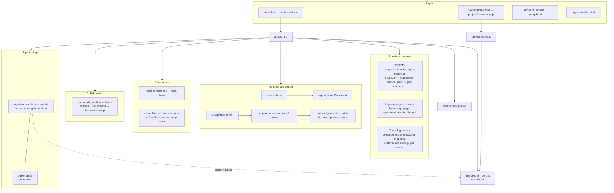
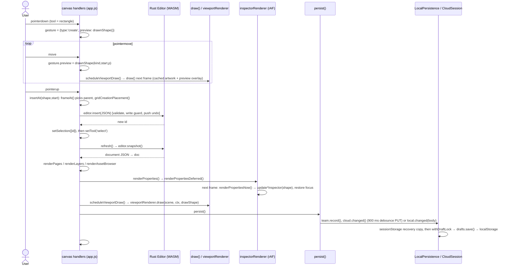

# Web Editor Architecture

The browser editor is ~200 hand-written vanilla ES modules in `web/` (plus 39 CSS files and 7 HTML pages) with no bundler in the main path: the browser loads `web/index.html`, which imports `editor-entry.js`, which dynamically imports `app.js`. `app.js` is the hub: it owns all mutable editor state (document snapshot, selection, tool, pan/zoom, the active gesture), constructs the Rust `Editor` from the wasm-pack output in `web/pkg`, and wires about 35 `install*()` feature modules through callbacks. The single most important rule: **the Rust engine owns the document**. JavaScript never mutates the document in place; it sends complete shapes (JSON) to an `Editor` method, then calls `refresh()`, which re-reads `editor.snapshot()` and re-renders everything from it.

## At a glance

| Key files | Entry points | Depends on | Used by | Related docs |
|---|---|---|---|---|
| [web/app.js](../../web/app.js), [web/editor-entry.js](../../web/editor-entry.js), [web/editor-api.js](../../web/editor-api.js), [web/viewport-renderer.js](../../web/viewport-renderer.js), [web/inspector-focus.js](../../web/inspector-focus.js), [web/local-persistence.js](../../web/local-persistence.js), [web/cloud-session.js](../../web/cloud-session.js), [web/agent-runtime.js](../../web/agent-runtime.js) | `web/index.html`, `web/project-home.html`, `web/setup.html`, `web/account.html`, `web/admin.html`, `web/svg-animation.html` | `web/pkg/pixlprfct_core.js` (Rust/WASM), `/api/*` routes of the host (optional) | All four hosts (Sites worker, self-hosted server, static build, Electron), the MCP server via `editor-api.js` | [PERFORMANCE.md](../PERFORMANCE.md), [PRELOADER.md](../PRELOADER.md), [MCP.md](../MCP.md), [Interface reference log](../FIGMA_UI_REFERENCE.md), [AGENTS.md](../../AGENTS.md) |

## Pages and entry points

All pages are plain HTML in `web/`. Each host serves the folder at `/editor/` (self-hosted: `server/index.mjs` maps `/editor/*` to `web/`; Sites: `scripts/prepare-editor.mjs` copies `web/` to `public/editor/`; static: `scripts/build-static.mjs` copies it to `.static/editor/`; desktop: `scripts/desktop/prepare.mjs` copies it to `.desktop/app/web/`). See [Build-System](Build-System.md).

| Page | Module | What it does |
|---|---|---|
| `index.html` | `editor-entry.js` → `app.js` | The design editor. The entry calls `startLoading()`, parses `?draft=`/`?cloud=` with `projectRoute()` (`project-navigation.js`), peeks at the stored body and redirects to `svg-animation.html` if `isSvgAnimation()` is true; otherwise `await import('./app.js')`. Any import failure calls `failLoading()`. |
| `project-home.html` | `project-home-entry.js` → `project-home.js` | Project list ("Home"): local drafts, cloud/workspace files, templates (`design-browser.js`), thumbnails (`project-preview.js`). `mountProjectHome(root,{onReady,onError})`. On the Sites host the same module is mounted by React in `components/project-home.tsx` (`app/page.tsx`). |
| `setup.html` | `setup.js` | Self-host setup builder: `mountSetup(shell(...,'setup'))` from `setup-controls.js` / `setup-plan.js`. |
| `account.html` | `account.js` | Sign-in and account management (uses `account-ui.js` `api`, `auth`, `shell`). Excluded from the static build (`serverPages` in `build-static.mjs`). |
| `admin.html` | `admin.js` | Admin console; also embeds `mountSetup`. See [ADMIN_CONSOLE.md](../ADMIN_CONSOLE.md). |
| `svg-animation.html` | `svg-animation.js` | Separate SVG Animator app with its own state; shares persistence modules. See [SVG-Animator](SVG-Animator.md). |
| `svg-animation-preview.html` | `vendor/svg-animation-preview.js` (esbuild IIFE) | CSP-locked sandbox iframe for animated SVG preview. |

`index.html` and `project-home.html` contain generated `<!-- preloader:styles -->` / `<!-- preloader:markup -->` blocks written by `scripts/generate-preloader.mjs` from `loading-screen.css` and `loadingScreenMarkup()` so the loading animation paints before any module loads ([PRELOADER.md](../PRELOADER.md)). `static-host.js` exports `staticHost`, true when `<html data-host="static">` (set by `build-static.mjs`); app code uses it to skip `/api/installation`, cloud files and team libraries.

## app.js: the hub

`app.js` (1,971 lines, 112 relative imports) is a single module-scope program, not a class. Its top-level state (around lines 155–245):

| State | Meaning |
|---|---|
| `editor` | The `Editor` instance from `./pkg/pixlprfct_core.js` |
| `doc`, `documentBody` | Parsed and raw result of the last `editor.snapshot()` |
| `selectedIds`, `selected`, `layerAnchor` | Selection set, last-selected ID, shift-range anchor in Layers |
| `tool` | `'select'`, `'hand'`, `'rectangle'`, `'ellipse'`, `'frame'`, `'text'`, `'pen'`, `'pencil'`, `'section'`, `'slice'`, `'comment'`, `'text-path'`, ... |
| `zoom`, `pan`, `pageViews` | Viewport; per-page `{zoom,pan}` remembered across page switches |
| `gesture` | Active pointer gesture object (`{type:'create'|'move'|'resize'|'rotate'|'marquee'|'pan'|'scale'|'gradient'|'grid-area'|...}`) holding `preview`/`previews` |
| `textEditing`, `layoutCssPreview`, `layerCssPreview`, `gridPickerPreview` | Non-committed preview documents that `draw()` renders instead of `pageShapes()` |
| `local`, `drafts`, `cloud`, `team`, `libraries` | Persistence and collaboration controllers |
| `projectLoading`, `recoveryBlocked` | Guards: no persistence while loading or when stored data failed to parse |

`pageShapes()` caches `doc.shapes.filter(s=>s.page_id===doc.active_page)` keyed on the `doc` object identity, so it is free to call repeatedly between snapshots.

### Startup sequence (bottom of app.js)

1. `await init(); editor = new Editor();` — wasm-bindgen's `web` target loads `pixlprfct_core_bg.wasm` relative to the module URL.
2. `editor.set_text_measurer(cb)` — Rust calls back into JS for text metrics. The callback measures with an offscreen 2D context (`measureCtx`) using `fontCss()`/`textSize()`/`textBaseline()` from `typography.js`, so engine layout and canvas drawing share one measurer.
3. Unless `staticHost`, `fetch('/api/installation')`; in self-hosted mode also `/api/workspaces` for the signed-in user.
4. Load the document: requested local draft (`drafts.activate(id)` under `withDraftLock`), cloud file (loaded later via `cloud.open`), or `drafts.restore()`, falling back to the legacy `localStorage['pixlprfct.document.v1']` key, else `seed()` (a built-in "Launch concept" composition). `migrateChromeDocument()` runs before `editor.load()`. A parse failure sets `recoveryBlocked` and seeds instead of overwriting the stored data.
5. Create `LocalPersistence` and `localRecovery`; restore a per-tab recovery copy if present.
6. Install inspector and panel modules (`installInspectorLayout`, `installToolbelt`, `installAutoLayoutInspector`, `installVariables`, `installCompactInspector`, `installContextualActions`, `installRectangleInspector`, `installTextStyleControls`, `installColorStyleControls`, `installPageStyles`, `installPageBackground`, ...). Each returns an `update…()` function that app.js stores in a module-level `let` and calls during inspector rendering.
7. `cloudFiles(...)`, `createLibraryManager(...)`, `installTeamCollaboration(...)`, `installAgentConnection(...)`.
8. `await document.fonts.ready; editor.refresh_text_layout(); refresh(false);` then `installDesktop(...)` and `finishLoading()`.

### The refresh cycle

Every committed edit follows the same pattern:

```js
function update(shape){ safe(()=>{ editor.update(JSON.stringify(reconcilePaints(shape, old))); refresh(); }); }
```

`safe()` turns any thrown engine error (validation failure, write-guard refusal) into a toast. `refresh(save=true)`:

1. Clears live previews, saves the outgoing page's view, calls `snapshot()` (re-parse `editor.snapshot()`, load used Google fonts, prune selection to existing IDs).
2. Runs document fix-ups that themselves call the engine: `editor.enable_grid_containers()` for legacy grids, `ensureBaseTextDocument()` (`base-text.js`).
3. `renderPages()`, `renderLayers()`, `renderAssetBrowser()`, `renderProperties()` — the left-panel renderers compare a signature string (`pageViewSignature`, `layerViewSignature`); pages return early when unchanged and layers only patch existing rows instead of rebuilding the tree.
4. `scheduleViewportDraw()` — one `requestAnimationFrame`-coalesced `draw()`.
5. `persist()` if `save`.
6. Sets `#undo`/`#redo` disabled state from `editor.can_undo()`/`can_redo()`.

Other engine calls follow the same "call, then `refresh()`" contract: `editor.insert`, `insert_enclosing_frame`, `update_many`, `move_into`, `move_into_cells`, `move_and_enclose`, `bind_variable`, `save_text_style`, `paste_layers`, `frame_selection`, etc. Previews that must not touch history use the read-only engine calls `preview_update_many` and `preview_layout_update`, which return a computed document without committing.

### Input handling, tools and selection

`bind()` (line ~1118) installs all listeners. Canvas pointer handling lives in `canvas.onpointerdown/onpointermove/onpointerup`:

- **pointerdown** builds a `gesture`. With a drawing tool active: `gesture={type:'create',kind:tool,start:p,preview:drawnShape(tool,p,p)}` (`vectors.js`). With select: hit testing via `canvasHit(x,y)`, which is `editor.hit_test(x,y)` (Rust) on the Canvas path or `cssCanvas.hit()` when the CSS canvas is active. Handles come from `resizing.js` (`resizeHandleAt`, `rotationHandleAt`).
- **pointermove** only updates `gesture.preview(s)` and calls `scheduleViewportDraw()`. Moves use `snapMovement()` (`snapping.js`) and `snapGuides()` (`guide-snap.js`); Alt/Ctrl bypasses snapping.
- **pointerup** commits once: `insertAt()` (which picks a parent frame with `frameAt()` and calls `editor.insert`/`insert_enclosing_frame`), or `editor.move_into*`/`move_and_enclose`, or `updateMany(previews)`.
- **Escape** cancels a gesture without touching the document ("Previews never touch the document").
- **Wheel**: plain wheel pans by `deltaX/deltaY` (`TRACKPAD_PAN_SPEED = 1`; Shift swaps axes). Ctrl/Cmd+wheel calls `pinchZoom()` → `zoomAt(zoomTarget(zoom,delta)/zoom, x, y)`. A capture-phase document listener intercepts Ctrl+wheel anywhere in `#workspace` to stop browser page zoom. Safari `gesturestart/change/end` events go through `installNativePinch()`.
- **Keyboard**: a large `window` `keydown` handler maps shortcuts (V/H/F/R/O/T/L/P, Ctrl/Cmd+Z/Y/S/D, Shift+A, K, etc.). Enter/Space on a focused button are ignored so buttons keep native activation.

`setTool(value)` finishes text editing, clears per-tool editing modes, updates toolbar `aria-pressed` and the cursor, and refuses non-viewing tools when a team file is read-only. `setSelection(ids)` normalises with `selectionRoots()` (`selection.js`), resets sub-modes (vector path, gradient, grid-area and layout-spacing editing) when the selection changes, and informs `pasteContext`. Selection colors in `draw()`: blue `#0d99ff`, component purple `#9747ff`, slot pink `#e539b9`.

`canvas-tools.js` defines editor-only layers (`editor_meta.role` of `slice`, `comment`, `annotation`, `measurement`, `spec`, `section`); `artworkShapes()` strips them (re-parenting section children) before any export or CSS rendering.

## Module dependency structure

Fan-in leaders: `icons.js` (42 importers), `appearance.js` (21), `selection.js` (15), `rotation.js` and `inspector-settings.js` (13 each), `context-menu.js` (12), `typography.js` (11), `paints.js` (10).



### Module groups

| Group | Modules (in `web/`) |
|---|---|
| Shell & routing | `app.js`, `editor-entry.js`, `loading-screen.js`, `project-navigation.js`, `static-host.js`, `project-home*.js`, `design-browser.js`, `project-preview.js`, `account*.js`, `admin.js`, `setup*.js`, `workspace-window.js`, `floating-window.js`, `popover-position.js`, `tooltips.js`, `context-menu.js`, `action-panel.js`, `toolbelt.js` |
| Canvas & rendering | `viewport-renderer.js`, `appearance.js`, `scene.js`, `shadows.js`, `stacking.js`, `rotation.js`, `stroke-render.js`, `stroke-alignment.js`, `stroke-tips.js`, `gradients.js`, `paint-textures.js`, `paint-shaders.js`, `images.js`, `typography.js`, `vectors.js`, `css-renderer.js`, `masonry.js`, `device-chrome.js`, `frame-tools.js`, `canvas-tools.js`, `layout-guides.js` — see [Rendering-and-Export](Rendering-and-Export.md) |
| Tools & gestures | `selection.js`, `resizing.js`, `scaling.js`, `snapping.js`, `guide-snap.js`, `pencil.js`, `vector-edit.js`, `gradient-edit.js`, `text-editing.js`, `clipboard.js`, `layer-drop.js`, `page-drop.js`, `asset-drag.js`, `layout-spacing.js`, `layout-keyboard.js`, `grid-canvas.js`, `grid-areas.js`, `grid-stack-drop.js`, `grid-picker-drag.js`, `grid-resize-feedback.js`, `zoom-inertia.js`, `native-pinch.js` — see [Canvas-Tools-and-Editing](Canvas-Tools-and-Editing.md) |
| Inspector | `compact-inspector.js`, `figma-inspector.js`, `inspector-layout.js`, `inspector-disclosure.js`, `collapsible-inspector.js`, `inspector-settings.js`, `inspector-focus.js`, `inspector-dropdown.js`, `contextual-actions.js`, `rectangle-inspector.js`, `rectangle-actions.js`, `tool-inspector.js`, `paint-stack-inspector.js`, `paint-popover.js`, `paint-*.js`, `color-picker.js`, `color-variable-picker.js`, `gradient-controls.js`, `shadow-controls.js`, `effect-*.js`, `glass-controls.js`, `stroke-popovers.js`, `auto-layout-inspector.js`, `layout-sizing.js`, `grid-controls.js`, `guide-controls.js`, `text-style-controls.js`, `color-style-controls.js`, `page-styles.js`, `page-background.js`, `layer-css-inspector.js`, `layer-css-editor.js`, `layout-css-editor.js`, `breakpoint-preview.js`, `control-inspector.js`, `dropdown-inspector.js`, `component-properties.js`, `variants.js`, `slots.js`, `instance-context.js` |
| Layers & pages panel | `renderPages()`/`renderLayers()` inside `app.js`, `layer-drop.js`, `page-typeahead.js`, `pages-resize.js`, `layers-panel.css` |
| Assets & libraries | `assets.js`, `library-manager.js`, `library-model.js`, `library-catalog.js`, `library-changes.js`, `library-release-ui.js`, `local-libraries.js`, `icon-library.js`, `icons.js`, `icon-keywords.js`, `google-fonts.js`, `font-weight-catalog.js` — see [Teams-Libraries-and-Collaboration](Teams-Libraries-and-Collaboration.md), [Icon-Library](Icon-Library.md) |
| Variables & styles | `variables.js`, `variable-manager.js` — see [Styles-Variables-and-Paints](Styles-Variables-and-Paints.md) |
| Document controls & dev/prototype | `controls.js`, `control-parts.js`, `control-sizing.js`, `input-base.js`, `base-text.js`, `*-control.js`, `behaviors.js`, `development.js`, `motion.js`, `prototype*.js` — see [Prototyping-Behaviors-and-Controls](Prototyping-Behaviors-and-Controls.md) |
| Persistence & import | `local-drafts.js`, `local-persistence.js`, `recovery-store.js`, `local-recovery.js`, `cloud-files.js`, `cloud-session.js`, `cloud-history.js`, `project-file.js`, `design-import.js`, `svg-import.js`, `figma/*.js` — see [Import-Design-Files](Import-Design-Files.md) |
| Collaboration | `team-collaboration.js`, `team-session.js`, `live-session.js`, `document-merge.js`, `team-activity.js`, `team-onboarding.js` |
| Agent bridge | `agent-connection.js`, `agent-transport.js`, `agent-runtime.js`, `editor-api.js`, `export-chunks.js` — see [MCP-Server](MCP-Server.md) |
| Desktop | `desktop-integration.js` — see [Desktop-App](Desktop-App.md) |
| SVG Animator | `svg-animation*.js`, `svg-gradients.js`, `svg-path.js`, `svg-viewport.js` |

## editor-api.js: the generated engine catalog

`web/editor-api.js` is generated by `scripts/generate-editor-api.mjs` ("Do not edit by hand") and committed. The generator:

1. Reads `web/pkg/pixlprfct_core.d.ts` (so it must run after `wasm-pack`) and regex-matches every `Editor` method signature `name(args): ret;`.
2. Excludes lifecycle/internal methods (`reserve_ids`, `free`, `clear_history`, `load`, `set_write_guard`, `set_text_measurer`, `refresh_text_layout`, `undo`, `redo`, `snapshot`), marks 11 methods `readOnly` (`copy_layers`, `can_undo`, `can_redo`, `grid_layout`, `hit_test`, `prototype_hit_test`, `prototype_hits`, `prototype_pointer_hits`, `preview_update_many`, `preview_layout_update`, `preview_grid_drop`), types arguments named `json`/`selection`/`variables`/`placements` as `json`, and attaches hand-written descriptions from its `notes` table.
3. Scans `src/*.rs` for `pub struct|enum` declarations (with serde attributes) into `modelReference`.

It exports `engineCommands` (currently 100 commands, 11 read-only) and `modelReference` (51 Rust type declarations). Consumers:

- `web/agent-runtime.js` — validates and dispatches MCP `command` calls (`invoke()` checks argument count and types, JSON-encodes `json` args).
- `mcp/reference.mjs` — serves the commands/model reference topics to agents.
- `tests/mcp-runtime.test.mjs` and `npm run mcp:check` (`--check` throws "Editor API catalog is stale. Run npm run mcp:catalog after building the engine.").

Adding a `#[wasm_bindgen]` method to the Rust `Editor` automatically exposes it to agents after `npm run build:editor`; add a `notes` entry and, if it does not mutate, add it to `readOnly`.

## Agent runtime (in-browser MCP target)

`installAgentConnection(options)` builds the "MCP connection" window, `createAgentRuntime()` and `createAgentConnection()`. The transport (`agent-transport.js`) connects to `ws://127.0.0.1:PORT/bridge` only (`validateConnection` rejects anything else; pairing codes match `/^[-\w]{43}$/`), stores pairing in `sessionStorage`, and uses `window.pixlMcp?.connections` for automatic discovery in the desktop app. Messages: `hello`, `ping`, `result`; runtime methods: `read`, `select`, `command`, `build`, `css`, `export`, `history`, `libraries`.

Writes go through `transact()`: check the revision string (`${epoch}:${revision}`) and that `busy()` is false (no gesture, text edit or CSS preview), create a **scratch** `Editor` (`agentEditor()` in app.js, with the same text measurer), load the current snapshot, install the team/library write guard, run the batch, `finalize()` (grid containers, base text), validate custom CSS, run the guard again, verify the host document did not change, then `editor.load(after)` on the real editor. Because `load` goes through `commit_document`, a whole MCP batch is **one undo step** in the user's history.

## Inspector system

The right panel (`.right-panel`, `#design-inspector`) is static markup in `index.html` that modules re-compose rather than recreate:

- `inspector-layout.js` — "Compose existing controls once; retain their nodes and event handlers."
- `figma-inspector.js` — rearranges existing controls into the measured interface layout; product-specific settings remain below.
- `compact-inspector.js` + `paint-stack-inspector.js` — Fill/Stroke paint stacks.
- `contextual-actions.js` — selection-specific actions (blend modes list `blendModes`, `ratioSize` aspect lock, `swapEndpoints` for arrows).
- `inspector-disclosure.js` / `collapsible-inspector.js` — accordions and property switches; "Keep existing sections and control nodes intact".
- `inspector-settings.js` — shared building blocks: `numberField`, `settingRow`, `settingsPopover` ("One persistent popup per inspector section. Rerendering the document must not replace the open form"), `colorField`.

`renderProperties()` calls `team?.selectionChanged()`, `scheduleViewportDraw()` and `renderPropertiesDeferred()`. The deferred renderer is `inspectorRenderer()` from `inspector-focus.js`: it coalesces any number of calls into one `requestAnimationFrame`, then runs `renderPropertiesNow()` (which calls each installed `update…(shape)` — `updateCompactInspector`, `updateContextualActions`, `updateFigmaInspector`, `updateRectangleInspector`, `updateAutoLayoutInspector`, `updateInspectorLayout`, `updateTextStyles`, `updatePaintPopovers`, `updateVariables`, `updateLayoutSizing`, ... — plus `render*Controls` functions), and restores focus, caret and uncommitted typed text to the equivalent field if the DOM was replaced, but only if the selection key is unchanged. It also disables inspector fields when a team file is not editable, then `syncInspectorDropdowns()`.

### Shared controls and the "no native select" rule

[AGENTS.md](../../AGENTS.md): "Use the application's shared custom dropdown and input components. Do not introduce browser-native visible select menus." The mechanism is `inspector-dropdown.js` (`installInspectorDropdowns(root)`): code keeps writing ordinary `<select>` elements as the value/event API; the installer finds `select:not([multiple])` inside editor chrome (`.left-panel,.right-panel,.paint-popover,.workspace-window,.variables-workspace,dialog,#project-home,#admin-app,.account-app`, excluding `#workspace` and the prototype player), hides them behind a custom trigger button, and renders options in one shared `popover="manual"` `role="listbox"` menu (`#inspector-select-menu`) with typeahead. If you add a select outside those containers it will stay native — put it inside one or call the installer for your root.

> **Note:** The task description lists `input-base.js`, `number-control.js` and `segmented-control.js` as editor chrome controls. In code they are **document control layers** (form controls designers place in their designs): `input-base.js` defines token sets (`inputTokens`, `dropdownTokens`, `buttonTokens`, ...) and `ensureInputBase()` adds them as variables; `number-control.js`/`segmented-control.js` export `*Config`, `*Markup`, `*Css` used by `controls.js`, `css-renderer.js` and framework export. Editor chrome numeric inputs come from `inspector-settings.js` `numberField` and plain inputs in `index.html`.

### UI design tokens

Chrome styling uses CSS custom properties on `:root`, deliberately separate from document paint:

| File | Tokens |
|---|---|
| `ui-colors.css` | `color-scheme:dark`; `--ui-workspace:#1e1e1e`, `--ui-surface:#2c2c2c`, `--ui-field:#383838`, `--ui-hover`, `--ui-text-*`, `--ui-border*`, `--ui-accent:#0d99ff`, danger/warning/success/variable pairs (28 vars) |
| `ui-spacing.css` | `--ui-space-1..6` (4–24px), `--ui-control-height:28px`, `--ui-icon-button:24px`, `--ui-section-height:48px` |
| `ui-radii.css` | `--ui-radius-control:6px`, `--ui-radius-menu:8px`, `--ui-radius-dialog:12px` |
| `ui-typography.css` | `--ui-font:Inter,Arial,sans-serif`, `--ui-text:11px`, `--ui-caption:10px`, `--ui-title:14px`, weights 400/500/600 |
| `ui-shadows.css` | `--ui-shadow-overlay`, `--ui-shadow-dialog` |
| `ui-states.css` | `--ui-pressed`, `--ui-selected-hover`, `--ui-selected-pressed`, `--ui-primary-pressed`, `--ui-disabled-opacity:.45` |
| `ui-motion.css` | `--ui-motion-fast:120ms`, `--ui-motion-enter:160ms`, `--ui-motion-ease` |

Each file applies its tokens with `:is(.navigation-rail,.left-panel,.right-panel,.toolbox,dialog,.paint-popover,...)` selectors (often `!important`) so they win over older per-component CSS in `editor.css` (93 KB).

## Persistence and autosave lifecycle

`persist()` is the single save trigger, called from `refresh()`:

```js
if(projectLoading) return;
if(recoveryBlocked){ status 'Recovery needed — save to a file'; return; }
team?.record(); cloud?.changed();
if(cloud?.session.active) return;
local.changed(documentBody);
```

**Local drafts** (`local-drafts.js`): all local projects live in one `localStorage` key `pixlprfct.drafts.v1` (`{version:1,activeId,files:[{id,name,body,updatedAt,deletedAt?}]}`); the per-tab active ID is in `sessionStorage['pixlprfct.drafts.active']`. `withDraftLock()` serialises read-check-write across tabs with the Web Locks API (`navigator.locks.request(DRAFTS_KEY, ...)`); `DraftConflict` is raised when another tab changed the same file.

**LocalPersistence** (`local-persistence.js`): `changed(body)` first `remember()`s a recovery record in per-tab storage under `pixlprfct.local-recovery:<draftId>`, then `flush()` saves under the lock in a loop until the snapshot stops changing, clears the recovery record and reports "Saved on this device". On failure it keeps the recovery record and shows the `localRecovery()` dialog (retry, save as separate project, download `.pixl`, open latest). `beforeunload` warns if `local.dirty()`; `pagehide` and `visibilitychange→hidden` call `persist()`.

**Cloud** (`cloud-files.js`, `cloud-session.js`): when a cloud file is active, `CloudSession.changed()` writes a recovery copy (`pixlprfct.cloud.session`) through `recoveryStore(sessionStorage, localStorage)` and debounces `flush()` by `delay=900` ms. `flush()` PUTs `/api/documents/<id>` with `if-match: <revision>` (requests time out after 20 s), loops while the snapshot keeps changing, and on HTTP 409 stops with "Cloud conflict — open Files". `cloud-history.js` lists and restores `/versions`. See [Cloud-API-and-Database](Cloud-API-and-Database.md).

**Collaboration**: `team.record()` lets `LiveSession` record a personal undo history (`PersonalHistory` in `document-merge.js`). Live sessions poll `POST /api/documents/<id>/live` and reconcile remote bodies with a three-way `mergeDocuments(base, local, remote)`; overlapping paths raise a conflict UI. Non-live team files use an edit lease; `TeamSession.guard()` blocks writes without an edit token. Details in [Teams-Libraries-and-Collaboration](Teams-Libraries-and-Collaboration.md).

## Undo integration with Rust history

History is entirely in Rust (`src/lib.rs`): `commit_document()` validates, rejects documents over 5,000,000 serialized bytes, calls the JS write guard (`check_write`), and pushes the **previous whole document** onto `undo` (capped at 100 entries; `redo` cleared). `undo()`/`redo()` swap documents after running the write guard. JS consequences:

- Every engine call = one undo step, so batch work into one call (`update_many`, `move_into`, MCP `transact`).
- `applyHistory(direction)` in app.js calls `editor.undo()`/`redo()`, restores grid-area or grid-item selection from before/after snapshots, and `refresh()`es (which persists the reverted state).
- `editor.clear_history()` is called after loading a document, seeding, applying remote live-session documents, and in scratch editors.
- Text inputs keep native undo: `desktop-integration.js` forwards menu Undo/Redo to `document.execCommand` when an input has focus.
- Write guards: `team.guard()` and `libraries.guard()` combine into the `set_write_guard` callback, so even undo can be refused (e.g. read-only review mode or protected library content).

## Performance techniques

- **Frame coalescing**: `scheduleViewportDraw()` collapses all draw requests to one rAF; pointer moves update previews without drawing synchronously; `inspectorRenderer()` coalesces inspector rebuilds; left panels skip rebuilds by signature.
- **Viewport raster cache**: `createViewportRenderer(drawScene,{deferEdits:true})` caches artwork (not overlays) in an `OffscreenCanvas` with 256 px overscan, at most 16,777,216 pixels and 8192 px per edge; edits paint directly and cache on the next unchanged frame. See [Rendering-and-Export](Rendering-and-Export.md).
- **Pan/zoom**: wheel pan updates `pan` and schedules a draw; zoom uses `zoomTarget(current, delta) = clampZoom(current*exp(-delta*0.054))` with `MIN_ZOOM=.02`, `MAX_ZOOM=64` (`zoom-inertia.js`), anchored at the pointer by `zoomAt()`.
- **Engine-side**: [PERFORMANCE.md](../PERFORMANCE.md) records the 727-layer benchmark and Rust-side optimisations (variable binding resolution, instance sync).

> **Note:** `pan-inertia.js` (`panInertiaStep`, `releasePanVelocity`) and `followZoom()` in `zoom-inertia.js` are only exercised by `tests/pan-inertia.test.mjs` / `tests/zoom-inertia.test.mjs`; `app.js` does not import them, so there is currently no pan inertia or eased zoom-follow in the editor.

## Sequence: drag out a rectangle



Moving an existing layer is the same shape: `gesture.type==='move'`, previews from `snapMovement()`, and on pointerup `dropParent()` decides between `editor.move_into`, `move_into_cells` (grid), `move_and_enclose` or `updateMany()`.

## How to add a new inspector section

1. Add static markup to `web/index.html` inside `#design-inspector` (use existing classes from `inspector-fields.css`, `inspector-disclosure.css`).
2. Create `web/my-feature.js` exporting `installMyFeature({current, change, document})` that binds events once and returns `update(shape)`.
3. In `app.js`, declare `let updateMyFeature=()=>{}`, assign it during startup, and call it from `renderPropertiesNow()`.
4. Commit with the provided `change`/`update` callback (never mutate `doc`), so history, guards and persistence apply.
5. Use `<select>` + `installInspectorDropdowns` and `inspector-settings.js` helpers; follow [Interface reference log](../FIGMA_UI_REFERENCE.md).
6. Add a `tests/*.test.mjs` unit test for pure logic.

## Invariants and gotchas

- Never keep a reference to `doc` shapes across a `refresh()`; it is replaced on every snapshot.
- Any thrown error inside `safe()` becomes a toast, not a console error; check toasts when debugging.
- `persist()` is a no-op while `projectLoading` is true and when `recoveryBlocked`.
- While a gesture, text edit or CSS preview is active, MCP writes and remote live updates are refused or deferred (`busy()`).
- Documents are capped at 5 MB serialized (engine `load`/`commit_document` and `project-file.js`).
- Removing an `install*` call silently leaves a no-op `update*` function; nothing fails loudly.

## Related pages

[Architecture-Overview](Architecture-Overview.md) · [Rust-Document-Engine](Rust-Document-Engine.md) · [Rendering-and-Export](Rendering-and-Export.md) · [Canvas-Tools-and-Editing](Canvas-Tools-and-Editing.md) · [Build-System](Build-System.md) · [MCP-Server](MCP-Server.md) · [Teams-Libraries-and-Collaboration](Teams-Libraries-and-Collaboration.md) · [Hosting-Modes](Hosting-Modes.md) · [Contributing-and-Conventions](Contributing-and-Conventions.md)

## Source of truth

- [web/app.js](../../web/app.js) — state, `refresh()`, `persist()`, `draw()`, `bind()`, startup block
- [web/editor-entry.js](../../web/editor-entry.js), [web/project-navigation.js](../../web/project-navigation.js), [web/loading-screen.js](../../web/loading-screen.js)
- [web/inspector-focus.js](../../web/inspector-focus.js), [web/inspector-dropdown.js](../../web/inspector-dropdown.js), [web/inspector-settings.js](../../web/inspector-settings.js)
- [web/local-drafts.js](../../web/local-drafts.js), [web/local-persistence.js](../../web/local-persistence.js), [web/cloud-session.js](../../web/cloud-session.js), [web/cloud-files.js](../../web/cloud-files.js), [web/live-session.js](../../web/live-session.js)
- [web/agent-runtime.js](../../web/agent-runtime.js), [web/agent-transport.js](../../web/agent-transport.js), [scripts/generate-editor-api.mjs](../../scripts/generate-editor-api.mjs)
- [src/lib.rs](../../src/lib.rs) — `commit_document`, `undo`, `redo`, `load`
- Docs: [AGENTS.md](../../AGENTS.md), [PERFORMANCE.md](../PERFORMANCE.md), [PRELOADER.md](../PRELOADER.md), [Interface reference log](../FIGMA_UI_REFERENCE.md)
